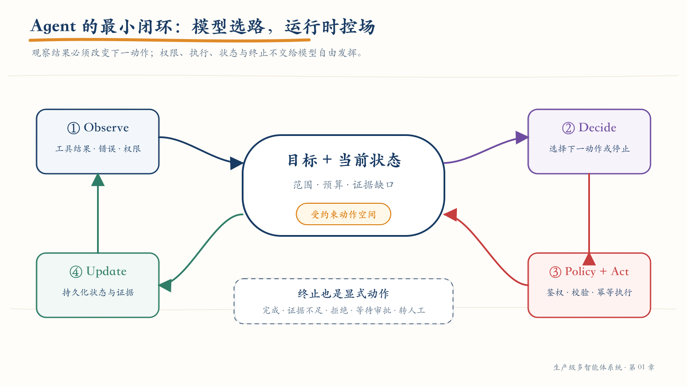
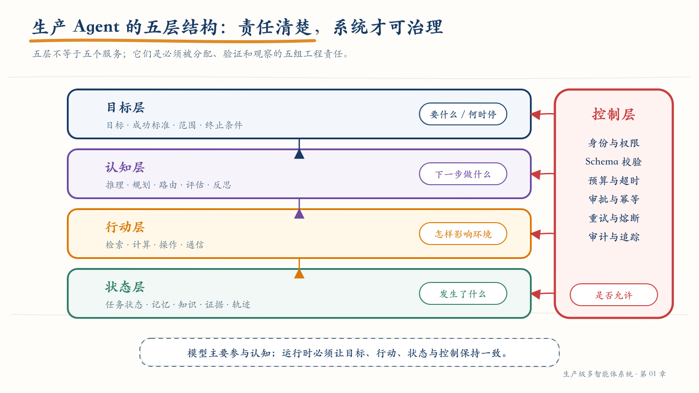
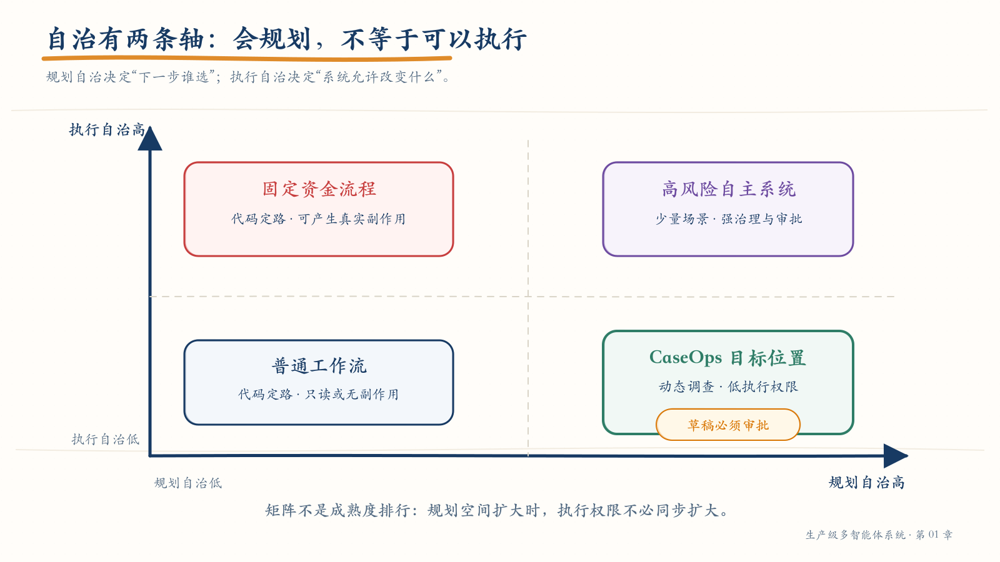
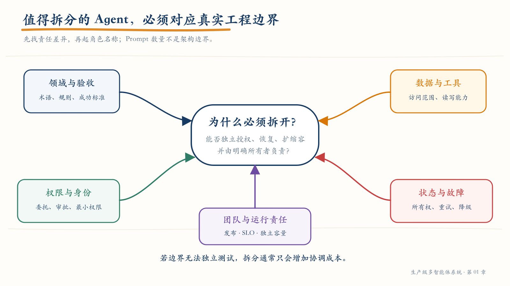
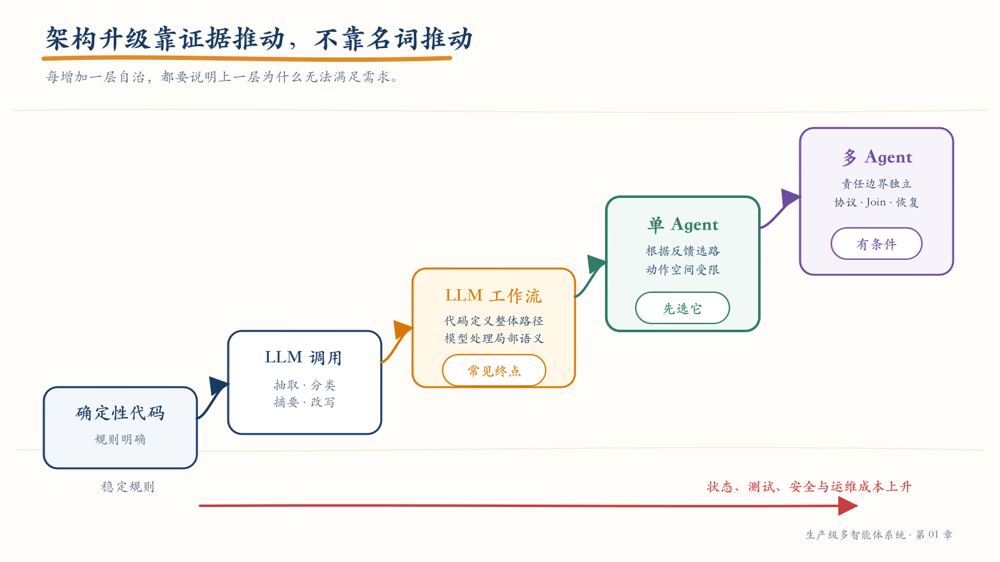
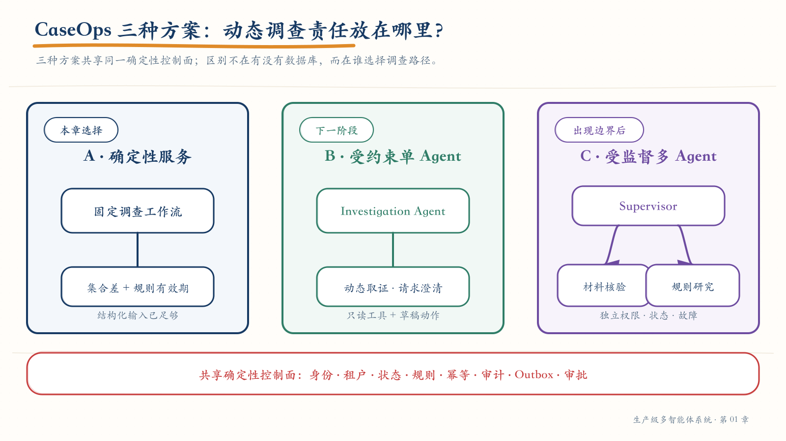

# Chapter 01: The Nature of Agents and Architectural Boundaries

When people talk about agents, it is easy to begin with technical terms: large language models, tool calling, memory, planning, supervisors, and MCP. Putting these components on a diagram is not difficult. The difficult part is answering a more fundamental question:

> Which part of the system truly needs to decide its next step autonomously based on feedback from the environment?

Without an answer, the design that follows will probably do little more than rewrite an originally clear program as expensive, slow, and difficult-to-test model calls. Even with an answer, we still need to ask how much the model may decide, which responsibilities must remain in deterministic systems, when one agent is sufficient, and when splitting the work across multiple agents is actually worthwhile.

This chapter does not rush into code. I will first establish a complete conceptual framework:

1. Where the boundaries lie among agents, ordinary LLM applications, and workflows;
2. Which engineering layers make up an agent;
3. Which problems reasoning, planning, state, memory, and knowledge each solve;
4. How to design the degree of autonomy rather than pursue it;
5. What justifies decomposing a system into multiple agents;
6. How to choose the lowest-complexity architecture that satisfies the requirements.

Once these concepts are in place, we will apply them to the CaseOps claims collaboration system that runs throughout the book. The project does not replace theory in this chapter; it tests theory. Every architectural conclusion must explain real requirements, code boundaries, and observable results.

## 1. The boundary between workflows and agents

Consider two systems that handle the same task. A user wants to find out why an insurance claim has remained incomplete and what supporting material should be provided next.

System A follows a predefined sequence:

```text
Read case
  → Read policy
  → Compare received documents with required documents
  → Determine missing documents
  → Create notification draft
```

Regardless of the intermediate results, developers have defined the path in advance. The program may include an LLM—for example, to extract document names from a file—but the overall execution order remains unchanged. The model provides a local capability; control of the system path remains in code.

System B fixes only the goal and boundaries:

```text
Goal: Identify why the case is blocked and recommend an evidence-backed next step
Allowed actions: Read case, parse documents, query policy, cross-check, request clarification
Prohibited actions: Send notifications, modify claim outcomes, access another tenant's data
```

It begins by reading the case. If the materials are already structured, it checks them directly against the policy. If they arrive as scanned documents, it parses them first. If old and new policies conflict, it looks up the accident date and location. If the evidence remains contradictory, it requests clarification or hands the case off to a human. Intermediate observations change the next action.

Both systems may use LLMs, and both may call tools. The real distinction is:

> Developers predetermine the path of a workflow; an agent chooses its next action from feedback within a given goal and set of boundaries.

This boundary is more reliable than asking whether a system uses an LLM, calls an API, or has memory. Tool calling may be just one node in a fixed process, and a multi-turn conversation may simply execute the same question-and-answer template repeatedly. A system begins to exhibit agentic behavior only when the model participates in controlling the path toward a goal.

### 1.1 Dynamic does not mean random

“Choosing a path based on feedback” does not mean letting the model improvise without limits. An engineered agent does not face an infinite action space, but a defined and authorized set of candidate actions:

```json
{
  "next_action": "read_policy",
  "arguments": {
    "policy_id": "motor-claim-standard",
    "effective_at": "2026-07-01"
  },
  "reason_code": "POLICY_VERSION_REQUIRES_CONFIRMATION",
  "risk_level": "read_only"
}
```

The model makes a judgment among the candidate actions where ambiguity exists. The runtime checks that the action exists, the parameters conform, the caller is authorized to execute it, and the current state permits the transition. Dynamism comes from observation and decision-making, not from removing constraints.

### 1.2 The real boundary is who controls the transition rules

Traditional workflows can also read feedback, contain conditional branches, and even include loops. For example, “retry a failed query three times, then hand off to a human if it still fails” clearly changes the path based on a result, but it is not an agent. The developer has already encoded, as deterministic rules, every permitted transition from each state and the conditions for taking it.

Both types of system can be represented as state diagrams:

```text
Workflow: next_state = transition(current_state, result)
Agent:    next_action = model_policy(goal, current_state, observation)
```

The workflow's `transition` is fixed at release time. At runtime, the agent's `model_policy` combines the goal, state, and observations to choose the next step from the allowed action space. Developers no longer enumerate every complete path, but they still define the action set, constraints, and valid states.

A more rigorous test, therefore, is not whether the path can change, but:

> Whether a path change includes runtime discretion exercised by the model based on semantics and context.

This explains why an ordinary rules engine is not an AI agent, why a DAG with loops and branches may still be only a workflow, and why a single tool call is usually insufficient to constitute an agent. Agentic behavior arises when the model occupies the policy-selection position in the feedback loop.

## 2. An engineering definition of an AI agent

“An agent is an intelligent system that can perform tasks on behalf of a user” is an intuitive definition, but it is insufficient for engineering design. It does not tell us what the system must store or control, nor does it help a team distinguish an ordinary chatbot from an agent that can operate continuously.

This book uses the following definition, which can be implemented in code:

> An AI agent is a goal-directed system that can observe task and environment state, choose the next action within a constrained action space, update its state from the action's result, and continually decide whether to proceed, stop, refuse, or hand off.

This definition contains six indispensable elements: goal, observation, decision, action, state update, and termination.



*Figure 1-1 The model participates in selecting the next step, while the runtime is responsible for authorization, execution, state, and termination.*

### 2.1 Understanding the agent loop with a simplified model

To express it somewhat more formally, a single step of an agent run can be written as:

```text
oₜ       = observe(environmentₜ, stateₜ)
proposal = model(goal, stateₜ, oₜ, allowed_actions)
action   = gate(proposal, identity, policy, budget)
result   = execute(action)
stateₜ₊₁ = update(stateₜ, action, result, evidence)
done     = terminate(goal, stateₜ₊₁, constraints)
```

The responsibility separation matters more than the notation.

- The model produces a `proposal`—a proposed action;
- `gate` represents the deterministic control layer, which may allow, modify, reject, or route the proposal for approval;
- `execute` is what actually reads or changes the external environment;
- `update` converts the result into reliable state for the next iteration;
- `terminate` ensures that the system does not run forever merely because the model can keep generating content.

From this perspective, the LLM is only the agent's **policy proposer**, not the complete agent. The database, tool gateway, state store, policy engine, and executor are not peripheral accessories; they are part of the loop.

This model also reveals an often-overlooked fact: the model does not see the objective environment itself. It sees observation `oₜ`, after authorization filtering, data transformation, and context assembly. If the observation is missing, stale, or contaminated, even the strongest model can only infer from false premises. Agent quality therefore depends not only on the model, but also on whether observations are constructed and state is updated faithfully.

### 2.2 Goal: a task contract, not a role description

“You are a senior claims specialist” can constrain tone and focus, but it cannot define when a task is complete. An executable goal should include at least:

- **Task scope**: which object, time range, and business questions the task covers;
- **Success criteria**: what constitutes completion and what evidence the conclusion requires;
- **Constraints**: budget, deadline, data scope, and prohibited actions;
- **Termination conditions**: completion, insufficient evidence, excessive risk, awaiting approval, or handoff to a human.

A role can help the model enter the appropriate semantic space; the goal is what governs system operation. The “ever-expanding task” behavior and infinite loops common in production incidents often result not from an insufficiently capable model, but from a goal that was never expressed as decidable completion conditions.

### 2.3 Observation: what does the agent actually see?

An observation is not simply the user's message passed to the model. The observation needed for one decision typically includes:

- The current goal and task phase;
- Actions already completed and their results;
- Facts, errors, and versions returned by tools;
- Remaining time, tokens, or call budget;
- Current identity, permissions, and approval status;
- Evidence requirements not yet satisfied;
- Whether the environment has changed.

Observation quality sets the upper bound on decision quality. Lost state, errors rewritten as ordinary text, and stale data without timestamps all cause the model to make seemingly reasonable decisions in a false world.

### 2.4 Decision: choosing the next step is not producing a long chain of thought

An engineering system needs an executable decision record, not an unverifiable block of free-form text. A decision must answer at least:

- What the next action is;
- Which known facts supply its parameters;
- Why the current state permits the action;
- What evidence the action still needs;
- Whether failure should lead to a retry, a new path, or termination.

The model may perform complex inference internally, but systems should exchange structured action proposals, evidence references, and reason codes. Only then can decisions be validated, evaluated, audited, and replayed.

### 2.5 Action: where capability and risk begin

Action turns an agent from something that “can answer” into something that “can affect the environment.” Common tools fall into four categories:

| Tool type | Typical capabilities | Primary risks | Common controls |
|---|---|---|---|
| Retrieval | Search, RAG, read-only SQL queries | Unauthorized reads, stale facts, prompt injection | Data scopes, source labels, row- and column-level permissions |
| Computation | Rules engines, statistics, code execution | Resource exhaustion, invalid input, untrusted code | Schemas, resource limits, sandboxes |
| Operations | Update tickets, create orders, initiate payouts | Duplicate execution, unauthorized writes, irreversible impact | Approval, idempotency, transactions, rollback |
| Communication | Email, messages, inter-agent delegation | Identity spoofing, replay, error propagation | Signatures, authorization, replay protection, message contracts |

One principle runs throughout this book:

> A model may propose an action, but it may not authorize itself.

Whether execution is allowed must be decided by policies, identities, and business rules outside the model. “Do not exceed your authority” in a prompt is a behavioral instruction, not access control.

### 2.6 Update: turning a single call into a persistent system

After execution, the system must convert the result into state that the next iteration can use. An update does more than append a tool response to a conversation. It also needs to determine:

- Whether the current step is complete;
- Which new facts and evidence were produced;
- Which assumptions were confirmed or refuted;
- Whether budget was consumed;
- Whether to retry, investigate further, or wait for approval;
- Which information may enter long-term memory and which must remain within this task.

Without reliable state updates, an agent will repeat tool calls, forget constraints, or fail to recover after an interrupted process.

### 2.7 Termination: stopping is also a system capability

Many prototypes design only the success path and never define when to stop. A production system should represent at least the following outcomes as explicit states:

| State | Meaning | Valid next step |
|---|---|---|
| `SUCCEEDED` | The goal and evidence requirements are satisfied | Return the result and terminate |
| `RETRYABLE_ERROR` | Temporary error, rate limit, or timeout | Retry according to policy or switch providers |
| `INVALID_INPUT` | Parameters or user information are insufficient | Correct the parameters or request clarification |
| `PERMISSION_DENIED` | The current identity is not authorized to execute | Stop or escalate to a human |
| `WAITING_APPROVAL` | A high-risk action is awaiting approval | Persist state and pause |
| `INSUFFICIENT_EVIDENCE` | A reliable conclusion cannot be reached | Investigate further, explicitly refuse to answer, or hand off to a human |

An agent that can stop safely is generally closer to production requirements than one that must provide an answer at all costs.

### 2.8 Which capabilities are necessary, and which are merely common implementations?

Debates about agents often arise from mistaking common components for defining criteria. The following table keeps the concepts precise:

| Capability | Is it a defining condition for an agent? | Reason |
|---|---|---|
| Explicit goal | Yes | Without a goal, the system cannot determine whether an action advances the task |
| Receive environmental feedback | Yes | Without feedback, the system cannot form a closed loop |
| Select the next action based on feedback | Yes | This is the core boundary between an agent and a fixed process |
| Maintain task state | Yes for complex tasks | Without state, the system cannot plan continuously, recover, or deduplicate |
| Call external tools | Usually, but not always | An action may be a tool call, a question to the user, or a delegation |
| Long-term memory | No | A one-off task needs only short-term task state |
| Self-reflection | No | It is an optional quality-improvement mechanism, not a defining condition |
| Multiple roles or models | No | Quantity does not determine agentic behavior |
| Broad execution permissions | No | An agent may have read-only actions |

This distinction is crucial. It lets architects add capabilities according to task needs rather than pile on components to “look like an agent.”

## 3. The five-layer structure of a production agent

The minimal loop explains how an agent operates. The five-layer structure answers where a team should place each responsibility. I decompose a production agent into the goal, cognition, action, state, and control layers.



*Figure 1-2 The five layers are not five microservices, but five groups of responsibilities that must be explicitly assigned and tested.*

| Layer | Core question | Typical content | Primary failures |
|---|---|---|---|
| Goal layer | Why does it run, and when is it done? | Goal, scope, success criteria, constraints, termination conditions | Goal drift, infinite loops |
| Cognition layer | What should it do next? | Reasoning, planning, routing, evaluation, reflection | Planning errors, routing errors |
| Action layer | How does it read or change the environment? | Tools, parameters, execution results | Tool misuse, duplicate side effects |
| State layer | What does the system need to remember? | Task state, memory, knowledge, evidence | Contamination, loss, inconsistency |
| Control layer | When should it allow, block, or escalate? | Authorization, budgets, approvals, circuit breakers, audits | Unauthorized action, loss of control, undiagnosable failure |

These five layers do not require physical separation. A small agent can be a modular monolith, but each layer's responsibilities should still be visible in interfaces and tests. Packing everything into one system prompt does not make these responsibilities disappear; it only makes them harder to govern.

### 3.1 Cognition layer: reasoning, planning, and evaluation are not the same

These terms are often used interchangeably, leaving teams unable to identify what to fix when the system fails.

| Capability | Question answered | Example in a claims investigation |
|---|---|---|
| Reasoning | What does the current evidence mean? | Two document names may refer to the same proof of accident |
| Planning | Which steps should come next? | Check the documents first, then determine the policy version by date |
| Evaluation | Is the previous result sufficient? | Only the filename is available, not evidence from the file's contents |
| Reflection | Should the original plan change? | Stop repeating retrieval and ask the customer for clarification instead |
| Introspection | Does the system recognize its own limitations? | It currently lacks access to the local policy repository |

Reasoning produces a judgment, planning organizes future actions, evaluation checks results, reflection decides whether to change the path, and introspection exposes capability boundaries. One model call may perform all of them, or different nodes may handle them. Keeping the concepts distinct makes it possible to design the corresponding evaluations and failure handling.

We should also avoid another misconception: planning is not better when it lists as many steps as possible up front. The more uncertain the environment, the shorter the planning horizon should be. One practical approach is “rolling planning”:

1. Plan only the most valuable next step, or next few steps, given the current evidence;
2. Execute and read the actual result;
3. Evaluate whether the original assumptions still hold;
4. Then decide whether to retain, revise, or abandon the original plan.

This is more robust than generating a grand plan with a dozen steps, because later steps will not be built on tool results that have not yet occurred.

### 3.2 State layer: state, memory, knowledge, and evidence must remain distinct

“Add memory to the agent” is not a sufficiently clear requirement. A team must first distinguish what the system actually needs to store.

| Information type | Example | Lifecycle | Appropriate medium |
|---|---|---|---|
| Task state | Current step, retry count, awaiting approval | One task | Structured state, checkpoint |
| Conversational memory | A constraint the user added in the previous turn | One session or across sessions | Message history, summaries, memory store |
| Domain knowledge | Claims policies, document definitions, organizational relationships | Shared across tasks | Relational database, knowledge graph, vector store |
| Evidence | Case version, policy version, tool-result hash | Audit and traceability period | Evidence store, audit log |
| Decision trace | Why a particular action was selected | Diagnosis and evaluation period | Trace, context graph |

Task state answers “Where are we now?” Memory answers “What from past interactions is worth retaining?” Knowledge answers “What reusable facts exist in this domain?” Evidence answers “What supports this conclusion?” Putting all of them into a message list simultaneously creates context bloat, temporal confusion, and permission leakage.

At a deeper level, these four kinds of information also have different **responsibilities for truth**:

- Task state is written by the runtime and must satisfy state-machine constraints;
- Memory usually comes from interaction history and may require summarization, forgetting, and user correction;
- Domain knowledge is maintained by business data sources and requires versions, validity periods, and access control;
- Evidence must trace back to a specific source, not merely preserve the model's paraphrase.

A model may summarize this information, but generating a statement does not promote that statement to a system fact.

### 3.3 Control layer: not a guardrail plugin, but the system's skeleton

The control layer spans the other four layers. It limits the goal's scope, filters observation content, validates action proposals, controls state transitions, and determines whether to terminate. It includes at least:

- Caller identity and the delegation chain;
- Data, tool, and action permissions;
- Input and output schemas;
- Maximum step, time, and cost budgets;
- Approval and idempotency for write operations;
- Retries, timeouts, circuit breaking, and degradation;
- Auditing, tracing, and evidence retention.

This is also the most visible difference between a prototype and a production system. A prototype proves that “the model can sometimes complete the task.” The control layer proves that “the system remains within bounds when it succeeds, fails, or is attacked.”

The five-layer structure ultimately creates a clear division of responsibility: the goal layer defines “what is wanted,” the cognition layer proposes “what to do,” the action layer is responsible for “how to do it,” the state layer records “what happened,” and the control layer decides “whether it is allowed.” If a responsibility has no owner in the architecture diagram, it will usually fall into the prompt at runtime and become the hardest kind of implicit behavior to test.

## 4. A taxonomy of LLM-based systems

After understanding the components, we also need to understand system types. The following four types may use the same LLM and tools, but differ in how they control the execution path.

| System type | Path controller | Acts dynamically based on feedback? | Typical tasks |
|---|---|---|---|
| Ordinary LLM application | A single call or the user | No | Translation, summarization, extraction |
| LLM-enhanced workflow | Predefined by developers | Partially | Contract parsing, report pipelines |
| Single agent | The model selects within boundaries | Yes | Research, failure diagnosis, dynamic investigation |
| Multi-agent system | Multiple independent responsible parties collaborate | Yes | Cross-domain services, complex engineering, parallel evidence gathering |

They can be further distinguished along three dimensions:

| Dimension | LLM-enhanced workflow | Single agent | Multi-agent |
|---|---|---|---|
| Step order | Mostly fixed in code | Selected by the model at runtime | Negotiated or delegated among multiple responsible parties |
| Action set | Usually fixed at each node | A finite set that can be composed dynamically | Each agent owns its own finite set |
| State ownership | Held centrally by the workflow | Agent task state is held centrally | Local and shared state must be explicitly defined |
| Failure recovery | Node-level retries and compensation | Plan revision, degradation, or handoff to a human | Local recovery plus cross-agent coordination |
| Primary complexity | Orchestration branches | Nondeterministic paths | Distributed responsibilities and protocols |

### 4.1 Tool calling is not a sufficient condition

If a program always executes “extract parameters → call search → generate summary,” it remains an LLM-enhanced workflow even if the model emits the tool call. Tools describe what the system can do; they do not tell us who controls the path.

One question can settle the distinction:

> When a tool returns an unexpected result, does the next step follow a branch already written in code, or does the model choose a new path within the allowed bounds?

The former is usually a workflow; only the latter may be an agent.

Likewise, a model outputting a tool name does not mean the model has execution authority. Tool selection, tool authorization, and tool execution are three different things:

1. **Selection** answers “What does the model want to call?”
2. **Authorization** answers “May the current identity and task make this call?”
3. **Execution** answers “How does the system complete the call in a retryable and auditable way?”

Collapsing all three into a single SDK call is one of the first problems exposed when many prototypes move toward production.

### 4.2 Multiple prompts do not make a multi-agent system

A system that calls an “analyst prompt,” a “reviewer prompt,” and a “summarizer prompt” in sequence does not necessarily contain three agents. If all three share the same state, permissions, and failure domain, and always run in a fixed order, the more accurate name is a multi-stage LLM workflow.

The “multi” in multi-agent refers not to the number of personas, but to the number of independent responsibility boundaries. Section 7 develops this test further.

### 4.3 More agents does not mean a more advanced system

System types are not maturity levels. Fixed rules, monetary calculations, authorization decisions, and transaction commits usually should use deterministic code. A workflow that is demonstrably correct is more mature than a multi-agent system that cannot recover or be audited.

## 5. Autonomy is not a switch, but a boundary to design

“This agent has a high degree of autonomy” conveys too little information. Autonomy must be examined from at least two perspectives.

The first perspective is behavioral level:

| Level | Model responsibility | Deterministic system responsibility | Typical form |
|---|---|---|---|
| L0 Fixed execution | None | All paths and actions | Rules-based program |
| L1 Local generation | Extraction, classification, rewriting | End-to-end orchestration | LLM workflow |
| L2 Controlled selection | Routing among safe candidates | Candidate set, validation, execution | Constrained tool selection |
| L3 Dynamic planning | Planning, tool calling, step adjustment | Permissions, budget, state, execution | Single agent |
| L4 Collaborative delegation | Cross-agent division of work and replanning | Protocols, isolation, auditing | Multi-agent |
| L5 Long-term autonomy | Forming subgoals and acting continuously | Strong supervision, governance, and emergency stop | A small number of controlled long-running tasks |

This scale is useful for describing the behavioral stage of a system as a whole, but it can also imply that a higher level is always better. We therefore need a second perspective: split planning autonomy and execution autonomy into two axes.

- **Planning autonomy**: how broadly the model may decide what to do next;
- **Execution autonomy**: how much risk the system permits it to impose on the external world.



*Figure 1-3 The planning space may be broad while execution permissions remain narrow. The two axes must be designed separately.*

A research agent may freely change its retrieval direction, giving it high planning autonomy, while remaining limited to reading public information and therefore having low execution autonomy. A fixed refund program has zero planning autonomy because code determines the entire path, yet it may directly change financial state and therefore carry high execution risk.

The reasonable pattern for enterprise systems is generally not “complete autonomy,” but **constrained autonomy**:

- Let the model handle ambiguous semantics and dynamic routing;
- Narrow the scope of tool and data access;
- Route high-risk actions through deterministic policies and human approval;
- Keep budgets, termination, and auditing independent of the model.

The minimum autonomy needed to achieve the goal is usually the right amount of autonomy.

### 5.1 Where autonomy risk comes from

Autonomy is not itself the risk. Risk arises when autonomy combines with capability, permissions, and scope of effect. A qualitative model helps make this concrete:

```text
Risk exposure ≈ Decision uncertainty × Tool capability × Permission scope × Duration
                ────────────────────────────────────────────────────────────────
                               Oversight strength × Recoverability
```

This is a design checklist, not a formula for calculating an exact value.

- Even with high planning freedom, a read-only research agent still has limited tool capability and permission scope;
- An agent that can change financial state may pose substantial risk even if it executes only one step;
- An agent running for a long time without supervision will continuously accumulate errors and cost;
- Approval, idempotency, compensation, and an emergency stop can reduce the impact of errors.

Improving model quality is therefore not the only way to control autonomy risk. Reducing tool permissions, shortening task duration, limiting affected objects, and improving recovery are often more direct and verifiable.

## 6. When an agent is worth using

OpenAI's engineering guide recommends first identifying tasks that traditional deterministic and rules-based methods struggle to handle, including complex decision-making or large volumes of unstructured data. Anthropic's distinction between workflows and agents likewise emphasizes starting with the simplest solution that meets the requirements rather than assuming an autonomous system by default.

In actual reviews, I look for four kinds of signals.

### 6.1 The path cannot be fully determined before execution

If the next step depends on evidence just discovered and may need repeated adjustment, a fixed workflow accumulates many brittle branches. Research, failure diagnosis, open-ended data analysis, and investigations of complex documents often fall into this category.

### 6.2 The input contains substantial semantic uncertainty

The same intent may be expressed in many ways, document structures may vary, and rules may require contextual interpretation. Here, a model can perform classification, matching, interpretation, and candidate-action selection, while final facts and permissions still require deterministic validation.

### 6.3 Tools must be composed dynamically

The system cannot know in advance which tools it will need, how many times to call them, or in what order, but the action set itself can still be limited and validated. This is more suitable for production delivery than giving a model arbitrary access to code and APIs.

### 6.4 Feedback and stopping conditions can be defined

An agent must know whether an action succeeded, whether the evidence is sufficient, and when to stop. If a task offers only “do your best,” with no observable feedback, an autonomous loop will be difficult to stabilize.

### 6.5 When not to use an agent

The following scenarios should usually favor deterministic programs or workflows:

- Rules are explicit, paths are stable, and branches can be fully enumerated;
- Transformations, validations, and calculations have low cognitive load;
- The core path requires extremely low latency or extremely high throughput;
- Decisions about monetary amounts, permissions, compliance status, and similar fields require exact consistency;
- Success, feedback, or safe termination cannot be defined;
- The model's quality improvement cannot offset its latency, cost, and risk.

“The task is important” is not a reason to use an agent. The more important the task, the more carefully the model should be confined to the places where it truly outperforms rules.

### 6.6 Architecture selection is fundamentally a net-benefit decision

An agent is not worthwhile merely because it performs “slightly better.” A complete assessment must consider both benefits and new costs:

```text
Agent net benefit
  = Expanded task coverage + Quality improvement + Better human workflows
  - Model and infrastructure costs
  - Losses in latency and availability
  - Evaluation, governance, and operational costs
  - Expected loss from incorrect actions
```

Suppose a model improves recognition accuracy for unstructured documents by 8%, but increases latency on the core path tenfold, while an incorrect result can trigger an irreversible write. That upgrade may not be justified. Conversely, if the model provides reliable assistance for long-tail cases that previously required manual investigation, it may deliver substantial value even at a higher per-call cost.

Agent suitability therefore cannot be judged from a single demonstration. At a minimum, establish:

1. A deterministic baseline without an agent;
2. A representative task set covering normal, boundary, and high-risk cases;
3. Quality, path, latency, cost, and safety metrics;
4. Explicit release thresholds and rollback conditions.

### 6.7 A suitability scorecard

A score cannot replace architectural judgment, but it can force a team to turn intuition into discussable evidence. Score each item from 0 to 2:

| Criterion | 0 points | 1 point | 2 points |
|---|---|---|---|
| Task path | Completely fixed | A few dynamic branches | Highly dependent on intermediate feedback |
| Input structure | Stable and structured | Semi-structured | Unstructured and expressed in diverse ways |
| Semantic judgment | Not required | Required locally | Required throughout the task |
| Tool composition | Fixed order | Limited selection | Dynamic composition required |
| Feedback quality | No clear feedback | Partially observable | Each step can be evaluated continuously |
| Benefit of autonomous planning | None | Some local benefit | Clearly reduces brittle processes |

The total can serve as a starting point:

- 0–3: Prefer a deterministic program or ordinary LLM call;
- 4–7: Prefer an LLM-enhanced workflow;
- 8–10: Evaluate a constrained single agent;
- 11–12: An agent is likely to add value, but a baseline experiment is still required.

The scorecard has three veto conditions: authorization cannot be made reliable, safe termination cannot be provided, or feedback cannot be obtained. Even with a high score, a system should not proceed directly to production autonomy if any of these conditions applies.

The score is a screening tool, not a decision algorithm. The final architecture choice must still be demonstrated through baseline experiments and risk analysis.

## 7. When multiple agents are truly necessary

As tasks grow, the context and tools of a single agent expand, but “the task is complex” is still not sufficient justification for decomposition. Multi-agent systems solve problems of distributed responsibility. They are valuable only when specialization, isolation, parallelism, or organizational ownership produces measurable benefits.

### 7.1 What is a multi-agent system?

A multi-agent system is not “one program that calls a model multiple times.” It consists of multiple agents with local goals, capabilities, or responsibilities that interact explicitly to complete a global task.

We can express it as:

```text
Global goal G
  → Decompose into local goals g₁, g₂, ... gₙ
  → Agentᵢ acts based on its own state sᵢ, tools Tᵢ, and policy πᵢ
  → Exchange results through messages, a shared environment, or a coordinator
  → Merge them into global result R according to a result contract
```

This definition emphasizes five conditions:

| Condition | Question to answer |
|---|---|
| Local responsibility | Which result is each agent independently responsible for? |
| Local capability | Which knowledge, tools, and permissions does it have? |
| Interaction protocol | How are tasks, results, errors, and evidence transmitted? |
| Coordination mechanism | How are dependencies, parallelism, conflicts, and timeouts handled? |
| Join contract | Which conditions must local results satisfy before they form a global result? |

Multiple agents may be homogeneous or heterogeneous. A supervisor may orchestrate them centrally, or they may collaborate through events or a shared environment. But without independent responsibilities and interaction contracts, “multi-agent” is merely an implementation detail or role-playing wrapper.

### 7.2 Why collaboration can create additional value

The capability of a multi-agent system is not merely the sum of each agent's outputs. Collaboration can create four kinds of additional value:

1. **Task decomposition**: Split a problem too large for one context into local goals with acceptance criteria;
2. **Specialization**: Give different agents narrower knowledge, tools, and evaluation criteria;
3. **Parallel processing**: Process independent evidence sources or subtasks simultaneously;
4. **Failure isolation**: Allow a local capability to fail, degrade, or be replaced without bringing down the entire task.

But “emergent capability” cannot serve as an exemption from scrutiny. If a system outperforms a single agent, we still need to identify why: more focused context, a smaller search space, lower latency through parallelism, or fewer errors through independent review. An improvement that cannot be explained and reproduced should not justify a production architecture.

Collaboration must also resolve several fundamental questions:

- Who is authorized to create and delegate subtasks?
- What are each subtask's inputs, deadlines, and acceptance criteria?
- Does an agent return facts, recommendations, or executable commands?
- How are conflicting results adjudicated?
- Does a local failure trigger a retry, replacement, degradation, or termination of the global task?
- Who writes shared state, and how are concurrent overwrites prevented?

These questions correspond to task protocols, message protocols, join contracts, and state consistency. Chapter 3 examines specific collaboration patterns in depth. For now, we need only remember that once agents are decomposed, the system moves from a model-orchestration problem into a distributed-systems problem.

### 7.3 Decomposition must follow real engineering boundaries



*Figure 1-4 Look for genuine differences in responsibility before creating a new agent.*

I examine eight kinds of boundaries:

| Boundary | Diagnostic question | Verifiable artifact |
|---|---|---|
| Domain | Does it have distinct terminology, rules, and success criteria? | Domain model, capability inventory |
| Data | Is it limited to a specific data scope? | Data access policy |
| Tools | Does it have different read and write capabilities? | Tool registry, schema |
| Permissions | Does it need a separate identity and approval policy? | RBAC/ABAC, delegation policy |
| State | Does it independently create and maintain task state? | State contract |
| Failure | Does it require separate retry, degradation, and recovery? | Runbook, failure domain |
| Scaling | Are its workload and resource requirements independent? | SLO, capacity model |
| Ownership | Is it independently released and owned by a different team? | Owner, release policy |

If most of these boundaries do not exist, decomposition generally adds only:

- Agent routing and delegation errors;
- Context loss during handoffs;
- Distributed-state consistency problems;
- Higher latency and more tokens;
- More complex testing, tracing, and failure recovery.

A multi-agent system does not inherently improve reliability. It gains real resilience only when the failure of one agent can be isolated, replaced, or degraded instead of propagated by other agents.

### 7.4 Specialization, parallelism, and isolation must be demonstrated separately

The three common benefits of multi-agent systems should not be conflated.

**Specialization** means that each agent has a narrower domain context, tool set, and evaluation criteria. It creates value only if context conflicts or tool-selection errors decrease as a result.

**Parallelism** means that subtasks have no undeclared dependencies and that the time saved through concurrency exceeds the cost of coordination and merging. Forcing dependent steps to run in parallel only creates inconsistency.

**Isolation** means that a local failure does not contaminate global state and that permissions cannot spread laterally. Merely placing prompts in different functions or containers does not automatically provide failure isolation.

All three benefits should be demonstrated with metrics: Does tool-selection accuracy improve? Does end-to-end latency decrease? Does the failure blast radius shrink? Otherwise, “multi-agent systems are better at complex tasks” is only a slogan that cannot be accepted.

## 8. Choose architecture from the lowest level of complexity

We can now compress the preceding concepts into an architecture escalation ladder.



*Figure 1-5 Increase autonomy and distributed complexity only when the preceding level cannot meet the requirements and evaluations can demonstrate the benefit.*

**Deterministic code** suits calculations and controls with explicit rules and stable inputs. Authorization decisions, state transitions, monetary calculations, schema validation, and transaction commits should preferentially remain at this level.

**Ordinary LLM calls** suit summarization, classification, extraction, and rewriting. The model processes unstructured information but does not continuously control the path.

**LLM-enhanced workflows** place models within predefined steps. They are a reasonable endpoint for many enterprise tasks, not a transitional state “waiting to be upgraded into an agent.”

**A single agent** suits tasks whose paths cannot be enumerated in advance and must adjust to feedback, while the goal and responsibility remain centralized.

**Multiple agents** suit tasks in which domain, permissions, state, failure, or ownership must remain independent, and where the benefits of specialization, parallelism, or isolation can be verified.

This ladder does not require systems to implement every level in order. It requires architects to explain why a simpler level is insufficient.

Each move up the ladder spends a “complexity budget”: more nondeterministic states, a larger testing space, a more complex security surface, and greater operational demands. A sound architecture does not maximize capability. It reliably meets business goals with the least complexity.

### 8.1 Five common misjudgments

Before turning to the case study, let us collect the most easily confused judgments:

1. **A system that can call tools is an agent**: Tools are capabilities; dynamic path control is what makes a system agentic.
2. **Multiple roles make a multi-agent system**: Roles are prompt text; engineering boundaries define architecture.
3. **An agent must have long-term memory**: A short task may not need long-term memory, but it must have enough task state to maintain the loop.
4. **Greater autonomy is more advanced**: Autonomy increases capability, but it also expands risk, cost, and the testing space.
5. **A stronger model reduces the need for a control layer**: The more a model can act, the more important identity, permissions, budgets, and auditing become.

## 9. CaseOps: from decision framework to architecture choice

Only now do we turn to the project that runs throughout the book.

CaseOps is an enterprise claims collaboration system. The task used in this chapter is:

> Investigate why case C-102 remains incomplete and identify the missing documents and applicable policy. If the customer needs to be contacted, generate only a notification draft; do not send it automatically.

This task combines structured facts, policy matching, natural-language documents, temporal semantics, and potential external actions. It appears suitable for an agent, but “appears suitable” is not an architectural conclusion. We will apply the preceding framework step by step.

### 9.1 First rewrite natural language as a task contract

| Contract field | Definition for C-102 |
|---|---|
| Goal | Identify why the case is blocked and recommend the next step |
| Success criteria | Both the missing documents and applicable policy have versioned evidence |
| Allowed inputs | Cases, documents, and policies within the current tenant |
| Allowed actions | Read, compare, and generate a notification draft |
| Prohibited actions | Send notifications, modify the claim decision, or access another tenant |
| Termination conditions | Sufficient conclusion, insufficient evidence, lack of permission, or waiting for a human |
| Audit requirements | Preserve the case version, policy version, reason code, and action record |

This step matters. Only after success and prohibition conditions are fixed does the discussion of autonomy have coordinates.

### 9.2 Separate the deterministic core from semantically uncertain areas

C-102 already has structured facts:

| Business object | Fixed fact |
|---|---|
| Case | `C-102`, version 7 |
| Tenant | `tenant-demo` |
| Status | `waiting_for_documents` |
| Policy | `motor-claim-standard@2026.1` |
| Received documents | Loss statement, identity documents |
| Required documents | Loss statement, identity documents, proof of accident |
| Action restriction | Only a request-for-documents draft may be generated |

With this input, the core path can be fully described in advance:

1. Read the case within the current tenant;
2. Read the policy version bound to the case;
3. Verify that the policy applies at the time of the accident;
4. Subtract the set of received documents from the set of required documents;
5. If documents are missing, create a notification draft pending human review.

None of these steps requires open-ended planning. A longer prompt will not make set subtraction more correct, and tenant isolation cannot be decided ad hoc by a model. The current requirement therefore receives a low agent-suitability score.

Potential areas of semantic uncertainty do exist around the task:

- Scanned files have no standard document codes;
- A local institution uses an alias for “proof of accident”;
- Both old and new policies match;
- Two data sources disagree on receipt status;
- A potentially duplicate case is discovered during the investigation;
- When evidence is insufficient, the system must choose among further investigation, clarification, and stopping.

These variations make the path depend on intermediate observations. They are reasons to introduce an agent in the future, not excuses to introduce one prematurely in the current version.

### 9.3 Compare three candidate architectures



*Figure 1-6 All three options share a deterministic control plane. They differ only in where responsibility for dynamic investigation resides.*

| Option | Path control | Applicable conditions | Decision in this chapter |
|---|---|---|---|
| A: Deterministic investigation service | Application code | Current facts are structured and the policy is unambiguous | Selected |
| B: Constrained single agent | Investigation Agent | Unstructured documents and dynamic evidence gathering arise | Next stage of evolution |
| C: Supervised multi-agent system | Supervisor and specialist agents | Independent permissions, state, failure, or parallelism benefits arise | Not selected yet |

All three options need identity, tenancy, policies, state, idempotency, auditing, and approval. An agent does not replace this infrastructure; it changes only where responsibility for dynamic investigation resides.

### 9.4 Use a runnable baseline to prove that “an agent is not needed yet”

CaseOps Slice 0 implements option A. Its core application logic remains deterministic:

```python
case, case_evidence = cases.get(tenant_id, case_id)
policy, policy_evidence = policies.get(
    tenant_id,
    case.policy_id,
    case.policy_version,
)

missing = tuple(
    item
    for item in policy.required_documents
    if item.code not in set(case.received_document_codes)
)

return InvestigationResult(
    decision=decision_for(missing),
    recommended_action=draft_only_action(missing),
    evidence=(case_evidence, policy_evidence),
)
```

The complete code is available in the separate [CaseOps repository](https://github.com/dataPro-lgtm/production-grade-multi-agent-caseops). This chapter pins the immutable version `chapter-01-slice-0`:

```bash
git clone https://github.com/dataPro-lgtm/production-grade-multi-agent-caseops.git
cd production-grade-multi-agent-caseops
git checkout chapter-01-slice-0
docker compose up --build -d
```

Start the investigation:

```bash
curl --fail-with-body \
  --request POST \
  http://localhost:8080/v1/cases/C-102/investigations \
  --header 'Content-Type: application/json' \
  --header 'X-API-Key: caseops-local-dev-key' \
  --header 'Idempotency-Key: book-ch01-c102-0001' \
  --data '{"notification_action":"draft"}'
```

The key response is:

```json
{
  "result": {
    "decision": {
      "code": "MISSING_REQUIRED_DOCUMENTS",
      "explanation": "案件缺少规则要求的必要材料：事故证明。"
    },
    "recommended_action": {
      "type": "draft_notification",
      "execution_policy": "human_approval_required",
      "side_effect": "none"
    },
    "evidence": [
      {"ref": "case://C-102@7"},
      {"ref": "policy://motor-claim-standard@2026.1"}
    ]
  }
}
```

This implementation also validates the preceding five-layer structure:

- **Goal layer**: The task covers only missing-document investigation and draft recommendations;
- **Cognition layer**: There is currently no model planning; application code performs the rules-based decision;
- **Action layer**: The system can only read and create drafts; it has no sending port;
- **State layer**: Results, evidence, audits, and the outbox enter persistent storage;
- **Control layer**: Tenant filtering, idempotency, transactions, and approval policies exist independently.

The project is valuable not because it demonstrates an agent, but because it establishes a baseline for future comparison. After Chapter 2 introduces a model, we must prove that it solves problems Slice 0 cannot solve without breaking these deterministic boundaries.

### 9.5 Define explicit upgrade triggers

CaseOps will not upgrade merely because “the next chapter needs to teach agents.” It will upgrade to a constrained single agent only after the following evidence appears:

1. A stable extraction process cannot cover the unstructured documents;
2. The investigation path genuinely depends on intermediate evidence and changes frequently;
3. The maintenance cost and omission rate of fixed branches have become measurable;
4. The agent produces a verifiable benefit on the same Golden Dataset;
5. Permissions, state, budgets, and safe termination can operate independently.

An upgrade from a single agent to multiple agents additionally requires proof that at least one independent boundary truly exists in domain, permission isolation, failure recovery, parallelism benefits, or team ownership.

### 9.6 Record the architectural judgment in an ADR

“Start with the simpler version” cannot remain only a verbal agreement. CaseOps [ADR-0001](https://github.com/dataPro-lgtm/production-grade-multi-agent-caseops/blob/chapter-01-slice-0/docs/adr/0001-start-with-a-deterministic-modular-monolith.md) records the candidate options, current constraints, reasons for the selection, upgrade conditions, and rollback path.

A sound agent-architecture ADR should answer at least:

| Decision question | Required evidence |
|---|---|
| How much of the goal can be achieved without an agent? | Runnable baseline and unmet requirements |
| Which decision must be made dynamically? | Cases a fixed path cannot handle reliably |
| Which actions may the model select? | Finite action set and parameter contracts |
| Which actions may not execute autonomously? | Policies, approvals, and side-effect boundaries |
| Who owns the state? | State schema, versions, and recovery responsibilities |
| Is the upgrade better? | Quality, latency, cost, and risk comparison |
| How will the system roll back if benefits are insufficient? | Retained deterministic path |

If a team cannot answer “Which decision must the model make dynamically?” I will not recommend moving further toward an agent architecture. If it cannot answer “Who owns state and permissions?” I will certainly not recommend decomposition into multiple agents.

## 10. A transferable method for architectural judgment

Beyond CaseOps, the following six steps apply to any agent project.

### Step 1: Define the outcome, not the role

Rewrite “build an analysis agent” as a business goal, success criteria, evidence requirements, and termination conditions. Name the role last.

### Step 2: Draw the deterministic baseline first

Write down the minimal process that can be completed without an agent. This is both the cost baseline and the path for subsequent evaluation and rollback.

### Step 3: Isolate the genuinely ambiguous decisions

Assign to the model only the parts that cannot be coded reliably, require semantic understanding, or require dynamic routing from feedback. Do not include transactions, permissions, and consistency in that boundary.

### Step 4: Separate planning autonomy from execution autonomy

Specify what the model may decide and what the system will actually permit it to execute. Write operations, high-risk communications, and financial actions should have stronger policies and approval requirements.

### Step 5: Evaluate a single agent first

Evaluate multiple agents only when independent boundaries exist in domain, data, tools, permissions, state, failure, scaling, or ownership.

### Step 6: Decide whether to upgrade from the same body of evidence

Use the same task set to compare completion quality, path correctness, latency, cost, permission violations, and recovery. An architecture upgrade must provide measurable value, not merely a more attractive topology diagram.

The final judgment can be condensed to one sentence:

> Put the model where ambiguous decisions play to its strengths; return determinism, permissions, and consistency to software engineering.

## 11. Chapter summary

We can now answer the question “What is an agent?” in full.

An agent is not another name for an LLM, nor is it a collection of tool calls, long-term memory, and multi-turn conversations. It is a goal-driven, dynamic action system: it observes the current state, chooses the next step from a constrained action space, updates state after execution, and can complete, refuse, wait, or stop safely.

A production agent needs at least five groups of responsibilities: goal, cognition, action, state, and control. Reasoning differs from planning; task state differs from long-term memory; knowledge differs from evidence. Only by keeping these concepts distinct can we locate the layer in which an error occurred and determine whether to fix it with a prompt, code, policy, or data.

More autonomy is not always better. Planning autonomy and execution autonomy must be designed separately. A multi-agent system is likewise not defined by the number of roles, but by independent responsibility boundaries. Decomposition without real boundaries adds only coordination cost and failure surface.

CaseOps chooses a deterministic investigation service in this chapter not because it will never need an agent, but because the current structured task does not yet require dynamic routing. This runnable baseline provides a point of comparison for future upgrades. The next chapter introduces the first constrained Investigation Agent. Its focus is not another prompt, but putting tool calling into an explicit state machine: how requests are validated, errors classified, state recovered, duplicate side effects prevented, and exactly what MCP solves in the chain of responsibility.

## Further reading

- [Anthropic: Building Effective Agents](https://www.anthropic.com/engineering/building-effective-agents)
- [OpenAI: A Practical Guide to Building Agents](https://openai.com/business/guides-and-resources/a-practical-guide-to-building-ai-agents/)
- [NIST: AI Risk Management Framework](https://www.nist.gov/itl/ai-risk-management-framework)
- [OWASP Top 10 for Agentic Applications 2026](https://genai.owasp.org/resource/owasp-top-10-for-agentic-applications-for-2026/)
- [CaseOps `chapter-01-slice-0`](https://github.com/dataPro-lgtm/production-grade-multi-agent-caseops/tree/chapter-01-slice-0)
