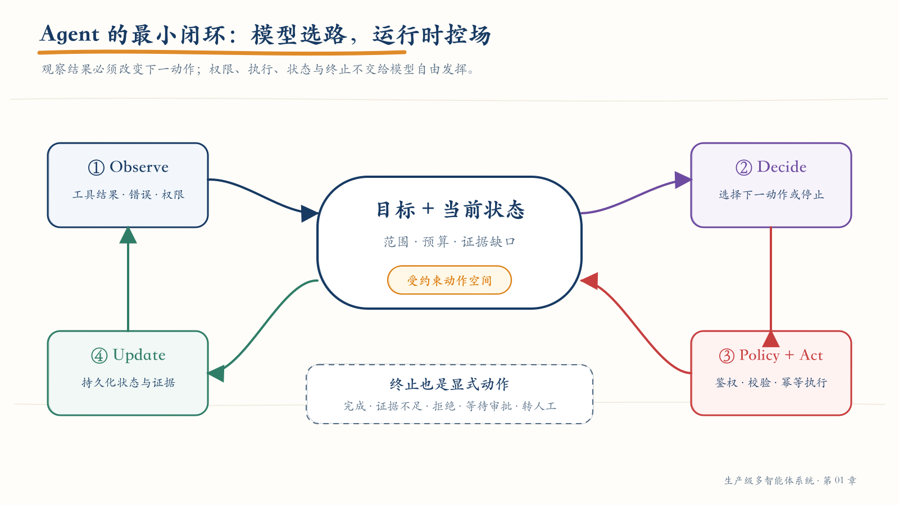
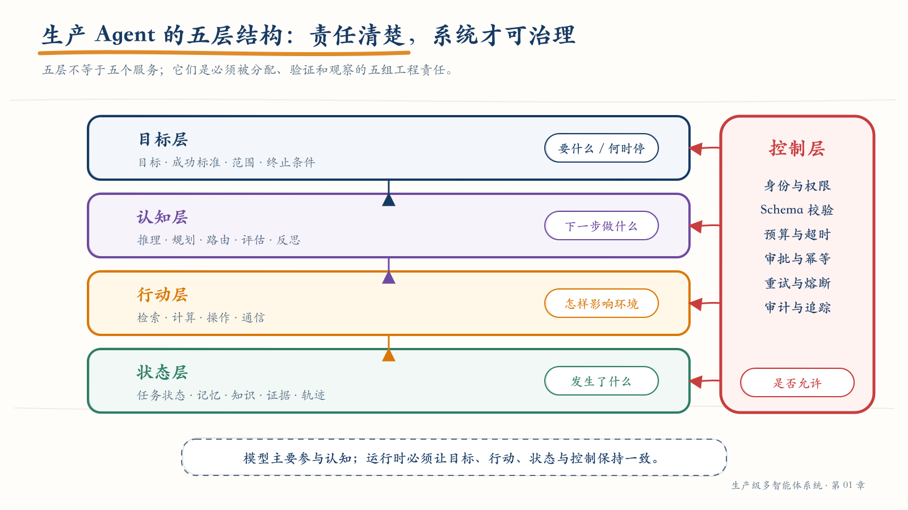
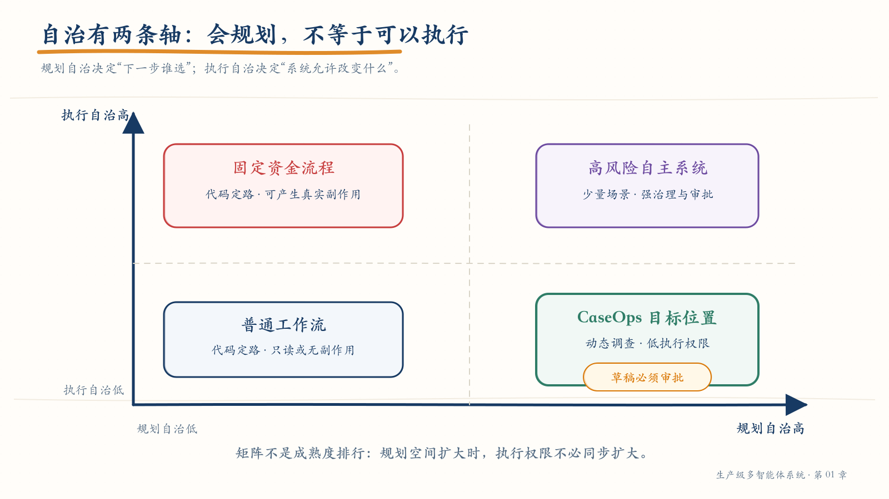
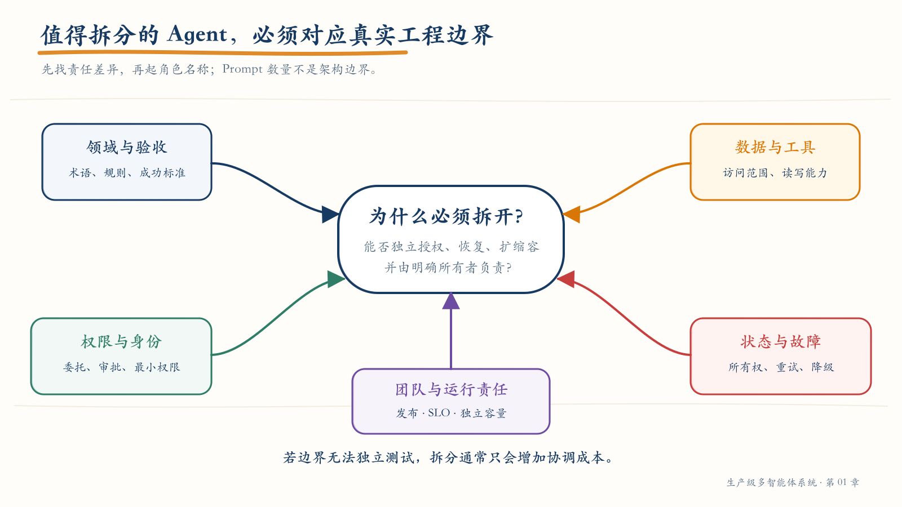
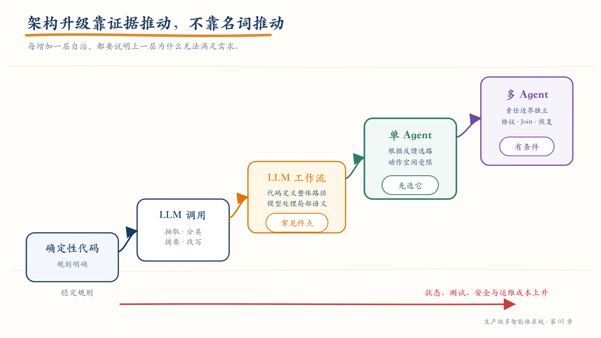
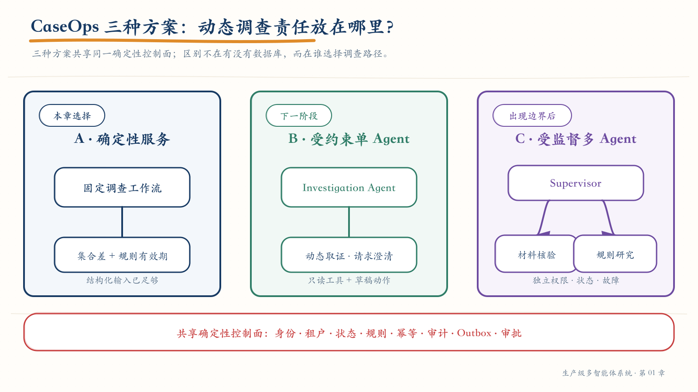

# 第01章　Agentの本質とアーキテクチャ境界

Agentについて語るとき、私たちはつい、大規模言語モデル、ツール呼び出し、メモリ、プランニング、Supervisor、MCPといった技術用語から話を始めがちです。これらのコンポーネントを1枚の図に描くのは難しくありません。難しいのは、より根本的な問いに答えることです。

> システムのどの部分が、環境からのフィードバックに応じて次のステップを自律的に決める必要があるのでしょうか。

この問いに答えられなければ、その後の設計は、もともと明快だったプログラムを、高コストで低速、しかもテストしにくいモデル呼び出しへ書き換えただけになる可能性が高いでしょう。答えが見つかったとしても、さらに問う必要があります。モデルにはどこまで判断させてよいのか、どの責任を決定論的システムに残すべきか、1つのAgentで十分なのはいつで、複数のAgentに分割する価値が生まれるのはいつなのか、という問いです。

本章では、まだコードには入りません。まず、次の事項を含む包括的な概念の座標軸を確立します。

1. Agentと通常の大規模言語モデルアプリケーション、ワークフローの境界はどこにあるのか。
2. 1つのAgentは、どのようなエンジニアリング層で構成されるのか。
3. 推論、プランニング、状態、メモリ、知識は、それぞれ何を解決するのか。
4. 自律性の度合いは、どのように追求するのではなく、どのように設計すべきか。
5. マルチエージェントへ分割する根拠は何か。
6. 要件を満たす最小複雑度のアーキテクチャをどのように選ぶか。

これらの概念を形にした後、本書全体を通じて扱うCaseOps保険金請求協調システムへ適用します。本章におけるプロジェクトの役割は、理論に置き換わることではなく、理論を検証することです。すべてのアーキテクチャ上の結論は、実際の要件、コード上の境界、観測可能な結果を説明できなければなりません。

## 1. ワークフローとAgentの境界

まず、同じタスクを処理する2つのシステムを見てみましょう。ユーザーは、ある保険金請求案件がなぜ長期間完了していないのかを突き止め、次にどの書類を追加すべきか確認したいと考えています。

システムAは、あらかじめ編成された手順を実行します。

```text
案件を読み取る
  → ルールを読み取る
  → 受領済み書類と必須書類を比較する
  → 不足書類に関する結論を生成する
  → 通知の下書きを作成する
```

途中の結果が何であっても、経路は開発者が事前に記述しています。たとえば文書から書類名を抽出するためにモデルを使うなど、プログラムに大規模言語モデルを含めることはできますが、全体の実行順序は変わりません。モデルが担うのは局所的な能力であり、システムの経路を制御する権限は依然としてコードにあります。

システムBは、目標と境界だけを固定します。

```text
目標：案件が停止している原因を突き止め、エビデンスに基づく次のステップを提案する
許可されたアクション：案件の読み取り、書類の解析、ルールの照会、クロスチェック、明確化の依頼
禁止されたアクション：通知の送信、支払結果の変更、他テナントのデータへのアクセス
```

まず案件を読み取ります。書類がすでに構造化されていれば、ルールと直接照合します。受領したものがスキャン文書なら、先に文書を解析します。新旧のルールが競合していれば、事故日と発生場所を追加で確認します。それでもエビデンスが矛盾する場合は、明確化を求めるか、人間へ引き継ぎます。途中で得られた観測結果が、次のアクションを変えるのです。

どちらのシステムも大規模言語モデルを使い、ツールを呼び出す可能性があります。真の違いは次の点にあります。

> ワークフローでは開発者が経路を事前に決定します。Agentは、与えられた目標と境界の中で、フィードバックに基づいて次のアクションを選択します。

この境界は、「大規模言語モデルを使っているか」「APIを呼び出せるか」「メモリがあるか」よりも信頼できる基準です。ツール呼び出しは、固定フローの1ノードにすぎない場合があります。複数ターンの対話であっても、同じ質問応答テンプレートを繰り返し実行しているだけかもしれません。目標を中心とする経路制御にモデルが関与して初めて、システムはAgentとしての性質を帯び始めます。

### 1.1 動的であることはランダムであることではない

「フィードバックに基づいて経路を選択する」とは、モデルに好き勝手させることではありません。エンジニアリングされたAgentが向き合うのは、無限のアクション空間ではなく、定義され、許可された候補アクションの集合です。

```json
{
  "next_action": "read_policy",
  "arguments": {
    "policy_id": "motor-claim-standard",
    "effective_at": "2026-07-01"
  },
  "reason_code": "POLICY_VERSION_REQUIRES_CONFIRMATION",
  "risk_level": "read_only"
}
```

モデルは候補アクションの中で曖昧な判断を担います。一方、ランタイムは、そのアクションが存在するか、パラメータが規約に適合しているか、呼び出し元に実行権限があるか、現在の状態で遷移が許されるかを検査します。動的であることは、観測と意思決定から生じるのであって、制約を取り払うことから生じるのではありません。

### 1.2 真の境界は「遷移ルール」を誰が握るか

従来のワークフローもフィードバックを読み取り、条件分岐を含み、ループさえ持つことができます。たとえば「照会に失敗したら3回再試行し、それでも失敗したら人間へ引き継ぐ」という処理は、明らかに結果に応じて経路が変わります。それでもAgentではありません。各状態からどこへ遷移できるか、どの条件を満たすと遷移するかが、すべて開発者によって決定論的ルールとして記述済みだからです。

どちらのシステムも、状態図として表せます。

```text
ワークフロー：next_state = transition(current_state, result)
Agent：      next_action = model_policy(goal, current_state, observation)
```

ワークフローの`transition`はリリース時点ですでに固定されています。これに対し、Agentの`model_policy`は実行時に目標、状態、観測を総合し、許可されたアクション空間から次のステップを選択します。開発者は完全な経路を列挙しなくなりますが、それでもアクションの集合、制約、状態の妥当性は定義します。

したがって、より厳密な判断基準は「経路が変わるかどうか」ではなく、次の点です。

> 経路の変化に、モデルが意味とコンテキストに基づいて行う実行時の裁量が含まれているか。

これは、通常のルールエンジンがAI Agentではない理由、ループと分岐を持つDAGが依然としてワークフローにすぎない場合がある理由、1回のツール呼び出しだけでは通常Agentにならない理由も説明します。Agentとしての性質は、フィードバックループにおける「方策選択」の位置にモデルが入ることで生まれます。

## 2. AI Agentのエンジニアリング上の定義

「Agentとは、ユーザーに代わってタスクを完遂できる知的システムである」という定義は直感的ですが、エンジニアリング設計には不十分です。システムが何を保存し、何を制御する必要があるかを示していません。また、通常のチャットボットと継続的に実行できるAgentをチームが区別する助けにもなりません。

本書では、コードに落とし込める次の定義を採用します。

> AI Agentとは、目標を中心に動作し、タスクと環境の状態を観測し、制約されたアクション空間から次の行動を選択し、その結果に基づいて状態を更新し、継続、停止、拒否、引き継ぎのいずれかを継続的に決定できるシステムです。

この定義には、目標、観測、意思決定、行動、状態更新、終了という6つの不可欠な要素があります。



*図1-1　モデルは次のステップの選択に関与し、ランタイムは権限、実行、状態、終了を担います。*

### 2.1 単純化したモデルでAgentのループを理解する

少し形式化すると、Agentの1ステップの実行は次のように表せます。

```text
oₜ       = observe(environmentₜ, stateₜ)
proposal = model(goal, stateₜ, oₜ, allowed_actions)
action   = gate(proposal, identity, policy, budget)
result   = execute(action)
stateₜ₊₁ = update(stateₜ, action, result, evidence)
done     = terminate(goal, stateₜ₊₁, constraints)
```

ここで最も注目すべきなのは数式ではなく、責任の分離です。

- モデルが生成するのは`proposal`、すなわちアクション提案です。
- `gate`は決定論的なコントロール層を表し、提案を許可、変更、拒否したり、承認へ回したりできます。
- `execute`が初めて外部環境を実際に読み取り、または変更します。
- `update`は結果を、次のループで利用できる信頼性のある状態へ変換します。
- `terminate`は、モデルがまだコンテンツを生成できるという理由だけでシステムが無限に動作し続けることを防ぎます。

この観点に立てば、大規模言語モデルはAgentの**方策提案器**にすぎず、Agent全体ではありません。データベース、ツールゲートウェイ、状態ストア、ポリシーエンジン、実行器も周辺部品ではなく、ループの一部です。

このモデルは、見落とされがちな事実も明らかにします。モデルが見ているのは客観的環境そのものではなく、権限によるフィルタリング、データ変換、コンテキストの組み立てを経た観測`oₜ`です。観測が欠落している、古くなっている、または汚染されているなら、どれほど強力なモデルでも、誤った前提から推論するしかありません。したがって、Agentの品質はモデルだけでなく、観測の構築と状態更新が現実に忠実かどうかにも左右されます。

### 2.2 目標：役割の説明ではなく、タスク契約

「あなたは経験豊富な保険金請求の専門家です」という記述で制約できるのは、言葉遣いと注目する観点だけです。タスクがいつ完了するかは定義できません。実行可能な目標には、少なくとも次の要素が必要です。

- **タスク範囲**：どの対象、どの期間、どの業務上の問題を扱うか。
- **成功基準**：どのような結果なら完了とみなすか、結論にはどのエビデンスが必要か。
- **制約条件**：予算、期限、データ範囲、禁止されたアクション。
- **終了条件**：完了、エビデンス不足、リスク上限超過、承認待ち、人間への引き継ぎ。

役割はモデルを適切な意味空間へ導くのに役立ちますが、システム動作の根拠になるのは目標です。本番障害でよく見られる、作業範囲が際限なく広がる問題や無限ループは、多くの場合、モデルの賢さが足りないのではなく、目標が判定可能な完了条件として記述されていないために起こります。

### 2.3 観測：Agentは実際に何を見ているのか

観測とは、単にユーザーのメッセージをモデルへ渡すことではありません。1回の意思決定に必要な観測には、通常、次の情報が含まれます。

- 現在の目標とタスクの段階。
- 実行済みのアクションとその結果。
- ツールが返した事実、エラー、バージョン。
- 残り時間、Token、呼び出し予算。
- 現在のID、権限、承認状態。
- まだ満たされていないエビデンス要件。
- 環境に変化があったかどうか。

観測の品質が、意思決定の上限を決めます。状態の喪失、通常のテキストに書き換えられたエラー、タイムスタンプのない古いデータはいずれも、誤った世界の中でモデルに一見もっともらしい判断をさせる原因になります。

### 2.4 意思決定：次のステップを選ぶことは、長い思考を出力することではない

エンジニアリングシステムに必要なのは、検証できない自由文に依存することではなく、実行可能な意思決定の記録です。意思決定は、少なくとも次の問いに答えなければなりません。

- 次のアクションは何か。
- パラメータは、どの既知の事実から得られたか。
- 現在の状態で、なぜこのアクションが許されるのか。
- このアクションによって、どのエビデンスを補う必要があるか。
- 失敗した場合、再試行するのか、経路を変えるのか、停止するのか。

モデルは内部で複雑な推論を行えますが、システム間で受け渡すべきものは、構造化されたアクション提案、エビデンス参照、理由コードです。そうすることで初めて、検証、評価、監査、リプレイが可能になります。

### 2.5 行動：能力とリスクはここから始まる

行動によって、Agentは「回答できる」存在から「環境に影響を与えられる」存在へ変わります。一般的なツールは4種類に分けられます。

| ツールの種類 | 代表的な能力 | 主なリスク | 一般的な制御 |
|---|---|---|---|
| 検索 | 検索、RAG、SQL読み取り専用クエリ | 権限外の読み取り、古い事実、プロンプトインジェクション | データ範囲、出典表示、行・列レベルの権限 |
| 計算 | ルールエンジン、統計、コード実行 | リソース枯渇、誤った入力、信頼できないコード | Schema、リソース上限、サンドボックス |
| 操作 | チケット更新、注文作成、支払い開始 | 重複実行、権限外の書き込み、不可逆な影響 | 承認、冪等性、トランザクション、ロールバック |
| 通信 | メール、メッセージ、Agent間の委任 | ID詐称、リプレイ、誤りの伝播 | 署名、認可、リプレイ防止、メッセージ契約 |

ここには、本書全体を貫く原則があります。

> モデルはアクションを提案できますが、自分自身に権限を付与することはできません。

実行を許可するかどうかは、モデルの外部にあるポリシー、ID、ビジネスルールによって決定しなければなりません。Promptに「権限を越えてはならない」と記述することは、行動上の指示にすぎず、アクセス制御ではありません。

### 2.6 更新：1回の呼び出しを継続的なシステムに変える

実行後、システムは結果を次のループで使える状態に変換しなければなりません。更新とは、ツールのレスポンスを対話履歴に追加するだけではありません。次の事項も処理する必要があります。

- 現在のステップが完了したか。
- どのような新しい事実とエビデンスが生まれたか。
- どの仮説が裏付けられ、どの仮説が覆されたか。
- 予算を消費したか。
- 再試行、追加調査、承認待ちが必要か。
- どの情報を長期メモリに保存でき、どの情報を今回のタスクだけに留めるべきか。

信頼できる状態更新がなければ、Agentはツール呼び出しを繰り返し、制約を忘れ、プロセス中断後に復旧できなくなります。

### 2.7 終了：停止もシステムの能力である

多くのプロトタイプは成功経路だけを設計し、「いつ処理を続けないか」を定義していません。本番システムでは、少なくとも次の結果を明示的な状態として表す必要があります。

| 状態 | 意味 | 許可される次のステップ |
|---|---|---|
| `SUCCEEDED` | 目標とエビデンス要件を満たした | 結果を返して終了 |
| `RETRYABLE_ERROR` | 一時的なエラー、レート制限、タイムアウト | ポリシーに従って再試行、またはプロバイダーを変更 |
| `INVALID_INPUT` | パラメータまたはユーザー情報が不足している | パラメータを修正、または明確化を依頼 |
| `PERMISSION_DENIED` | 現在のIDには実行権限がない | 停止、または人間へエスカレーション |
| `WAITING_APPROVAL` | 高リスクのアクションが承認待ちである | 永続化して一時停止 |
| `INSUFFICIENT_EVIDENCE` | 信頼できる結論を形成できない | 追加調査、明確な回答拒否、または人間への引き継ぎ |

安全に停止できるAgentは、「何があっても答えを出す」Agentよりも、本番要件に近いのが普通です。

### 2.8 必須条件と、一般的な実装にすぎないもの

Agentをめぐる議論では、「一般的なコンポーネント」を「定義上の条件」と取り違えることが、しばしば混乱の原因になります。次の表は、概念を正確に保つのに役立ちます。

| 能力 | Agentを成立させる重要な条件か | 理由 |
|---|---|---|
| 明確な目標 | はい | 目標がなければ、アクションがタスクを前進させるか判断できない |
| 環境からのフィードバックを受け取る | はい | フィードバックがなければ、ループを形成できない |
| フィードバックに基づいて次のアクションを選択する | はい | これがAgentと固定フローを分ける中核的な境界である |
| タスク状態を維持する | 複雑なタスクでは必要 | 状態がなければ、継続的なプランニング、復旧、重複排除ができない |
| 外部ツールを呼び出す | 通常は必要だが、絶対ではない | 行動はツール呼び出しだけでなく、ユーザーへの質問や委任でもよい |
| 長期メモリ | いいえ | 単発タスクには短期のタスク状態だけでよい |
| 自己リフレクション | いいえ | 任意の品質改善メカニズムであり、定義上の条件ではない |
| 複数の役割または複数のモデル | いいえ | 数はAgentとしての性質を決めない |
| 高い実行権限 | いいえ | Agentが読み取り専用アクションしか持たない場合もある |

この区別は非常に重要です。アーキテクトは、「Agentらしく見せる」ためにコンポーネントを積み上げるのではなく、タスクの必要性に応じて能力を追加できるようになります。

## 3. 本番運用Agentの5層構造

最小ループはAgentがどのように動作するかを説明し、5層構造はチームが責任をどこに配置すべきかに答えます。本書では、本番運用Agentを目標層、認知層、行動層、状態層、コントロール層に分けます。



*図1-2　5層は5つのマイクロサービスではなく、明確に割り当ててテストしなければならない5つの責任群です。*

| 層 | 中核となる問い | 代表的な内容 | 主な失敗 |
|---|---|---|---|
| 目標層 | なぜ動作し、いつ完了するのか | 目標、範囲、成功基準、制約、終了条件 | 目標の逸脱、無限ループ |
| 認知層 | 次に何をするのか | 推論、プランニング、ルーティング、評価、リフレクション | プランの誤り、ルーティングの誤り |
| 行動層 | 環境をどのように読み取り、変更するのか | ツール、パラメータ、実行結果 | ツールの誤用、副作用の重複 |
| 状態層 | システムは何を記憶する必要があるのか | タスク状態、メモリ、知識、エビデンス | 汚染、喪失、不整合 |
| コントロール層 | いつ許可、阻止、エスカレーションするのか | 認証・認可、予算、承認、サーキットブレーカー、監査 | 権限逸脱、制御不能、診断不能 |

この5層は、物理的に分割する必要はありません。小規模なAgentはモジュラーモノリスで十分ですが、それでも各層の責任はインターフェースとテストから見えるようにすべきです。すべてを1つのSystem Promptに詰め込んでも、これらの責任が消えるわけではありません。ガバナンスが難しくなるだけです。

### 3.1 認知層：推論、プランニング、評価は同じものではない

これらの用語はしばしば混同され、その結果、システムに問題が起きても、どこを直すべきか分からなくなります。

| 能力 | 答える問い | 保険金請求調査での例 |
|---|---|---|
| 推論 Reasoning | 現在のエビデンスは何を意味するか | 2つの書類名が同じ事故証明を指している可能性がある |
| プランニング Planning | 次にどのステップを実行するか | まず書類を照合し、次に日付に基づいてルールのバージョンを確定する |
| 評価 Evaluation | 前のステップの結果で十分か | 現在あるのはファイル名だけで、内容に基づくエビデンスがない |
| リフレクション Reflection | 元のプランを修正すべきか | 検索の繰り返しをやめ、顧客に明確化を求める |
| 内省 Introspection | システムは自らの制約を認識しているか | 現在、地域別ルールベースへのアクセス権限がない |

推論は判断を導き、プランニングは将来のアクションを構成し、評価は結果を検査し、リフレクションは経路を変えるか決定し、内省は能力の境界を明らかにします。1回のモデル呼び出しですべてをまとめて処理することも、異なるノードに担わせることもできます。概念として分けて初めて、それぞれに対応する評価と障害処理を設計できます。

もう1つ避けるべき誤解があります。プランニングでは、最初からできるだけ長い手順を列挙すればよいわけではありません。環境の不確実性が高いほど、プランニングの視野を短くすべきです。実用的な方法の1つが「ローリングプランニング」です。

1. 現在のエビデンスのもとで最も価値のある次の1ステップ、または少数のステップだけを計画する。
2. 実行後に実際の結果を読み取る。
3. 元の仮説が引き続き成立するか評価する。
4. その後で、元のプランを維持、修正、破棄するか決める。

この方法は、十数ステップに及ぶ壮大なプランを生成するよりも堅牢です。後続のステップが、まだ起きていないツール実行結果を前提にしなくなるからです。

### 3.2 状態層：状態、メモリ、知識、エビデンスを分離する

「Agentにメモリを追加する」だけでは、要件として十分に明確ではありません。チームはまず、システムが何を保存する必要があるのかを区別しなければなりません。

| 情報の種類 | 例 | ライフサイクル | 適切な格納先 |
|---|---|---|---|
| タスク状態 | 現在のステップ、再試行回数、承認待ち | 1回のタスク | 構造化State、Checkpoint |
| 対話メモリ | 前のターンでユーザーが追加した制約 | 1セッションまたはセッション間 | メッセージ履歴、要約、メモリストア |
| ドメイン知識 | 保険金請求ルール、書類の定義、組織関係 | タスク間で共有 | リレーショナルデータベース、ナレッジグラフ、ベクトルデータベース |
| エビデンス | 案件バージョン、ルールバージョン、ツール結果のハッシュ | 監査・追跡期間 | Evidence Store、監査ログ |
| 意思決定トレース | なぜ特定のアクションを選んだか | 診断・評価期間 | Trace、Context Graph |

タスク状態は「現在どこまで進んでいるか」、メモリは「過去のやり取りのうち何を保持する価値があるか」、知識は「このドメインにどのような再利用可能な事実があるか」、エビデンスは「今回の結論の根拠は何か」に答えます。すべてをメッセージリストに入れると、コンテキストの肥大化、鮮度の混乱、権限漏洩を同時に引き起こします。

さらに深く見ると、この4種類の情報は、**真実性に対する責任**も異なります。

- タスク状態はランタイムが書き込み、ステートマシンの制約を満たさなければなりません。
- メモリは通常、過去のやり取りに由来し、要約、忘却、ユーザーによる訂正が必要になる場合があります。
- ドメイン知識は業務データソースが管理し、バージョン、有効期間、アクセス制御が必要です。
- エビデンスは具体的な出典へたどり着けなければならず、モデルによる言い換えだけを保存してはなりません。

モデルはこれらの情報を要約できますが、文を1つ生成したというだけで、それをシステム上の事実へ昇格させることはできません。

### 3.3 コントロール層：ガードレールのプラグインではなく、システムの骨格

コントロール層は、ほかの4層を横断します。目標の範囲を制限し、観測内容をフィルタリングし、アクション提案を検証し、状態遷移を制御し、終了すべきかを決定します。少なくとも、次の要素を含みます。

- 呼び出し元のIDと委任チェーン。
- データ、ツール、アクションに対する権限。
- 入出力Schema。
- 最大ステップ数、時間、コスト予算。
- 書き込み操作の承認と冪等性。
- 再試行、タイムアウト、サーキットブレーカー、縮退運転。
- 監査、トレーシング、エビデンス保持。

これは、プロトタイプと本番システムの違いが最も明確に現れる部分でもあります。プロトタイプは「モデルがタスクを完遂できる場合がある」ことを証明します。一方、コントロール層は「システムが成功時、失敗時、攻撃時のいずれにも境界を越えない」ことを証明します。

5層構造は最終的に、明快な分担を形づくります。目標層は「何が必要か」を定義し、認知層は「何をするか」を提案し、行動層は「どう実行するか」を担い、状態層は「何が起きたか」を保存し、コントロール層は「許可するか」を決定します。アーキテクチャ図で担当が見つからない責任は、実行時にはPromptへ押し込まれ、最もテストしにくい暗黙の振る舞いになるのが普通です。

## 4. 大規模言語モデルアプリケーションのシステム分類

コンポーネントを理解した後は、システムの種類も理解する必要があります。次の4種類のシステムは、同じ大規模言語モデルとツールを使う可能性がありますが、経路の制御方法が異なります。

| システムの種類 | 経路の制御者 | フィードバックに応じて動的に行動するか | 代表的なタスク |
|---|---|---|---|
| 通常のLLMアプリケーション | 1回の呼び出しまたはユーザー | いいえ | 翻訳、要約、抽出 |
| LLM拡張ワークフロー | 開発者が事前定義 | 局所的 | 契約解析、レポートパイプライン |
| 単一Agent | モデルが境界内で選択 | はい | 調査、障害診断、動的な検証 |
| マルチエージェントシステム | 複数の独立した責任主体が協調 | はい | ドメイン横断サービス、複雑なエンジニアリング、並列フォレンジック |

さらに、3つの観点から区別できます。

| 観点 | LLM拡張ワークフロー | 単一Agent | マルチエージェント |
|---|---|---|---|
| ステップの順序 | 基本的にコードで固定 | 実行時にモデルが選択 | 複数の責任主体が協議または委任 |
| アクション集合 | 通常はノードごとに固定 | 有限集合を動的に組み合わせ可能 | 各Agentが固有の有限集合を持つ |
| 状態の所有権 | ワークフローが一元的に保持 | Agentのタスク状態として一元的に保持 | ローカル状態と共有状態を明確にする必要がある |
| 障害復旧 | ノード単位の再試行と補償 | プランの調整、縮退運転、人間への引き継ぎ | 局所復旧とAgent間協調 |
| 主な複雑性 | オーケストレーションの分岐 | 非決定論的な経路 | 分散した責任とプロトコル |

### 4.1 ツール呼び出しは十分条件ではない

プログラムが「パラメータ抽出 → 検索呼び出し → 要約生成」を固定的に実行する場合、モデルがツール呼び出しを発行していても、システムはLLM拡張ワークフローのままです。ツールはシステムに何ができるかを示しますが、誰が経路を制御するかは示しません。

判断するときは、次のように問えます。

> ツールが想定外の結果を返した後、次のステップはコードにあらかじめ記述された分岐でしょうか。それとも、モデルが許可された範囲内で選び直すのでしょうか。

前者は通常ワークフローであり、後者がAgentである可能性を持ちます。

同様に、モデルがツール名を出力したからといって、モデルに実行権限があるわけではありません。ツールの選択、ツールの認可、ツールの実行は別のものです。

1. **選択**は「モデルが何を呼び出したいか」に答えます。
2. **認可**は「現在のIDとタスクで呼び出しが許可されるか」に答えます。
3. **実行**は「システムが再試行可能かつ監査可能な方法で呼び出しをどう完了するか」に答えます。

この3つを1回のSDK呼び出しにまとめると、多くのプロトタイプが本番へ移行するとき、真っ先に問題が表面化します。

### 4.2 複数のPromptはマルチエージェントではない

システムが「アナリストPrompt」「レビュアーPrompt」「サマライザーPrompt」を順番に呼び出しても、3つのAgentを持っているとは限りません。3つが同じ状態、同じ権限、同じ障害ドメインを共有し、常に固定順序で実行されるなら、より正確な呼び方は多段階LLMワークフローです。

マルチエージェントにおける「マルチ」とは、ペルソナの数ではなく、独立した責任境界の数です。この判断については、第7節で詳しく説明します。

### 4.3 Agentは多いほど高度というわけではない

システムの種類は、成熟度のランキングではありません。固定ルール、金額計算、権限判断、トランザクションのコミットには、通常、決定論的コードを使うべきです。正しさを証明できるワークフローは、復旧も監査もできないマルチエージェントシステムより成熟しています。

## 5. 自律性はスイッチではなく、設計すべき境界である

「このAgentは自律性が高い」というだけでは、情報が足りません。自律性は、少なくとも2つの観点から見る必要があります。

第1の観点は、振る舞いのレベルです。

| レベル | モデルが担う責任 | 決定論的システムが担う責任 | 代表的な形態 |
|---|---|---|---|
| L0 固定実行 | なし | すべての経路とアクション | ルールベースプログラム |
| L1 局所生成 | 抽出、分類、書き換え | オーケストレーション全体 | LLMワークフロー |
| L2 制御された選択 | 安全な候補からルーティング | 候補集合、検証、実行 | 制限付きツール選択 |
| L3 動的プランニング | プランニング、ツール呼び出し、ステップ調整 | 権限、予算、状態、実行 | 単一Agent |
| L4 協調的な委任 | Agentをまたぐ分担と再プランニング | プロトコル、分離、監査 | マルチエージェント |
| L5 長期自律 | サブゴールを形成し、継続的に行動 | 強い監督、ガバナンス、緊急停止 | 少数の制御された長期タスク |

この分類は、システム全体がどの振る舞いの段階にあるかを表すのに適しています。しかし、レベルが高いほど優れているという誤解を招きやすいため、第2の観点も必要です。プランニングの自律性と実行の自律性を、2つの軸に分けます。

- **プランニングの自律性**：モデルが、次に何をするかをどの範囲まで決定できるか。
- **実行の自律性**：システムが、どのリスク範囲まで外部世界の変更を許可するか。



*図1-3　プランニング空間は広くても、実行権限は低く抑えられます。この2つの軸は別々に設計しなければなりません。*

調査Agentは、検索の方向を自由に調整できるため、プランニングの自律性が高くても、公開情報を読み取るだけなら実行の自律性は低くなります。固定された返金プログラムは、経路が完全にコードで決まっているためプランニングの自律性はゼロですが、資金の状態を直接変更する可能性があり、むしろ実行リスクは高くなります。

企業システムで妥当なことが多い形態は「全面的な自律」ではなく、**制約された自律性**です。

- 曖昧な意味の処理と動的ルーティングをモデルに許可する。
- ツールとデータへのアクセス範囲を狭める。
- 高リスクのアクションを決定論的ポリシーと人手による承認へ回す。
- 予算、終了、監査をモデルから独立して存在させる。

目標達成に必要な最小限の自律性こそが、通常は妥当な自律性です。

### 5.1 自律性のリスクはどこから生じるか

自律性そのものがリスクなのではありません。リスクは、自律性が能力、権限、作用範囲と組み合わさることで生じます。定性的には、次のモデルで理解できます。

```text
リスクエクスポージャー ≈ 意思決定の不確実性 × ツール能力 × 権限範囲 × 継続時間
                         ─────────────────────────────────────────
                                  監督強度 × 復旧可能性
```

これは正確な数値を計算するための式ではなく、設計チェックリストです。

- 読み取り専用の調査Agentは、プランニングの自由度が高くても、ツール能力と権限範囲は限られています。
- 資金の状態を変更できるAgentは、1ステップしか実行しなくても高リスクになり得ます。
- 長時間にわたり監督されないAgentは、誤りとコストを蓄積し続けます。
- 承認、冪等性、補償、緊急停止を備えたシステムは、誤りの影響を抑えられます。

したがって、モデルの品質を高めることだけが、自律性のリスクを制御する手段ではありません。ツール権限の削減、タスク時間の短縮、作用対象の制限、復旧能力の強化のほうが、より直接的で検証しやすい場合が多くあります。

## 6. Agentを使う価値があるのはいつか

OpenAIのエンジニアリングガイドは、従来の決定論的手法やルールベース手法では扱いにくく、複雑な意思決定または大量の非構造化データを含むタスクを優先して探すよう推奨しています。AnthropicによるワークフローとAgentの区別も、自律システムを前提にするのではなく、要件を満たす最も単純なソリューションから始めるべきだと強調しています。

実際のレビューでは、次の4種類のシグナルを探します。

### 6.1 実行前に経路全体を決められない

次のステップが今発見したエビデンスに依存し、繰り返し調整される可能性がある場合、固定ワークフローは大量の壊れやすい分岐を抱えることになります。調査、障害診断、オープンエンドなデータ分析、複雑な書類調査は、通常この種類に該当します。

### 6.2 入力に多くの意味的不確実性が含まれる

同じ意図が多様に表現され、書類構造が安定せず、コンテキストと組み合わせてルールを解釈する必要があります。モデルはここで分類、マッチング、解釈、候補アクションの選択を担えますが、最終的な事実と権限は引き続き決定論的に検証する必要があります。

### 6.3 ツールを動的に組み合わせる必要がある

どのツールを、何回、どの順序で呼び出す必要があるかをシステムが事前に把握できない一方、アクションの集合自体は制限し、検証できます。これは、モデルに任意のコードと任意のAPIを開放するより、本番運用に適しています。

### 6.4 タスクのフィードバックと停止を定義できる

Agentは、アクションが成功したか、エビデンスが十分か、いつ停止すべきかを把握できなければなりません。「できるだけよくする」だけで、観測可能なフィードバックがないタスクでは、自律ループは安定しにくくなります。

### 6.5 Agent化すべきでない場合

次のシナリオでは通常、決定論的プログラムまたはワークフローを優先すべきです。

- ルールが明確で経路が安定しており、分岐を完全に列挙できる。
- 認知負荷の低い変換、検証、計算。
- 極めて低いレイテンシ、または極めて高いスループットが必要なコア経路。
- 金額、権限、コンプライアンス状態など、厳密な一貫性が必要な意思決定。
- 成功、フィードバック、安全な停止を定義できない。
- モデルによる品質上の利益が、レイテンシ、コスト、リスクを上回らない。

「タスクが重要である」ことは、Agentを使う理由にはなりません。タスクが重要であるほど、モデルは、ルールより明確に優れている位置にのみ配置する必要があります。

### 6.6 アーキテクチャ選択の本質は純便益の判断である

Agentは、単に「効果が少し高い」だけで採用に値するわけではありません。完全な判断には、利益と追加コストの両方を含める必要があります。

```text
Agentの純便益
  = 新たに対応可能になるタスク + 品質向上 + 人手プロセスの改善
  - モデルとインフラストラクチャのコスト
  - レイテンシと可用性の低下
  - 評価、ガバナンス、運用保守のコスト
  - 誤ったアクションによる期待損失
```

たとえば、モデルが非構造化書類の認識率を8%高めたとしても、コア経路のレイテンシが10倍になり、誤った結果が不可逆な書き込み操作を引き起こすなら、そのアップグレードは妥当とは限りません。反対に、これまで人手で調査するしかなかったロングテール案件に安定した処理支援を提供できるなら、1回あたりの呼び出しコストが高くても、大きな価値を持つ可能性があります。

したがって、Agentの適性を1回のデモだけで判断することはできません。少なくとも次のものを確立する必要があります。

1. Agentを使わない決定論的ベースライン。
2. 通常、境界、高リスクのケースを網羅する代表的なタスクセット。
3. 品質、経路、レイテンシ、コスト、安全性の指標。
4. 明確なリリース閾値とフォールバック条件。

### 6.7 適性スコア表

スコアリングはアーキテクチャ判断の代わりにはなりませんが、チームに直感を議論可能なエビデンスへ変換させることができます。各項目を0〜2点で評価します。

| 判断項目 | 0点 | 1点 | 2点 |
|---|---|---|---|
| タスク経路 | 完全に固定 | 少数の動的分岐 | 中間フィードバックに強く依存 |
| 入力構造 | 安定した構造化データ | 半構造化データ | 非構造化かつ表現が多様 |
| 意味判断 | 不要 | 局所的に必要 | タスク全体で必要 |
| ツールの組み合わせ | 固定順序 | 少数の選択肢 | 動的な組み合わせが必要 |
| フィードバックの品質 | 明確なフィードバックなし | 一部を観測可能 | 各ステップを継続的に評価可能 |
| 自律的プランニングの利益 | なし | 局所的な利益あり | 壊れやすいフローを大幅に削減 |

合計点は、判断の出発点として使えます。

- 0〜3：決定論的プログラムまたは通常のLLM呼び出しを優先。
- 4〜7：LLM拡張ワークフローを優先。
- 8〜10：制約された単一Agentを評価。
- 11〜12：Agentが価値を持つ可能性は高いが、それでもベースライン実験が必要。

この表には、3つの拒否条件があります。確実に認可できない、安全に停止できない、フィードバックを得られない、という条件です。たとえスコアが高くても、いずれか1つが該当すれば、本番環境での自律動作へ直接進むべきではありません。

スコアリングは選別ツールであって、意思決定アルゴリズムではありません。最終的なアーキテクチャ選択は、やはりベースライン実験とリスク分析によって裏付ける必要があります。

## 7. マルチエージェントが本当に必要になるのはいつか

単一Agentのコンテキストとツールは、タスクの成長に伴って肥大化します。しかし、「タスクが複雑である」だけでは、分割の根拠として依然不十分です。マルチエージェントが解決するのは、責任の分散に関する問題です。専門化、分離、並列化、組織上の所有権が測定可能な利益をもたらす場合にのみ、価値があります。

### 7.1 マルチエージェントシステムとは何か

マルチエージェントシステムとは、「1つのプログラムがモデルを複数回呼び出すこと」ではありません。局所的な目標、能力、責任を持つ複数のAgentが、明示的なやり取りを通じて全体のタスクを共同で完遂するシステムです。

次のように抽象化できます。

```text
全体目標 G
  → 局所目標 g₁, g₂, ... gₙ に分解
  → Agentᵢ が固有の状態 sᵢ、ツール Tᵢ、方策 πᵢ に基づいて行動
  → メッセージ、共有環境、コーディネーターを介して結果を交換
  → 結果契約に従って全体結果 R に統合
```

この定義では、5つの条件を重視します。

| 条件 | 答える必要がある問い |
|---|---|
| 局所的責任 | 各Agentは、どの結果に対して独立して責任を負うか |
| 局所的能力 | どの知識、ツール、権限を持つか |
| 対話プロトコル | タスク、結果、エラー、エビデンスをどのように受け渡すか |
| 協調メカニズム | 依存関係、並列処理、競合、タイムアウトをどのように扱うか |
| Join Contract | 局所的な結果がどの条件を満たせば全体結果を形成できるか |

複数のAgentは、同種でも異種でも構いません。Supervisorによる集中オーケストレーションも、イベントまたは共有環境を通じた協調も可能です。ただし、独立した責任と対話契約がなければ、「マルチエージェント」は実装の詳細または役割の装飾にすぎません。

### 7.2 協調はなぜ付加価値を生み得るのか

マルチエージェントシステムの能力は、各Agentの出力を単純に足し合わせたものだけではありません。協調によって、4種類の付加価値が生じる可能性があります。

1. **タスク分解**：単一のコンテキストでは扱いきれない問題を、受け入れ検証可能な局所目標へ分割する。
2. **専門化**：Agentごとに、より狭い知識、ツール、評価基準を使用する。
3. **並列処理**：依存関係のないエビデンスソースまたはサブタスクを同時に処理する。
4. **障害分離**：一部の能力の失敗、縮退、置き換えを可能にし、タスク全体の停止を防ぐ。

ただし、いわゆる「創発的能力」を検証不要の理由にしてはなりません。システムが単一Agentより良い結果を出したとしても、理由を突き止める必要があります。コンテキストがより集中したのか、探索空間が小さくなったのか、並列化で時間が短縮されたのか、それとも独立したレビューで誤りが減ったのか。説明も再現もできない改善を、本番アーキテクチャの根拠にすべきではありません。

協調では、いくつかの基本的な問題も解決しなければなりません。

- サブタスクを作成し、委任する権限を誰が持つか。
- サブタスクの入力、期限、受け入れ基準は何か。
- Agentが返すのは事実、提案、実行可能なコマンドのどれか。
- 2つの結果が競合した場合、どのルールで裁定するか。
- 局所的な失敗に対し、再試行、置き換え、縮退、全体タスクの終了のいずれを行うか。
- 誰が共有状態を書き込み、並行更新による上書きをどう防ぐか。

これらの問題は、それぞれタスクプロトコル、メッセージプロトコル、Join Contract、状態の一貫性に対応します。第3章では具体的な協調パターンを詳しく検討します。本章で覚えておくべきことは、Agentを分割した瞬間に、システムはモデルのオーケストレーション問題から分散システム問題へ移るということです。

### 7.3 分割は実在するエンジニアリング境界に対応させる



*図1-4　まず実在する責任の違いを探し、その後で新しいAgentを作るか決めます。*

次の8種類の境界を、1つずつ確認します。

| 境界 | 診断の問い | 検証可能な成果物 |
|---|---|---|
| ドメイン | 独立した用語、ルール、成功基準を持つか | ドメインモデル、ケイパビリティ一覧 |
| データ | 特定のデータ範囲にしかアクセスできないか | Data Access Policy |
| ツール | 異なる読み書き能力を持つか | Tool Registry、Schema |
| 権限 | 独立したIDと承認ポリシーが必要か | RBAC/ABAC、委任ポリシー |
| 状態 | タスク状態を独立して作成、維持するか | State Contract |
| 障害 | 個別の再試行、縮退、復旧が必要か | Runbook、Failure Domain |
| スケーリング | 負荷とリソース要件が独立しているか | SLO、キャパシティモデル |
| 所有権 | 異なるチームが独立してリリースし、責任を負うか | Owner、Release Policy |

これらの境界の大半が存在しないなら、分割によって増えるものは通常、次のとおりです。

- Agentのルーティングと委任の誤り。
- 引き継ぎ時のコンテキスト喪失。
- 分散状態の一貫性問題。
- レイテンシの増大とToken消費の増加。
- テスト、トレーシング、障害復旧の複雑化。

マルチエージェントは、自動的に信頼性を高めるわけでもありません。1つのAgentの失敗がほかのAgentによって拡散されず、分離、代替、縮退できて初めて、システムは真にレジリエンスを獲得します。

### 7.4 専門化、並列化、分離はそれぞれ証明する

マルチエージェントで一般的な3種類の利益を、混同してはなりません。

**専門化**とは、各Agentが、より狭いドメインコンテキスト、ツール、評価基準を持つことです。それによってコンテキストの競合またはツール選択の誤りが減った場合に限り、専門化は価値を生みます。

**並列化**とは、サブタスク間に未宣言の依存関係がなく、並行処理で節約できる時間が、協調と統合のコストを上回ることです。順序依存のあるステップを無理に並列化すれば、不整合が生じるだけです。

**分離**とは、局所的な失敗が全体状態を汚染せず、権限も水平方向へ拡散しないことです。Promptを別々の関数やコンテナに入れるだけで、障害分離が自動的に得られるわけではありません。

この3種類の利益は、すべて指標で証明すべきです。ツール選択の正確度が向上したか、エンドツーエンドのレイテンシが短縮したか、障害の影響範囲が縮小したかを測定します。そうでなければ、「マルチエージェントは複雑なタスクをより得意とする」という主張は、受け入れ検証できないスローガンにすぎません。

## 8. 最小複雑度からアーキテクチャを選ぶ

ここまでの知識は、1つのアーキテクチャの階段にまとめられます。



*図1-5　前の段階では要件を満たせず、利益を評価によって証明できる場合にのみ、自律性と分散の複雑性を追加します。*

**決定論的コード**は、ルールが明確で入力が安定している計算と制御に適しています。権限判断、状態遷移、金額計算、Schema検証、トランザクションのコミットは、この段階に留めることを優先すべきです。

**通常のLLM呼び出し**は、要約、分類、抽出、書き換えに適しています。モデルは非構造化情報を処理しますが、経路を継続的に制御しません。

**LLM拡張ワークフロー**は、モデルを事前定義されたステップに組み込みます。これは多くの企業タスクにとって妥当な到達点であり、「まだAgentへアップグレードしていない」過渡的な形態ではありません。

**単一Agent**は、経路を事前に列挙できず、フィードバックに応じた調整が必要でありながら、目標と責任が一元化されているタスクに適しています。

**マルチエージェント**は、ドメイン、権限、状態、障害、所有権を独立させなければならず、専門化、並列化、分離による利益を検証できるタスクに適しています。

この階段は、システムを段階ごとに実装するよう求めるものではありません。より単純な段階ではなぜ不十分なのかを、アーキテクトに説明するよう求めるものです。

1段上がるたびに、チームは「複雑度予算」を消費します。非決定論的な状態が増え、テスト空間が広がり、セキュリティ面が複雑になり、運用要件も高くなります。妥当なアーキテクチャとは、能力が最も多いものではなく、最小限の複雑性でビジネス目標を安定して満たすものです。

### 8.1 よくある5つの誤判断

ケースに入る前に、最も混同しやすい判断をまとめておきます。

1. **ツールを呼び出せればAgentである**：ツールは能力であり、動的な経路制御こそがAgentとしての性質です。
2. **複数の役割があればマルチエージェントである**：役割はプロンプト上の表現であり、エンジニアリング境界こそがアーキテクチャです。
3. **長期メモリがなければAgentではない**：短いタスクでは長期メモリがなくても構いませんが、ループを維持するのに十分なタスク状態は必要です。
4. **自律性が高いほど高度である**：自律性は能力を増やす一方で、リスク、コスト、テスト空間も拡大します。
5. **モデルが強力ならコントロール層を減らせる**：モデルが行動できるほど、ID、権限、予算、監査は重要になります。

## 9. CaseOps：判断フレームワークからアーキテクチャ決定へ

ここで初めて、本書全体を通じて扱うプロジェクトに入ります。

CaseOpsは、企業向けの保険金請求協調システムです。本章で扱うタスクは次のとおりです。

> 案件C-102がまだ完了していない理由を調査し、不足書類と適用ルールを確認する。顧客への連絡が必要な場合は、通知の下書きのみを生成し、自動送信してはならない。

このタスクには、構造化された事実、ルールマッチング、自然言語の書類、時間の意味論、外部への潜在的なアクションが同時に含まれます。一見するとAgentに向いていますが、「向いているように見える」ことはアーキテクチャ上の結論ではありません。ここまでのフレームワークに従って、段階的に判断します。

### 9.1 まず自然言語をタスク契約に書き換える

| 契約フィールド | C-102での定義 |
|---|---|
| 目標 | 案件が停止している原因を特定し、次のステップを提案する |
| 成功基準 | 不足書類と適用ルールの両方にバージョン付きエビデンスがある |
| 許可された入力 | 現在のテナント内の案件、書類、ルール |
| 許可されたアクション | 読み取り、比較、通知の下書き生成 |
| 禁止されたアクション | 通知の送信、支払結果の変更、テナントをまたぐアクセス |
| 終了条件 | 十分な結論、エビデンス不足、権限なし、人手対応待ち |
| 監査要件 | 案件バージョン、ルールバージョン、理由コード、アクション記録を保存 |

この作業は重要です。まず成功条件と禁止条件を固定して初めて、その後の自律性に関する議論に座標軸が生まれます。

### 9.2 決定論的な中核と意味的な不確実領域を分ける

C-102には、すでに次の構造化された事実があります。

| ビジネスオブジェクト | 固定された事実 |
|---|---|
| 案件 | `C-102`、バージョン7 |
| テナント | `tenant-demo` |
| 状態 | `waiting_for_documents` |
| ルール | `motor-claim-standard@2026.1` |
| 受領済み書類 | 損害状況説明、本人確認書類 |
| 必須書類 | 損害状況説明、本人確認書類、事故証明 |
| アクション制限 | 不足書類に関する下書きの生成のみ許可 |

この入力であれば、中核経路は完全に事前記述できます。

1. 現在のテナント内で案件を読み取る。
2. 案件に紐づくルールのバージョンを読み取る。
3. 事故発生日時点でルールが有効だったか検証する。
4. 必須書類の集合から受領済み書類の集合を差し引く。
5. 不足書類がある場合、人手レビュー待ちの通知下書きを作成する。

ここには、オープンエンドなプランニングが必要なステップはありません。集合差はPromptを長くしても正確にはなりませんし、テナント分離をモデルの即時判断に委ねることもできません。したがって、現在の要件におけるAgent適性スコアは低くなります。

一方、このタスクの周辺には、意味的な不確実領域が存在する可能性があります。

- スキャン文書に標準の書類コードがない。
- 地域機関が「事故証明」の別名を使っている。
- 新旧のルールが同時に一致する。
- 2つのデータソースで受領状態が競合している。
- 調査中に重複案件の疑いが見つかる。
- エビデンスが不足したとき、追加調査、明確化、停止の中から選ぶ必要がある。

これらの変化があると、経路は中間の観測に依存するようになります。将来Agentを導入する理由にはなりますが、現行バージョンで前倒ししてAgentを導入する言い訳にはなりません。

### 9.3 3つの候補アーキテクチャを比較する



*図1-6　3つの案は同じ決定論的コントロールプレーンを共有し、動的な調査責任をどこに置くかだけが異なります。*

| 案 | 経路制御 | 適用条件 | 本章での判断 |
|---|---|---|---|
| A：決定論的調査サービス | アプリケーションコード | 現在の事実が構造化され、ルールが一意 | 選択 |
| B：制約された単一Agent | Investigation Agent | 非構造化書類と動的なエビデンス収集が生じる | 次の発展段階 |
| C：監督されたマルチエージェント | Supervisorと専門Agent | 独立した権限、状態、障害、並列化の利益が生じる | 現時点では選択しない |

3つの案には、いずれもID、テナント、ルール、状態、冪等性、監査、承認が必要です。Agentはこれらの基盤の代替ではなく、動的な調査責任の配置を変えるだけです。

### 9.4 実行可能なベースラインで「当面Agentは不要」と証明する

CaseOps Slice 0が実装するのは案Aです。中核となるアプリケーションロジックは、決定論的に保たれています。

```python
case, case_evidence = cases.get(tenant_id, case_id)
policy, policy_evidence = policies.get(
    tenant_id,
    case.policy_id,
    case.policy_version,
)

missing = tuple(
    item
    for item in policy.required_documents
    if item.code not in set(case.received_document_codes)
)

return InvestigationResult(
    decision=decision_for(missing),
    recommended_action=draft_only_action(missing),
    evidence=(case_evidence, policy_evidence),
)
```

完全なコードは独立した[CaseOpsリポジトリ](https://github.com/dataPro-lgtm/production-grade-multi-agent-caseops)にあります。本章では、イミュータブルなバージョン`chapter-01-slice-0`を固定して使用します。

```bash
git clone https://github.com/dataPro-lgtm/production-grade-multi-agent-caseops.git
cd production-grade-multi-agent-caseops
git checkout chapter-01-slice-0
docker compose up --build -d
```

調査を開始します。

```bash
curl --fail-with-body \
  --request POST \
  http://localhost:8080/v1/cases/C-102/investigations \
  --header 'Content-Type: application/json' \
  --header 'X-API-Key: caseops-local-dev-key' \
  --header 'Idempotency-Key: book-ch01-c102-0001' \
  --data '{"notification_action":"draft"}'
```

主要なレスポンスは次のとおりです。

```json
{
  "result": {
    "decision": {
      "code": "MISSING_REQUIRED_DOCUMENTS",
      "explanation": "案件缺少规则要求的必要材料：事故证明。"
    },
    "recommended_action": {
      "type": "draft_notification",
      "execution_policy": "human_approval_required",
      "side_effect": "none"
    },
    "evidence": [
      {"ref": "case://C-102@7"},
      {"ref": "policy://motor-claim-standard@2026.1"}
    ]
  }
}
```

この実装は、前述の5層構造も同時に検証します。

- **目標層**：タスクは不足書類の調査と下書きの提案だけを扱う。
- **認知層**：現時点ではモデルによるプランニングはなく、ルール判断はアプリケーションコードが行う。
- **行動層**：読み取りと下書き作成だけで、送信ポートはない。
- **状態層**：結果、エビデンス、監査、Outboxを永続ストレージへ保存する。
- **コントロール層**：テナントフィルタリング、冪等性、トランザクション、承認ポリシーが独立して存在する。

このプロジェクトに価値があるのは、Agentを実演しているからではありません。後で比較できるベースラインを確立しているからです。第2章でモデルを導入した後は、それがSlice 0では解決できない問題を解決し、同時にこれらの決定論的境界を損なっていないことを証明しなければなりません。

### 9.5 アップグレードのトリガーを明確にする

CaseOpsは、「次章でAgentを扱う必要がある」という理由でアップグレードすることはありません。次のエビデンスが現れて初めて、制約された単一Agentへアップグレードします。

1. 安定した抽出フローでは、非構造化書類を網羅できない。
2. 調査経路が実際に中間エビデンスに依存し、頻繁に変化する。
3. 固定分岐の保守コストと見落とし率を測定できる。
4. 同じGolden Dataset上で、Agentが検証可能な利益をもたらす。
5. 権限、状態、予算、安全な停止を独立して実行できる。

単一Agentからマルチエージェントへアップグレードするには、独立したドメイン、権限分離、障害復旧、並列化の利益、チームの所有権のうち、少なくとも1つが実在することを追加で証明する必要があります。

### 9.6 ADRでアーキテクチャ判断を固定する

「まず単純なバージョンを作る」という方針を、口頭での議論だけに留めてはなりません。CaseOpsの[ADR-0001](https://github.com/dataPro-lgtm/production-grade-multi-agent-caseops/blob/chapter-01-slice-0/docs/adr/0001-start-with-a-deterministic-modular-monolith.md)には、候補案、現在の制約、選択理由、アップグレード条件、フォールバック経路が記録されています。

適切なAgentアーキテクチャADRは、少なくとも次の問いに答える必要があります。

| 判断の問い | 提示すべきエビデンス |
|---|---|
| Agentを使わずに、目標のどこまでを達成できるか | 実行可能なベースラインと未達要件 |
| どの意思決定を動的に行う必要があるか | 固定経路では安定して処理できないケース |
| モデルはどのアクションを選択できるか | 有限のアクション集合とパラメータ契約 |
| どのアクションを自律的に実行してはならないか | ポリシー、承認、副作用の境界 |
| 状態を誰が所有するか | State Schema、バージョン、復旧責任 |
| アップグレード後に改善したか | 品質、レイテンシ、コスト、リスクの比較 |
| 利益が不十分な場合にどう戻すか | 保持されている決定論的経路 |

チームが「どの意思決定をモデルが動的に行わなければならないか」に答えられないなら、Agent化を続けることは勧めません。「状態と権限を誰が所有するか」に答えられないなら、マルチエージェントへの分割はなおさら勧められません。

## 10. 転用可能なアーキテクチャ判断手法

CaseOps以外のAgentプロジェクトでも、次の6つのステップで判断できます。

### ステップ1：役割ではなく、結果を定義する

「分析Agentを作る」という表現を、ビジネス目標、成功基準、エビデンス要件、終了条件へ書き換えます。役割名は最後に付けます。

### ステップ2：まず決定論的ベースラインを描く

Agentを使わずに実現できる最小フローを書き出します。これはコストのベースラインであると同時に、後の評価とフォールバックの経路でもあります。

### ステップ3：真に曖昧な意思決定を特定する

安定してコード化できず、意味理解またはフィードバックに基づく動的ルーティングを必要とする部分だけをモデルに任せます。トランザクション、権限、一貫性まで一緒に囲い込んではなりません。

### ステップ4：プランニングの自律性と実行の自律性を分ける

モデルが何を決定できるかと、システムが実際に何の実行を許すかを明確にします。書き込み操作、高リスクの通信、資金に関するアクションには、より強いポリシーと承認が必要です。

### ステップ5：まず単一Agentを評価する

ドメイン、データ、ツール、権限、状態、障害、スケーリング、所有権のいずれかに独立した境界が存在する場合にのみ、マルチエージェントの評価へ進みます。

### ステップ6：同じエビデンスでアップグレードの可否を決める

同じタスクセットを使って、完遂品質、経路の正確性、レイテンシ、コスト、権限違反、復旧能力を比較します。アーキテクチャのアップグレードは、より美しいトポロジー図ではなく、測定可能な利益をもたらさなければなりません。

最終的な判断は、次の一文にまとめられます。

> モデルは曖昧な意思決定という得意な位置に置き、決定論、権限、一貫性はソフトウェアエンジニアリングへ戻します。

## 11. 本章のまとめ

これで、「Agentとは何か」という問いに完全に答えられます。

Agentは大規模言語モデルの別名でも、ツール呼び出し、長期メモリ、複数ターンの対話を組み合わせたものでもありません。目標駆動型の動的な行動システムです。現在の状態を観測し、制約されたアクション空間から次のステップを選択し、実行後に状態を更新し、完了、拒否、待機、安全な停止のいずれかへ進むことができます。

本番運用Agentには、少なくとも目標、認知、行動、状態、コントロールという5層の責任が必要です。推論とプランニングは異なり、タスク状態と長期メモリも異なり、知識とエビデンスも異なります。これらの概念を区別して初めて、どの層でエラーが起きたのか、Prompt、コード、ポリシー、データのどれで修正すべきかを判断できます。

自律性は高いほどよいわけではありません。プランニングの自律性と実行の自律性は、分けて設計しなければなりません。マルチエージェントも役割の数ではなく、独立した責任境界を意味します。実在する境界のない分割は、協調コストと障害面を増やすだけです。

CaseOpsが本章で決定論的調査サービスを選んだのは、Agentが永久に不要だからではなく、現在の構造化タスクにはまだ動的ルーティングが必要ないからです。この実行可能なベースラインによって、その後のアップグレードに比較対象が生まれます。次章では、最初の制約されたInvestigation Agentを導入します。重点は、もう1つPromptを書くことではなく、ツール呼び出しを明示的なステートマシンに組み込むことにあります。リクエストをどう検証するか、エラーをどう分類するか、状態をどう復旧するか、副作用の重複をどう防ぐか、そしてMCPが責任チェーンの中で何を解決するのかを扱います。

## 関連資料

- [Anthropic：Building Effective Agents](https://www.anthropic.com/engineering/building-effective-agents)
- [OpenAI：A Practical Guide to Building Agents](https://openai.com/business/guides-and-resources/a-practical-guide-to-building-ai-agents/)
- [NIST：AI Risk Management Framework](https://www.nist.gov/itl/ai-risk-management-framework)
- [OWASP Top 10 for Agentic Applications 2026](https://genai.owasp.org/resource/owasp-top-10-for-agentic-applications-for-2026/)
- [CaseOps `chapter-01-slice-0`](https://github.com/dataPro-lgtm/production-grade-multi-agent-caseops/tree/chapter-01-slice-0)
