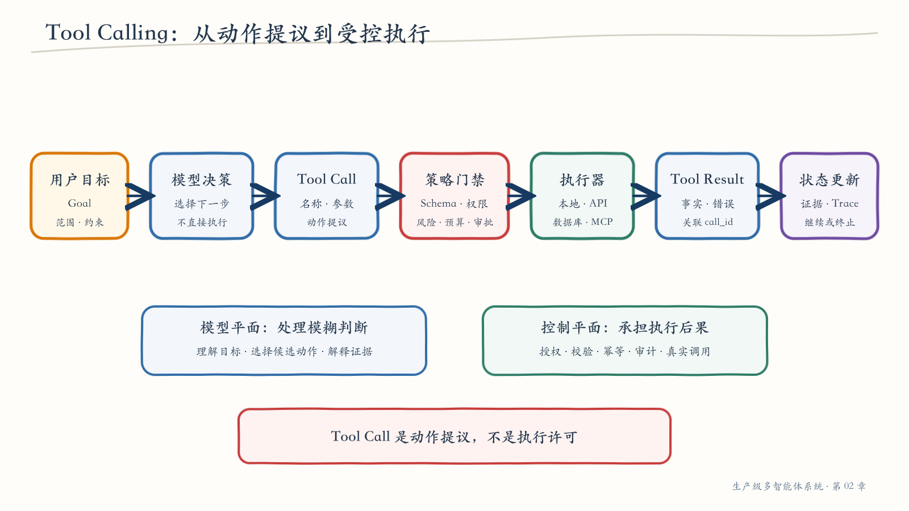
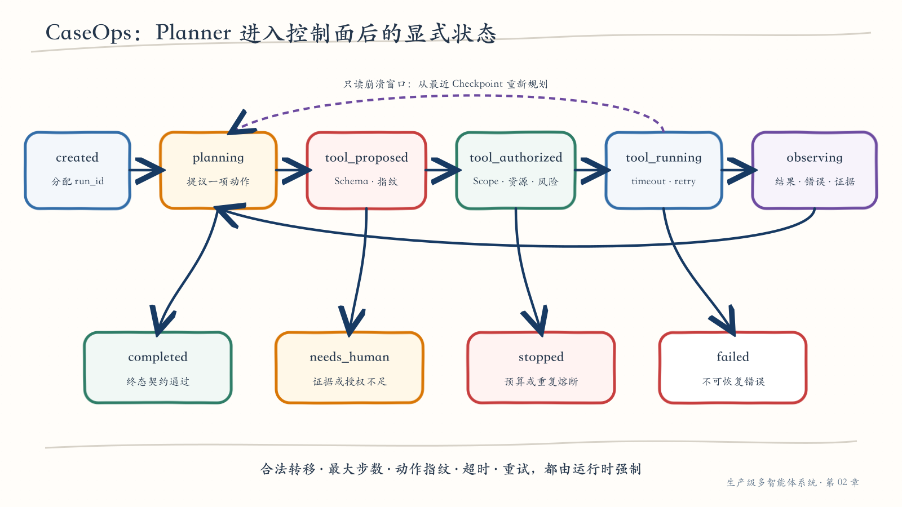
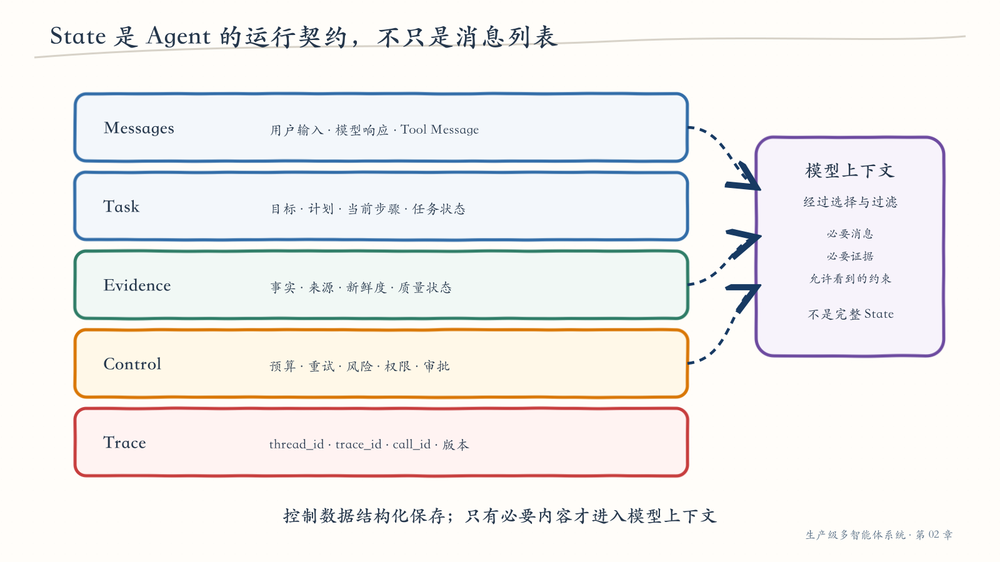
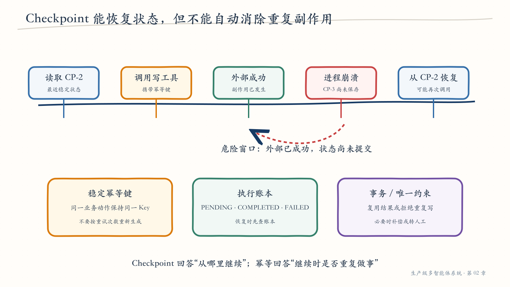
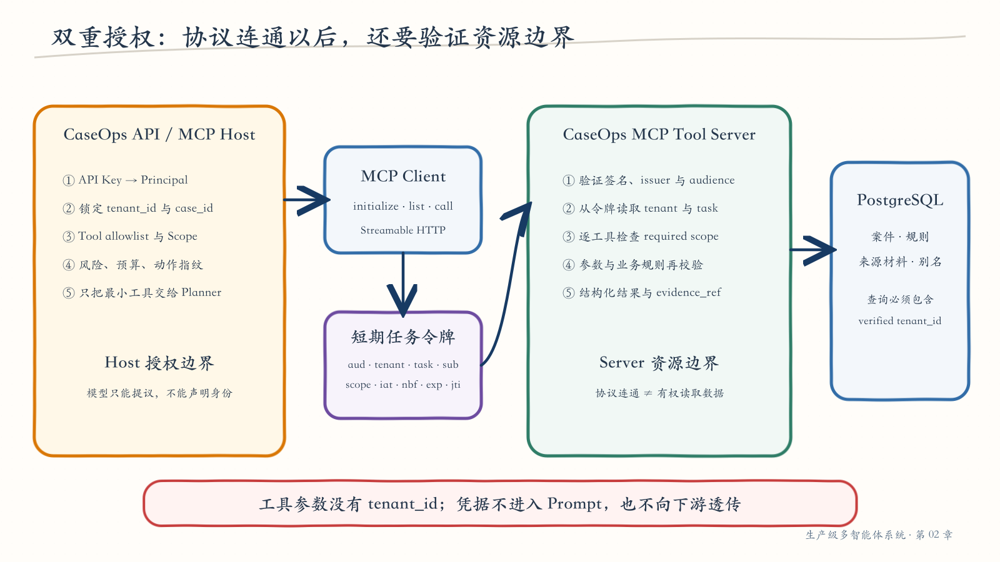
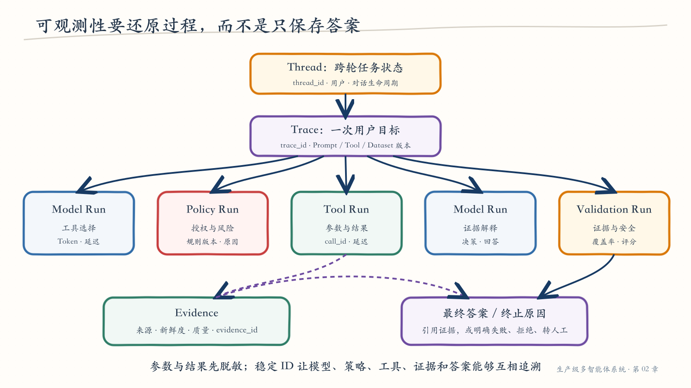

# Chapter 02: Tool Calling: State Machines, Control Planes, and MCP

Chapter 1 did something that may have seemed conservative but was in fact crucial: rather than start by turning CaseOps into an agent, I first established a deterministic investigation baseline. It could read a case, pin the rule version, compare document codes, and generate notification drafts without causing external side effects.

That baseline soon encountered a common problem in real systems. The structured fields for case C-102 contained only two document types:

```text
LOSS_STATEMENT
IDENTITY_DOCUMENT
```

According to the rules, `ACCIDENT_CERTIFICATE` was indeed missing. Yet the source-document area also contained a "Road Traffic Accident Determination Letter"; the upstream system simply had not normalized it to a standard code.

If every input were always well structured, extending the deterministic workflow would be enough. But the problem had now become: Where should the system look first? After discovering an unstructured document, should it perform semantic normalization? Can the normalized result serve as evidence? And when the evidence is insufficient, should the system continue, stop, or hand off to a human? This is precisely where a model can add value—it can choose the next step based on intermediate observations.

But enabling a model to call tools is still a long way from a production system. As soon as a model can act, we must answer all of the following:

1. Is a tool call a request or permission to execute?
2. Who validates parameters, permissions, and resource boundaries?
3. How do we turn a ReAct loop into an inspectable state machine?
4. Where does execution resume after a process crash?
5. How do we prevent duplicate side effects and infinite loops?
6. What does MCP standardize, and what does it not solve for us?
7. How do we prove that every step actually ran?

This chapter first explains these concepts, principles, and judgments in depth, and then moves into CaseOps Slice 1. The project still exists to validate the knowledge, not to stand in for the theory: every control boundary described in the text must ultimately be discoverable in code, database records, and tests.

## 1. Models have no hands: a tool call is only an action proposal

Tool calling is often described as "a large language model calling a function." That explanation is useful for beginners, but it can easily obscure who is responsible for what. A model generally does not connect directly to a database from within its reasoning process, nor does it somehow acquire the ability to execute a Python function.

The application first gives the model the names, descriptions, and input Schemas of the available tools. The model returns structured output:

```json
{
  "call_id": "call_8f34c9",
  "name": "caseops_get_case_snapshot",
  "arguments": {
    "case_id": "C-102"
  }
}
```

At this point, no database has been read. The output says only:

> Given the current goal and observations, I recommend calling this tool next with these arguments.

Actual execution still happens outside the model. The application must parse the proposal, verify that the tool exists, validate the arguments, determine whether the current principal is authorized, and only then have a deterministic executor call a local function, HTTP API, database adapter, or MCP server.

This boundary defines the agent's security model:

> The model has the right to propose; the control plane has the right to authorize; the executor has the actual capability.



*Figure 2-1 From goal to result, the model is responsible only for proposing candidate actions; the control plane is responsible for authorization, execution, recording, and termination.*

### 1.1 The responsibility chain of a complete tool call

I usually break one round of tool calling into nine stages:

| Stage | Input | Responsible component | Meaning of failure |
|---|---|---|---|
| Goal assembly | User request, business object, constraints | Application layer | The goal is incomplete, so execution cannot start safely |
| Capability filtering | Identity, scenario, tenant, risk | Policy layer | The tool should not be visible to the model |
| Action proposal | State, observations, candidate tools | Model / Planner | The proposal may be wrong; that alone is not an incident |
| Protocol parsing | Structured model output | Provider Adapter | The output does not conform to the protocol |
| Argument validation | Name, arguments, schema | Tool Runtime | Arguments are invalid or out of bounds |
| Runtime authorization | Principal, scope, resource, state | Policy Engine | The current call is not permitted |
| Tool execution | Authorized call | Executor / MCP Client | A real dependency failed |
| Result normalization | Raw response, error | Tool Adapter | The output does not conform to the contract |
| State update | Tool result, evidence, budget | State Machine | Determines whether to continue, stop, or hand off to a human |

Compressing all of this into a single `model.bind_tools()` call makes the code much shorter, but it does not eliminate any responsibility. Those responsibilities are merely hidden behind framework defaults, callbacks, and exception handling. As soon as an authorization bypass, retry storm, or duplicate write occurs, the team still has to uncover these stages again.

### 1.2 Why a schema is necessary but far from sufficient

An input schema can reject missing fields, unknown fields, incorrect types, and values that are obviously out of bounds. For example:

```json
{
  "type": "object",
  "additionalProperties": false,
  "properties": {
    "case_id": {
      "type": "string",
      "minLength": 1,
      "maxLength": 80
    }
  },
  "required": ["case_id"]
}
```

This schema can prove that `case_id` is a correctly formatted string, but it cannot prove that:

- the current caller belongs to the tenant that owns C-102;
- the original target of the run was to investigate C-102;
- the current state permits reading the case;
- the tool remains on the tenant's capability allowlist;
- the call budget has not been exhausted.

Argument validity and action authorization are therefore two different judgments:

```text
valid(arguments) ≠ authorized(principal, resource, state, action)
```

In CaseOps, even if the model submits the perfectly valid `{"case_id":"C-999"}`, the runtime rejects it because it falls outside the resource boundary of the current run. A model cannot grant itself more authority by constructing a valid argument.

### 1.3 What `tool_call_id` and Action Fingerprint each solve

`tool_call_id` correlates a specific proposal with a specific result. Without it, during parallel calls, retries, and long execution chains, a downstream model has difficulty determining which tool result answers which request, and the audit system cannot reconstruct the timeline.

But `tool_call_id` is not suitable for loop detection. The model can generate a new ID in every round:

```text
call_a → read_case(C-102)
call_b → read_case(C-102)
call_c → read_case(C-102)
```

The three call IDs differ, but the actions are identical. Loop detection requires another identifier:

```text
fingerprint = SHA256(tool_name + canonical_json(arguments))
```

The responsibilities of the two should remain separate:

| Identifier | Granularity | Primary purpose |
|---|---|---|
| `tool_call_id` | A single call instance | Request-result correlation, auditing, protocol interaction |
| `action_fingerprint` | Action semantics | Duplicate detection, caching, risk statistics |
| `idempotency_key` | A single business intent | Preventing duplicate business effects from the same external request |

Conflating all three concepts in a single field often creates hidden risks during recovery and retries.

## 2. Tool contract: do not stop at a function signature

What a tool truly exposes is not a function but a constrained capability. A function signature describes only the shape of the input; a production contract must also specify identity, resources, risk, time, and effects.

I require every tool to answer nine questions:

1. **What does it do?** A single, unambiguous business operation with clearly determinable success;
2. **Who can call it?** Role, scope, tenant, and delegation relationship;
3. **When can it be called?** Permitted task stages and prerequisite states;
4. **Where does its input come from?** How model-supplied fields are separated from system-injected fields;
5. **How is its output validated?** Structure, version, evidence references, and freshness;
6. **What is its risk level?** Read-only, reversible write, or irreversible write;
7. **Can it be retried safely?** Idempotency key, maximum attempts, backoff, and timeout;
8. **How are external effects confirmed?** How success, failure, and unknown outcomes are distinguished;
9. **What must be recorded?** Principal, argument summary, result, latency, version, and correlation ID.

A minimal contract can be expressed in a structure like this:

```yaml
name: caseops_resolve_document_alias
version: "1.0"
required_scope: document:resolve
risk: read_only
timeout_seconds: 5
max_attempts: 2
input:
  case_id: run-bound-resource
  document_id: model-proposed
output:
  resolved: boolean
  canonical_code: optional string
  rule_version: optional string
  evidence_ref: string
```

The most important line here is `case_id: run-bound-resource`. It means that the model may propose which tool to use, but it cannot take the tool outside the current task object. The runtime compares the proposed argument with the case ID already authorized for the run.

### 2.1 Distinguish model-supplied from system-injected input fields

Typical fields that a model should not populate include:

- `tenant_id`;
- the calling principal and organizational identity;
- OAuth access token and API Key;
- approval status;
- the current task budget;
- server-side idempotency key;
- audit timestamp.

These fields must come from a trustworthy runtime environment. Putting them in the tool schema is equivalent to allowing the model to declare its own identity and permissions.

None of the four CaseOps MCP tools has a `tenant_id` argument. The tenant, task ID, calling principal, and scope come from a short-lived task token issued inside the API; after validating that token, the MCP server constructs the database-query boundary.

### 2.2 Outputs should be designed for evidence, not just language

A response like the following is difficult to use for reliable reasoning:

```json
{
  "message": "It looks like all required documents are present."
}
```

It lacks the rule version, source, and verifiable fields. A better response separates facts from evidence:

```json
{
  "case_id": "C-102",
  "document_id": "DOC-C102-003",
  "resolved": true,
  "canonical_code": "ACCIDENT_CERTIFICATE",
  "rule_version": "2026.1",
  "confidence": 1.0,
  "evidence_ref": "evidence://C-102/DOC-C102-003@1"
}
```

The model can still generate a natural-language explanation from these fields, but the basis for its conclusion can now be reviewed by programs, auditors, and evaluation systems.

### 2.3 More tools do not make an agent stronger

Giving the model the entire enterprise tool catalog at once creates three problems:

- a larger choice space makes the model more likely to choose the wrong tool or confuse similar ones;
- high-risk tools enter the attack surface even when they are unnecessary;
- tool descriptions and Schemas consume the context budget.

A better approach is to have a deterministic policy filter tools by tenant, role, task stage, risk, and approval status, and then provide the model with the smallest capability set needed for the current step.

The effective action space can be written as an intersection:

```text
effective_tools
  = tenant_catalog
  ∩ principal_scopes
  ∩ task_stage_policy
  ∩ risk_policy
  ∩ runtime_health
```

The model sees the result; it does not participate in computing the intersection.

## 3. The engineering essence of ReAct is controlled state transition

ReAct is often summarized as "thought–action–observation." For an engineering system, the most important goal is not to make the model produce a long chain of reasoning, but to establish a closed loop:

```text
Read state
  → Propose the next action
  → Validate and authorize
  → Execute the action
  → Record the observation
  → Update state
  → Decide whether to continue or terminate
```

I do not recommend treating free-form Chain of Thought as system state. What a production system actually needs to persist is the action proposal, reason codes, evidence references, authorization result, and termination reason. Internal reasoning is neither reliable business fact nor necessarily safe to place in logs, where it may expose sensitive information.



*Figure 2-2 ReAct is not an infinite while loop, but a set of valid states, transition conditions, and terminal states.*

### 3.1 A Planner round permits only three output types

CaseOps constrains Planner output to three types:

| Type | Meaning | Runtime action |
|---|---|---|
| `tool_call` | Proposes one next action | Enter validation, authorization, and execution |
| `final` | The evidence is sufficient; return a structured conclusion | Complete after validating the terminal schema |
| `needs_human` | Cannot proceed safely | Save the reason and hand off to a human |

A general-purpose system may also add `clarification_required` or `waiting_approval`, but it should not interpret arbitrary natural language as a valid control signal.

The protocol between the model adapter and runtime should remain stable:

```python
class Planner(Protocol):
    async def decide(
        self,
        state: AgentState,
        tools: tuple[ToolDefinition, ...],
    ) -> PlannerDecision:
        ...
```

This interface provides a practical benefit: testing the control plane does not require an external model. CaseOps uses a deterministic `ConformancePlanner` to drive the same state machine and validate authorization, MCP, checkpoints, and termination logic; a real model connects through a Responses API adapter.

I want to emphasize that `ConformancePlanner` is a protocol-conformance driver, not an agent, and it does not represent model performance. Wrapping a fixed script and calling it an "offline agent" would conflate system correctness with model capability.

### 3.2 State transitions must be constrained by code

The main path through CaseOps Slice 1 is:

```text
created
  → planning
  → tool_proposed
  → tool_authorized
  → tool_running
  → observing
  → planning
  → completed
```

Alternative terminal states include:

```text
needs_human | stopped | failed
```

The program maintains a table of valid transitions. For example, `created → completed` is invalid because the system has not yet gone through planning and evidence formation; `tool_proposed → tool_running` is also invalid because it bypasses the authorization state.

This may look more verbose than a `while True`, but it answers the most important questions during an incident investigation:

- What did the model propose?
- Did the arguments pass validation?
- Who authorized execution?
- Did the tool actually start?
- Did it return a fact, a business error, or a protocol error?
- Why did the system stop?

### 3.3 Stop conditions must be hard constraints

"Stop when there is no new tool call" is not enough. A model may repeatedly read the same case, or keep rewriting arguments after an error. At minimum, the runtime should enforce:

- maximum tool steps;
- maximum wall-clock time;
- per-tool timeout;
- total token or cost budget;
- a repetition limit for the same action fingerprint;
- a limit on consecutive steps that add no new evidence;
- permission denials, security blocks, and approval waits;
- non-retryable errors;
- satisfied success criteria.

CaseOps Slice 1 places `max_steps`, `repeat_limit`, tool timeout, and `max_attempts` in structured control state. Even if the model wants to continue, crossing a boundary forces the run into a terminal state.

## 4. State is a runtime contract, not a chat history

Calling a message list state is acceptable in simple chat, but it is far from sufficient for an action-taking system. A single agent run must express task, evidence, control, and correlation information at the same time.



*Figure 2-3 Messages are only one part of the model context; task, evidence, control, and tracing information must be structured separately.*

State can be divided into five layers:

| State layer | Typical fields | Primary consumers |
|---|---|---|
| Task | `goal`, `case_id`, `status`, `step_count` | State machine, product interface |
| Proposal | `pending_call`, arguments, action fingerprint | Authorizer, executor |
| Evidence | Tool Observation, source, rule version | Planner, validator |
| Control | budget, repeat count, stop reason | Runtime, policy layer |
| Trace | `run_id`, sequence, `tool_call_id` | Audit, recovery, operations |

The complete state can be persisted, but the content passed to the model should first be filtered by a context builder. Credentials, internal authorization details, and irrelevant history should not automatically enter the prompt simply because they are all present in state.

### 4.1 Do not conflate state, memory, knowledge, and audit

| Type | Lifecycle | Example | Appropriate storage |
|---|---|---|---|
| Run state | One execution | Current step, observations, budget | Checkpoint |
| Long-term memory | Across tasks | User-confirmed preferences | Memory Store |
| Domain Knowledge | Shared across users | Claims rules, document aliases | Business database, knowledge system |
| Audit / Trace | Compliance and operations period | Identity, action, authorization, version | Audit store, Trace Backend |

A checkpoint solves how the same run resumes; it is not long-term memory. A rules database is not model memory either: it has its own versions, owners, and release process. Putting everything into a vector database erases the distinct governance semantics of state, knowledge, and audit.

### 4.2 Incremental updates and field ownership

Nodes can usually read the complete state, but they should not freely rewrite every field. Each component updates only the portion it owns:

```python
state.observations.append(observation)
state.pending_call = None
state.step_count += 1
```

In a parallel graph, the reducer or merge rules must also be explicit. If two nodes write `status`, `evidence`, or `budget` at the same time, the last writer silently overwrites the earlier result unless field ownership is defined. This issue becomes even more significant in the multi-agent chapter.

## 5. Checkpoints, idempotency, and effect ledgers are three different things

A checkpoint records "where the system believes execution has reached"; idempotency ensures that "when the same business intent arrives again, it does not create a second business effect"; and the effect ledger records "what external action actually occurred." The three work together and cannot replace one another.



*Figure 2-4 If the process crashes after the tool succeeds but before the new checkpoint commits, recovery may execute the tool again.*

The most dangerous window is:

```text
1. Save CP-2: preparing to execute the tool
2. The external write tool succeeds
3. The process crashes
4. CP-3: the successful observation has not been saved
5. The system recovers from CP-2
6. The same tool executes again
```

Adding Checkpoints alone actually makes duplicate execution easier to reproduce, because the system faithfully returns to the point at which success had not yet been recorded.

### 5.1 Different tool risks require different recovery semantics

| Tool risk | Default strategy after a crash | Additional controls required |
|---|---|---|
| Read-only, idempotent | Read again | timeout, bounded retries, result version |
| Reversible write | Query the effect before deciding whether to retry | Business idempotency key, status query, compensation |
| Irreversible write | Stop or require approval by default | Effect Ledger, approval, receipt, human handling |
| Unknown result | Do not retry blindly | Reconciliation API, external request ID, Runbook |

CaseOps Slice 1 deliberately exposes only read-only tools. If the process stops in `tool_running`, recovery discards the unfinished proposal and replans from the most recently persisted observations; repeated reads are safe. This recovery policy will not automatically carry over when write tools are added.

### 5.2 Do not promise false exactly-once guarantees

Across networks, databases, and third-party systems, it is difficult to achieve true global exactly-once semantics with a single local transaction. A more reliable engineering formulation is:

```text
at-least-once delivery
+ business idempotency
+ effect confirmation
+ reconciliation
```

If a team cannot explain how an external system recognizes the same business intent and how already-applied effects can be queried, it should not enable automatic retries.

## 6. MCP standardizes connectivity, not business boundaries

MCP addresses the protocol between an application and external context capabilities: how to initialize a connection, negotiate capabilities, list tools, pass structured arguments, and return results. It is valuable because a host no longer needs to invent a private protocol for every tool server.

As of this writing, the current MCP specification version is `2025-11-25`. Tool input and output schemas use JSON Schema 2020-12 by default; the standard also clearly distinguishes protocol errors from tool-execution errors and emphasizes that tool annotations are only hints and must not be treated as trustworthy authorization information.



*Figure 2-5 The protocol boundary governs connectivity and interoperability; the business boundary remains responsible for identity, authorization, tenants, and risk.*

### 6.1 Host, client, and server

- **Host**: the user-facing agent application, which owns task state and the final decision;
- **Client**: the protocol component within the Host that maintains a connection to a particular Server;
- **Server**: the capability provider that exposes Tools, Resources, or Prompts.

An MCP server is not a new agent. It may simply expose a set of governed enterprise capabilities through a standard protocol. Nor should the model directly hold server credentials; credentials belong to the host or a controlled client.

### 6.2 How Tools, Resources, and Prompts are controlled

The specification assigns different control tendencies to the three primitives:

| Primitive | Primary purpose | Default controller |
|---|---|---|
| Tools | Perform computation or operations | Model selects, client authorizes |
| Resources | Provide files, data, and context | Application selects |
| Prompts | Provide reusable interaction templates | User selects |

"Tools are model-controlled" does not mean that the model can bypass the client and execute them directly. It means only that the model typically selects candidate tools; the server must still validate input, access permissions, and rates, while the client must still handle confirmation, timeout, result validation, and auditing.

### 6.3 Initialization and capability negotiation

An MCP connection is not ready to use merely because "HTTP works." The client first sends `initialize`, and the two sides negotiate:

- protocol version;
- client and server information;
- capability set;
- optional extensions.

The client then sends an initialized notification before normal calls can begin. Production systems should treat incompatible versions and missing capabilities as startup or readiness failures, rather than waiting for a model call to expose the problem.

### 6.4 Choosing between stdio and Streamable HTTP

Current standard MCP transports include stdio and Streamable HTTP:

| Transport | Suitable scenarios | Primary concerns |
|---|---|---|
| stdio | Local processes and desktop extensions launched by the host | Process lifecycle, credentials in environment variables, resource isolation |
| Streamable HTTP | Independent services, cross-process communication, and platform deployments | TLS, authentication, sessions, DNS Rebinding, abuse prevention |

CaseOps uses Streamable HTTP and deploys the MCP tool server as an independent read-only service. The service enables stateless HTTP and structured JSON responses to support future horizontal scaling; task state remains on the host side, rather than putting agent state into the MCP server.

### 6.5 The correct way to understand MCP authorization

The authorization specification for remote MCP builds on standards such as OAuth 2.1 and requires resource server metadata, a resource indicator, and token audience binding. One critical security principle is:

> An MCP server may accept only tokens explicitly issued for that server; it must not pass received tokens through to downstream services unchanged.

Otherwise, a compromised server could use a high-privilege token to access other resources laterally.

The local environment for CaseOps Slice 1 uses a short-lived HMAC task token bound to `issuer`, `audience`, `tenant_id`, `task_id`, `subject`, `scopes`, `iat`, `nbf`, `exp`, and `jti`. This verifies the resource and task boundaries, but it is only an STS substitute in the development environment, not a complete OAuth 2.1 authorization server. Enterprise OIDC, key rotation, revocation, and policy management will be developed further in Chapter 6.

### 6.6 Choosing among a local port, a business API, and MCP

Do not turn every internal function into a remote service just because MCP is popular.

| Choice | Suitable conditions | Unsuitable conditions |
|---|---|---|
| Local function/port | Same process, strong types, low latency, one team | Multiple languages, multiple Hosts, independent releases |
| Business HTTP/gRPC API | Stable service boundary, many non-agent consumers | Every host must repeat tool adaptation |
| MCP | Tool interoperability across multiple Hosts, dynamic discovery, unified protocol | Extremely low-latency kernel, simple fixed workflow |

MCP is a protocol choice, not a badge of architectural maturity.

## 7. Error classification determines whether to retry

"Retry three times whenever a tool errors" is a quick way to create a retry storm. The runtime should first identify the error category:

| Category | Example | Default strategy |
|---|---|---|
| Contract | Missing field, incorrect type, unknown tool | Do not retry; correct the proposal or terminate |
| Authorization | Insufficient scope, cross-tenant access, missing approval | Do not retry; reject or hand off to a human |
| Business | Case does not exist, state does not permit the action, rule is missing | Usually do not retry; gather more evidence |
| Transient | Connection timeout, rate limiting, temporary 5xx | Bounded retries for safe tools only |
| Protocol | MCP version, session, or message-format error | Reinitialize or isolate the server |
| Unknown Effect | A write times out, but the external operation may have succeeded | Reconcile first; prohibit blind retries |

An MCP tool-execution failure should usually be represented as a normal tool result with `isError`, giving the model an opportunity to adjust; unparseable JSON-RPC, unknown methods, or connection-level problems are protocol errors. This distinction avoids misclassifying a business failure as a server crash.

### 7.1 The retry budget belongs in the tool contract

Different tools have different retry characteristics. A read-only query can be retried after a timeout; sending a notification or submitting a claim cannot use the same policy.

At minimum, the system should limit all of the following:

- per-attempt timeout;
- maximum attempts;
- exponential backoff and jitter;
- total calls per run;
- repetitions of the same action fingerprint;
- global concurrency and downstream rate.

Every read-only tool in CaseOps currently permits at most two attempts, and the runtime also enforces an overall timeout as a lower-priority backstop. One test injects a single transient error and confirms that execution stops after the second attempt succeeds; another has the Planner repeatedly propose the same action and confirms that the executor is invoked only once, with the action-fingerprint gate stopping the second proposal.

## 8. Observability: recording only the answer cannot reconstruct execution

A final answer alone cannot explain what happened along the way. Production troubleshooting must answer at least these questions:

- Which user request started which run?
- What did the Planner propose at each step?
- Which policy allowed or denied it?
- Which tool version did MCP call?
- Which evidence and rule version produced the result?
- Where did retries, recovery, and termination occur?
- Which observations did the final answer use?



*Figure 2-6 Requests, runs, tool calls, checkpoints, and evidence should be mutually correlatable.*

### 8.1 Trace and Audit have different concerns

Trace supports performance and failure diagnosis and usually records spans, latency, dependencies, and errors; Audit supports accountability and emphasizes principal, action, resource, authorization result, and non-repudiation.

They can share IDs, but neither can replace the other. Writing complete Prompts and tool results into Trace unconditionally can expose sensitive data and does not satisfy the immutability and retention requirements of audit records.

### 8.2 The minimum correlation model

CaseOps uses the following relationships:

```text
request_id
  └─ run_id
      ├─ checkpoint.sequence
      ├─ tool_call_id
      │   └─ action_fingerprint
      ├─ evidence_ref
      ├─ audit_event
      └─ outbox_event
```

Here, `run_id` is the backbone of one agent execution, `tool_call_id` identifies a call instance, and `evidence_ref` links to the business source.

### 8.3 Tests that should exist by Chapter 2

Do not wait for the "observability chapter" to test the runtime. Slice 1 already covers:

- valid and invalid state transitions;
- argument schema and unknown fields;
- tool allowlist, scope, and case boundaries;
- uniform Not Found responses for cross-tenant access;
- circuit breaking for duplicate action fingerprints;
- bounded retries for transient errors;
- stopping at the step budget;
- MCP initialization, tool listing, and structured results;
- a 401 response when no Bearer token is supplied;
- token tampering and incorrect audience;
- recovery from a crash window at read-only `tool_running`;
- idempotent replay of an agent run;
- Responses API tool proposals and terminal-state contracts;
- PostgreSQL migrations, containers, and end-to-end calls.

These tests prove the control plane, protocol plane, and adapter separately, instead of attributing every failure to "model instability."

## 9. CaseOps Slice 1: controlled tool execution

The preceding concepts can now be applied to a real execution chain.

### 9.1 Why this scenario warrants an upgrade from a workflow

The deterministic baseline from Chapter 1 was not wrong. It read only trusted structured fields and concluded:

```json
{
  "decision": "MISSING_REQUIRED_DOCUMENTS",
  "missing": ["ACCIDENT_CERTIFICATE"]
}
```

Slice 1 adds a new fact: an upstream source document may exist but remain unnormalized. The complete processing path depends on intermediate observations:

```text
Are all required case fields already present?
  ├─ Yes → Finish
  └─ No → Are there any unstructured source documents?
           ├─ No → Return the missing-document conclusion
           └─ Yes → Is there a governed alias rule?
                    ├─ Yes → Merge the normalized result and evaluate again
                    └─ No → Insufficient evidence or hand off to a human
```

The path can no longer be determined entirely from the initial input, so the model begins to provide legitimate value in deciding "what to check next"; cases, rules, and aliases, however, still come from deterministic systems.

### 9.2 Code structure

The complete implementation is in the separate [CaseOps repository](https://github.com/dataPro-lgtm/production-grade-multi-agent-caseops). This chapter pins the following immutable version:

```text
tag:     chapter-02-slice-1
version: v0.2.0
commit:  ec35916
```

Responsibilities are divided among the core code as follows:

| File | Responsibility |
|---|---|
| [`contracts.py`](https://github.com/dataPro-lgtm/production-grade-multi-agent-caseops/blob/chapter-02-slice-1/src/caseops/agent/contracts.py) | Run, Tool, Observation, and terminal-state contracts |
| [`state_machine.py`](https://github.com/dataPro-lgtm/production-grade-multi-agent-caseops/blob/chapter-02-slice-1/src/caseops/agent/state_machine.py) | Valid state transitions |
| [`policy.py`](https://github.com/dataPro-lgtm/production-grade-multi-agent-caseops/blob/chapter-02-slice-1/src/caseops/agent/policy.py) | allowlist, scope, risk, and case boundaries |
| [`runtime.py`](https://github.com/dataPro-lgtm/production-grade-multi-agent-caseops/blob/chapter-02-slice-1/src/caseops/agent/runtime.py) | Budgets, fingerprints, retries, execution, and recovery |
| [`planner.py`](https://github.com/dataPro-lgtm/production-grade-multi-agent-caseops/blob/chapter-02-slice-1/src/caseops/agent/planner.py) | Conformance and OpenAI Responses adapters |
| [`mcp_server.py`](https://github.com/dataPro-lgtm/production-grade-multi-agent-caseops/blob/chapter-02-slice-1/src/caseops/agent/mcp_server.py) | Streamable HTTP MCP tool service |
| [`mcp_auth.py`](https://github.com/dataPro-lgtm/production-grade-multi-agent-caseops/blob/chapter-02-slice-1/src/caseops/agent/mcp_auth.py) | Issuance and validation of short-lived task tokens |
| [`service.py`](https://github.com/dataPro-lgtm/production-grade-multi-agent-caseops/blob/chapter-02-slice-1/src/caseops/agent/service.py) | Run idempotency, persistence, auditing, and Outbox |

The code does not use a framework-provided one-click agent factory. This is not a rejection of frameworks; this chapter needs to make state, authorization, and recovery semantics explicit. Even if a graph framework replaces this implementation later, these contracts must remain.

### 9.3 Four tools, four single responsibilities

| Order | Tool | Key facts returned |
|---|---|---|
| 1 | `caseops_get_case_snapshot` | Structured documents and the bound rule version |
| 2 | `caseops_get_policy_requirements` | Required documents for the exact rule version |
| 3 | `caseops_list_unclassified_documents` | Unnormalized source documents |
| 4 | `caseops_resolve_document_alias` | Canonical code, rule version, evidence reference |

All four tools are marked read-only, idempotent, and closed-world, but the runtime does not authorize them based on annotations alone. Actual authorization is still performed against a trustworthy Principal and the task resource.

### 9.4 What happened during an actual run

The end-to-end acceptance run produced this tool ledger:

```text
caseops_get_case_snapshot           succeeded  attempt=1
caseops_get_policy_requirements     succeeded  attempt=1
caseops_list_unclassified_documents succeeded  attempt=1
caseops_resolve_document_alias      succeeded  attempt=1
```

The final result was:

```json
{
  "status": "completed",
  "step_count": 4,
  "result": {
    "outcome": "DOCUMENTS_COMPLETE_AFTER_NORMALIZATION",
    "received_document_codes": [
      "IDENTITY_DOCUMENT",
      "LOSS_STATEMENT"
    ],
    "resolved_document_codes": [
      "ACCIDENT_CERTIFICATE"
    ],
    "missing_document_codes": [],
    "evidence_refs": [
      "case://C-102@7",
      "evidence://C-102/DOC-C102-003@1",
      "policy://motor-claim-standard@2026.1"
    ]
  }
}
```

The acceptance run wrote four tool-execution records and 23 state checkpoints. When replayed with the same idempotency key, the API returned the same `run_id` without executing the tools again.

### 9.5 Run it yourself

```bash
git clone https://github.com/dataPro-lgtm/production-grade-multi-agent-caseops.git
cd production-grade-multi-agent-caseops
git checkout chapter-02-slice-1

docker compose up --build -d
docker compose ps
make acceptance
```

The acceptance script starts a new run and then replays it with the same idempotency key. For the complete MCP 401 validation, tool-ledger queries, and troubleshooting notes, see the [Chapter 2 runbook](https://github.com/dataPro-lgtm/production-grade-multi-agent-caseops/blob/chapter-02-slice-1/docs/chapter-02-runbook.md).

### 9.6 Real-model mode and evidence boundaries

The default Docker configuration uses `conformance + mcp`:

- actually uses MCP Streamable HTTP;
- actually issues and validates task tokens;
- actually reads PostgreSQL;
- does not call an external model.

After `CASEOPS_AGENT_PLANNER=openai` and `CASEOPS_OPENAI_API_KEY` are set, the Planner switches to the Responses API; the default model can be configured through an environment variable. The adapter disables parallel tool calls, accepts only one proposal per round, and requires a structured terminal state.

The release evidence for `chapter-02-slice-1` covers MockTransport contract tests; it does not include online acceptance testing against a real OpenAI account. We can therefore confirm that the adapter contract holds, but cannot infer that a specific model, region, or account configuration has passed production validation. Code existence, passing contract tests, and passing live tests against an external system are three different conclusions.

## 10. How to choose an implementation abstraction

Once the control plane is understood, framework selection becomes much simpler.

### 10.1 Prebuilt agent

This is suitable when there are few tools, low risk, and simple state. It can quickly provide a model–tool loop, but the team must still confirm:

- whether authorization can be inserted before tool execution;
- whether state can be persisted;
- whether retry and timeout can be configured per tool;
- whether a complete tool ledger is available;
- whether human approval and safe termination are supported.

### 10.2 Graph orchestration

This is suitable for explicit branches, human pauses, parallelism, and recovery. A graph framework can reduce state-machine boilerplate, but it does not automatically define field ownership, idempotency, or business authorization.

### 10.3 Custom controlled executor

This is suitable for highly regulated systems, complex transactions, or strict audit requirements. The cost is more code; the benefit is complete visibility into state, authorization, errors, and recovery semantics.

CaseOps Slice 1 chooses this layer because this chapter must prove the control boundaries. Even if the system later moves to LangGraph or another runtime, the constraints in [ADR-0002](https://github.com/dataPro-lgtm/production-grade-multi-agent-caseops/blob/chapter-02-slice-1/docs/adr/0002-control-plane-before-model-autonomy.md) still apply.

## 11. Migration checklist

Outside CaseOps, you can build your first controllable agent in the following order:

1. List the smallest set of actions the model may propose;
2. Complete the input, output, identity, risk, timeout, and retry contract for every tool;
3. Remove tenant, identity, credentials, and approvals from model-supplied arguments;
4. Define explicit states and valid transitions;
5. Set budgets for steps, time, cost, and repeated actions;
6. Distinguish protocol, authorization, business, transient, and unknown-effect errors;
7. Save a checkpoint for every state transition;
8. Design business idempotency and an effect ledger for write tools;
9. Validate the control plane with a deterministic driver, then evaluate the model separately;
10. Use fault injection to prove that the system stops, recovers, and does not exceed its authority.

If any of these ten steps can be explained only by saying "it is written in the prompt," the system does not yet constitute reliable production control.

## 12. Chapter summary

What tool calling truly changes is not model capability but system risk: model output can now trigger real reads, writes, and external effects.

This chapter has six central conclusions:

1. A tool call is an action proposal, not permission to execute;
2. A schema proves the shape of arguments; a policy engine decides whether to authorize the action;
3. The engineering form of ReAct is a state machine with valid transitions and hard stop conditions;
4. Checkpoints, idempotency, and effect ledgers solve different problems;
5. MCP unifies the protocol but does not replace tenant, authorization, and business-risk controls;
6. The control plane and model capability must be tested separately, with their evidence stated separately.

CaseOps Slice 1 still has only one Investigation Agent. The next chapter introduces multiple agents. At that point, state ownership, delegated authority, partial success, and result merging become the new core problems. We will not split the system into agents merely because "more roles" exist; we will apply the same principle: define responsibilities and controls first, then discuss collaboration patterns.

## Further reading

- [MCP Specification 2025-11-25: Server / Tools](https://modelcontextprotocol.io/specification/2025-11-25/server/tools)
- [MCP Specification 2025-11-25: Transports](https://modelcontextprotocol.io/specification/2025-11-25/basic/transports)
- [MCP Specification 2025-11-25: Authorization](https://modelcontextprotocol.io/specification/2025-11-25/basic/authorization)
- [MCP Python SDK](https://github.com/modelcontextprotocol/python-sdk)
- [OpenAI: Using tools](https://developers.openai.com/api/docs/guides/tools)
- [OpenAI Responses API](https://developers.openai.com/api/reference/resources/responses/methods/create)
- [CaseOps `chapter-02-slice-1`](https://github.com/dataPro-lgtm/production-grade-multi-agent-caseops/tree/chapter-02-slice-1)
