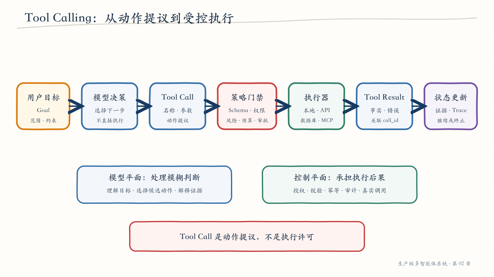
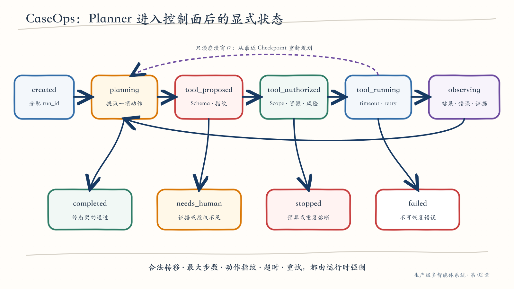
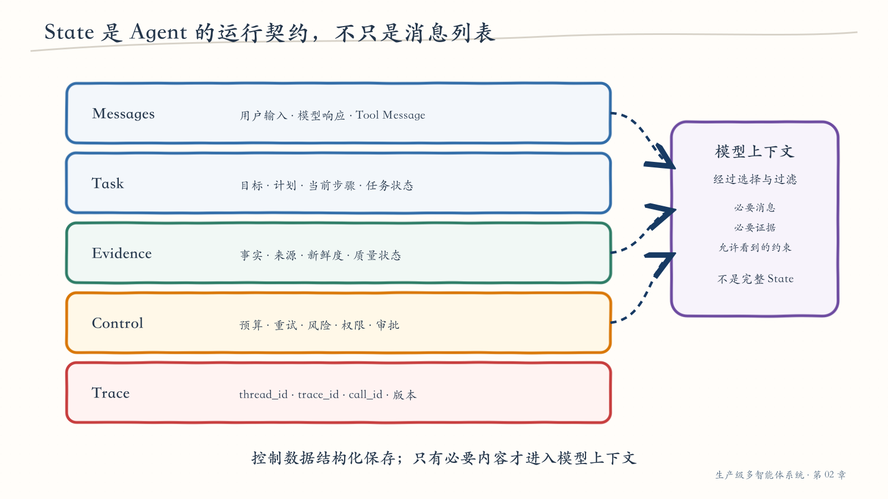
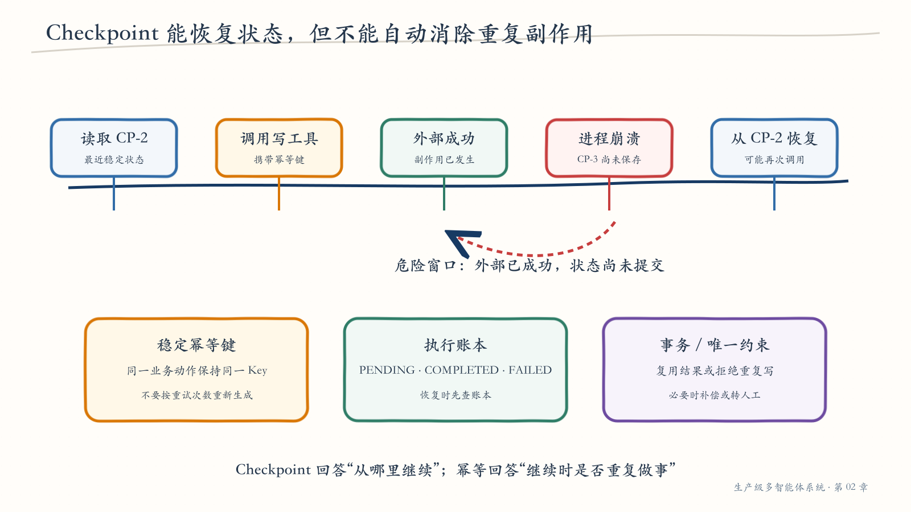
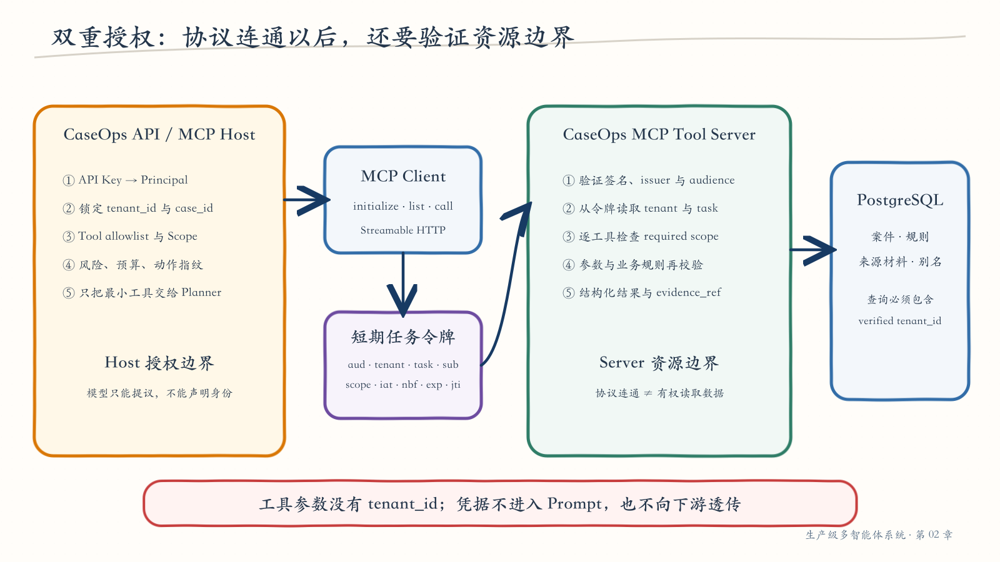
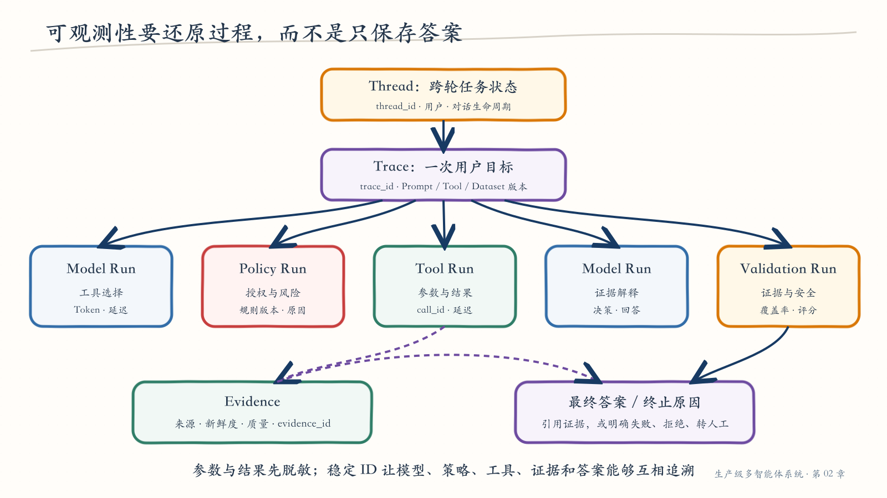

# 第02章　ツール呼び出し：ステートマシン、コントロールプレーン、MCP

第1章では、一見すると慎重すぎるようで、実は非常に重要なことを行いました。最初からCaseOpsをAgentとして実装するのではなく、まず決定論的な調査ベースラインを構築したのです。このベースラインは、案件の読み取り、ルールバージョンの固定、書類コードの比較、外部への副作用を伴わない通知下書きの生成が可能です。

このベースラインはすぐに、実システムでよくある問題に直面しました。案件C-102の構造化フィールドには、次の2種類の書類しかありません。

```text
LOSS_STATEMENT
IDENTITY_DOCUMENT
```

ルールに従えば、確かに`ACCIDENT_CERTIFICATE`が不足しています。しかし、ソース書類領域には「道路交通事故認定書」が残っており、上流システムがそれを標準コードへ正規化していないだけでした。

すべての入力が常に整っているなら、決定論的フローを拡張し続けるだけで十分です。ところが今問われているのは、システムが最初にどこを調べるべきか、非構造化書類を見つけた後に意味的な正規化を追加で行う必要があるか、正規化結果をエビデンスとして扱えるか、そしてエビデンスが不十分な場合に続行するのか、停止するのか、人間へ引き継ぐのか、ということです。ここにこそ、モデルが価値を提供できる余地があります。モデルは、中間の観察結果に基づいて次のステップを選択できるからです。

しかし、「モデルにツールを呼び出させる」だけでは、本番システムにはほど遠い状態です。モデルがアクションを起こせるようになった瞬間、次の問いにも同時に答えなければなりません。

1. Tool Callはリクエストなのか、それとも実行許可なのか。
2. パラメータ、権限、リソース境界を誰が検証するのか。
3. ReActループを、どのように検査可能なステートマシンへ変換するのか。
4. プロセスがクラッシュした後、どこから再開するのか。
5. 副作用の重複と無限ループをどう防ぐのか。
6. MCPは何を標準化し、何を代わりに解決してくれないのか。
7. 各ステップが本当に実行されたことを、どのように証明するのか。

本章では、まずこれらの概念、原理、判断方法を十分に掘り下げ、その後CaseOps Slice 1へ進みます。プロジェクトの役割は、あくまで知識を検証することであり、理論の代わりになることではありません。本文に登場するコントロール境界は、最終的にコード、データベースレコード、テストの中で確認できなければなりません。

## 1. モデルに手はない：Tool Callはアクションの提案にすぎない

Tool Callingは、しばしば「大規模言語モデルが関数を呼び出すこと」と説明されます。入門には便利な表現ですが、責任の所在を誤解させやすくもあります。通常、モデルが推論プロセス内からデータベースへ直接接続することはなく、何もないところからPython関数の実行能力を得ることもありません。

まずアプリケーションが、利用可能なツールの名前、説明、入力Schemaをモデルへ渡します。モデルは次のような構造化出力を返します。

```json
{
  "call_id": "call_8f34c9",
  "name": "caseops_get_case_snapshot",
  "arguments": {
    "case_id": "C-102"
  }
}
```

この時点では、データベースはまだ読み取られていません。この出力が表しているのは、次の提案だけです。

> 現在の目標と観察結果に基づき、次のステップとして、このパラメータでこのツールを呼び出すことを提案します。

実際の実行は、引き続きモデルの外部で行われます。アプリケーションは提案を解析し、ツールが存在するかを確認し、パラメータを検証し、現在の主体に権限があるかを判断したうえで、決定論的な実行器を通じてローカル関数、HTTP API、データベースアダプター、またはMCP Serverを呼び出さなければなりません。

この境界線が、Agentのセキュリティモデルを決定します。

> モデルは提案権を持ち、コントロールプレーンは認可権を持ち、実行器は実際の能力を持ちます。



*図2-1　目標から結果に至るまで、モデルが担うのは候補アクションの提示だけです。コントロールプレーンが認可、実行、記録、終了を担当します。*

### 1.1 1回の完全なツール呼び出しを構成する責任チェーン

通常、1回のツール呼び出しを9つの段階に分けて考えます。

| 段階 | 入力 | 責任主体 | 失敗が意味すること |
|---|---|---|---|
| 目標の構成 | ユーザーリクエスト、業務オブジェクト、制約 | アプリケーション層 | 目標が不完全で、安全に開始できない |
| 能力のフィルタリング | アイデンティティ、シナリオ、テナント、リスク | ポリシー層 | ツールをモデルへ公開すべきではない |
| アクションの提案 | 状態、観察結果、候補ツール | モデル / Planner | 提案は誤る可能性があるが、それ自体は事故ではない |
| プロトコルの解析 | モデルの構造化出力 | Provider Adapter | 出力がプロトコルに準拠していない |
| パラメータ検証 | 名前、パラメータ、Schema | Tool Runtime | パラメータが無効、または境界外である |
| ランタイム認可 | Principal、scope、リソース、状態 | Policy Engine | 現在の呼び出しが許可されていない |
| ツールの実行 | 認可済みの呼び出し | Executor / MCP Client | 実際の依存先で障害が発生した |
| 結果の正規化 | 生レスポンス、エラー | Tool Adapter | 出力が契約に準拠していない |
| 状態の更新 | Tool Result、エビデンス、予算 | State Machine | 続行、停止、人間への引き継ぎを決定する |

これらを1回の`model.bind_tools()`呼び出しへ押し込めば、コードはずっと短くなります。しかし、責任そのものが消えるわけではありません。フレームワークのデフォルト値、コールバック、例外処理の中に隠れるだけです。権限逸脱、リトライストーム、重複書き込みが発生すれば、チームは結局、これらの段階を再び洗い出さなければなりません。

### 1.2 Schemaはなぜ必要で、それでもまったく不十分なのか

入力Schemaは、必須フィールドの欠落、未知のフィールド、誤った型、明らかに境界を超えた値を拒否できます。たとえば、次のとおりです。

```json
{
  "type": "object",
  "additionalProperties": false,
  "properties": {
    "case_id": {
      "type": "string",
      "minLength": 1,
      "maxLength": 80
    }
  },
  "required": ["case_id"]
}
```

このSchemaは、`case_id`が正しい形式の文字列であることは証明できますが、次のことは証明できません。

- 現在の呼び出し元が、C-102の属するテナントに所属している。
- 実行の本来の目標がC-102の調査である。
- 現在の状態で案件の読み取りが許可されている。
- このツールが、現在もテナントの能力allowlistに含まれている。
- 呼び出し予算がまだ枯渇していない。

したがって、パラメータの妥当性とアクションの認可は、異なる2つの判断です。

```text
valid(arguments) ≠ authorized(principal, resource, state, action)
```

CaseOpsでは、モデルが形式上まったく問題のない`{"case_id":"C-999"}`を送信しても、今回のrunに設定されたリソース境界の外へ出るため、ランタイムが拒否します。モデルは「正しい形式のパラメータを組み立てる」ことで、自分自身の権限を拡張することはできません。

### 1.3 `tool_call_id`とAction Fingerprintは、それぞれ何を解決するのか

`tool_call_id`は、ある具体的な提案と、その具体的な結果を関連付けるために使います。並列呼び出し、リトライ、長い処理チェーンでは、これがなければ、後続のモデルはどのTool Resultがどのリクエストへの応答なのか判断しにくくなり、監査システムもタイムラインを再構築できません。

しかし、`tool_call_id`はループ検出には適していません。モデルは各ラウンドで新しいIDを生成できるからです。

```text
call_a → read_case(C-102)
call_b → read_case(C-102)
call_c → read_case(C-102)
```

3つの呼び出しIDは異なりますが、アクションはまったく同じです。ループ検出には、別の識別子が必要です。

```text
fingerprint = SHA256(tool_name + canonical_json(arguments))
```

3つの概念の責務は、次のように分けるべきです。

| 識別子 | 粒度 | 主な用途 |
|---|---|---|
| `tool_call_id` | 1つの呼び出しインスタンス | リクエストと結果の関連付け、監査、プロトコル上のやり取り |
| `action_fingerprint` | アクションの意味 | 重複検出、キャッシュ、リスク統計 |
| `idempotency_key` | 1つの業務意図 | 同一の外部リクエストによる業務上の効果の重複を防止 |

3つの概念を1つのフィールドへ混在させると、復旧とリトライで問題を残しがちです。

## 2. Tool Contract：関数シグネチャだけを書いてはいけない

ツールが実際に公開するのは関数ではなく、制約を受ける能力です。関数シグネチャは入力の形を示すだけであり、本番運用の契約には、アイデンティティ、リソース、リスク、時間、効果まで記述する必要があります。

各ツールには、次の9つの問いへの回答を求めます。

1. **何をするのか**：単一かつ明確で、成功したかどうかを判断できる業務上の意味。
2. **誰が呼び出せるのか**：ロール、scope、テナント、委任関係。
3. **いつ呼び出せるのか**：許可されたタスク段階と事前状態。
4. **入力はどこから来るのか**：モデルが入力できるフィールドと、システムが注入するフィールドをどう分けるか。
5. **出力をどう検証するのか**：構造、バージョン、エビデンス参照、鮮度。
6. **リスクレベルは何か**：読み取り専用、取り消し可能な書き込み、取り消し不可能な書き込み。
7. **安全にリトライできるか**：冪等キー、最大回数、バックオフ、タイムアウト。
8. **外部への効果をどう確認するか**：成功、失敗、結果不明をどう区別するか。
9. **何を記録しなければならないか**：主体、パラメータの要約、結果、レイテンシ、バージョン、相関ID。

最小限の契約は、次のような構造で記述できます。

```yaml
name: caseops_resolve_document_alias
version: "1.0"
required_scope: document:resolve
risk: read_only
timeout_seconds: 5
max_attempts: 2
input:
  case_id: run-bound-resource
  document_id: model-proposed
output:
  resolved: boolean
  canonical_code: optional string
  rule_version: optional string
  evidence_ref: string
```

ここで最も重要なのは、`case_id: run-bound-resource`です。これは、モデルがどのツールを使うかは提案できても、そのツールを今回のタスク対象から持ち出せないことを意味します。ランタイムは、提案されたパラメータと、runですでに認可されている案件IDを比較します。

### 2.1 入力フィールドは「モデルが入力するもの」と「システムが注入するもの」を分ける

モデルに入力させるべきでない代表的なフィールドには、次のものがあります。

- `tenant_id`
- 呼び出し主体と組織のアイデンティティ
- OAuth access token、API Key
- 承認状態
- 現在のタスク予算
- サーバー側の冪等キー
- 監査タイムスタンプ

これらのフィールドは、信頼できる実行環境から取得しなければなりません。ツールSchemaに含めることは、モデルに自身のアイデンティティと権限の宣言へ関与させるのと同じです。

CaseOpsの4つのMCPツールには、いずれも`tenant_id`パラメータがありません。テナント、タスクID、呼び出し主体、scopeは、API内部で発行される短期タスクトークンから取得します。MCP Serverはトークンを検証した後で、データベースクエリの境界を構築します。

### 2.2 出力は言語だけでなく、エビデンスを中心に設計する

次のような戻り値は、信頼できる推論には使いにくいものです。

```json
{
  "message": "書類はすべてそろっているようです"
}
```

ルールバージョン、出典、検証可能なフィールドが欠けているからです。よりよい戻り値では、事実とエビデンスを分離します。

```json
{
  "case_id": "C-102",
  "document_id": "DOC-C102-003",
  "resolved": true,
  "canonical_code": "ACCIDENT_CERTIFICATE",
  "rule_version": "2026.1",
  "confidence": 1.0,
  "evidence_ref": "evidence://C-102/DOC-C102-003@1"
}
```

モデルは引き続き、これらのフィールドに基づいて自然言語の説明を生成できます。しかし、その結論の根拠はすでに、プログラム、監査担当者、評価システムが再確認できる形になっています。

### 2.3 ツールが多くても、Agentが強いとは限らない

企業内のツールカタログ全体を一度にモデルへ渡すと、3つの問題が同時に生じます。

- 選択空間が広がり、モデルが誤ったツールを選んだり、似たツールを混同したりしやすくなる。
- 高リスクのツールが、不要なときにも攻撃対象領域へ入る。
- ツールの説明とSchemaがコンテキスト予算を圧迫する。

より合理的なのは、まず決定論的なポリシーによって、テナント、ロール、タスク段階、リスク、承認状態を基準にフィルタリングし、現在必要な最小能力セットだけをモデルへ渡す方法です。

有効なアクション空間は、次のような積集合で表せます。

```text
effective_tools
  = tenant_catalog
  ∩ principal_scopes
  ∩ task_stage_policy
  ∩ risk_policy
  ∩ runtime_health
```

モデルが見るのは計算結果だけであり、この積集合の計算には関与しません。

## 3. ReActのエンジニアリング上の本質は、制御された状態遷移である

ReActは、「思考―行動―観察」と要約されることがよくあります。エンジニアリングシステムで最も重要なのは、モデルに長い思考文を出力させることではなく、次の閉ループを構築することです。

```text
状態を読み取る
  → 次のアクションを提案する
  → 検証して認可する
  → アクションを実行する
  → 観察結果を記録する
  → 状態を更新する
  → 続行または終了を判断する
```

自由記述のChain of Thoughtをシステム状態として扱うことは推奨しません。本番システムが本当に保存すべきなのは、アクションの提案、理由コード、エビデンス参照、認可結果、終了理由です。内部推論プロセスは、信頼できる業務上の事実ではないうえ、ログへ残すべきでない機密情報を含む可能性もあります。



*図2-2　ReActは無限のwhileループではなく、正当な状態、遷移条件、終端状態の集合です。*

### 3.1 Plannerの1ラウンドで許可する出力は3種類だけ

CaseOpsでは、Plannerの出力を次の3種類に限定しています。

| 種類 | 意味 | ランタイムのアクション |
|---|---|---|
| `tool_call` | 次のアクションを1つ提案する | 検証、認可、実行へ進む |
| `final` | エビデンスが十分にそろい、構造化された結論を出す | 終端状態のSchemaを検証して完了する |
| `needs_human` | 安全に続行できない | 理由を保存し、人間へ引き継ぐ |

汎用システムでは`clarification_required`や`waiting_approval`を追加しても構いませんが、「あらゆる自然言語」を正当な制御シグナルとして解釈してはいけません。

モデルアダプターとランタイムの間には、安定したプロトコルが必要です。

```python
class Planner(Protocol):
    async def decide(
        self,
        state: AgentState,
        tools: tuple[ToolDefinition, ...],
    ) -> PlannerDecision:
        ...
```

このインターフェースには、非常に実用的な利点があります。コントロールプレーンをテストするときに、外部モデルへ依存する必要がありません。CaseOpsでは、決定論的な`ConformancePlanner`を使って同じステートマシンを駆動し、認可、MCP、チェックポイント、終了ロジックを検証します。実際のモデルは、Responses APIアダプターを介して接続します。

ここで特に強調したいのは、`ConformancePlanner`はプロトコル適合性ドライバーであって、Agentではなく、モデルの性能を表すものでもないという点です。固定スクリプトを「オフラインAgent」として見せると、システムの正しさとモデルの能力を混同してしまいます。

### 3.2 状態遷移はプログラムで制約する

CaseOps Slice 1のメインパスは、次のとおりです。

```text
created
  → planning
  → tool_proposed
  → tool_authorized
  → tool_running
  → observing
  → planning
  → completed
```

分岐先となる終端状態には、次のものがあります。

```text
needs_human | stopped | failed
```

プログラムは、正当な遷移表を維持します。たとえば`created → completed`は、プランニングとエビデンス形成を経ていないため不正です。`tool_proposed → tool_running`も、認可状態を迂回するため不正です。

これは`while True`より冗長に見えますが、インシデント発生時に最も重要な次の問いへ答えられます。

- モデルが何を提案したのか。
- パラメータは検証を通過したのか。
- 誰が実行を認可したのか。
- ツールは本当に実行を開始したのか。
- 返されたのは事実、業務エラー、プロトコルエラーのどれか。
- システムはなぜ停止したのか。

### 3.3 停止条件はハード制約でなければならない

「新しいTool Callがなければ停止する」だけでは不十分です。モデルは同じ案件を繰り返し読み取るかもしれませんし、エラー後にパラメータを書き換え続けるかもしれません。ランタイムでは、少なくとも次の条件を強制する必要があります。

- ツールステップの最大数
- 最大実時間
- ツール単位のタイムアウト
- Tokenまたは費用の総予算
- 同一アクションフィンガープリントの繰り返し上限
- 新しいエビデンスが増えない連続回数の上限
- 権限拒否、セキュリティブロック、承認待ち
- リトライ不可能なエラー
- 成功基準の達成

CaseOps Slice 1では、`max_steps`、`repeat_limit`、ツールのtimeout、`max_attempts`を構造化された制御状態へ組み込んでいます。モデルが続行を望んでも、境界へ達した後は終端状態へ移るしかありません。

## 4. Stateは実行契約であり、チャット履歴ではない

単純なチャットであれば、メッセージ一覧をStateと呼んでも問題ありません。しかし、アクションを伴うシステムではまったく不十分です。1回のAgent runには、少なくともタスク、エビデンス、制御、相関情報を同時に表現する必要があります。



*図2-3　メッセージはモデルコンテキストの一部にすぎません。タスク、エビデンス、制御、トレース情報は、それぞれ独立して構造化する必要があります。*

Stateは5層に分けられます。

| 状態レイヤー | 代表的なフィールド | 利用する責任主体 |
|---|---|---|
| Task | `goal`、`case_id`、`status`、`step_count` | ステートマシン、プロダクトUI |
| Proposal | `pending_call`、パラメータ、アクションフィンガープリント | 認可器、実行器 |
| Evidence | Tool Observation、出典、ルールバージョン | Planner、検証器 |
| Control | budget、repeat count、stop reason | ランタイム、ポリシー層 |
| Trace | `run_id`、sequence、`tool_call_id` | 監査、復旧、運用 |

完全なStateは永続化できますが、モデルへ渡す内容はContext Builderでフィルタリングするべきです。アイデンティティ資格情報、内部の認可詳細、無関係な履歴を、「すべてStateに入っている」という理由だけで自動的にPromptへ含めてはいけません。

### 4.1 State、Memory、Knowledge、Auditを混同しない

| 種類 | ライフサイクル | 例 | 適切な保存先 |
|---|---|---|---|
| Run State | 1回の実行 | 現在のステップ、観察結果、予算 | Checkpoint |
| Long-term Memory | タスクをまたぐ | ユーザーが確認した設定 | Memory Store |
| Domain Knowledge | ユーザー間で共有 | 保険金請求ルール、書類エイリアス | 業務データベース、ナレッジシステム |
| Audit / Trace | コンプライアンスと運用の周期 | アイデンティティ、アクション、認可、バージョン | 監査データベース、Trace Backend |

Checkpointが解決するのは、同じrunをどのように再開するかという問題であり、長期記憶とは異なります。ルールデータベースもモデルの記憶ではありません。独立したバージョン、所有者、リリースプロセスを持っています。すべての内容をベクトルデータベースへ詰め込めば、状態、知識、監査は、それぞれ固有のガバナンス上の意味を失います。

### 4.2 差分更新とフィールド所有権

通常、ノードはState全体を読み取れますが、すべてのフィールドを自由に書き換えるべきではありません。各コンポーネントは、自身が担当する部分だけを更新します。

```python
state.observations.append(observation)
state.pending_call = None
state.step_count += 1
```

並列グラフでは、Reducerまたはマージ規則も明確にする必要があります。2つのノードが同時に`status`、`evidence`、`budget`へ書き込む際、フィールド所有権が定義されていなければ、最後の書き込みが、それ以前の結果をひそかに上書きします。この問題は、マルチエージェントを扱う章でさらに顕著になります。

## 5. Checkpoint、冪等性、Effect Ledgerは別々のものである

Checkpointは「システムがどこまで実行したと認識しているか」を保存します。冪等性は「同じ業務意図が再度到着しても、2つ目の業務上の効果を生じさせないこと」を保証します。Effect Ledgerは「外部アクションが実際にどうなったか」を記録します。3つは相互に補完しますが、互いの代わりにはなりません。



*図2-4　ツールが成功した後、新しいチェックポイントをコミットする前にクラッシュすると、復旧後に再実行される可能性があります。*

最も危険なのは、次のウィンドウです。

```text
1. CP-2を保存：ツール実行の準備
2. 外部書き込みツールの実行に成功
3. プロセスがクラッシュ
4. CP-3：成功した観察結果は未保存
5. システムがCP-2から復旧
6. 同じツールを再実行
```

Checkpointを増やすだけでは、かえって重複実行を再現しやすくなります。システムが、「成功がまだ記録されていない」地点へ忠実に戻るからです。

### 5.1 リスクが異なるツールには、異なる復旧セマンティクスが必要

| ツールのリスク | クラッシュ後のデフォルト戦略 | 必要な追加制御 |
|---|---|---|
| 読み取り専用、冪等 | 再読み取り可能 | timeout、有限回のリトライ、結果バージョン |
| 取り消し可能な書き込み | まず効果を照会し、その後リトライを判断 | 業務冪等キー、状態照会、補償 |
| 取り消し不可能な書き込み | デフォルトでは停止または承認 | Effect Ledger、承認、受領確認、人手対応 |
| 結果不明 | むやみにリトライしない | 照合インターフェース、外部リクエストID、Runbook |

CaseOps Slice 1では、意図的に読み取り専用ツールだけを公開しています。プロセスが`tool_running`で停止した場合、復旧ロジックは未完了の提案を破棄し、最後に永続化された観察結果から再度プランニングします。読み取りの重複は安全です。今後、書き込みツールを追加しても、この復旧戦略が自動的に適用できるわけではありません。

### 5.2 偽りのExactly Onceを約束しない

ネットワーク、データベース、サードパーティーシステムをまたぐ場合、1つのローカルトランザクションで真のグローバルExactly Onceを実現することは困難です。より信頼できるエンジニアリング上の表現は、次のとおりです。

```text
at-least-once delivery
+ business idempotency
+ effect confirmation
+ reconciliation
```

外部システムが同じ業務意図をどう識別するのか、発生済みの効果をどう照会するのかをチームが説明できないなら、自動リトライを有効にすべきではありません。

## 6. MCPは接続を標準化するが、業務境界の代わりにはならない

MCPが解決するのは、アプリケーションと外部のコンテキスト能力との間にあるプロトコル上の問題です。すなわち、接続をどう初期化し、能力をどうネゴシエートし、ツールをどう列挙し、構造化パラメータをどう渡し、結果をどう返すかという問題です。MCPには大きな価値があります。hostがツールサーバーごとに独自プロトコルを考案する必要がないからです。

本章執筆時点で、MCPの現行仕様バージョンは`2025-11-25`です。ツールの入力および出力Schemaは、デフォルトでJSON Schema 2020-12を採用しています。また、標準はプロトコルエラーとツール実行エラーを明確に区別し、ツールのアノテーションはヒントにすぎず、信頼できる認可情報として扱ってはならないと強調しています。



*図2-5　プロトコル境界は接続と相互運用性を担いますが、アイデンティティ、認可、テナント、リスクは引き続き業務境界が担います。*

### 6.1 Host、Client、Server

- **Host**：ユーザー向けのAgentアプリケーションで、タスク状態と最終判断を保持します。
- **Client**：Host内のプロトコルコンポーネントで、特定のServerとの接続を維持します。
- **Server**：Tools、Resources、Promptsを公開する能力提供者です。

MCP Serverは、新たなAgentではありません。ガバナンスが適用された企業能力の集合を、標準プロトコルで公開するだけの場合もあります。また、モデルがServerの資格情報を直接保持するべきではありません。資格情報はHostまたは制御されたClientに属します。

### 6.2 Tools、Resources、Promptsの制御方式

仕様では、3種類のプリミティブに対して、異なる制御の方向性を示しています。

| プリミティブ | 主な用途 | デフォルトの制御者 |
|---|---|---|
| Tools | 計算または操作の実行 | モデルが選択し、クライアントが認可 |
| Resources | ファイル、データ、コンテキストの提供 | アプリケーションが選択 |
| Prompts | 再利用可能な対話テンプレートの提供 | ユーザーが選択 |

「Toolsはmodel-controlledである」とは、モデルがクライアントを迂回して直接実行できるという意味ではありません。候補ツールの選択を、通常はモデルが担当するという意味にすぎません。Serverは引き続き入力、アクセス権、レートを検証し、Clientは引き続き確認、タイムアウト、結果検証、監査を行う必要があります。

### 6.3 初期化と能力ネゴシエーション

MCP接続は、「HTTPが通れば使える」というものではありません。まずクライアントが`initialize`を送信し、双方が次の項目をネゴシエートします。

- プロトコルバージョン
- ClientとServerの情報
- 能力セット
- オプションの拡張

その後、クライアントがinitialized通知を送信して初めて、通常の呼び出し段階へ進めます。本番システムでは、バージョンの非互換性やcapabilityの不足を、起動またはready状態への移行失敗として扱うべきです。モデルが呼び出してからエラーにするべきではありません。

### 6.4 stdioとStreamable HTTPをどう選ぶか

現在のMCP標準トランスポートには、stdioとStreamable HTTPがあります。

| トランスポート | 適したシナリオ | 主な注意点 |
|---|---|---|
| stdio | Hostが起動するローカルプロセス、デスクトップ拡張 | プロセスのライフサイクル、環境変数の資格情報、リソース分離 |
| Streamable HTTP | 独立サービス、プロセス間、プラットフォーム化されたデプロイ | TLS、認証、セッション、DNS Rebinding、不正利用の防止 |

CaseOpsではStreamable HTTPを使用し、MCP Tool Serverを独立した読み取り専用サービスとしてデプロイしています。サービスはステートレスHTTPと構造化JSONレスポンスを有効にしており、将来の水平スケーリングに対応しやすくなっています。一方、Host側にはタスク状態を保持し、Agent StateをMCP Serverへ置くことはしません。

### 6.5 MCP認可を正しく理解する

リモートMCPの認可仕様は、OAuth 2.1などの標準に基づいており、リソースサーバーメタデータ、resource indicator、token audienceのバインディングを要求します。重要なセキュリティ原則の1つは、次のとおりです。

> MCP Serverは、自身に対して明示的に発行されたtokenだけを受け入れ、受け取ったtokenをそのまま下流サービスへ転送してはなりません。

そうしなければ、侵害されたServerが高権限tokenを使って、他のリソースへ横方向にアクセスする可能性があります。

CaseOps Slice 1のローカル環境では、`issuer`、`audience`、`tenant_id`、`task_id`、`subject`、`scopes`、`iat`、`nbf`、`exp`、`jti`にバインドされた短期HMACタスクトークンを使用します。これによりリソース境界とタスク境界を検証できますが、これは開発環境におけるSTSの代替物にすぎず、完全なOAuth 2.1認可サーバーではありません。企業向けOIDC、鍵ローテーション、失効、ポリシー管理は、第6章でさらに整備します。

### 6.6 ローカルポート、業務API、MCPの選択

MCPが普及しているからといって、すべての内部関数をリモート化してはいけません。

| 選択肢 | 適した条件 | 適さない条件 |
|---|---|---|
| ローカル関数/ポート | 同一プロセス、強い型付け、低レイテンシ、単一チーム | 多言語、複数Host、独立リリース |
| 業務HTTP/gRPC API | 安定したサービス境界、Agent以外の利用者が多い | Hostごとにツール適応処理を繰り返す必要がある |
| MCP | 複数Host間でのツール相互運用、動的ディスカバリー、統一プロトコル | 極低レイテンシのカーネル、単純で固定されたフロー |

MCPはプロトコルの選択であり、アーキテクチャ成熟度を示すバッジではありません。

## 7. エラー分類がリトライ可否を決める

「ツールでエラーが出たら3回リトライする」は、リトライストームを生み出す近道です。ランタイムは、まずエラーの種類を識別する必要があります。

| 種類 | 例 | デフォルト戦略 |
|---|---|---|
| Contract | フィールド欠落、型エラー、未知のツール | リトライしない。提案を修正するか終了する |
| Authorization | scope不足、テナント境界の逸脱、承認不足 | リトライしない。拒否するか人間へ引き継ぐ |
| Business | 案件が存在しない、状態が許可されない、ルールがない | 通常はリトライしない。エビデンスを補う |
| Transient | 接続タイムアウト、レート制限、一時的な5xx | 安全なツールだけを有限回リトライする |
| Protocol | MCPバージョン、セッション、メッセージ形式のエラー | 再初期化するかServerを隔離する |
| Unknown Effect | 書き込みがタイムアウトしたが、外部では成功している可能性がある | まず照合し、むやみなリトライを禁止する |

MCPツールの実行失敗は通常、通常のTool Resultに含まれる`isError`で表現し、モデルが修正できる機会を与えるべきです。解析不能なJSON-RPC、未知のメソッド、接続レベルの問題のみがプロトコルエラーに該当します。この区別により、業務上の失敗をServerのクラッシュと誤認せずに済みます。

### 7.1 リトライ予算はツール契約に属する

リトライの可否はツールごとに異なります。読み取り専用クエリはタイムアウト後にリトライできますが、通知の送信や保険金支払いの申請に同じ戦略は使えません。

少なくとも、次の項目を同時に制限する必要があります。

- 1回ごとのtimeout
- 最大attempts
- 指数バックオフとjitter
- 1つのrunにおける総呼び出し数
- 同一アクションフィンガープリントの回数
- グローバルな同時実行数と下流サービスのレート

CaseOpsの現在の各読み取り専用ツールでは、最大2回まで試行します。ランタイムには、これより優先度の低い全体タイムアウト上限もあります。テストでは一時的なエラーを1回注入し、2回目の成功後に停止することを確認します。また、Plannerに同じアクションを提案させ続け、実行器による呼び出しが1回だけであり、2回目はアクションフィンガープリントのゲートで遮断されることも確認します。

## 8. オブザーバビリティ：回答だけを記録しても実行は再現できない

最終回答だけでは、途中で実際に何が起きたのかを説明できません。本番環境でのトラブルシューティングには、少なくとも次の問いへ答えられる必要があります。

- どのユーザーリクエストが、どのrunを開始したのか。
- Plannerは何ステップ目で何を提案したのか。
- どのポリシーが許可または拒否したのか。
- MCPはどのツールバージョンを呼び出したのか。
- 結果はどのエビデンスとルールバージョンに由来するのか。
- リトライ、復旧、停止はどこで発生したのか。
- 最終回答には、どの観察結果が使われたのか。



*図2-6　リクエスト、実行、ツール呼び出し、チェックポイント、エビデンスは、互いに関連付けられなければなりません。*

### 8.1 TraceとAuditでは注目点が異なる

Traceは性能と障害診断に利用され、通常はspan、レイテンシ、依存先、エラーを記録します。Auditは責任追跡に利用され、主体、アクション、リソース、認可結果、否認防止を重視します。

両者はIDを共有できますが、互いの代わりにはなりません。完全なPromptやツール結果を無条件でTraceへ書き込むと、機密データが漏えいする可能性があるだけでなく、監査記録に必要な不変性と保持要件も満たせません。

### 8.2 最小の相関モデル

CaseOpsでは、次の相関関係を使用します。

```text
request_id
  └─ run_id
      ├─ checkpoint.sequence
      ├─ tool_call_id
      │   └─ action_fingerprint
      ├─ evidence_ref
      ├─ audit_event
      └─ outbox_event
```

ここでは、`run_id`が1回のAgent実行の主軸、`tool_call_id`が呼び出しインスタンスの識別子、`evidence_ref`が業務上の出典との接続です。

### 8.3 第2章の段階ですでに備えるべきテスト

ランタイムのテストを「オブザーバビリティの章」まで先送りしてはいけません。Slice 1では、すでに次をカバーしています。

- 正当な状態遷移と不正な状態遷移
- パラメータSchemaと未知のフィールド
- ツールallowlist、scope、案件境界
- テナント境界を越えた場合に一律でNot Foundを返すこと
- 重複アクションフィンガープリントの遮断
- 一時的エラーに対する有限回のリトライ
- step budgetによる停止
- MCPの初期化、ツール一覧、構造化された結果
- Bearer tokenがない場合に401を返すこと
- tokenの改ざんと誤ったaudience
- 読み取り専用`tool_running`のクラッシュウィンドウからの復旧
- Agent runの冪等なリプレイ
- Responses APIにおけるツール提案と終端状態の契約
- PostgreSQLマイグレーション、コンテナ、エンドツーエンド呼び出し

これらのテストは、コントロールプレーン、プロトコル面、アダプターをそれぞれ証明します。すべての失敗を「モデルが不安定だから」と片付けることはしません。

## 9. CaseOps Slice 1：制御されたツール実行

ここまでの概念を、実際の実行チェーンへ落とし込みます。

### 9.1 このシナリオをワークフローからアップグレードする価値がある理由

第1章の決定論的ベースラインは、間違っていたわけではありません。信頼できる構造化フィールドだけを読み取り、次の結論を出します。

```json
{
  "decision": "MISSING_REQUIRED_DOCUMENTS",
  "missing": ["ACCIDENT_CERTIFICATE"]
}
```

Slice 1で追加された事実は、「上流のソース書類が存在していても、まだ正規化されていない可能性がある」ということです。完全な処理パスは、中間の観察結果によって決まります。

```text
案件フィールドはすでにすべてそろっているか？
  ├─ はい → 終了可能
  └─ いいえ → 未構造化のソース書類が存在するか？
                ├─ いいえ → 書類不足という結論を出す
                └─ はい → ガバナンスが適用されたエイリアスルールが存在するか？
                           ├─ はい → 正規化結果を統合して再判定する
                           └─ いいえ → エビデンス不足、または人間へ引き継ぐ
```

パスを最初の入力だけで完全に決められないため、モデルは「次に何を調べるか」という点で妥当な価値を持ち始めます。一方、案件、ルール、エイリアスは、引き続き決定論的システムが提供します。

### 9.2 コード構成

完全な実装は、独立した[CaseOpsリポジトリ](https://github.com/dataPro-lgtm/production-grade-multi-agent-caseops)にあります。本章では、次の不変バージョンを固定して使用します。

```text
tag:     chapter-02-slice-1
version: v0.2.0
commit:  ec35916
```

コアコードの責務は、次のように分かれています。

| ファイル | 責務 |
|---|---|
| [`contracts.py`](https://github.com/dataPro-lgtm/production-grade-multi-agent-caseops/blob/chapter-02-slice-1/src/caseops/agent/contracts.py) | Run、Tool、Observation、終端状態の契約 |
| [`state_machine.py`](https://github.com/dataPro-lgtm/production-grade-multi-agent-caseops/blob/chapter-02-slice-1/src/caseops/agent/state_machine.py) | 正当な状態遷移 |
| [`policy.py`](https://github.com/dataPro-lgtm/production-grade-multi-agent-caseops/blob/chapter-02-slice-1/src/caseops/agent/policy.py) | allowlist、scope、リスク、案件境界 |
| [`runtime.py`](https://github.com/dataPro-lgtm/production-grade-multi-agent-caseops/blob/chapter-02-slice-1/src/caseops/agent/runtime.py) | 予算、フィンガープリント、リトライ、実行、復旧 |
| [`planner.py`](https://github.com/dataPro-lgtm/production-grade-multi-agent-caseops/blob/chapter-02-slice-1/src/caseops/agent/planner.py) | ConformanceとOpenAI Responsesのアダプター |
| [`mcp_server.py`](https://github.com/dataPro-lgtm/production-grade-multi-agent-caseops/blob/chapter-02-slice-1/src/caseops/agent/mcp_server.py) | Streamable HTTP MCPツールサービス |
| [`mcp_auth.py`](https://github.com/dataPro-lgtm/production-grade-multi-agent-caseops/blob/chapter-02-slice-1/src/caseops/agent/mcp_auth.py) | 短期タスクトークンの発行と検証 |
| [`service.py`](https://github.com/dataPro-lgtm/production-grade-multi-agent-caseops/blob/chapter-02-slice-1/src/caseops/agent/service.py) | Runの冪等性、永続化、監査、Outbox |

コードは、フレームワークが提供するワンクリックのAgentファクトリーを使用していません。これはフレームワークを否定するためではなく、本章で状態、認可、復旧のセマンティクスを明示する必要があるためです。今後、グラフフレームワークへ切り替える場合も、これらの契約は維持しなければなりません。

### 9.3 4つのツール、4つの単一責任

| 順序 | ツール | 返される重要な事実 |
|---|---|---|
| 1 | `caseops_get_case_snapshot` | 構造化された書類とバインドされたルールバージョン |
| 2 | `caseops_get_policy_requirements` | 厳密なルールバージョンにおける必須書類 |
| 3 | `caseops_list_unclassified_documents` | 未正規化のソース書類 |
| 4 | `caseops_resolve_document_alias` | 正規コード、ルールバージョン、エビデンス参照 |

4つのツールは、すべて読み取り専用、冪等、閉世界としてマークされていますが、ランタイムがアノテーションだけを根拠に認可することはありません。実際の認可は、引き続き信頼できるPrincipalとタスクリソースに基づいて実行します。

### 9.4 実際の1回の実行で何が起きたか

エンドツーエンドの受け入れ検証で得られたツール台帳は、次のとおりです。

```text
caseops_get_case_snapshot           succeeded  attempt=1
caseops_get_policy_requirements     succeeded  attempt=1
caseops_list_unclassified_documents succeeded  attempt=1
caseops_resolve_document_alias      succeeded  attempt=1
```

最終結果は、次のとおりです。

```json
{
  "status": "completed",
  "step_count": 4,
  "result": {
    "outcome": "DOCUMENTS_COMPLETE_AFTER_NORMALIZATION",
    "received_document_codes": [
      "IDENTITY_DOCUMENT",
      "LOSS_STATEMENT"
    ],
    "resolved_document_codes": [
      "ACCIDENT_CERTIFICATE"
    ],
    "missing_document_codes": [],
    "evidence_refs": [
      "case://C-102@7",
      "evidence://C-102/DOC-C102-003@1",
      "policy://motor-claim-standard@2026.1"
    ]
  }
}
```

受け入れ検証のrunでは、4件のツール実行レコードと23件の状態チェックポイントが書き込まれます。同じ冪等キーでリプレイすると、APIは同じ`run_id`を返し、ツールは再実行されません。

### 9.5 自分で実行する

```bash
git clone https://github.com/dataPro-lgtm/production-grade-multi-agent-caseops.git
cd production-grade-multi-agent-caseops
git checkout chapter-02-slice-1

docker compose up --build -d
docker compose ps
make acceptance
```

受け入れ検証スクリプトは新しいrunを1回実行し、その後、同じ冪等キーでリプレイします。MCP 401の検証、ツール台帳の照会、障害説明の詳細は、[第2章のRunbook](https://github.com/dataPro-lgtm/production-grade-multi-agent-caseops/blob/chapter-02-slice-1/docs/chapter-02-runbook.md)を参照してください。

### 9.6 実モデルモードとエビデンス境界

デフォルトのDocker構成は`conformance + mcp`を使用します。

- MCP Streamable HTTPを実際に経由する。
- 短期タスクトークンを実際に発行、検証する。
- PostgreSQLを実際に読み取る。
- 外部モデルは呼び出さない。

`CASEOPS_AGENT_PLANNER=openai`と`CASEOPS_OPENAI_API_KEY`を設定すると、PlannerはResponses APIへ切り替わります。デフォルトモデルは環境変数で設定できます。アダプターは並列ツール呼び出しを無効にし、1ラウンドにつき1つの提案だけを受け入れ、構造化された終端状態を要求します。

`chapter-02-slice-1`のリリースエビデンスはMockTransportの契約テストをカバーしていますが、実際のOpenAIアカウントを使ったオンライン呼び出しの受け入れ検証は含みません。したがって、ここで確認できるのはアダプター契約が成立していることまでであり、特定のモデル、リージョン、アカウント設定が本番環境で検証済みだと推論することはできません。コードが存在すること、契約テストが通ること、外部システムの実機テストが通ることは、それぞれ異なる結論です。

## 10. 実装抽象化をどう選ぶか

コントロールプレーンを理解すれば、フレームワークの選択はずっと簡単になります。

### 10.1 事前構築済みAgent

ツールが少なく、リスクが低く、状態が単純なシナリオに適しています。モデルとツールのループをすばやく実現できますが、チームは引き続き次の点を確認する必要があります。

- ツール実行前に認可処理を挿入できるか。
- 状態を永続化できるか。
- retryとtimeoutをツール単位で設定できるか。
- 完全なtool ledgerを取得できるか。
- 人手による承認と安全な停止をサポートするか。

### 10.2 グラフ型オーケストレーション

明示的な分岐、人手による一時停止、並列処理、復旧に適しています。グラフフレームワークはステートマシンのボイラープレートを減らせますが、フィールド所有権、冪等性、業務認可を自動的に定義してくれるわけではありません。

### 10.3 カスタムの制御された実行器

厳格な規制、複雑なトランザクション、厳密な監査を必要とするシステムに適しています。コード量は増えますが、状態、認可、エラー、復旧のセマンティクスが完全に可視化されるという利点があります。

CaseOps Slice 1がこの層を選んだのは、本章でコントロール境界を証明するためです。将来LangGraphや別のランタイムへ移行しても、[ADR-0002](https://github.com/dataPro-lgtm/production-grade-multi-agent-caseops/blob/chapter-02-slice-1/docs/adr/0002-control-plane-before-model-autonomy.md)の制約は引き続き有効です。

## 11. 移行チェック

CaseOps以外でも、次の順序に沿って、最初の制御可能なAgentを構築できます。

1. モデルが提案できる最小のアクションセットを列挙する。
2. 各ツールについて、入力、出力、アイデンティティ、リスク、タイムアウト、リトライの契約を整備する。
3. テナント、アイデンティティ、資格情報、承認をモデルのパラメータから取り除く。
4. 明示的な状態と正当な遷移を定義する。
5. step、時間、費用、アクション重複の予算を設定する。
6. プロトコル、権限、業務、一時的、効果不明のエラーを区別する。
7. 状態遷移のたびにCheckpointを保存する。
8. 書き込みツールのために、業務上の冪等性とEffect Ledgerを設計する。
9. 決定論的ドライバーでコントロールプレーンを検証し、その後モデルを個別に評価する。
10. 障害注入によって、システムが停止し、復旧し、権限を逸脱しないことを証明する。

この10ステップのいずれかを「Promptに書いてあるから」としか説明できないなら、まだ信頼できる本番制御とは言えません。

## 12. 本章のまとめ

ツール呼び出しによって本当に変わるのは、モデルの能力ではなく、システムのリスクです。モデルの出力が、実際の読み取り、書き込み、外部への効果を引き起こす可能性を持ち始めます。

本章の最も重要な結論は、次の6つです。

1. Tool Callはアクションの提案であり、実行許可ではない。
2. Schemaはパラメータの形を証明し、Policy Engineが認可可否を決める。
3. ReActのエンジニアリング上の形は、正当な遷移とハードな終了条件を持つステートマシンである。
4. Checkpoint、冪等性、Effect Ledgerは、それぞれ異なる問題を解決する。
5. MCPはプロトコルを統一するが、テナント、認可、業務リスクの制御に取って代わるものではない。
6. コントロールプレーンとモデル能力は、別々にテストし、エビデンスも別々に明示しなければならない。

CaseOps Slice 1には、まだ1つのInvestigation Agentしかありません。次章では、複数のAgentを導入します。そのとき、状態の所有権、委任された権限、部分的成功、結果のマージが新たな中心課題になります。「ロールが増えた」という理由だけでAgentを分割することはありません。引き続き同じ原則に従い、まず責任と制御を定義し、その後で協調パターンを議論します。

## 参考文献

- [MCP Specification 2025-11-25：Server / Tools](https://modelcontextprotocol.io/specification/2025-11-25/server/tools)
- [MCP Specification 2025-11-25：Transports](https://modelcontextprotocol.io/specification/2025-11-25/basic/transports)
- [MCP Specification 2025-11-25：Authorization](https://modelcontextprotocol.io/specification/2025-11-25/basic/authorization)
- [MCP Python SDK](https://github.com/modelcontextprotocol/python-sdk)
- [OpenAI：Using tools](https://developers.openai.com/api/docs/guides/tools)
- [OpenAI Responses API](https://developers.openai.com/api/reference/resources/responses/methods/create)
- [CaseOps `chapter-02-slice-1`](https://github.com/dataPro-lgtm/production-grade-multi-agent-caseops/tree/chapter-02-slice-1)
