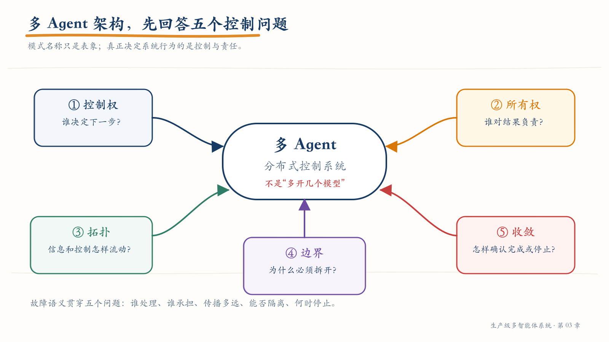
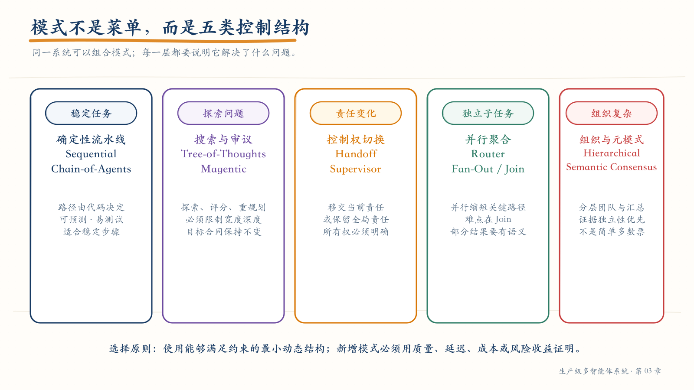
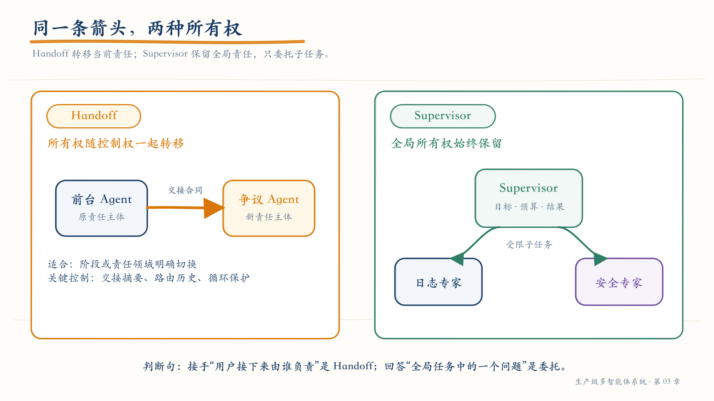
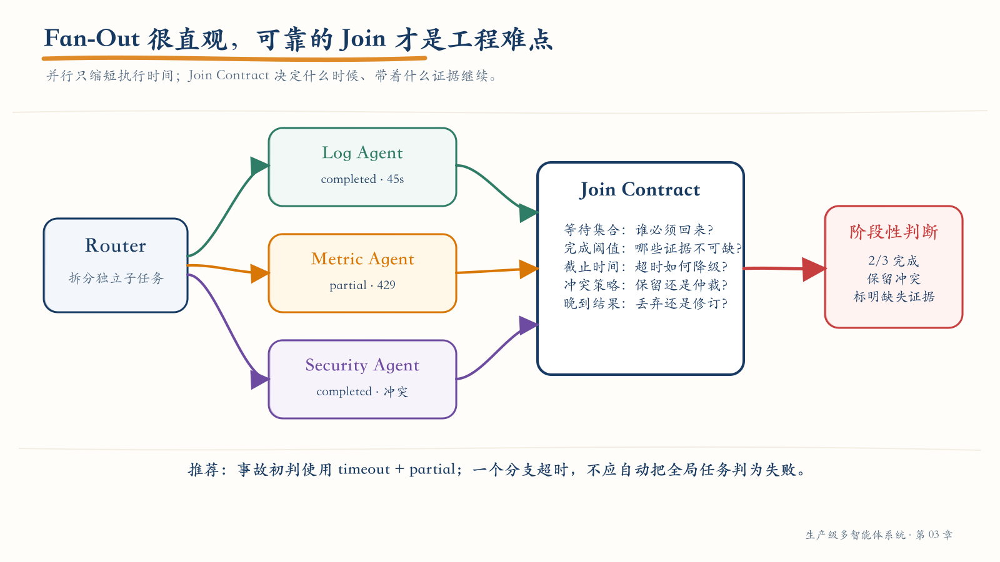
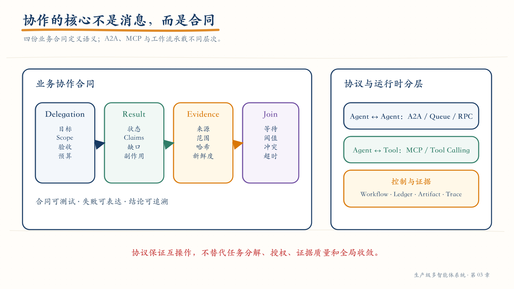
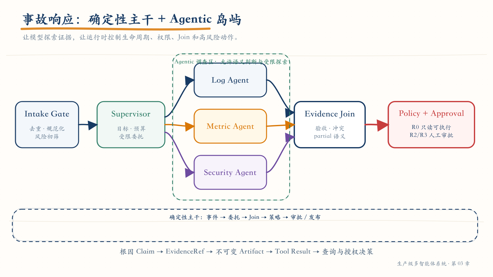
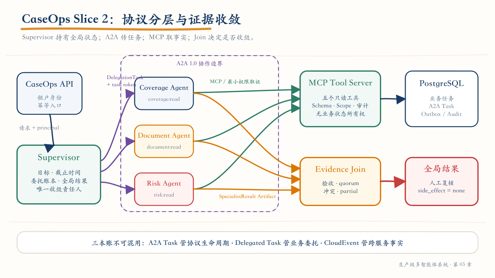

# Chapter 03: Multi-Agent Collaboration: Architecture Patterns, Protocols, and Incident Response

At 2:02 a.m., the payment success rate suddenly fell from 99.6% to 93.1%. Within one minute, the alerting platform raised three types of anomalies:

- application logs showed a surge in `payment_confirm timeout` errors;
- the payment gateway's P95 latency rose from 420 ms to 3.8 s;
- the hit rate of a newly deployed risk-control rule deviated sharply from its baseline.

The on-call engineer had eight minutes to produce an initial assessment: How large was the impact? What was the most likely cause? Was the evidence sufficient? Should the next step be further investigation, traffic restriction, or a rollback request?

This task seems naturally suited to multiple agents: a log agent investigates errors, a metric agent examines trends, a security agent checks rule changes, and finally a Supervisor synthesizes the findings. It is therefore easy for a team to draw four circles, connect them with a few arrows, and let the models send messages to one another.

The real difficulty begins there.

If the log agent times out, does the entire task fail? When three agents reach conflicting conclusions, who has the authority to decide? After the Supervisor delegates a task, can it also expand the delegate's production permissions? If an agent says, "The risk-control rule is the root cause," can we trace that claim all the way back to the original query and immutable evidence? If the Supervisor keeps delegating without obtaining new evidence, when must the system stop?

These questions show that the essence of multi-agent architecture is not "running a few more models." It is the redesign of a distributed control system:

> **Multi-agent architecture is first a design of control, responsibility, state, and failure boundaries; only then is it a design of role counts and message formats.**

This chapter begins with the payment incident to establish a method: what problems different collaboration patterns actually solve, how contracts constrain delegation and results, how state ownership should be divided, and where A2A, MCP, and workflow engines each belong. I then return to the book's CaseOps project and turn these judgments into a runnable, testable, and replayable Slice 2. The theory explains why the system is designed this way; the project proves that the design is more than a slogan on a whiteboard.

!!! note "Stable principles and evolving protocols"
    Control, responsibility, state ownership, evidence, idempotency, and convergence are relatively stable engineering principles. The objects and interfaces of A2A, MCP, LangChain, and LangGraph will continue to evolve. At the time of writing, this chapter refers to A2A 1.0, the current stable MCP specification, and the LangChain/LangGraph 1.x documentation. Production implementations should pin versions and validate upgrades with contract tests.

## 1. Do not count agents yet: answer five control questions first

"How many agents are here?" is not the most valuable architectural question. Two agents may be nothing more than two prompts in the same loop; one agent may have several isolated tool domains and complex state. To determine whether a system truly constitutes a multi-agent architecture, first ask five questions.



*Figure 3-1 Pattern names are only the surface; control, ownership, topology, boundaries, and convergence determine system behavior.*

### 1.1 Who decides the next step: control

Control answers the question, "Who has the authority to choose the next execution path?"

In a fixed pipeline, code determines `A → B → C`. In the Supervisor pattern, the Supervisor can choose the next specialist based on the current evidence. In the Handoff pattern, the current agent transfers control of the conversation and task to the recipient. In a dynamic-planning pattern, a Planner may even generate a new subtask graph.

The more dynamic the control, the more the system needs to:

- specify which tasks may be generated;
- limit maximum depth, width, rounds, time, and cost;
- record why a path was chosen;
- force termination when no progress is made;
- apply deterministic gates to high-risk actions.

A model's ability to propose the next step does not mean it has final control. In production, the runtime must still constrain valid states and valid edges.

### 1.2 Who is accountable for the result: ownership

Ownership is not "who performed the most work." It is "who is accountable for the task's final state, output quality, and failure handling."

A Handoff typically transfers primary ownership of the current task or conversation. A Supervisor retains global ownership and delegates only bounded subtasks to specialists. This distinction directly affects:

- who explains the result to the user;
- who stores global task state;
- who handles specialist failures or conflicts;
- who may delegate again;
- who decides that the task is complete.

If an architecture diagram includes a Supervisor, but specialists can bypass it and directly modify global task state, the nominal supervision relationship has not become a real ownership boundary.

### 1.3 How are agents connected: topology

Topology describes how information and control flow. Common forms include chains, trees, stars, hierarchical networks, and shared blackboards.

Topology is not a visual preference. It determines:

- the length of the critical path;
- which node becomes a throughput bottleneck;
- how widely one failure propagates;
- how many times context must be copied;
- how easily loops can form;
- how many edges a trace must cross for a single task.

For example, a star-shaped Supervisor makes governance easier to centralize, but may become a performance and context bottleneck; a decentralized network reduces single-point control, but substantially increases the difficulty of consistency and termination decisions.

### 1.4 Why split the system: boundaries

An agent usually deserves to exist independently because it owns at least one real boundary:

| Boundary | Incident-response example | Value of separation |
|---|---|---|
| Domain boundary | Log diagnosis, metric analysis, security changes | Independent knowledge and evaluation criteria |
| Data boundary | Log store, time-series database, audit store | Minimal data-access scope |
| Tool boundary | Log query, metric aggregation, change audit | Smaller executable action space |
| Permission boundary | Read-only diagnosis versus production changes | Isolated risk and credentials |
| State boundary | Specialist drafts versus global incident state | Prevent concurrent overwrites |
| Failure boundary | Metric-service failure does not derail log investigation | Local degradation |
| Team boundary | Observability platform, security platform, payment team | Alignment with real-world ownership |

If two so-called agents share the same tools, permissions, state, knowledge, and evaluation criteria, and differ only in the role names in their prompts, the split is likely doing little more than adding latency and failure points.

### 1.5 How is completion established: convergence

Even a single-agent loop can fall into repeated calls. A multi-agent system can additionally suffer from agents repeatedly questioning one another, repeated delegation, cyclic handoffs, and endless voting. The system must define completion, partial completion, and termination conditions in advance.

Convergence conditions should cover at least:

- **Success**: all acceptance criteria are satisfied and every critical conclusion has evidence;
- **Partial success**: some specialists failed, but the available evidence supports a qualified conclusion;
- **Waiting**: additional user input, an external event, or human approval is required;
- **Failure**: a critical dependency is unavailable and there is no safe degradation path;
- **Rejection**: permissions or policy prohibit further action;
- **Budget termination**: the time, cost, step, or delegation limit has been exhausted;
- **No-progress termination**: no new tasks, evidence, or conclusions have appeared for a defined number of consecutive rounds.

Together, these five questions determine whether a multi-agent system can be understood, tested, and operated. Failure handling cuts across all of them: control determines who handles a failure, ownership determines who bears the consequences, topology determines the scope of propagation, boundaries determine whether the failure can be isolated, and convergence rules determine when the system stops.

## 2. Patterns are not a menu; they are different control structures

Common references list many pattern names: Sequential, Chain-of-Agents, Tree-of-Thoughts, Handoff, Supervisor, Router, Magentic, Hierarchical Network, and Semantic Consensus. The problem is that these names do not sit at the same level of abstraction.

Some patterns describe execution order, some describe transfers of control, some describe search strategies, and others are merely result-aggregation mechanisms layered on top of other architectures. Treating them as mutually exclusive options turns architecture selection into choosing "the name that sounds most advanced."

A more practical approach is to group patterns by the problem they primarily solve.



*Figure 3-2 A system can combine multiple patterns, but each layer should state the specific control problem it solves.*

### 2.1 Deterministic pipelines: Sequential and Chain-of-Agents

**Sequential** passes a task through multiple nodes in a predefined order. Each step's output becomes the next step's input, and the path is defined by code or a workflow.

```text
Extract alert → Query service topology → Analyze metrics → Generate incident summary
```

It suits tasks whose steps are stable, order is clear, and intermediate artifacts are easy to define. Its advantages are predictability, testability, and straightforward checkpoints; the tradeoff is less flexibility when encountering unknown situations.

**Chain-of-Agents** also forms a chain, but each node usually has a more distinct semantic responsibility, such as researcher, analyst, or reviewer. It can still be a deterministic agentic workflow; the model need not be free to choose the next hop.

The shared risk is that errors propagate down the chain. Upstream outputs must pass schemas and quality gates; unvalidated natural-language prose must not be treated directly as a downstream fact.

### 2.2 Search and deliberation: Tree-of-Thoughts and Magentic

**Tree-of-Thoughts (ToT)** explores multiple reasoning branches in parallel, then scores, prunes, and selects among candidate paths. It describes a search structure, not inherently a multi-agent system: ToT can be implemented by one model, multiple model instances, or several specialized reviewers.

ToT is suitable when several paths are plausible, intermediate solutions can be evaluated, and bad paths can be pruned early. It is not suitable for low-latency, low-cost tasks or action chains with irreversible side effects. Without width, depth, and scoring budgets, the search tree quickly runs out of control.

**Magentic-style dynamic planning** allows a manager to revise plans, create new tasks, and choose new specialists based on progress. It fits open-ended research and problems with incomplete information, but a production system must uphold this principle:

> Dynamic planning may change "how to accomplish it," but it must not quietly change "what must be accomplished."

The original Goal Contract, risk level, permission ceiling, deadline, and acceptance criteria must remain stable. Plans may be versioned; goals must not drift silently across rounds of delegation.

### 2.3 Switching control: Handoff and Supervisor

**Handoff** transfers primary control and the necessary context to a receiving agent. It fits situations where the stage of a conversation or the domain of responsibility changes clearly, such as transferring a presales inquiry to order support, or a bot to a human agent.

**Supervisor** retains global control and ownership of the result, delegates bounded subtasks to specialists, and then synthesizes their results. It fits tasks that require parallel investigation, unified budgets, conflict handling, and global auditing.

Both may look like "Agent A calls Agent B," but their engineering semantics are entirely different. The next section examines them in detail.

### 2.4 Parallel aggregation: Router + Fan-Out/Join

A Router chooses one or more specialists based on the input; Fan-Out dispatches independent subtasks in parallel; Join determines when and how to continue after results return.

This pattern fits log investigation, metric analysis, and security auditing during an incident: the three use different data sources, have few dependencies on one another, and can reduce the critical path through parallelism.

The hardest part of a parallel system, however, is not "starting three agents at once." It is the Join:

- Must the system wait for every result?
- Can it produce a partial conclusion if one specialist times out?
- How should conflicting evidence be represented?
- Can a late result update an already published report?
- Which results satisfy the minimum evidence threshold?

Without an explicit Join Contract, parallelism merely postpones uncertainty until the aggregation node.

### 2.5 Organizational structures and meta-patterns: Hierarchical Network and Semantic Consensus

**Hierarchical Network** organizes multiple groups into tiers. A team Supervisor manages domain specialists, while the top-level Supervisor receives only compressed and validated team results.

It fits large organizations, complex domains, and distinct security zones, but each additional layer introduces information loss, accumulated latency, and the possibility of hidden risk. Lower-level output should not simply report "normal/abnormal"; it should carry confidence, missing evidence, risk, and traceable references upward.

**Semantic Consensus** is not a complete topology but a result-aggregation meta-pattern. Multiple agents make independent judgments, after which the system forms a conclusion based on semantic agreement, evidence quality, role weights, or arbitration rules.

Consensus is not majority voting. Three agents may cite the same erroneous data source, so numerical agreement does not imply independent evidence. More reliable consensus requires checking:

- whether evidence sources are independent;
- whether conclusions are falsifiable;
- whether dissenting views are preserved;
- whether weights come from verifiable capability rather than model-reported confidence;
- whether high-risk conclusions still require human adjudication.

### 2.6 Select patterns from constraints

Pattern selection should work backward from task constraints rather than forward from framework capabilities.

| Task characteristic | Prefer | Watch out for |
|---|---|---|
| Stable steps and a clear path | Sequential / Chain | Adding dynamic routing merely for an "agentic feel" |
| Clear transfer of responsibility between stages | Handoff | No one retaining global accountability after control transfers |
| Multiple independent domains requiring one conclusion | Supervisor + Fan-Out/Join | The Supervisor becoming a context and latency bottleneck |
| Multiple candidate reasoning paths that can be scored | ToT | Search cost and a faulty evaluator |
| Open-ended work requiring continuous plan revision | Dynamic planning / Magentic | Goal drift and delegation explosion |
| Clear organizational or permission hierarchy | Hierarchical Network | Layered summaries hiding risk |
| Independent review or synthesis of viewpoints | Semantic Consensus | Treating vote counts as fact quality |

Real systems often combine patterns. Incident response, for example, can use a deterministic backbone to control the lifecycle, a Supervisor to orchestrate the investigation, a Router to dispatch work to three specialists in parallel, a Join to aggregate results according to evidence rules, and an approval node to decide whether to execute a change.

More combinations are not inherently better. Each additional dynamic control structure should address a specific bottleneck, and its value should be validated through latency, quality, cost, or risk metrics.

## 3. Handoff and Supervisor: the same arrow, two kinds of ownership

In an architecture diagram, an arrow from Agent A to Agent B might mean a tool call, subtask delegation, conversation handoff, event delivery, or shared evidence. Without a semantic label, the diagram cannot guide implementation.

The central difference between Handoff and Supervisor is not which one is "more advanced," but whether ownership transfers.



*Figure 3-3 Handoff transfers current control and primary responsibility; Supervisor retains global responsibility and delegates only bounded subtasks.*

### 3.1 Handoff: the recipient becomes the responsible party

Consider customer service. A front-desk agent identifies that an order has entered a dispute-resolution phase and transfers it to a dispute agent. A proper Handoff must convey at least:

- why the handoff is occurring;
- which facts have already been confirmed;
- the user's goal and unresolved questions;
- which context may be transferred;
- the actions the recipient may perform;
- the conditions for return, rejection, or handoff to a human.

After the transfer, the dispute agent becomes primarily responsible for the current interaction. The original agent should not continue competing with it for control.

Common Handoff failures include:

- forwarding the entire chat history without a structured handoff summary;
- leaving the recipient unable to tell which facts have been verified;
- implicitly expanding permissions along with the context;
- both agents believing the other is responsible;
- creating a loop through repeated back-and-forth transfers.

A Handoff therefore needs routing history and loop protection. For example, after the same task has traveled between two agents twice, force a handoff to a human or escalation to a Supervisor.

### 3.2 Supervisor: specialists are constrained delegates

The incident-response scenario is better suited to a Supervisor. The user gives the Supervisor the goal of "delivering an initial assessment within eight minutes"; the Supervisor then delegates separately to log, metric, and security specialists.

Each specialist owns only its own subtask:

```text
Global goal: Determine the impact, root cause, and next step for the decline in payment success rate

Log subtask: Identify error patterns, affected services, and the time of first occurrence
Metric subtask: Quantify the scope of impact, correlated metrics, and the timeline of changes
Security subtask: Verify concurrent changes to rules, configuration, and permissions
```

The Supervisor must retain:

- global acceptance criteria;
- the total budget and deadline;
- the subtask ledger;
- the evidence index;
- conflicts and missing information;
- responsibility for final output and escalation.

A specialist may report `blocked`, but it cannot mark the entire incident as failed; it may recommend a rollback, but it does not automatically inherit the Supervisor's change permissions.

### 3.3 A practical test

Use this one-sentence test:

> **If the recipient takes over responsibility for the user from that point forward, it is a Handoff. If the recipient answers only a bounded question within the global task, it is Supervisor delegation.**

The two can coexist in one system. A Supervisor can delegate investigation tasks to specialists; once human intervention is confirmed as necessary, it can Handoff current responsibility to the on-call engineer. But the two actions should use different event types, state transitions, and audit fields.

## 4. Parallelism is easy; joining reliably is hard

The three investigative domains in incident response are largely independent. Serial execution adds all three latencies; with parallel execution, the critical path approaches the latency of the slowest branch. Router + Fan-Out is therefore attractive.

But the real world will not return three neat green check marks:

- the log agent completes within 45 seconds;
- the metric agent remains incomplete after two retries because the time-series database is rate-limiting it;
- the security agent reports that "the rule change is highly correlated," but provides only the change time, not the rule contents;
- the log and security agents disagree about the likely root cause.



*Figure 3-4 Fan-Out dispatches tasks in parallel; the Join Contract determines wait conditions, evidence thresholds, conflicts, and late results.*

### 4.1 Four basic Join strategies

| Strategy | Condition for proceeding | Suitable scenario | Primary risk |
|---|---|---|---|
| `all` | All required tasks complete | Every result is indispensable | Tail latency and one branch blocking the whole task |
| `quorum` | A count or weight threshold is met | Redundant judgments, consensus | The majority may share the same error |
| `timeout + partial` | The deadline arrives and existing results meet the minimum threshold | Time-sensitive initial incident assessment | Incompleteness and the conclusion's limits must be explicit |
| `first_valid` | The first validated result arrives | Equivalent retrieval paths or racing | Fastest does not mean highest quality |

Incident response is well suited to `timeout + partial`: the eight-minute SLO has priority, but the system must have at least evidence of impact and one causal direction. A metric-agent timeout should not automatically fail the global task; it should be recorded as missing evidence, with the final conclusion downgraded to a "provisional assessment."

### 4.2 A Join Contract must specify six things

```yaml
join_id: join-incident-evidence-v1
required_tasks:
  - impact_assessment
minimum_completion:
  count: 2
  required_evidence_types:
    - impact_metric
    - causal_signal
deadline: 2026-07-23T02:10:00Z
on_timeout: emit_partial
on_conflict: preserve_and_escalate
late_result_policy: append_new_revision
```

An executable Join Contract includes at least:

1. **Wait set**: which tasks are required and which are optional;
2. **Completion threshold**: whether completion is determined by count, weight, role, or evidence type;
3. **Deadline**: when the timeout clock starts and who owns that clock;
4. **Partial-result semantics**: which conclusions may still be published and what limitations must accompany them;
5. **Conflict policy**: whether to preserve, arbitrate, reinvestigate, or hand off to a human;
6. **Late-result policy**: whether to discard the result, append a revision, or reopen the task.

### 4.3 Do not flatten conflicts into smooth prose

Suppose log evidence shows that the payment service began exhausting its connection pool before the risk-control rule was deployed, while security evidence shows a strong correlation between the rule's deployment time and the decline in the success rate. A language model can easily blend the two into "the risk-control rule caused connection-pool exhaustion," but the available evidence has not established that causal chain.

The Join should preserve a structured conflict:

```json
{
  "topic": "primary_cause",
  "claims": [
    {
      "claim_id": "claim_log_17",
      "value": "connection_pool_exhaustion",
      "evidence_refs": ["ev_log_41", "ev_trace_09"]
    },
    {
      "claim_id": "claim_sec_08",
      "value": "risk_rule_change",
      "evidence_refs": ["ev_change_12"]
    }
  ],
  "resolution": "unresolved",
  "next_query": "compare_first_occurrence_and_dependency_path"
}
```

The system may request one targeted follow-up investigation, but it should limit the number of remediation rounds. If additional evidence still cannot resolve the conflict, send the conflict and its evidence to a human instead of forcing the model to generate a single answer.

## 5. The core of collaboration is not messaging but contracts

Agents can communicate through function calls, queues, RPC, A2A, or shared state. The transport differs, but production collaboration must always answer the same questions:

- What exactly have you been asked to accomplish?
- What may you read, what may you call, and how much may you spend?
- How is completion determined?
- In what structure must the result be returned?
- What evidence supports each conclusion?
- How are failure, timeout, and escalation represented?

Natural-language messages cannot reliably carry these responsibilities. A multi-agent system needs at least four contracts.



*Figure 3-5 Delegation, Result, Evidence, and Join Contracts define business semantics; A2A, MCP, and the workflow runtime support different layers of interaction.*

### 5.1 Delegation Contract: turn a subtask into acceptable work

```json
{
  "task_id": "task-log-01",
  "parent_task_id": "incident-20260723-001",
  "goal": "Identify the main log patterns and their first occurrence for the payment failures",
  "acceptance_criteria": [
    "Return the top three error categories and their proportions",
    "Provide the time of first occurrence and affected services",
    "Cite at least one item of read-only query evidence for each conclusion"
  ],
  "scope": {
    "services": ["payment-api", "risk-gateway"],
    "time_range": ["2026-07-23T01:45:00Z", "2026-07-23T02:10:00Z"]
  },
  "input_refs": ["alert-8821", "service-map-v17"],
  "allowed_tools": ["search_logs@2", "read_trace@1"],
  "deadline": "2026-07-23T02:08:00Z",
  "budget": {
    "max_tool_calls": 8,
    "max_rows_scanned": 200000
  },
  "output_schema": "agent-result.v1",
  "escalation": "return_blocked_with_missing_access"
}
```

Acceptance criteria are the element most easily overlooked. `goal: analyze logs` is almost impossible to verify; "return error proportions, time of first occurrence, and affected services, and cite evidence" can be checked programmatically and against an evaluation set.

The delegation contract must also prevent task expansion. A delegate may refine the goal into internal steps, but it cannot unilaterally change the time range, add services, broaden the data scope, or perform production writes.

### 5.2 Result Contract: make failure and uncertainty first-class states

```json
{
  "task_id": "task-log-01",
  "agent_id": "log-investigator@3",
  "status": "partial",
  "summary": "Connection-pool exhaustion is currently the strongest signal, but one log shard is unavailable",
  "claims": [
    {
      "claim_id": "claim-log-17",
      "statement": "Connection-pool exhaustion in payment-api began 42 seconds before the success rate declined",
      "evidence_refs": ["ev-log-41", "ev-metric-07"],
      "confidence": 0.84
    }
  ],
  "artifacts": ["artifact://incident-001/log-analysis/v2"],
  "missing_evidence": ["log-shard-cn-east-3"],
  "side_effects": [],
  "recommended_next": "Read the dependency trace from risk-gateway to payment-api"
}
```

Recommended task states include at least:

| State | Meaning | Typical Supervisor action |
|---|---|---|
| `completed` | All acceptance criteria are satisfied | Proceed to Join |
| `partial` | Valid artifacts exist, but with explicit gaps | Determine whether the minimum threshold is met |
| `blocked` | A permission, input, or external condition is missing | Supply the condition or escalate |
| `failed` | Completion is impossible within the allowed policy | Degrade, substitute, or terminate |

Do not let a specialist return only a paragraph that "looks complete." `partial` and `missing_evidence` prevent the Supervisor from packaging an incomplete result as a certain conclusion.

### 5.3 Evidence Contract: every conclusion must lead back to the original read

Evidence is more than a URL or a natural-language citation. At minimum, it should record:

```json
{
  "evidence_id": "ev-log-41",
  "kind": "log_aggregate",
  "source": "logs.payment_prod",
  "query_fingerprint": "sha256:7bc...",
  "scope": {
    "tenant": "prod-cn",
    "time_range": ["2026-07-23T01:45:00Z", "2026-07-23T02:10:00Z"]
  },
  "observed_at": "2026-07-23T02:04:32Z",
  "artifact_uri": "artifact://incident-001/evidence/log-41.json",
  "content_hash": "sha256:56a...",
  "quality": "passed",
  "tool_call_id": "call-search-log-04",
  "trace_id": "trace-incident-001"
}
```

The final root-cause chain should be traceable backward in this direction:

```text
Incident conclusion
  ← Claim
    ← EvidenceRef
      ← Immutable Artifact
        ← Tool Result
          ← Normalized query and authorization decision
```

If a final conclusion can be traced back only to "the security agent said so," the system remains at the role-playing stage.

### 5.4 Join Contract: define deterministic rules for aggregation

A Join Contract should not be hidden inside the Supervisor's prompt. It is testable control logic responsible for:

- validating the Result Schema;
- verifying the association between a task and its parent task;
- checking the minimum evidence set;
- deduplicating evidence and identifying interdependent evidence;
- preserving conflicts;
- determining completion, partial completion, or timeout;
- generating the next version of aggregate state.

These four contracts turn collaboration between agents from "chat" into distributed task execution that can be tested against acceptance criteria.

## 6. State ownership: do not let every agent modify the same dictionary

The simplest prototype usually has one global `state` that every agent can read and modify. Once parallel execution begins, two branches may update `messages`, `status`, `evidence`, and `next_step` at the same time, with the last write overwriting the first.

The problem is not only a technical race condition. The deeper issue is that the system has not defined who has the authority to declare which facts.

### 6.1 Assign a single writer by state type

| State | Recommended owner | Write principle |
|---|---|---|
| Global Task Graph | Orchestrator / Supervisor | Single writer or event sourcing |
| Agent Local State | Corresponding agent | Local checkpoint; never directly overwrite global state |
| Delegation Ledger | Orchestrator | Append task versions and state transitions |
| Evidence / Artifact | Artifact Store | Immutable versions shared by reference |
| Conversation View | Host / UI | Projected from task and message events |
| Policy Decision | Policy Engine | Append-only; agents cannot rewrite it |
| Approval State | Approval Service | Independent state machine and approver identity |

A specialist should not directly change `incident.status` to `resolved`. It may only submit a Result; the Orchestrator that owns the global task validates the Result and then advances the state.

### 6.2 Share facts through immutable artifacts

Copying full context between agents creates three problems: higher token costs, wider exposure of sensitive information, and inconsistent versions of facts.

A more robust approach is:

1. write query results and analysis outputs to an immutable Artifact;
2. generate a stable `artifact_uri` and content hash;
3. pass only the required references and summaries during delegation;
4. let the recipient read the original Artifact according to its permissions;
5. create a new version for new analysis rather than overwriting the old one.

This makes it possible to answer precisely which version of the data supported a particular conclusion.

### 6.3 Concurrent updates require version conditions

Even if a single service owns global state, multiple results may arrive simultaneously. Updates should carry a version condition:

```text
update task
set status = "joining", version = 18
where task_id = "incident-001" and version = 17
```

If the condition fails, the runtime rereads the current version and performs a deterministic merge instead of silently overwriting it. For duplicate queue deliveries, use `task_id + result_version` or an event ID as the idempotency key.

### 6.4 Message history is not task state

A chat history is useful for showing "what was said," but it should not carry the entire control state. The following information belongs in structured fields or independent stores:

- current task and parent-child relationships;
- satisfied acceptance criteria;
- budget and deadline;
- evidence index;
- policy and approval results;
- retry count and error classification;
- current owner;
- no-progress counter;
- termination reason.

The model can read a trimmed projection of this state, but it should not have to reconstruct control semantics by reinterpreting the entire message history.

## 7. A2A, MCP, and workflows: three layers, not three alternatives

When a system begins to use distributed deployment, teams often ask, "If we already use MCP, do we still need A2A?" or "Once we have A2A, do we still need a workflow engine?"

The premise is wrong. The three primarily solve problems at different layers.

### 7.1 MCP: how agent applications use external capabilities

MCP establishes standardized connections among Hosts, Clients, and Servers, allowing AI applications to discover and use capabilities such as tools, resources, and prompts. It is well suited to:

- connecting a log agent to a log-query Server;
- allowing a metric agent to read time-series resources and call aggregation tools;
- connecting a security agent to a change-audit system.

MCP standardizes capability exposure and invocation boundaries. It does not decide for you:

- whether to create three agents;
- who owns global incident state;
- how to Join the three results;
- which conclusions meet the incident-publication threshold;
- when to stop investigating.

### 7.2 A2A: how independent agents discover and collaborate

The A2A 1.0 specification defines interoperability objects and operations for independent agents. Common core objects include:

| Object | Purpose |
|---|---|
| `AgentCard` | Describes an agent's identity, interface, capabilities, skills, and security schemes |
| `Message` | Carries user or agent messages and their multiple Parts |
| `Task` | Represents stateful, trackable work and its lifecycle |
| `Artifact` | Represents files, structured data, or other outputs produced by a task |
| `contextId` | Associates a set of related interactions or a multi-turn context |

A2A 1.0 has several semantics that implementers can easily overlook.

First, the server generates each new `taskId`. A business system may have its own `delegation_task_id`, but it must not pretend that this is the A2A Task ID. The former represents business responsibility; the latter represents the protocol lifecycle. The two must be associated, but should not be collapsed into one field.

Second, Messages are for interaction; task results belong in Artifacts. If critical results exist only in transient status messages, a client cannot reliably recover outputs after a disconnect.

Third, an Agent Card is more than a "capability description." The client must use `supportedInterfaces` to select a protocol and version it supports, and must check the server's declarations before invoking optional capabilities such as streaming or push notifications. CaseOps Slice 2 declares only HTTP+JSON 1.0; it does not invent support for Streaming or Push Notification that has not been implemented.

Fourth, a Task is a stateful unit of work. Long-running work may report progress through polling, streaming updates, or push notifications, but the Task states defined by the protocol are still not equivalent to enterprise business states. Business systems generally need separate ledgers for idempotency, responsibility, acceptance, and auditing.

A2A can carry delegation, task updates, streaming results, and Artifact exchange. It still does not automatically solve:

- how to split subtasks;
- whether delegation violates least privilege;
- whether business acceptance criteria have been met;
- whether evidence from multiple agents is independent;
- how the global task converges;
- whether production changes require approval.

These remain the responsibility of your control plane and business contracts.

### 7.3 Workflow or state graph: who advances the global lifecycle

LangGraph, Temporal, or a business state machine can provide:

- deterministic state transitions;
- pause, resume, and checkpointing;
- timers, timeouts, and retries;
- Fan-Out/Join;
- approval waits;
- compensation and termination;
- event replay.

A framework can help implement control logic, but it cannot replace architectural judgment. An unclear Join Contract remains unclear regardless of the workflow engine used to implement it.

### 7.4 Recommended protocol layering

```text
Business control layer     Goal / Delegation / Result / Join / Policy
                               ↓
Agent collaboration layer  A2A, task queues, controlled RPC
                               ↓
Tool capability layer      MCP, local Tool Calling, domain APIs
                               ↓
Evidence and state layer    Workflow, Task Ledger, Artifact Store, Trace
```

A typical path is: the Supervisor delegates to a log agent through A2A or a queue; the log agent calls a log-query tool through MCP; the workflow engine stores the global task, waits for results, and executes the Join; the Artifact Store preserves immutable evidence.

### 7.5 Delegation must not expand permissions

Agent A's permissions do not mean that Agent B, to which it delegates, automatically inherits them all. A safer formulation of effective permissions is:

```text
Effective permissions
= user authorization
∩ delegator's delegable scope
∩ delegate's own capabilities
∩ current task Scope
∩ runtime policy
```

The policy system must compute this intersection; a model cannot simply declare "I authorize you to access the production database" in a message.

For short-lived delegation, the system can issue scoped, time-limited, revocable task credentials bound to:

- `task_id`;
- permitted tools and actions;
- data scope;
- tenant and environment;
- expiration time;
- maximum calls or cost;
- whether further delegation is allowed.

By default, a delegate should not have redelegation authority. Even where redelegation is permitted, it must not exceed the original permissions and Scope.

## 8. Production incident response: a deterministic backbone with agentic islands

Now return to the payment failure from the opening. Our goal is not to build a "fully autonomous operations team," but to produce an evidence-rich, risk-controlled, revisable initial incident assessment within eight minutes.

The most robust structure is not to let every node plan freely:

> **Use a deterministic backbone to control the lifecycle, and use agents only in the local areas that require semantic judgment and exploration.**



*Figure 3-6 Intake, Join, risk gates, and approval form the deterministic backbone; log, metric, and security investigations are constrained agentic islands.*

### 8.1 Step 1: the Intake Gate turns input into an event first

After an alert arrives, the deterministic entry point:

- deduplicates it and correlates it with existing incidents;
- parses the service, environment, metric, and time window;
- reads the service catalog and owner;
- assesses the initial risk;
- creates the `incident_id`, `trace_id`, and global deadline;
- rejects invalid events that lack a tenant, environment, or source.

No free-form agent judgment is needed here. Input normalization, deduplication, and initial risk screening should be repeatable and testable.

### 8.2 Step 2: the Supervisor performs only bounded planning

The Supervisor generates subtasks based on the event, service topology, and available AgentCards. The plan must pass runtime checks:

- Does the subtask belong to the original incident?
- Is a suitable capability available?
- Does the Scope fall within the permitted range?
- Is the total budget sufficient?
- Has the parallel-width limit been exceeded?
- Does the plan include a production write?

The initial investigation permits only R0 read-only capabilities, so tools such as "restart service" or "roll back rule" should not be exposed to investigative agents.

### 8.3 Step 3: three investigative agents collect evidence in parallel

The **Log Agent** queries error clusters, first occurrence times, and affected call chains;  
the **Metric Agent** quantifies the scope of impact and compares the timelines of deployments, dependencies, and business metrics;  
the **Security Agent** queries concurrent changes to rules, configuration, permissions, and keys.

Each agent has an independent tool domain and read-only credentials. They submit a shared Result Contract, while domain-specific Artifacts remain permissible.

Parallel branches do not chat directly with one another. If the log agent needs a metric, it submits a supplemental request through the Supervisor or reads an already published Artifact for which it has permission. This avoids creating an uncontrolled mesh of dependencies.

### 8.4 Step 4: Evidence Join accepts results before summarizing them

The Join node first performs deterministic checks:

1. Does the Result match the original `task_id` and Schema?
2. Does the Artifact exist, and is its hash correct?
3. Does each Claim cite evidence?
4. Does the evidence Scope cover the conclusion?
5. Are the minimum completion and evidence thresholds met?
6. Are there conflicts that must be preserved?

Only accepted results proceed to the summarization model. The summarization model may organize the language and propose next steps; it may not invent nonexistent evidence or delete conflicts.

### 8.5 Step 5: the risk gate determines the distance between "recommendation" and "execution"

Incident agents may provide:

- recommendations for further queries;
- scope of impact;
- root-cause candidates;
- mitigation options and their expected risk;
- unknowns requiring human confirmation.

Whether an action executes automatically, however, depends on its risk level:

| Risk level | Example action | Recommended control |
|---|---|---|
| R0 read-only | Query logs, query metrics, read configuration | Agent may execute with full auditing |
| R1 low risk | Create a ticket, generate a notification draft | May execute automatically; idempotency required |
| R2 medium risk | Shift a small percentage of traffic, enable time-limited degradation | Human approval, short-lived credentials, automatic restoration |
| R3 high risk | Production rollback, blocking, core configuration changes | Two-person approval, dedicated change system, rollback plan |

In this scenario, even if all three agents agree that the risk-control rule is the root cause, they should not automatically roll back production. The system generates an evidence-backed change recommendation and sends it to an Approval Gate; an independent change system performs and records the actual change.

### 8.6 What a provisional output should look like

At the eight-minute deadline, the Metric Agent has returned only a partial result because of rate limiting. The system can still publish:

```text
Status: Provisional assessment (2/3 investigations complete; metric investigation partially complete)

Impact:
- Payment success rate fell from 99.6% to 93.1%
- Payment traffic in East China is most affected

Current strongest root-cause candidate:
- payment-api connection-pool exhaustion
- First occurrence was 42 seconds before the success rate declined
- Evidence: ev-log-41, ev-trace-09

Unresolved conflict:
- The risk-control rule change is highly correlated with the incident time
- It has not been shown that the rule change caused connection-pool exhaustion

Recommendations:
- Continue querying the risk-gateway → payment-api dependency trace
- Do not roll back automatically; if a change is needed, enter R3 two-person approval
```

This has greater production value than a confident but untraceable paragraph of "root-cause analysis."

## 9. CaseOps Slice 2: turn collaboration contracts into runtime facts

The preceding payment incident is useful for explaining the method, but an engineering book cannot prove itself with hypothetical architecture alone. We now return to C-102, the case that runs throughout the book.

The deterministic kernel in Chapter 1 could see only two already structured document codes, so it concluded that the accident certificate was missing. The controlled agent in Chapter 2 found a "Road Traffic Accident Determination Letter" through MCP and normalized it to `ACCIDENT_CERTIFICATE` using a governed alias rule. In this chapter, the question is no longer simply whether the documents are complete. It is how three evidence domains collaborate without sharing permissions or mutable state:

- the coverage specialist confirms the rule version bound to the case and its required documents;
- the document specialist reads source documents and performs read-only normalization;
- the risk specialist reads structured risk signals and determines whether human review is required;
- the Supervisor is accountable for tasks, budget, Join, and final state.

This scenario genuinely warrants multiple agents—not because I gave them three different role names, but because their tools, scopes, evidence types, and failure semantics differ.

| Control question | CaseOps Slice 2 answer |
|---|---|
| Control | The Supervisor creates tasks, dispatches them in parallel, and executes the Join |
| Ownership | The Supervisor has exclusive write ownership of the global run and final result |
| Topology | Star-shaped Supervisor + three-way Fan-Out/Join |
| Boundaries | coverage, document, and risk use different scopes and evidence prefixes |
| Convergence | Required nodes, minimum successes, conflicts, and deadline are defined in the Join Contract |

### 9.1 One complete path



*Figure 3-7 Business tasks, A2A Tasks, and MCP Tool Calls belong to three separate layers; the Supervisor accepts only specialist Artifacts that pass the evidence Join.*

A real request follows this path:

```text
CaseOps API
  → Supervisor creates collaboration_run
  → Writes three delegated_task records
  → Issues a least-privilege task token for each task
  → Official A2A Client reads the Agent Card
  → Sends three Messages in parallel over A2A 1.0 HTTP+JSON
  → A2A Server creates three persistent Tasks
  → Specialist agents read authorized facts through MCP
  → Specialist agents return SpecialistResult Artifacts
  → Supervisor executes deterministic EvidenceJoin
  → Results, audit records, and CloudEvents Outbox persist together
```

This chain deliberately retains three types of identifiers:

| Identifier | Generated by | Problem it solves |
|---|---|---|
| `collaboration_run.id` | CaseOps Supervisor | Global business run, idempotency, and auditing |
| `delegated_task.id` | CaseOps Supervisor | Subtask accountability, acceptance, and permission binding |
| A2A `Task.id` | A2A Server | Protocol task state, query, and cancellation |

Calling all three `task_id` may seem convenient, but it makes recovery, authorization, and troubleshooting ambiguous.

### 9.2 A Delegation Contract is not "go check this"

The CaseOps delegation object is a strict Pydantic contract. The following excerpt retains the most important fields:

```python
class DelegationTask(BaseModel):
    schema_version: Literal["caseops.delegation-task.v1"]
    task_id: str
    parent_run_id: str
    case_id: str
    specialist_id: SpecialistId
    goal: str
    acceptance_criteria: tuple[str, ...]
    allowed_evidence_kinds: tuple[str, ...]
    required_scopes: tuple[str, ...]
    deadline_at: datetime
```

Notice that there is no `tenant_id`. The tenant comes from the Principal authenticated by the API and the signed task token, not from a message field that the model or a remote agent can modify.

The scopes the Supervisor generates for the three specialists are:

| Specialist | Scope | Permitted actions |
|---|---|---|
| coverage | `case:read`, `policy:read` | Read the case snapshot and bound rules |
| document | `case:read`, `document:read`, `document:resolve` | Read source documents and perform read-only alias normalization |
| risk | `risk:read` | Read structured risk signals |

The task token also binds `tenant_id`, `task_id`, `audience`, scopes, issue time, and expiration time. Effective permissions remain the intersection of multiple constraints; they do not automatically expand merely because the Supervisor initiated a delegation.

### 9.3 Specialist agents return only immutable artifacts

The three specialist agents cannot update `collaboration_runs`, nor can they write their own judgments as the final case state. They may return only the shared `SpecialistResult`:

```python
class SpecialistResult(BaseModel):
    schema_version: Literal["caseops.specialist-result.v1"]
    task_id: str
    specialist_id: SpecialistId
    status: Literal["succeeded", "partial", "failed"]
    summary: str
    claims: tuple[Claim, ...]
    artifacts: tuple[str, ...]
    missing_evidence: tuple[str, ...]
    error_code: str | None
```

Every Claim must include an EvidenceRef. coverage may submit only `case://` and `policy://`; document may submit only `case://`, `evidence://`, and `alias-rule://`; risk may submit only `risk-signal://` and `risk-rule://`. Even if a risk agent returns correctly formatted `policy://` evidence, the Join rejects it because it crosses the evidence boundary.

### 9.4 An A2A Task cannot replace the business task ledger

CaseOps uses the official A2A Python SDK 1.1.2 to implement A2A 1.0 HTTP+JSON. The Agent Card exposes three skills, but does not claim Streaming or Push Notification because Slice 2 does not deliver those capabilities.

A2A Tasks use a PostgreSQL TaskStore for persistence; CaseOps separately has a `delegated_tasks` table. The two tables may appear to record similar information, but their responsibilities differ:

- an A2A Task manages protocol-defined lifecycle states such as submitted, working, and completed;
- a DelegatedTask manages the business goal, acceptance criteria, evidence scope, scopes, deadline, attempt count, and result;
- the Supervisor executes the Join only from the business ledger; it must not confuse "protocol call succeeded" with "business task is acceptable."

This is precisely the boundary between a protocol and a business control plane. Interoperability is necessary, but it is not proof of business correctness.

### 9.5 How Evidence Join makes a decision

`EvidenceJoin` does not call a model. It accepts results in a fixed order:

1. Does the `task_id` belong to an expected task?
2. Does the `specialist_id` match the delegation?
3. Has the same specialist submitted more than once?
4. Does the Result indicate failure or partial success?
5. Do the Claim's EvidenceRefs use URI prefixes permitted for this specialist?
6. Have the required specialists completed?
7. Has the minimum success count been met?
8. Does the same Claim key have different values?

The Join can produce five business outcomes:

| Outcome | Meaning | System action |
|---|---|---|
| `COMPLETE` | All required results passed; no risk gate was triggered | Continue the read-only flow |
| `COMPLETE_WITH_REVIEW_REQUIRED` | Evidence is complete, but risk rules require human review | Route to a human; do not act automatically |
| `PARTIAL_EVIDENCE` | Core results are usable, but an optional branch failed | Deliver a provisional conclusion with the gap |
| `INSUFFICIENT_EVIDENCE` | A required specialist or quorum was not satisfied | Request more evidence or terminate |
| `CONFLICT_REQUIRES_HUMAN` | The same Claim has mutually exclusive values | Preserve the conflict and hand off to a human |

These five states reflect production reality more closely than a binary success/failure model.

### 9.6 Events are facts that have already occurred, not remote commands

Slice 2 produces CloudEvents 1.0 envelopes when a run starts, each delegation completes, and the Join completes. A normal run writes five Outbox events:

```text
dev.caseops.collaboration.started.v1       × 1
dev.caseops.delegation.completed.v1        × 3
dev.caseops.collaboration.completed.v1     × 1
```

Each event contains `id`, `source`, `type`, `subject`, `time`, `dataschema`, `correlationid`, and `tenantid`. The Outbox and business state commit in the same PostgreSQL transaction, eliminating the dual-write window in which "the run is complete, but the completion event was never written."

Events and commands must be distinguished:

- `collaboration.completed` describes a fact that has already occurred and can have multiple subscribers;
- "ask the risk agent to investigate C-102" is a command with a target recipient, acceptance criteria, and a deadline;
- an A2A Message carries task interactions between agents;
- a CloudEvent provides a consistent cross-service event envelope;
- the two can coexist, but must not be treated as the same semantic object merely because both use JSON.

Slice 2 implements only the reliable event producer. Broker delivery, consumer idempotency, dead-letter handling, and replay are developed further in the production-foundations chapter.

### 9.7 Results from an actual run

After a collaboration run was started for C-102, all three specialist agents succeeded:

```json
{
  "status": "completed",
  "result": {
    "outcome": "COMPLETE_WITH_REVIEW_REQUIRED",
    "join": {
      "accepted_specialists": ["coverage", "document", "risk"],
      "failed_specialists": [],
      "missing_required_specialists": [],
      "conflicts": [],
      "quorum_met": true
    },
    "recommended_action": "route_to_human_reviewer",
    "side_effect": "none"
  }
}
```

Specifically:

- coverage cites `case://C-102@7` and `policy://motor-claim-standard@2026.1`;
- document cites the source document `evidence://C-102/DOC-C102-003@1`;
- risk cites two risk signals and `risk-rule://rapid-high-value-claim@2026.1`;
- the high amount and short time since the policy took effect trigger the human-review gate;
- the system does not deny the claim, freeze anything, send notifications, or modify the case.

"Route to a human" is the conclusion; "no side effect" is the execution fact. Both must be present to demonstrate that a risk recommendation did not cross the control boundary.

### 9.8 How to run and validate it

The companion implementation is published separately on GitHub; the book pins only an immutable version:

- Repository: [production-grade-multi-agent-caseops](https://github.com/dataPro-lgtm/production-grade-multi-agent-caseops)
- Chapter tag: [`chapter-03-slice-2`](https://github.com/dataPro-lgtm/production-grade-multi-agent-caseops/tree/chapter-03-slice-2)
- Version: `v0.3.0`
- Commit: `e55153d`
- Runbook: [`docs/chapter-03-runbook.md`](https://github.com/dataPro-lgtm/production-grade-multi-agent-caseops/blob/chapter-03-slice-2/docs/chapter-03-runbook.md)

```bash
git clone https://github.com/dataPro-lgtm/production-grade-multi-agent-caseops.git
cd production-grade-multi-agent-caseops
git checkout chapter-03-slice-2

docker compose up --build -d
make acceptance-chapter-03
```

The acceptance script checks more than an HTTP 200. It also verifies the Agent Card, an unauthorized A2A 401 response, three business tasks, five Outbox events, the Join result, and idempotent replay; end-to-end validation additionally confirms through SQL that all three A2A Tasks were persisted.

## 10. Failure semantics: local failure is not global failure

Failures in a multi-agent system are layered. A tool-call failure, subtask failure, unsatisfied Join, and global-task failure are not the same thing.

### 10.1 Establish an error taxonomy instead of retrying everything

| Failure type | Example | Handling principle |
|---|---|---|
| Transient infrastructure error | 429, transient 5xx, connection reset | Bounded retries with backoff |
| Deterministic input error | Invalid Schema, missing required Scope | Reject; at most one structural repair |
| Permission denial | No permission to read the audit store | Terminate that path; do not retry blindly |
| Dependency timeout | Metric service does not return before the deadline | Mark `partial` and degrade according to the Join Contract |
| Evidence conflict | Two root-cause candidates are incompatible | Preserve both; perform targeted validation or human adjudication |
| Budget exhaustion | Supervisor reaches its delegation or token limit | Stop new delegation and emit a provisional report |
| Policy block | Investigative agent requests a production rollback | Reject the action and preserve the audit record |

"Ask the model again whenever something fails" turns permission errors into repeated attacks, unavailable dependencies into retry storms, and logic errors into cost inflation.

### 10.2 Retries are execution semantics, not wishes

Every retryable action should specify:

- the maximum number of attempts;
- backoff and jitter;
- which error codes are retryable;
- per-attempt and total timeouts;
- the idempotency key;
- whether the retry remains within the global deadline;
- how final failure maps to subtask state.

An action with side effects must not be retried automatically unless the external system provides idempotent semantics. For R2/R3 actions in an incident system, the approval version should also be bound to the idempotency key so that parameters cannot be replaced after approval.

### 10.3 Detect loops by "no progress," not only by round count

A maximum round count is a necessary hard limit, but it cannot reveal whether the system is making useful progress. A progress fingerprint can be calculated for each round:

```text
progress_hash = hash(
  set of completed task_id values
  + set of Artifact content hashes
  + set of normalized Claim IDs
)
```

If `progress_hash` remains unchanged for two consecutive rounds, the system has obtained no new tasks, evidence, or conclusions—even if the model has generated different wording—and should stop delegating further.

Also limit:

- maximum delegation depth;
- maximum Fan-Out per round;
- maximum redelegations of the same task;
- maximum Handoffs between agents;
- the percentage of the budget that any single agent may consume.

## 11. Observability: replay the entire causal chain from the final conclusion

A distributed Trace that records only "who called whom" is insufficient. A multi-agent system must observe control, semantics, tools, and evidence together.

### 11.1 What a Span must answer

| Layer | Key fields |
|---|---|
| Global task | `trace_id`, `incident_id`, goal version, current owner, total budget |
| Delegation | `task_id`, `parent_task_id`, reason for delegation, Scope, Agent version |
| Model | Model version, Prompt/policy version, input summary, output type, tokens, latency |
| Tool | `tool_call_id`, tool version, argument fingerprint, authorization decision, error code |
| Evidence | `evidence_id`, Artifact URI, hash, source, freshness, quality |
| Join | Wait set, completion threshold, timeout, conflicts, missing results |
| Approval | Risk level, recommended action, approver, approved parameter version, execution result |

This makes it possible to answer:

- Why did the Supervisor choose the security agent?
- Which subtask produced a particular conclusion?
- Which tool version and query scope did the subtask use?
- Why was the result accepted or rejected at Join?
- Which evidence was missing when the final report was published?

### 11.2 Logs are not an evidence store

Logs are useful for diagnosing runtime behavior; they should not be the sole store of business evidence. Logs may be sampled, expired, redacted, or reformatted. Query results that support final conclusions should be materialized as Artifacts with recorded hashes, permissions, and retention periods.

### 11.3 Evaluate both nodes and the system

Multi-agent evaluation should span at least four layers:

1. **Agent capability**: Can the log agent identify error patterns in the provided evidence?
2. **Contract compliance**: Does it satisfy the Result Schema, cite evidence, and obey Scope?
3. **Orchestration quality**: Does the system choose the right specialists, parallelize appropriately, and handle timeouts and conflicts correctly?
4. **End-to-end outcome**: Under SLO, cost, and risk constraints, is the initial incident assessment accurate and useful?

Evaluating only the final text hides accidental correctness and uncontrolled paths; evaluating only individual agents cannot reveal Join defects, state races, or permission propagation.

Recommended fault-injection cases for an incident system include:

- one agent times out;
- one agent returns an invalid Schema;
- two agents cite the same underlying erroneous evidence;
- the queue delivers a Result twice;
- the Supervisor attempts to exceed its delegation budget;
- a Handoff forms a loop;
- a high-risk action lacks approval;
- an Artifact is replaced or corrupted before Join.

## 12. Record a pattern choice with a PDR

An architecture pattern should not exist only on a whiteboard. A Pattern Decision Record (PDR) can document why a collaboration structure was chosen and the conditions under which that decision should be overturned.

The following is a simplified record for the payment incident response.

### 12.1 Context and constraints

- An initial assessment is required within eight minutes;
- logs, metrics, and security changes come from three independent data domains;
- only read access is permitted during the investigation phase;
- a qualified conclusion should still be produced when one data source is unavailable;
- every production rollback requires two-person approval;
- every conclusion must be traceable to the original evidence.

### 12.2 Candidate approaches

| Approach | Advantages | Primary problems |
|---|---|---|
| Single agent + all tools | Simple to implement | Excessive context and permissions; high serial latency |
| Fixed Sequential | Easy to control | Serializes three independent investigations, wasting time before the final one even begins |
| Handoff chain | Clear responsibility transfers | No need to transfer global ownership; incident findings are easily fragmented |
| Supervisor + Fan-Out/Join | Parallel evidence collection, unified accountability, partial completion | Requires explicit contracts for the Supervisor and Join |
| Fully decentralized network | Local autonomy | Excessive convergence, auditing, and permission-propagation costs |

### 12.3 Decision

Choose a **deterministic incident backbone + Supervisor + three-way Fan-Out/Join**.

- The Supervisor retains ownership of the global goal and result;
- the three specialists own only read-only, scope-limited investigative tasks;
- the Join uses `timeout + partial` and requires at least evidence of impact and one causal signal;
- conflicts are not automatically smoothed over;
- R2/R3 actions enter an independent Approval Gate;
- Artifacts are immutable, and final Claims must cite Evidence.

### 12.4 Validation metrics

| Metric | Target |
|---|---|
| P95 time to initial assessment | ≤ 8 minutes |
| Evidence coverage for critical Claims | 100% |
| Degraded completion rate when one specialist fails | ≥ 95% |
| Unauthorized production writes | 0 |
| Additional side effects caused by duplicate events | 0 |
| Automatic termination rate for no-progress loops | 100% |

### 12.5 Reversal and review conditions

Review the decision if:

- parallelism does not significantly reduce completion time relative to a single agent;
- the Supervisor becomes a bottleneck responsible for more than 30% of total latency;
- specialist outputs are highly correlated and their separation does not improve evidence diversity;
- the Join conflict rate remains high over time, indicating a problem with task boundaries or the Evidence Contract;
- runtime cost increases without improvements in accuracy or recovery time.

A PDR makes "Is multi-agent worthwhile?" a question that data can answer, rather than an irreversible architectural belief.

## 13. Common misconceptions

### 13.1 "The roles are different, so they should be separate agents"

Role names are not boundaries. First check whether tools, permissions, data, state, evaluation, or failures are genuinely different. If not, internal steps within one agent or a deterministic workflow are usually simpler.

### 13.2 "Using A2A gives us multi-agent orchestration"

A2A solves interoperability and task exchange. It does not replace business decomposition, authorization, Join, evidence quality, or convergence control. Protocol success means only that a message was delivered and its objects conform—not that the architecture is correct.

### 13.3 "The Supervisor will naturally handle every exception"

If exceptions are returned only in natural language, the Supervisor cannot reliably distinguish transient failure, permission denial, and partial success. Failure semantics must be structured, and the runtime must enforce retry and termination policies.

### 13.4 "Parallel is always faster"

Parallelism shortens the critical path only when subtasks are sufficiently independent, resources do not contend with one another, and Join cost remains manageable. Multiple agents saturating the same database at once may be slower than serial execution.

### 13.5 "If most agents agree, the result is more trustworthy"

Multiple agents may share the same model, Prompt, data source, and faulty premise. Evaluate the independence and quality of the evidence rather than merely counting votes.

### 13.6 "Sharing the full context is the best way to avoid losing information"

Sharing everything expands privacy and permission scope, increases token cost, and mixes together different versions of facts. Prefer structured delegations, necessary summaries, and immutable Artifact references.

### 13.7 "A rollback recommended by an agent can be executed directly"

Recommendation and execution belong to different risk domains. An investigative agent may produce a well-supported recommendation; a high-risk production action must pass independent policy, approval, idempotency, and rollback controls.

## 14. Implementation order

When designing a multi-agent system, proceed in this order:

1. **Prove that the split is necessary**: identify real domain, tool, permission, state, or failure boundaries;
2. **Define the global owner**: specify who is accountable for the goal, budget, result, and termination;
3. **Choose the least dynamic pattern**: do not introduce free routing when a fixed path will do; do not build a fully autonomous network when a Supervisor will do;
4. **Write four contracts**: Delegation, Result, Evidence, and Join;
5. **Partition state write authority**: single-writer global state, isolated local state, immutable Artifacts;
6. **Layer protocol responsibilities**: A2A/queues carry agent collaboration, MCP/Tool Calling carries tools, and the workflow controls the lifecycle;
7. **Compute the permission intersection**: delegation may only narrow permissions, never expand them;
8. **Design for partial success**: define timeouts, missing results, conflicts, and late results;
9. **Set hard boundaries**: depth, width, rounds, time, cost, retries, and no-progress termination;
10. **Validate whether it is worthwhile**: compare quality, latency, cost, and risk metrics against a single-agent or workflow baseline.

If several of these ten steps cannot be answered, the system is not ready to enter the "add another agent" phase.

## Summary: reliable collaboration comes from clear boundaries

The most compelling image of a multi-agent system is a group of agents with different roles discussing, dividing, and completing a complex goal. What a production system truly needs are the less visible elements outside that image: explicit ownership, bounded delegation, immutable evidence, executable Joins, isolated permissions, recoverable state, and a runtime that can force termination.

Returning to the payment incident from the opening, the system's value is not that all three agents get to offer an opinion. Its value is that:

- the three investigative domains can collect evidence in parallel under their respective least privileges;
- one global owner is accountable for time, budget, and conclusions;
- missing results and conflicts are not quietly smoothed over by a language model;
- every root-cause judgment can be traced to an original read-only query;
- an independent gate always separates high-risk recommendations from production execution;
- even if one branch fails, the system can still safely produce a provisional result or stop.

This is the engineering meaning of multi-agent: not adding roles, but breaking a complex task into collaborative units with **clear responsibilities, restricted permissions, controlled state, verifiable evidence, and failures that converge**.

---

## Chapter checklist

- [ ] Does each agent correspond to a real boundary rather than merely a role name?
- [ ] Are control and final-result ownership explicit?
- [ ] Do Handoff and subtask delegation use different semantics?
- [ ] Are there Delegation, Result, Evidence, and Join Contracts?
- [ ] Does the system have an explicit result state when parallel branches time out or conflict?
- [ ] Do global state, local state, Artifacts, policy, and approval each have an assigned writer?
- [ ] Can effective permissions only narrow after delegation?
- [ ] Do A2A, MCP, and the workflow control layer each have a distinct responsibility?
- [ ] Are delegation depth, parallel width, budget, retries, and no-progress loops bounded?
- [ ] Is there an independent approval and change system between high-risk recommendations and actual execution?
- [ ] Can each final Claim be traced back to Evidence, an Artifact, and the original Tool Call?
- [ ] Has the benefit of multi-agent over a single agent or deterministic workflow been validated quantitatively?

## References

- [A2A Protocol 1.0 Specification](https://a2a-protocol.org/latest/specification/): Agent discovery, tasks, messages, artifacts, streaming updates, and security model.
- [A2A Python SDK](https://github.com/a2aproject/a2a-python): The official A2A 1.0 Python implementation used by this chapter's project.
- [A2A and MCP](https://a2a-protocol.org/latest/topics/a2a-and-mcp/): The complementary boundaries of A2A and MCP.
- [CloudEvents 1.0.2](https://github.com/cloudevents/spec/tree/ce@v1.0.2): Event envelopes, context attributes, and protocol bindings.
- [Model Context Protocol Architecture](https://modelcontextprotocol.io/docs/learn/architecture): MCP Host, Client, Server, and data-layer architecture.
- [MCP Versioning](https://modelcontextprotocol.io/docs/learn/versioning): Current protocol versions and version-negotiation rules.
- [LangChain Multi-agent](https://docs.langchain.com/oss/python/langchain/multi-agent): Subagents, Handoffs, Router, and other patterns, plus context engineering.
- [LangGraph Graph API](https://docs.langchain.com/oss/python/langgraph/use-graph-api): Conditional routing, parallel nodes, `Send`, and other state-graph capabilities.
- [CaseOps Chapter 3 Slice 2](https://github.com/dataPro-lgtm/production-grade-multi-agent-caseops/tree/chapter-03-slice-2): Runnable implementations of Supervisor, A2A, MCP, Evidence Join, and CloudEvents.
