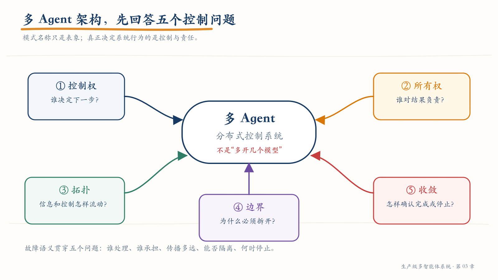
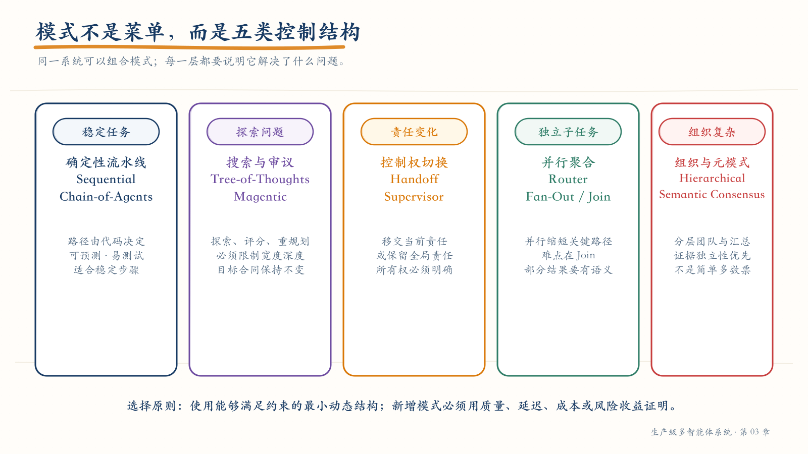
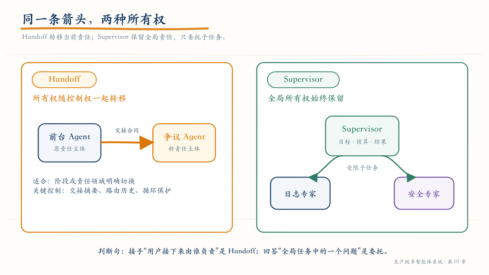
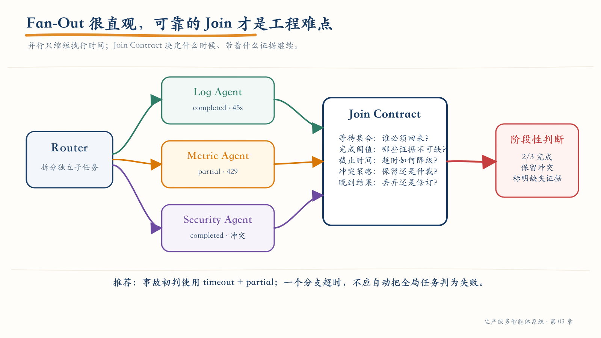
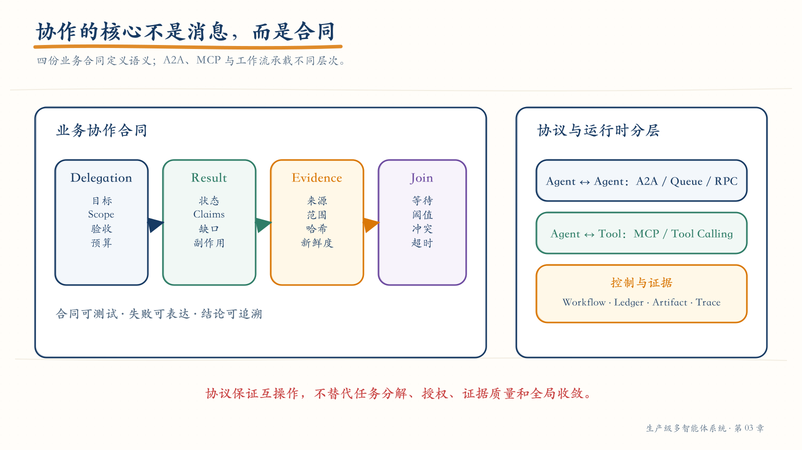
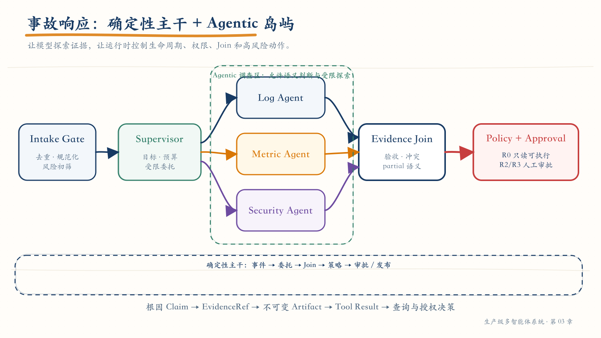
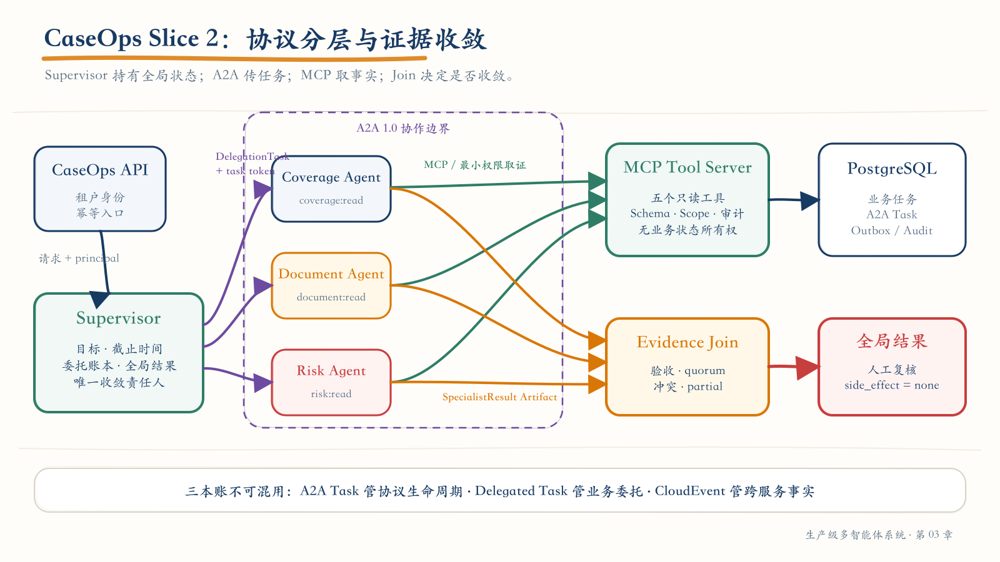

# 第03章　マルチエージェント協調：アーキテクチャパターン、プロトコル、インシデント対応

午前2時2分、決済成功率が突然99.6%から93.1%へ低下しました。アラートプラットフォームは1分以内に、3種類の異常を同時に報告しました。

- アプリケーションログに `payment_confirm timeout` が大量に出現した
- 決済ゲートウェイのP95レイテンシが420 msから3.8 sへ上昇した
- リリースされたばかりの不正検知ルールのヒット率が、ベースラインから明らかに外れた

オンコールエンジニアは8分以内に初期判断を示す必要があります。障害の影響はどの程度か、最も可能性の高い原因は何か、エビデンスは十分か、次の一手として調査を続けるべきか、トラフィックを制限すべきか、それともロールバックを申請すべきかを判断しなければなりません。

このタスクは、一見すると複数のAgentにうってつけです。Log Agentがエラーを調べ、Metric Agentが傾向を確認し、Security Agentがルール変更を検査し、最後にSupervisorが結果を集約します。そのため、チームは4つの円と数本の矢印を描き、モデル同士にメッセージを送らせがちです。

本当の難しさは、ここから始まります。

Log Agentがタイムアウトした場合、タスク全体も失敗とすべきでしょうか。3つのAgentが互いに矛盾する結論を出したとき、誰に裁定権があるのでしょうか。Supervisorがタスクを委譲した際に、委譲先の本番権限まで拡大してよいのでしょうか。あるAgentが「不正検知ルールが根本原因だ」と述べたとき、元のクエリと不変のエビデンスまで遡れるでしょうか。Supervisorが新しいエビデンスを得られないまま委譲を繰り返した場合、システムはいつ停止を強制すべきでしょうか。

これらの問いが示すとおり、マルチエージェントアーキテクチャの本質は「モデルの数を増やす」ことではありません。分散制御システムを設計し直すことです。

> **マルチエージェントアーキテクチャは、第一に制御権、責任、状態、障害境界の設計であり、役割の数やメッセージ形式の設計はその次です。**

本章では、まずこの決済インシデントを軸に方法論を組み立てます。それぞれの協調パターンがどの問題を解くのか、コントラクトで委譲と結果をどう制約するのか、状態の所有権をどう分けるのか、A2A、MCP、ワークフローエンジンがそれぞれどのレイヤーに位置するのかを説明します。続いて、本書を通して扱うCaseOpsプロジェクトに戻り、これらの判断を実行、テスト、リプレイできるSlice 2として実装します。理論はこの設計を採用する理由を説明し、プロジェクトはそれがホワイトボード上の標語にとどまらないことを証明します。

!!! note "安定した原則と現在のプロトコル"
    制御権、責任、状態の所有権、エビデンス、冪等性、収束は、比較的安定したエンジニアリング原則です。一方、A2A、MCP、LangChain、LangGraphのオブジェクトやインターフェースは今後も進化します。本稿の執筆時点では、A2A 1.0、MCPの現行安定仕様、LangChain/LangGraph 1.xのドキュメントを参照しています。本番実装ではバージョンを固定し、アップグレードを契約テストで検証してください。

## 1. Agentの数を数える前に、5つの制御上の問いに答える

「ここには何体のAgentがいるか」は、最も価値のあるアーキテクチャ上の問いではありません。2体のAgentが、同じループ内にある2つのPromptにすぎない場合もあります。一方、1体のAgentが、分離された複数のツール領域と複雑な状態を持つ場合もあります。システムが本当にマルチエージェントアーキテクチャを形成しているかを判断するには、まず5つの問いを立てます。



*図3-1　パターン名は表面的なものにすぎません。システムの振る舞いを決めるのは、制御権、所有権、トポロジー、境界、収束方法です。*

### 1.1 誰が次の一手を決めるのか：制御権

制御権は、「次の実行経路を選ぶ権限を誰が持つか」という問いに答えます。

固定パイプラインでは、コードが `A → B → C` を決定します。Supervisorパターンでは、Supervisorが現在のエビデンスに基づいて次の専門家を選択できます。Handoffパターンでは、現在のAgentが会話とタスクの制御権を受け手に渡します。動的計画パターンでは、Plannerが新しいサブタスクグラフを生成することさえあります。

制御が動的になるほど、システムには次の要件が強く求められます。

- 生成を許可するタスクを明示する
- 最大の深さ、幅、ラウンド数、時間、費用を制限する
- その経路を選んだ理由を記録する
- 進展がない場合は強制的に停止する
- 高リスクのアクションには決定論的なゲートを設ける

モデルが次の一手を提案できるからといって、最終的な制御権まで持つわけではありません。本番システムでは引き続き、ランタイムが正当な状態と正当なエッジを制約する必要があります。

### 1.2 誰が結果に責任を持つのか：所有権

所有権とは「誰が最も多くの作業を実行したか」ではなく、「タスクの最終状態、出力品質、障害対応に誰が責任を持つか」を意味します。

Handoffは通常、現在のタスクまたは会話の主たる所有権を移します。対してSupervisorは、グローバルな所有権を保持し、境界の定まったサブタスクだけを専門家へ委譲します。この違いは、次の事項に直接影響します。

- 誰がユーザーに結果を説明するか
- 誰がグローバルなタスク状態を保存するか
- 誰が専門家の失敗や対立を処理するか
- 誰が再委譲できるか
- 誰がタスクの完了を決定するか

アーキテクチャ図にSupervisorが描かれていても、専門家がSupervisorを迂回してグローバルなタスク状態を直接変更できるなら、名目上の監督関係は真の所有権境界になっていません。

### 1.3 Agentをどう接続するのか：トポロジー

トポロジーは、情報と制御がどう流れるかを表します。代表的な形態には、チェーン、ツリー、スター、階層ネットワーク、共有ブラックボードがあります。

トポロジーは見た目の好みではありません。次の要素を決定します。

- クリティカルパスの長さ
- スループットのボトルネックになるノード
- 1回の障害が影響する範囲
- コンテキストをコピーする回数
- ループの生じやすさ
- 1つのタスクを追跡する際に越えるエッジ数

たとえば、スター型Supervisorはガバナンスを一元化しやすい一方、性能とコンテキストのボトルネックになり得ます。非中央集権型ネットワークは単一制御点を減らしますが、一貫性と終了判定の難しさが大幅に増します。

### 1.4 なぜ分割するのか：境界

1体のAgentを独立させる価値があるのは、通常、少なくとも1つの実質的な境界を持つためです。

| 境界 | インシデント対応での例 | 分割する価値 |
|---|---|---|
| ドメイン境界 | ログ診断、メトリクス分析、セキュリティ変更 | 独立した知識と評価基準 |
| データ境界 | ログストア、時系列ストア、監査ストア | データアクセス範囲の最小化 |
| ツール境界 | ログ検索、メトリクス集約、変更監査 | 実行可能なアクション空間の縮小 |
| 権限境界 | 読み取り専用の診断と本番変更 | リスクと認証情報の分離 |
| 状態境界 | 専門家のドラフトとグローバルなインシデント状態 | 並行更新による上書きの回避 |
| 障害境界 | メトリクスサービスの障害がログ調査を巻き込まない | 局所的な縮退 |
| チーム境界 | オブザーバビリティプラットフォーム、セキュリティプラットフォーム、決済チーム | 実際の所有権との整合 |

2体の、いわゆるAgentが、同じツール、権限、状態、知識、評価基準を共有し、Prompt内の役割名だけが異なるなら、分割によってレイテンシと障害点を増やしている可能性が高いでしょう。

### 1.5 どう完了を確認するのか：収束

単一Agentのループでさえ呼び出しを繰り返し続けることがあります。マルチエージェントシステムではさらに、相互質問、重複委譲、循環Handoff、終わりのない投票が起こり得ます。システムは、完了、部分完了、停止の条件を事前に定義しなければなりません。

収束条件では、少なくとも次の状態を扱います。

- **成功**：受け入れ基準をすべて満たし、重要な結論のすべてにエビデンスがある
- **部分成功**：一部の専門家は失敗したが、現時点のエビデンスで限定的な結論を示せる
- **待機**：ユーザーからの追加入力、外部イベント、人による承認が必要
- **失敗**：重要な依存先が利用できず、安全な縮退経路もない
- **拒否**：権限またはポリシーにより続行できない
- **予算による終了**：時間、費用、ステップ数、委譲数の上限を使い切った
- **進展なしによる終了**：複数ラウンドにわたり、新しいタスク、エビデンス、結論が追加されていない

この5つの問いは、マルチエージェントシステムを理解し、テストし、運用できるかを左右します。障害処理はそのすべてを貫きます。制御権は誰が障害を処理するかを決め、所有権は誰が結果責任を負うかを決め、トポロジーは障害の伝播範囲を決め、境界は分離できるかを決め、収束ルールはいつ停止するかを決めます。

## 2. パターンはメニューではなく、異なる制御構造である

一般的な資料には、Sequential、Chain-of-Agents、Tree-of-Thoughts、Handoff、Supervisor、Router、Magentic、Hierarchical Network、Semantic Consensusなど、多くのパターン名が並んでいます。しかし、これらの名称は同じ抽象レイヤーに位置していません。

実行順序を表すパターンもあれば、制御権の移転を表すもの、探索戦略を表すもの、ほかのアーキテクチャの上に重ねる結果集約メカニズムにすぎないものもあります。これらを相互排他的な選択肢として扱うと、選定は「高度に聞こえる名前を1つ選ぶ」作業になってしまいます。

より実用的なのは、主に解決する問題ごとに分類することです。



*図3-2　同じシステムで複数のパターンを組み合わせられますが、各レイヤーでは、どの具体的な制御問題を解決するのかを説明する必要があります。*

### 2.1 決定論的パイプライン：SequentialとChain-of-Agents

**Sequential**では、タスクが事前定義された順序で複数のノードを通ります。前のステップの出力が次のステップの入力となり、経路はコードまたはワークフローで定義されます。

```text
アラートを抽出 → サービストポロジーを照会 → メトリクスを分析 → インシデント概要を生成
```

これは、ステップが安定しており、順序が明確で、中間成果物を定義しやすいタスクに適しています。予測可能で、テストしやすく、チェックポイントを設定しやすい点が利点です。その代わり、未知の状況に対する柔軟性は低くなります。

**Chain-of-Agents**もチェーン構造ですが、各ノードは通常、調査者、分析者、校閲者など、より明確な意味上の責任を担います。それでも、次の遷移先をモデルに自由に決めさせず、決定論的なAgentic Workflowとして構成できます。

両者に共通するリスクは、エラーがチェーンに沿って伝播することです。上流の出力はSchemaと品質ゲートを通す必要があり、検証されていない自然言語の一節を、そのまま下流の事実として扱ってはいけません。

### 2.2 探索と審議：Tree-of-ThoughtsとMagentic

**Tree-of-Thoughts（ToT）**は、複数の推論分岐を同時に探索し、候補経路を評価、枝刈り、選択します。これは探索構造を表すものであり、それ自体がマルチエージェントであるとは限りません。1つのモデル、複数のモデルインスタンス、複数の専門レビュアーのいずれでもToTを実装できます。

ToTは、合理的な経路が複数あり、中間解を評価でき、誤った経路を早期に枝刈りできる問題に適しています。低レイテンシ、低コストが求められる場合や、不可逆な副作用を伴うアクションチェーンには向きません。探索木に幅、深さ、評価予算の制限がなければ、急速に制御不能になります。

**Magentic系の動的計画**では、管理者が進捗に応じて計画を書き換え、新しいタスクを作り、新しい専門家を選べます。オープンエンドな調査や情報が不完全な問題に適していますが、本番環境では次の原則を守らなければなりません。

> 動的計画は「どのように完了するか」を変えられますが、「何を完了すべきか」を密かに変えてはいけません。

元のGoal Contract、リスクレベル、権限の上限、期限、受け入れ基準は安定していなければなりません。計画はバージョン化できますが、複数ラウンドの委譲中に目標がひそかにドリフトしてはなりません。

### 2.3 制御権の切り替え：HandoffとSupervisor

**Handoff**は、主たる制御権と必要なコンテキストを受け手のAgentに引き渡します。プリセールス相談から受注後サポートへの移行、ボットから有人オペレーターへの引き継ぎなど、会話の段階や責任領域が明確に切り替わる場面に適しています。

**Supervisor**は、グローバルな制御権と結果の所有権を保持し、境界の定まったサブタスクを専門家へ委譲してから、結果を集約します。並行調査、予算の一元管理、対立処理、グローバル監査が必要なタスクに適しています。

どちらも「Agent AがAgent Bを呼び出す」ように見えますが、エンジニアリング上の意味はまったく異なります。次節で詳しく説明します。

### 2.4 並列集約：Router + Fan-Out/Join

Routerは入力に応じて1体以上の専門家を選択します。Fan-Outは独立したサブタスクを並列に発行し、Joinは結果が返った後、いつ、どのように処理を続けるかを決めます。

これは、インシデント調査におけるログ、メトリクス、セキュリティ監査に適しています。3者は異なるデータソースを使い、相互依存が少ないため、並列化によってクリティカルパスを短縮できます。

ただし、並列システムで最も難しいのは「3体のAgentを同時に起動すること」ではなく、Joinです。

- すべての結果を待たなければならないか
- 1体の専門家がタイムアウトしても部分的な結論を示せるか
- 2つのエビデンスが矛盾する場合、どう表現するか
- 遅れて届いた結果で、すでに公開したレポートを更新できるか
- どの結果が最低限のエビデンス閾値を満たすか

明示的なJoin Contractがなければ、並列化は不確実性を集約ノードへ先送りするだけです。

### 2.5 組織構造とメタパターン：Hierarchical NetworkとSemantic Consensus

**Hierarchical Network**は、複数のグループを階層化します。各チームのSupervisorが担当領域の専門家を管理し、最上位のSupervisorは圧縮・検証済みのチーム結果だけを受け取ります。

これは、大規模組織、複雑なドメイン、異なるセキュリティ領域に適しています。一方で、階層化により情報損失、レイテンシの累積、リスクの隠蔽が生じます。下位レイヤーの出力は、単に「正常／異常」とするのではなく、信頼度、不足しているエビデンス、リスク、追跡可能な参照も上位へ伝える必要があります。

**Semantic Consensus**は完全なトポロジーではなく、結果を集約するメタパターンです。複数のAgentが独立して判断し、システムが意味的一致度、エビデンス品質、役割の重み、仲裁ルールに基づいて結論を形成します。

コンセンサスは多数決と同じではありません。3体のAgentが同じ誤ったデータソースを参照している可能性があるため、数の上で一致していても、エビデンスが独立しているとは限りません。より信頼できるコンセンサスには、次の確認が必要です。

- エビデンスの出所が独立しているか
- 結論が反証可能か
- 異なる意見が保持されているか
- 重みがモデルの自己申告した信頼度ではなく、検証可能な能力に基づいているか
- 高リスクの結論には、なお人による裁定が必要か

### 2.6 制約からパターンを選ぶ

パターン選択は、フレームワークの機能から考えるのではなく、タスクの制約から逆算できます。

| タスクの特徴 | 優先候補 | 注意点 |
|---|---|---|
| ステップが安定し、経路が明確 | Sequential / Chain | 「Agentらしさ」のために動的ルーティングを追加する |
| フェーズごとに責任が明確に切り替わる | Handoff | 制御権の移転後、グローバルな責任を負う者がいなくなる |
| 独立した複数の専門領域があり、統一結論が必要 | Supervisor + Fan-Out/Join | Supervisorがコンテキストとレイテンシのボトルネックになる |
| 複数の推論候補を評価できる | ToT | 探索コストと誤った評価器 |
| オープンエンドで、計画の継続的な改訂が必要 | 動的計画 / Magentic | 目標ドリフトと委譲の爆発 |
| 組織または権限領域に明確な階層がある | Hierarchical Network | 階層ごとの要約がリスクを隠す |
| 独立レビューや見解の統合が必要 | Semantic Consensus | 投票数を事実の品質と見なす |

実際のシステムでは、複数のパターンを組み合わせることがよくあります。たとえばインシデント対応では、決定論的な主幹でライフサイクルを制御し、Supervisorが調査を編成し、Routerが3体の専門家へタスクを並列に割り振り、Joinがエビデンスルールに従って集約し、最後に承認ノードが変更を実行するかを決めます。

組み合わせは多いほどよいわけではありません。動的な制御構造を1つ追加するたびに、それがどのボトルネックを解消するのかを説明し、レイテンシ、品質、コスト、リスクの指標で効果を検証する必要があります。

## 3. HandoffとSupervisor：同じ1本の矢印、2種類の所有権

アーキテクチャ図でAgent AからAgent Bへ向かう1本の矢印は、ツール呼び出し、サブタスクの委譲、会話の引き継ぎ、イベント送信、エビデンス共有のいずれを意味する場合もあります。意味が記されていなければ、その図は実装の指針になりません。

HandoffとSupervisorの本質的な違いは、どちらが「より高度」かではなく、所有権が移るかどうかです。



*図3-3　Handoffは現在の制御権と主たる責任を移します。Supervisorはグローバルな責任を保持し、境界の定まったサブタスクだけを委譲します。*

### 3.1 Handoff：受け手が現在の責任主体になる

カスタマーサービスを例に考えます。フロントAgentが、注文が異議申し立て処理の段階に入ったことを識別し、Dispute Agentへ引き継ぎます。適切なHandoffでは、少なくとも次の情報を渡します。

- 引き継ぐ理由
- 現時点で確認済みの事実
- ユーザーの目標と未解決の問題
- 引き継ぎを許可されたコンテキスト
- 受け手が実行できるアクションの範囲
- 差し戻し、拒否、人間への引き継ぎの条件

引き継ぎ後は、Dispute Agentが現在の対話における主たる責任主体になります。元のAgentが引き続き制御権を奪い合ってはいけません。

Handoffでよくある失敗には、次のものがあります。

- 構造化された引き継ぎ概要を作らず、チャット履歴全体だけを転送する
- 受け手が、どの事実まで検証済みなのかを把握していない
- コンテキストとともに権限が暗黙的に拡大される
- 2体のAgentが、互いに相手の責任だと考える
- 往復の引き継ぎがループになる

そのため、Handoffにはルーティング履歴とループ防止が必要です。たとえば、同じタスクが2体のAgent間を2往復した時点で、人間への引き継ぎまたはSupervisorへの移行を強制します。

### 3.2 Supervisor：専門家は制約付きの委譲先である

インシデント対応のシナリオには、Supervisorのほうが適しています。ユーザーは「8分以内に初期判断を示す」という目標をSupervisorへ渡し、Supervisorはログ、メトリクス、セキュリティの各専門家へタスクを委譲します。

専門家が所有するのは、自身のサブタスクだけです。

```text
グローバル目標：決済成功率低下の影響、根本原因、次の一手を判断する

ログのサブタスク：エラーパターン、影響を受けたサービス、最初の発生時刻を特定する
メトリクスのサブタスク：影響範囲、関連メトリクス、変化のタイムラインを定量化する
セキュリティのサブタスク：同時期のルール、設定、権限変更を照合する
```

Supervisorは次の情報を保持しなければなりません。

- グローバルな受け入れ基準
- 全体予算と期限
- サブタスク台帳
- エビデンス索引
- 対立と不足情報
- 最終出力とエスカレーションの責任

専門家は `blocked` を報告できますが、インシデント全体を直接失敗にしてはいけません。ロールバックを推奨できますが、Supervisorが変更権限を持つという理由だけで、その権限を自動的に継承してはいけません。

### 3.3 実用的な判断基準

次の一文で判断できます。

> **受け手が「ユーザー対応を次に誰が担うべきか」を引き受けるならHandoffです。受け手が「グローバルタスク内の境界の定まった1つの問題」にだけ答えるなら、Supervisorによる委譲です。**

同じシステム内で、両者を併用できます。Supervisorは調査タスクを専門家に委譲し、人による対応が必要だと確認した時点で、現在の責任をオンコールエンジニアへHandoffできます。ただし、2つのアクションには異なるイベントタイプ、状態遷移、監査フィールドを使用すべきです。

## 4. 並列化は難しくない。難しいのは確実なJoinである

インシデント対応における3つの調査領域は、おおむね独立しています。直列に実行すれば3つのレイテンシが加算されますが、並列に実行すればクリティカルパスは最も遅い分岐に近づきます。そのため、Router + Fan-Outは非常に魅力的です。

しかし現実には、3つの緑色のチェックマークがきれいにそろうわけではありません。

- Log Agentは45秒以内に完了した
- Metric Agentは時系列ストアのレート制限により、2回再試行しても完了しなかった
- Security Agentは「ルール変更との相関が高い」と返したが、変更時刻しか示さず、ルールの内容は示さなかった
- Log AgentとSecurity Agentで、根本原因の方向性が対立している



*図3-4　Fan-Outはタスクの並列発行を担当し、Join Contractは待機条件、エビデンス閾値、対立、遅延結果を決定します。*

### 4.1 4つの基本的なJoin戦略

| 戦略 | 続行条件 | 適した場面 | 主なリスク |
|---|---|---|---|
| `all` | 必須タスクがすべて完了 | どの結果も欠かせない場合 | テールレイテンシと単一障害による遅延 |
| `quorum` | 数または重みの閾値に到達 | 冗長な判断、コンセンサス | 多数派が同じ誤りを共有する可能性 |
| `timeout + partial` | 期限に達し、既存の結果が最低閾値を満たす | 迅速性を優先するインシデント初期判断 | 未完了事項と結論の限界を明示する必要 |
| `first_valid` | 検証を通過した最初の結果が到着 | 同等の複数経路による検索や競争実行 | 最速が最高品質とは限らない |

インシデント対応には `timeout + partial` が適しています。8分のSLOを優先しつつ、少なくとも影響範囲のエビデンスと1つの根本原因候補が必要です。タイムアウトしたMetric Agentによってグローバルタスクを自動的に失敗させるべきではありません。不足しているエビデンスとして記録し、最終結論を「暫定判断」に下げます。

### 4.2 Join Contractで明記すべき6つの事項

```yaml
join_id: join-incident-evidence-v1
required_tasks:
  - impact_assessment
minimum_completion:
  count: 2
  required_evidence_types:
    - impact_metric
    - causal_signal
deadline: 2026-07-23T02:10:00Z
on_timeout: emit_partial
on_conflict: preserve_and_escalate
late_result_policy: append_new_revision
```

実行可能なJoin Contractには、少なくとも次の内容を含めます。

1. **待機集合**：必須タスクと任意タスク
2. **完了閾値**：数、重み、役割、エビデンスタイプのいずれで判定するか
3. **期限**：タイムアウトの起点と、クロックの所有者
4. **部分結果のセマンティクス**：公開可能な結論と、付記すべき制限
5. **対立戦略**：保持、仲裁、再調査、人間への引き継ぎのいずれか
6. **遅延結果戦略**：破棄、改訂の追加、タスクの再開のいずれか

### 4.3 対立を滑らかな文章へ丸めない

ログのエビデンスが、不正検知ルールのリリース前から決済サービスでコネクションプール枯渇が起きていたことを示し、セキュリティのエビデンスが、ルールのリリース時刻と成功率低下に強い相関があることを示したとします。言語モデルは両者を「不正検知ルールがコネクションプール枯渇を引き起こした」とまとめがちですが、現在のエビデンスでは、この因果関係は立証されていません。

Joinは構造化された対立を保持する必要があります。

```json
{
  "topic": "primary_cause",
  "claims": [
    {
      "claim_id": "claim_log_17",
      "value": "connection_pool_exhaustion",
      "evidence_refs": ["ev_log_41", "ev_trace_09"]
    },
    {
      "claim_id": "claim_sec_08",
      "value": "risk_rule_change",
      "evidence_refs": ["ev_change_12"]
    }
  ],
  "resolution": "unresolved",
  "next_query": "compare_first_occurrence_and_dependency_path"
}
```

システムは、的を絞った追加調査を1回要求できますが、修正ラウンド数を制限すべきです。追加エビデンスでも対立を解消できない場合は、モデルに単一の回答を無理に生成させず、対立とエビデンスをそのまま人に渡します。

## 5. 協調の中心はメッセージではなくコントラクトである

Agentは、関数呼び出し、キュー、RPC、A2A、共有状態を介して通信できます。転送方式は異なっても、本番運用での協調では同じ一連の問いに答える必要があります。

- 何を完了するよう、厳密に求められているのか
- 何を読み、何を呼び出し、どれだけのコストを使えるのか
- 完了したことをどう判断するのか
- どの構造で結果を返すのか
- 各結論はどのエビデンスに基づくのか
- 失敗、タイムアウト、エスカレーションをどう表現するのか

自然言語のメッセージでは、これらの責任を安定して担えません。マルチエージェントシステムには、少なくとも4つのコントラクトが必要です。



*図3-5　委譲、結果、エビデンス、Joinのコントラクトが業務セマンティクスを構成し、A2A、MCP、ワークフローランタイムが異なるレイヤーのインタラクションを担います。*

### 5.1 Delegation Contract：サブタスクを受け入れ可能な作業にする

```json
{
  "task_id": "task-log-01",
  "parent_task_id": "incident-20260723-001",
  "goal": "決済失敗の主要なログパターンと最初の発生時刻を特定する",
  "acceptance_criteria": [
    "上位3種類のエラーと件数比率を返す",
    "最初の発生時刻と影響を受けたサービスを示す",
    "各結論で少なくとも1つの読み取り専用クエリのエビデンスを参照する"
  ],
  "scope": {
    "services": ["payment-api", "risk-gateway"],
    "time_range": ["2026-07-23T01:45:00Z", "2026-07-23T02:10:00Z"]
  },
  "input_refs": ["alert-8821", "service-map-v17"],
  "allowed_tools": ["search_logs@2", "read_trace@1"],
  "deadline": "2026-07-23T02:08:00Z",
  "budget": {
    "max_tool_calls": 8,
    "max_rows_scanned": 200000
  },
  "output_schema": "agent-result.v1",
  "escalation": "return_blocked_with_missing_access"
}
```

ここで最も見落とされやすいのが受け入れ基準です。`goal: ログを分析する` だけでは、ほぼ検証できません。「エラーの比率、最初の発生時刻、影響を受けたサービスを返し、エビデンスを参照する」として初めて、プログラムと評価セットで検査できます。

委譲コントラクトは、タスクの膨張も防がなければなりません。委譲先は目標を内部ステップに細分化できますが、時間範囲の変更、サービスの追加、データ範囲の拡大、本番書き込み操作の実行を独断で行ってはいけません。

### 5.2 Result Contract：失敗と不確実性を第一級の状態にする

```json
{
  "task_id": "task-log-01",
  "agent_id": "log-investigator@3",
  "status": "partial",
  "summary": "現時点で最も強いシグナルはコネクションプール枯渇だが、1つのログシャードを利用できない",
  "claims": [
    {
      "claim_id": "claim-log-17",
      "statement": "payment-apiのコネクションプール枯渇は、成功率低下の42秒前に発生した",
      "evidence_refs": ["ev-log-41", "ev-metric-07"],
      "confidence": 0.84
    }
  ],
  "artifacts": ["artifact://incident-001/log-analysis/v2"],
  "missing_evidence": ["log-shard-cn-east-3"],
  "side_effects": [],
  "recommended_next": "risk-gatewayからpayment-apiへの依存Traceを読み取る"
}
```

推奨するタスク状態には、少なくとも次を含めます。

| 状態 | 意味 | Supervisorの典型的なアクション |
|---|---|---|
| `completed` | 受け入れ基準をすべて満たす | Joinへ進む |
| `partial` | 有効な成果物はあるが、明示された不足がある | 最低閾値を満たすか評価する |
| `blocked` | 権限、入力、外部条件が不足 | 条件を補うかエスカレーションする |
| `failed` | 許可されたポリシーの範囲では完了できない | 縮退、代替、終了 |

専門家には「完了したように見える」文章だけを返させないでください。`partial` と `missing_evidence` があることで、Supervisorが不完全な結果を確定的な結論として包み直すのを防げます。

### 5.3 Evidence Contract：結論を元の読み取りまで遡れるようにする

エビデンスは、単なるURLや自然言語の引用ではありません。少なくとも次の内容を記録します。

```json
{
  "evidence_id": "ev-log-41",
  "kind": "log_aggregate",
  "source": "logs.payment_prod",
  "query_fingerprint": "sha256:7bc...",
  "scope": {
    "tenant": "prod-cn",
    "time_range": ["2026-07-23T01:45:00Z", "2026-07-23T02:10:00Z"]
  },
  "observed_at": "2026-07-23T02:04:32Z",
  "artifact_uri": "artifact://incident-001/evidence/log-41.json",
  "content_hash": "sha256:56a...",
  "quality": "passed",
  "tool_call_id": "call-search-log-04",
  "trace_id": "trace-incident-001"
}
```

最終的な根本原因のチェーンは、次の向きに逆追跡できる必要があります。

```text
インシデントの結論
  ← Claim
    ← EvidenceRef
      ← 不変のArtifact
        ← Tool Result
          ← 正規化されたクエリと認可判断
```

最終結論を「Security Agentがそう言っていた」までしか遡れないなら、そのシステムはまだロールプレイの段階にあります。

### 5.4 Join Contract：集約動作に決定論的なルールを設ける

Join ContractをSupervisorのPromptに隠してはいけません。これはテスト可能な制御ロジックであり、次の処理を担います。

- Result Schemaを検証する
- タスクと親タスクの関連を照合する
- 最低限必要なエビデンス集合を確認する
- 重複を排除し、相互依存するエビデンスを識別する
- 対立を保持する
- 完了、部分完了、タイムアウトを算出する
- 次のバージョンの集約状態を生成する

この4つのコントラクトによって、Agent間の協調は「チャット」から、受け入れ可能な分散タスク実行へ変わります。

## 6. 状態の所有権：すべてのAgentに同じ辞書を変更させない

最も手軽なプロトタイプでは通常、グローバルな `state` が1つだけあり、すべてのAgentが読み書きできます。並列処理が始まると、2つの分岐が `messages`、`status`、`evidence`、`next_step` を同時に更新し、最後の書き込みが前の書き込みを上書きする可能性があります。

問題は技術的な競合だけではありません。より根本的な問題は、どの事実を宣言する権限を誰が持つかをシステムが定義していないことです。

### 6.1 状態の種類ごとに唯一の書き込み主体を指定する

| 状態 | 推奨する所有者 | 書き込み原則 |
|---|---|---|
| Global Task Graph | Orchestrator / Supervisor | 単一書き込み主体またはイベントソーシング |
| Agent Local State | 対応するAgent | ローカルCheckpoint。グローバル状態を直接上書きしない |
| Delegation Ledger | Orchestrator | タスクのバージョンと状態遷移を追記 |
| Evidence / Artifact | Artifact Store | 不変のバージョンを参照で共有 |
| Conversation View | Host / UI | タスクとメッセージイベントから投影 |
| Policy Decision | Policy Engine | 追記のみ。Agentによる書き換え不可 |
| Approval State | Approval Service | 独立したステートマシンと承認者ID |

専門家が `incident.status` を直接 `resolved` に変更してはいけません。専門家が送信できるのはResultだけです。グローバルタスクを所有するOrchestratorが検証してから状態を進めます。

### 6.2 不変の成果物で事実を共有する

Agent間でコンテキスト全体をコピーすると、3つの問題が生じます。Tokenコストの増加、機密情報の拡散、事実のバージョン不一致です。

より堅牢な方法は次のとおりです。

1. クエリ結果と分析成果物を不変のArtifactへ書き込む
2. 安定した `artifact_uri` とコンテンツハッシュを生成する
3. 委譲時には必要な参照と概要だけを渡す
4. 受け手は権限に従って元の成果物を読み取る
5. 新たな分析では旧バージョンを上書きせず、新しいバージョンを生成する

これにより、「ある結論がどのバージョンのデータに基づくか」を明確に答えられます。

### 6.3 並行更新にはバージョン条件が必要

グローバル状態を単一のサービスが所有していても、複数の結果が同時に返ることがあります。更新操作にはバージョン条件を含めます。

```text
update task
set status = "joining", version = 18
where task_id = "incident-001" and version = 17
```

条件が満たされなければ、ランタイムは現在のバージョンを再度読み取り、決定論的なマージを実行します。黙って上書きしてはいけません。キューによる重複配信には、`task_id + result_version` またはイベントIDを冪等キーとして使います。

### 6.4 メッセージ履歴はタスク状態ではない

チャット履歴は「何が話されたか」を表示するのに適していますが、すべての制御状態を担うには不向きです。次の情報には、構造化フィールドまたは独立したストレージを使用します。

- 現在のタスクと親子関係
- 満たされた受け入れ基準
- 予算と期限
- エビデンス索引
- ポリシーと承認の結果
- 再試行回数とエラー分類
- 現在の所有者
- 進展なしのカウント
- 終了理由

モデルは、必要な範囲に絞った状態の投影を読み取れます。しかし、メッセージ履歴全体を再解釈して制御セマンティクスを復元する設計にしてはいけません。

## 7. A2A、MCP、ワークフロー：3つのレイヤーであり、三者択一ではない

システムを分散デプロイし始めると、チームはよく「すでにMCPを使っているのに、A2Aも必要なのか」、あるいは「A2Aがあれば、ワークフローエンジンは不要なのか」と尋ねます。

この問いは前提が誤っています。3者は主に異なるレイヤーの問題を解決します。

### 7.1 MCP：Agentアプリケーションが外部能力をどう利用するか

MCPはHost、Client、Server間の標準接続を確立し、AIアプリケーションがツール、リソース、プロンプトなどの能力を発見・利用できるようにします。たとえば次の用途に適しています。

- Log Agentをログ検索Serverへ接続する
- Metric Agentが時系列リソースを読み、集約ツールを呼び出す
- Security Agentを変更監査システムへ接続する

MCPが標準化するのは、能力の公開方法と呼び出し境界です。次のことまでは決めてくれません。

- 3体のAgentを作るべきか
- グローバルなインシデント状態を誰が所有するか
- 3つの結果をどうJoinするか
- どの結論がインシデント公開の閾値に達するか
- いつ調査の続行を停止するか

### 7.2 A2A：独立したAgentがどう発見し合い、協調するか

A2A 1.0仕様は、独立したAgent間の相互運用オブジェクトと操作を定義しています。代表的な中核オブジェクトは次のとおりです。

| オブジェクト | 役割 |
|---|---|
| `AgentCard` | AgentのID、インターフェース、能力、スキル、セキュリティ方式を記述する |
| `Message` | ユーザーまたはAgentのメッセージと複数のPartを伝える |
| `Task` | 状態を持ち、追跡可能な作業とそのライフサイクルを表す |
| `Artifact` | タスクが生成したファイル、構造化データ、その他の成果物を表す |
| `contextId` | 関連する一連のインタラクションまたは複数ターンのコンテキストを関連付ける |

A2A 1.0には、実装者が見落としやすいセマンティクスがいくつかあります。

第1に、新しい `taskId` はサーバー側で生成されます。業務システムは独自の `delegation_task_id` を持てますが、それがA2A Task IDであるかのように扱ってはいけません。前者は業務責任を、後者はプロトコルのライフサイクルを表します。両者は関連付ける必要がありますが、1つのフィールドに混在させるべきではありません。

第2に、Messageはインタラクションに使い、タスクの結果はArtifactへ格納します。重要な結果を一時的な状態メッセージだけに置くと、切断後のクライアントは成果物を確実に復元できません。

第3に、Agent Cardは単なる「能力紹介」ではありません。クライアントは `supportedInterfaces` を基に、自身が対応するプロトコルとバージョンを選び、ストリーミングやプッシュなどの任意機能を呼び出す前に、サーバーの宣言を確認する必要があります。CaseOps Slice 2が宣言するのはHTTP+JSON 1.0だけであり、未実装のStreamingやPush Notificationを装いません。

第4に、Taskは状態を持つ作業単位です。長時間タスクの進捗は、ポーリング、ストリーミング更新、プッシュ通知によって取得できます。ただし、プロトコルが提供するTask状態は、企業の業務状態と同じではありません。通常、業務システムには、冪等性、責任、受け入れ、監査を扱う独立した台帳も必要です。

A2Aは、委譲、タスク更新、ストリーミング結果、成果物交換を担えます。一方で、次の問題を自動的には解決しません。

- サブタスクをどう分割するか
- 委譲が最小権限に違反していないか
- 業務の受け入れ基準を満たしているか
- 複数のAgentのエビデンスが独立しているか
- グローバルタスクをどう収束させるか
- 本番変更に承認が必要か

これらは引き続き、コントロールプレーンと業務コントラクトの責任です。

### 7.3 ワークフローまたは状態グラフ：誰がグローバルなライフサイクルを進めるか

LangGraph、Temporal、業務ステートマシンは、次の処理を担えます。

- 決定論的な状態遷移
- 一時停止、再開、Checkpoint
- タイマー、タイムアウト、再試行
- Fan-Out/Join
- 承認待ち
- 補償と終了
- イベントリプレイ

フレームワークは制御ロジックの実装を支援しますが、アーキテクチャ判断の代わりにはなりません。Join Contractが曖昧なら、どのワークフローエンジンへ置き換えても曖昧なままです。

### 7.4 推奨するプロトコルのレイヤー分け

```text
業務制御レイヤー     Goal / Delegation / Result / Join / Policy
                       ↓
Agent協調レイヤー    A2A、タスクキュー、制御されたRPC
                       ↓
ツール能力レイヤー   MCP、ローカルTool Calling、ドメインAPI
                       ↓
エビデンス・状態層   Workflow、Task Ledger、Artifact Store、Trace
```

典型的な経路は次のとおりです。SupervisorがA2Aまたはキューを介してLog Agentへ委譲し、Log AgentがMCPを介してログ検索ツールを呼び出します。ワークフローエンジンはグローバルタスクを保存し、結果を待ってJoinを実行し、Artifact Storeは不変のエビデンスを保存します。

### 7.5 委譲によって権限を拡大してはいけない

Agent Aに権限があっても、委譲先のAgent Bがすべての権限を自動的に継承するわけではありません。より安全な有効権限は、次のように表せます。

```text
有効権限
= ユーザーの認可
∩ 委譲者が委譲できる範囲
∩ 委譲先自身の能力
∩ 現在のタスクScope
∩ ランタイムポリシー
```

この積集合は、モデルにメッセージ内で「本番データベースへのアクセスを許可する」と宣言させるのではなく、ポリシーシステムが計算しなければなりません。

短期的な委譲では、範囲と期間を限定し、取り消し可能なタスククレデンシャルを発行し、次の項目に紐付けられます。

- `task_id`
- 許可するツールとアクション
- データ範囲
- テナントと環境
- 有効期限
- 最大呼び出し回数またはコスト
- 再委譲を許可するか

デフォルトでは、委譲先に再委譲権限を与えるべきではありません。許可する場合も、元の権限とScopeを越えることはできません。

## 8. 本番インシデント対応：決定論的な主幹とAgenticな島

ここで、冒頭の決済障害へ戻ります。目標は「全自動の運用チーム」を構築することではありません。8分以内に、十分なエビデンスがあり、リスクが制御され、継続的に改訂できるインシデント初期判断を作ることです。

最も堅牢な構造は、すべてのノードに自由な計画を許すものではありません。

> **決定論的な主幹でライフサイクルを制御し、意味判断と探索が必要な局所だけでAgentを使います。**



*図3-6　入口、Join、リスクゲート、承認が決定論的な主幹を構成し、ログ、メトリクス、セキュリティの調査が制約されたAgenticな島を形成します。*

### 8.1 第1ステップ：Intake Gateが入力を先にイベントへ変換する

アラートの到着後、決定論的な入口が次の処理を行います。

- 重複排除と既存インシデントとの関連付け
- サービス、環境、メトリクス、時間枠の解析
- サービスカタログと担当者の読み取り
- 初期リスクの評価
- `incident_id`、`trace_id`、グローバル期限の作成
- テナント、環境、送信元が欠けた不正なイベントの拒否

ここでは、Agentによる自由判断は不要です。入力の正規化、重複排除、初期リスク評価は、再現可能かつテスト可能であるべきです。

### 8.2 第2ステップ：Supervisorは境界の定まった計画だけを作る

Supervisorは、イベント、サービストポロジー、利用可能なAgentCardを基にサブタスクを生成します。計画はランタイムによる次の検査を通過しなければなりません。

- サブタスクが元のインシデントに属しているか
- 適切な能力が存在するか
- Scopeが許可された範囲内か
- 全体予算が十分か
- 並列幅が上限を超えていないか
- 本番書き込みアクションを含んでいないか

初期調査ではR0の読み取り専用能力しか許可しません。そのため、「サービスを再起動する」「ルールをロールバックする」といったツールを調査Agentに公開してはいけません。

### 8.3 第3ステップ：3体の調査Agentが並列にエビデンスを収集する

**Log Agent**は、エラーのクラスタ、最初の発生時刻、影響を受けた呼び出しチェーンを照会します。  
**Metric Agent**は影響範囲を定量化し、リリース、依存関係、業務メトリクスのタイムラインを比較します。  
**Security Agent**は、同時期のルール、設定、権限、キーなどの変更を照会します。

各Agentは、独立したツール領域と読み取り専用クレデンシャルを使います。統一したResult Contractを提出しますが、ドメイン固有のArtifactは許可します。

並列分岐同士が直接チャットすることはありません。Log Agentがメトリクスを必要とする場合は、Supervisorを通じて追加リクエストを送るか、すでに公開され、読み取り権限のあるArtifactを参照します。これにより、制御不能なメッシュ状の依存関係を避けられます。

### 8.4 第4ステップ：Evidence Joinは要約の前に受け入れ検証を行う

Joinノードは、最初に次の決定論的な検査を実行します。

1. Resultが元の `task_id` とSchemaに一致するか
2. Artifactが存在し、ハッシュが正しいか
3. Claimがエビデンスを参照しているか
4. エビデンスのScopeが結論をカバーしているか
5. 最低完了条件とエビデンス閾値を満たしているか
6. 保持すべき対立が存在するか

受け入れ検証を通過した結果だけが、要約モデルへ渡されます。要約モデルは文章を構成し、次の一手を提案できますが、存在しないエビデンスを作ったり、対立を削除したりしてはいけません。

### 8.5 第5ステップ：リスクゲートが「推奨」と「実行」の距離を決める

インシデントAgentは、次の内容を示せます。

- 継続調査の提案
- 影響範囲
- 根本原因の候補
- 軽減策と予想リスク
- 人の確認が必要な未知の事項

ただし、アクションを自動実行できるかはリスクレベルで決まります。

| リスクレベル | アクション例 | 推奨する制御 |
|---|---|---|
| R0 読み取り専用 | ログ検索、メトリクス検索、設定読み取り | Agentが実行可能。完全な監査を残す |
| R1 低リスク | チケット作成、通知ドラフト生成 | 自動実行可能。冪等性を必須とする |
| R2 中リスク | 少量のトラフィック切り替え、時限的な縮退 | 人による承認、短期クレデンシャル、自動復旧 |
| R3 高リスク | 本番ロールバック、ブロック、重要設定の変更 | 2名承認、専用変更システム、ロールバック計画 |

本ケースでは、3体のAgentが不正検知ルールを根本原因だと一致して判断しても、本番環境を自動ロールバックすべきではありません。システムはエビデンス付きの変更提案を生成し、Approval Gateへ送ります。実際の変更は、独立した変更システムが実行・記録します。

### 8.6 暫定出力のあるべき姿

8分の期限を迎えた時点で、Metric Agentがレート制限により部分結果しか返せなかったとします。それでもシステムは、次の内容を公開できます。

```text
状態：暫定判断（3件中2件の調査が完了、メトリクス調査は部分完了）

影響：
- 決済成功率が99.6%から93.1%へ低下
- 中国東部の決済トラフィックが最も顕著な影響を受けている

現時点で最も有力な根本原因候補：
- payment-apiのコネクションプール枯渇
- 最初の発生時刻は成功率低下の42秒前
- エビデンス：ev-log-41、ev-trace-09

未解決の対立：
- 不正検知ルールの変更時刻と障害時刻に強い相関がある
- ルール変更がコネクションプール枯渇を引き起こしたことは未証明

推奨：
- risk-gateway → payment-apiの依存Traceを引き続き照会する
- 自動ロールバックは当面行わない。変更が必要な場合はR3の2名承認へ進む
```

これは、断定的であっても追跡できない「根本原因分析」より、本番運用で価値があります。

## 9. CaseOps Slice 2：協調コントラクトを実行時の事実にする

ここまでの決済インシデントは方法論の説明に適していますが、エンジニアリングの書籍が仮想的なアーキテクチャだけで自らを証明することはできません。ここで、本書を通して扱うC-102案件へ戻ります。

第1章の決定論的カーネルが認識できるのは、構造化済みの2つの資料コードだけだったため、事故証明が不足していると判断しました。第2章の制御されたAgentは、MCPを介して「道路交通事故認定書」を発見し、ガバナンスの対象となるエイリアスルールによって `ACCIDENT_CERTIFICATE` に正規化しました。本章では、もはや資料がそろっているかだけを問題にしません。権限や可変状態を共有せずに、3つのエビデンス領域をどう協調させるかを扱います。

- coverage専門家は、案件に紐付くルールのバージョンと必須資料を確認する
- document専門家は、出所となる資料を読み、読み取り専用の正規化を実行する
- risk専門家は、構造化されたリスクシグナルを読み、人手レビューが必要かを判断する
- Supervisorは、タスク、予算、Join、最終状態に責任を持つ

ここで複数のAgentに分割する価値があるのは、3つの役割名を付けたからではありません。ツール、scope、エビデンスタイプ、失敗セマンティクスが異なるからです。

| 制御上の問い | CaseOps Slice 2の回答 |
|---|---|
| 制御権 | Supervisorがタスクを作成し、並列に割り振り、Joinを実行する |
| 所有権 | Supervisorだけがグローバル実行と最終結果への書き込み権を持つ |
| トポロジー | スター型Supervisor + 3分岐のFan-Out/Join |
| 境界 | coverage、document、riskが異なるscopeとエビデンス接頭辞を使う |
| 収束 | 必須ノード、最低成功数、対立、deadlineをJoin Contractに記述する |

### 9.1 完全な1つの経路



*図3-7　業務タスク、A2A Task、MCP Tool Callは3つの異なるレイヤーに属します。Supervisorは、Evidence Joinを通過した専門Artifactだけを受け入れます。*

実際のリクエストは、次の経路を通ります。

```text
CaseOps API
  → Supervisorがcollaboration_runを作成
  → 3つのdelegated_taskを書き込む
  → 各タスクに最小権限のタスクトークンを発行
  → 公式A2A ClientがAgent Cardを読み取る
  → A2A 1.0 HTTP+JSONで3つのMessageを並列送信
  → A2A Serverが永続化された3つのTaskを作成
  → 専門AgentがMCPを介して許可済みの事実を読み取る
  → 専門AgentがSpecialistResult Artifactを返す
  → Supervisorが決定論的なEvidenceJoinを実行
  → 結果、監査、CloudEvents Outboxをまとめて永続化
```

このチェーンでは、意図的に3種類のIDを保持します。

| ID | 生成者 | 解決する問題 |
|---|---|---|
| `collaboration_run.id` | CaseOps Supervisor | グローバルな業務実行、冪等性、監査 |
| `delegated_task.id` | CaseOps Supervisor | サブタスクの責任、受け入れ検証、権限の紐付け |
| A2A `Task.id` | A2A Server | プロトコル上のタスク状態、照会、キャンセル |

3つすべてを `task_id` と呼べば簡単に見えますが、実際には復旧、認可、トラブルシューティングが曖昧になります。

### 9.2 Delegation Contractは「これを調べて」という一言ではない

CaseOpsの委譲オブジェクトは、厳密なPydanticコントラクトです。次の例では最も重要なフィールドを残しています。

```python
class DelegationTask(BaseModel):
    schema_version: Literal["caseops.delegation-task.v1"]
    task_id: str
    parent_run_id: str
    case_id: str
    specialist_id: SpecialistId
    goal: str
    acceptance_criteria: tuple[str, ...]
    allowed_evidence_kinds: tuple[str, ...]
    required_scopes: tuple[str, ...]
    deadline_at: datetime
```

ここには `tenant_id` がない点に注目してください。テナントは、APIで認証されたPrincipalと署名済みタスクトークンから取得します。モデルやリモートAgentが変更できるメッセージフィールドから取得するのではありません。

Supervisorが3体の専門家に生成するscopeは、それぞれ次のとおりです。

| 専門家 | Scope | 可能な処理 |
|---|---|---|
| coverage | `case:read`、`policy:read` | 案件スナップショットと紐付くルールを読み取る |
| document | `case:read`、`document:read`、`document:resolve` | 出所資料を読み、読み取り専用のエイリアス正規化を行う |
| risk | `risk:read` | 構造化されたリスクシグナルを読み取る |

タスクトークンは、`tenant_id`、`task_id`、`audience`、scope、発行時刻、有効期限にも紐付きます。有効権限は引き続き複数の制約の積集合であり、Supervisorが委譲を開始したという理由で自動的に拡大されることはありません。

### 9.3 専門Agentは不変の成果物だけを返す

3体の専門Agentは `collaboration_runs` を更新できず、自らの判断を最終的な案件状態として書き込むこともできません。返せるのは、統一された `SpecialistResult` だけです。

```python
class SpecialistResult(BaseModel):
    schema_version: Literal["caseops.specialist-result.v1"]
    task_id: str
    specialist_id: SpecialistId
    status: Literal["succeeded", "partial", "failed"]
    summary: str
    claims: tuple[Claim, ...]
    artifacts: tuple[str, ...]
    missing_evidence: tuple[str, ...]
    error_code: str | None
```

Claimには必ずEvidenceRefを含めます。coverageが送信できるのは `case://` と `policy://`、documentは `case://`、`evidence://`、`alias-rule://`、riskは `risk-signal://` と `risk-rule://` に限られます。risk Agentが形式上は正しい `policy://` エビデンスを返しても、Join段階で拒否されます。エビデンス境界を越えているためです。

### 9.4 A2A Taskは業務タスク台帳の代わりにならない

CaseOpsは、公式A2A Python SDK 1.1.2を使ってA2A 1.0 HTTP+JSONを実装しています。Agent Cardは3つのskillを外部公開しますが、StreamingとPush Notificationは宣言しません。Slice 2ではこれらの機能を提供していないためです。

A2A TaskはPostgreSQL TaskStoreで永続化され、CaseOpsには別途 `delegated_tasks` テーブルがあります。2つのテーブルには一見よく似た情報が記録されていますが、責任は異なります。

- A2A Taskは、プロトコルで定められたsubmitted、working、completedなどのライフサイクルを扱う
- DelegatedTaskは、業務目標、受け入れ条件、エビデンス範囲、scope、deadline、試行回数、結果を扱う
- Supervisorは業務台帳だけを基にJoinを実行し、「プロトコル呼び出し成功」を「業務タスク合格」と誤認しない

これが、プロトコルと業務コントロールプレーンの境界です。相互運用の成功は必要条件にすぎず、業務上の正しさの証明ではありません。

### 9.5 Evidence Joinはどう判断するか

`EvidenceJoin` はモデルを呼び出しません。次の固定順序で受け入れ検証を行います。

1. `task_id` が期待するタスクに属するか
2. `specialist_id` が委譲内容と一致するか
3. 同じ専門家からの重複送信か
4. Resultが失敗または部分成功か
5. ClaimのEvidenceRefが、その専門家に許可されたURI接頭辞の範囲内か
6. 必須の専門家が完了しているか
7. 最低成功数に達しているか
8. 同じClaim keyに異なるvalueが存在するか

Joinは、5種類の業務結果を生成できます。

| 結果 | 意味 | システムのアクション |
|---|---|---|
| `COMPLETE` | 必須の結果がすべて通過し、リスクゲートなし | 読み取り専用フローを続行 |
| `COMPLETE_WITH_REVIEW_REQUIRED` | エビデンスは完全だが、リスクルールにより人手レビューが必要 | 人間へルーティングし、自動処理しない |
| `PARTIAL_EVIDENCE` | 中核結果は利用可能だが、任意の分岐が失敗 | 不足を明示した暫定結論を提供 |
| `INSUFFICIENT_EVIDENCE` | 必須の専門家またはquorumを満たさない | 追加エビデンスを要求するか終了 |
| `CONFLICT_REQUIRES_HUMAN` | 同じClaimに相互排他的な値がある | 対立を保持して人間へ引き継ぐ |

この5つの状態は、「成功／失敗」の二分法より本番環境の現実に近いものです。

### 9.6 イベントは発生済みの事実であり、リモートコマンドではない

Slice 2は、実行開始時、各委譲の完了時、Join完了時にCloudEvents 1.0エンベロープを生成します。正常な1回の実行では、5つのOutboxイベントを書き込みます。

```text
dev.caseops.collaboration.started.v1       × 1
dev.caseops.delegation.completed.v1        × 3
dev.caseops.collaboration.completed.v1     × 1
```

イベントには `id`、`source`、`type`、`subject`、`time`、`dataschema`、`correlationid`、`tenantid` が含まれます。Outboxと業務状態は同じPostgreSQLトランザクション内でコミットされるため、「実行は完了したが、完了イベントがまったく書き込まれていない」という二重書き込みの隙間は生じません。

ここでは、イベントとコマンドを区別する必要があります。

- `collaboration.completed` は発生済みの事実を記述し、複数のコンシューマーが購読できる
- 「risk AgentにC-102を調査させる」は、対象の受け手、受け入れ基準、期限を持つコマンドである
- A2A MessageはAgent間のタスクインタラクションを担う
- CloudEventはサービス間イベントのエンベロープを統一する
- 両者は共存できるが、どちらもJSONを使うという理由だけで同じセマンティクスに混ぜてはいけない

Slice 2が実装するのは、信頼できるイベント生成側だけです。Broker配信、コンシューマーの冪等性、デッドレター、リプレイは、本番基盤の章でさらに整備します。

### 9.7 実測結果

C-102に対して協調実行を開始すると、3体の専門Agentはいずれも成功しました。

```json
{
  "status": "completed",
  "result": {
    "outcome": "COMPLETE_WITH_REVIEW_REQUIRED",
    "join": {
      "accepted_specialists": ["coverage", "document", "risk"],
      "failed_specialists": [],
      "missing_required_specialists": [],
      "conflicts": [],
      "quorum_met": true
    },
    "recommended_action": "route_to_human_reviewer",
    "side_effect": "none"
  }
}
```

内訳は次のとおりです。

- coverageは `case://C-102@7` と `policy://motor-claim-standard@2026.1` を参照する
- documentは出所資料 `evidence://C-102/DOC-C102-003@1` を参照する
- riskは2つのリスクシグナルと `risk-rule://rapid-high-value-claim@2026.1` を参照する
- 高額であり、保険契約の発効から時間が短いため、人手レビューのゲートが作動する
- システムは支払い拒否、凍結、通知、案件変更を行っていない

「人間へルーティングする」は結論であり、「副作用なし」は実行時の事実です。両方が同時に示されて初めて、リスクに関する推奨が制御境界を越えていないと分かります。

### 9.8 実行方法と受け入れ検証

対応するエンジニアリング実装はGitHubで独立して公開されており、本書では不変のバージョンだけを参照します。

- リポジトリ：[production-grade-multi-agent-caseops](https://github.com/dataPro-lgtm/production-grade-multi-agent-caseops)
- 本章のtag：[`chapter-03-slice-2`](https://github.com/dataPro-lgtm/production-grade-multi-agent-caseops/tree/chapter-03-slice-2)
- バージョン：`v0.3.0`
- commit：`e55153d`
- 実行手順：[`docs/chapter-03-runbook.md`](https://github.com/dataPro-lgtm/production-grade-multi-agent-caseops/blob/chapter-03-slice-2/docs/chapter-03-runbook.md)

```bash
git clone https://github.com/dataPro-lgtm/production-grade-multi-agent-caseops.git
cd production-grade-multi-agent-caseops
git checkout chapter-03-slice-2

docker compose up --build -d
make acceptance-chapter-03
```

受け入れ検証スクリプトはHTTP 200だけを確認するものではありません。Agent Card、A2Aの未認証リクエストに対する401、3つの業務タスク、5つのOutboxイベント、Join結果、冪等リプレイも確認します。エンドツーエンド検証ではさらに、3つのA2A Taskが永続化されていることをSQLで確認します。

## 10. 失敗セマンティクス：局所的な失敗はグローバルな失敗ではない

マルチエージェントシステムの失敗にはレイヤーがあります。ツール呼び出しの失敗、サブタスクの失敗、Join条件の未達、グローバルタスクの失敗は同じではありません。

### 10.1 一律に再試行せず、エラーを分類する

| 失敗の種類 | 例 | 処理原則 |
|---|---|---|
| 一時的なインフラエラー | 429、一時的な5xx、接続リセット | 上限付きのバックオフ再試行 |
| 決定論的な入力エラー | 不正なSchema、必須Scopeの欠落 | 拒否。構造修復は最大1回 |
| 権限拒否 | 監査ストアの読み取り権限がない | その経路を終了し、むやみに再試行しない |
| 依存先のタイムアウト | メトリクスサービスが期限までに応答しない | `partial` として記録し、Join Contractに従って縮退 |
| エビデンスの対立 | 2つの根本原因候補に互換性がない | 双方を保持し、的を絞った検証または人による裁定 |
| 予算枯渇 | Supervisorが委譲数またはToken数の上限に達した | 新規委譲を停止し、暫定レポートを出力 |
| ポリシーによるブロック | 調査Agentが本番ロールバックを要求した | アクションを拒否し、監査を保持 |

「失敗したらモデルにもう一度尋ねる」という方法では、権限エラーが反復攻撃に変わり、利用不能な依存先が再試行ストームを引き起こし、ロジックエラーがコスト膨張につながります。

### 10.2 再試行は実行セマンティクスであり、願望ではない

再試行可能な各アクションでは、次を明示します。

- 最大回数
- バックオフとジッター
- 再試行可能なエラーコード
- 1回ごと、および全体のタイムアウト
- 冪等キー
- 再試行がグローバル期限内に収まるか
- 最終的な失敗をどのサブタスク状態へ対応付けるか

副作用を伴うアクションは、外部システムが冪等性を提供しない限り、自動的に再試行できません。インシデントシステムのR2/R3アクションではさらに、承認バージョンを冪等キーに紐付け、承認後にパラメーターが差し替えられるのを防ぐ必要があります。

### 10.3 ループの識別には「ラウンド数」だけでなく「進展」を使う

最大ラウンド数は必要なハードリミットですが、システムが有効に前進しているかは識別できません。各ラウンドで進展のフィンガープリントを計算できます。

```text
progress_hash = hash(
  完了したtask_idの集合
  + Artifactのコンテンツハッシュ集合
  + 正規化したClaim IDの集合
)
```

2ラウンド連続で `progress_hash` が変化しないなら、モデルが異なる表現を生成していても、新しいタスク、エビデンス、結論は得られていません。さらなる委譲を停止すべきです。

さらに、次の事項も制限します。

- 委譲の最大深度
- 各ラウンドの最大Fan-Out
- 同一タスクの最大再委譲回数
- Agent間の最大Handoff回数
- 単一Agentが使用できる予算の割合

## 11. オブザーバビリティ：最終結論から因果チェーン全体をリプレイする

分散Traceが「誰が誰を呼び出したか」だけを記録しても不十分です。マルチエージェントシステムでは、制御、セマンティクス、ツール、エビデンスを同時に観測する必要があります。

### 11.1 1つのSpanが最低限答えるべきこと

| レイヤー | 主要フィールド |
|---|---|
| グローバルタスク | `trace_id`、`incident_id`、目標バージョン、現在の所有者、全体予算 |
| 委譲 | `task_id`、`parent_task_id`、委譲理由、Scope、Agentバージョン |
| モデル | モデルバージョン、Prompt/ポリシーバージョン、入力概要、出力タイプ、Token、レイテンシ |
| ツール | `tool_call_id`、ツールバージョン、パラメーターのフィンガープリント、認可判断、エラーコード |
| エビデンス | `evidence_id`、Artifact URI、ハッシュ、出所、鮮度、品質 |
| Join | 待機集合、完了閾値、タイムアウト、対立、不足した結果 |
| 承認 | リスクレベル、推奨アクション、承認者、承認済みパラメーターのバージョン、実行結果 |

これにより、次の問いに答えられます。

- SupervisorがSecurity Agentを選んだのはなぜか
- ある結論はどのサブタスクから得られたか
- サブタスクはどのツールバージョンとクエリ範囲を使ったか
- Join時に結果が受け入れられた、または拒否されたのはなぜか
- 最終レポートの公開時に不足していたエビデンスは何か

### 11.2 ログはエビデンスストアではない

ログは実行プロセスの診断には適していますが、唯一の業務エビデンスとして使うべきではありません。ログはサンプリング、期限切れ、マスキング、再フォーマットの対象になり得ます。最終結論に含める必要があるクエリ結果はArtifactとして固定し、ハッシュ、権限、保持期間を記録します。

### 11.3 ノードとシステムを同時に評価する

マルチエージェントの評価は、少なくとも4つのレイヤーに分けます。

1. **Agentの能力**：Log Agentが、与えられたエビデンスからエラーパターンを識別できるか
2. **コントラクト遵守**：Result Schemaに適合し、エビデンスを参照し、Scopeを守っているか
3. **編成品質**：適切な専門家を選び、合理的に並列化し、タイムアウトと対立を正しく処理しているか
4. **エンドツーエンドの結果**：SLO、コスト、リスクの制約下で、インシデント初期判断が正確で有用か

最終テキストだけを評価すると、偶然の正解や制御不能な経路が隠れます。一方、個々のAgentだけを評価しても、Join、状態競合、権限伝播の問題を発見できません。

インシデントシステムには、次のフォールトインジェクションケースを用意することを推奨します。

- 1体のAgentがタイムアウトする
- 1体のAgentが不正なSchemaを返す
- 2体のAgentが同じ根底の誤ったエビデンスを参照する
- キューがResultを重複配信する
- Supervisorが委譲予算を突破しようとする
- Handoffがループする
- 高リスクのアクションに承認がない
- Join前にArtifactが差し替えられる、または破損する

## 12. PDRでパターン選択を記録する

アーキテクチャパターンは、ホワイトボード上だけに存在すべきではありません。Pattern Decision Record（PDR）を使って、ある協調構造を選んだ理由と、どの条件で判断を覆すべきかを記録できます。

以下は、決済インシデント対応の簡略化した記録です。

### 12.1 背景と制約

- 8分以内に初期判断を示す必要がある
- ログ、メトリクス、セキュリティ変更は、独立した3つのデータ領域から得られる
- 調査段階では読み取り専用アクセスしか許可しない
- 1つのデータソースが利用不能でも、限定的な結論を示す必要がある
- 本番ロールバックには必ず2名の承認が必要
- すべての結論を元のエビデンスまで追跡できなければならない

### 12.2 候補案

| 案 | 利点 | 主な問題 |
|---|---|---|
| 単一Agent + すべてのツール | 実装が簡単 | コンテキストと権限が過大で、直列レイテンシが高い |
| 固定Sequential | 制御しやすい | 独立した3つの調査が直列化され、後続の調査を開始するまでの時間が無駄になる |
| Handoffチェーン | 責任の切り替えが明確 | グローバルな所有権の移転は不要であり、インシデントの結論が断片化しやすい |
| Supervisor + Fan-Out/Join | 並列のエビデンス収集、責任の一元化、部分完了が可能 | SupervisorとJoinに明確なコントラクトが必要 |
| 完全な非中央集権型ネットワーク | 局所的な自律性 | 収束、監査、権限伝播のコストが高すぎる |

### 12.3 決定

**決定論的なインシデント主幹 + Supervisor + 3分岐のFan-Out/Join**を選択します。

- Supervisorはグローバル目標と結果の所有権を保持する
- 3体の専門家は、読み取り専用かつ範囲限定の調査タスクだけを所有する
- Joinは `timeout + partial` を使用し、少なくとも影響のエビデンスと1つの因果シグナルを要求する
- 対立を自動的に丸めない
- R2/R3アクションは独立したApproval Gateへ送る
- Artifactは不変とし、最終Claimは必ずEvidenceを参照する

### 12.4 検証指標

| 指標 | 目標 |
|---|---|
| 初期判断の完了時間P95 | ≤ 8分 |
| 重要Claimのエビデンスカバレッジ | 100% |
| 単一専門家の失敗時に縮退完了できる割合 | ≥ 95% |
| 未認可の本番書き込み操作 | 0 |
| 重複イベントによる追加の副作用 | 0 |
| 進展のないループの自動終了率 | 100% |

### 12.5 ロールバックと再審条件

次の場合に決定を再検討します。

- 並列化しても単一Agentと比べて完了時間を大幅に短縮できない
- Supervisorが全体レイテンシの30%を超えるボトルネックになる
- 専門家の出力に強い相関があり、独立した分割によってエビデンスの多様性が得られない
- Joinの対立率が長期的に高く、タスク境界またはエビデンスコントラクトに問題がある
- 実行コストは増えたが、精度と復旧時間は改善していない

PDRにより、「マルチエージェントにする価値があるか」は、不可逆なアーキテクチャ信仰ではなく、データで答えられる問いになります。

## 13. よくある誤った判断

### 13.1 「役割が違うので、複数のAgentに分けるべきだ」

役割名は境界ではありません。まず、ツール、権限、データ、状態、評価、障害が本当に異なるかを確認してください。違いがなければ、単一Agentの内部ステップまたは決定論的ワークフローを使うほうが、通常はシンプルです。

### 13.2 「A2Aを使えば、マルチエージェントの編成ができる」

A2Aが解決するのは相互運用とタスク交換であり、業務分解、認可、Join、エビデンス品質、収束制御の代わりにはなりません。プロトコルの成功が示すのは、メッセージが届き、オブジェクトが仕様に適合したことだけであり、アーキテクチャの正しさではありません。

### 13.3 「Supervisorが自然にすべての異常を処理してくれる」

異常が自然言語だけで返される場合、Supervisorは一時的な失敗、権限拒否、部分成功を安定して区別できません。失敗セマンティクスは構造化し、再試行と終了のポリシーはランタイムが実行しなければなりません。

### 13.4 「並列化すれば必ず速くなる」

並列化がクリティカルパスを短縮するのは、サブタスクが十分に独立し、リソースを奪い合わず、Joinコストを制御できる場合だけです。複数のAgentが同時に同じデータベースを飽和させると、直列実行より遅くなることがあります。

### 13.5 「多数のAgentが同意すれば、信頼性が高まる」

複数のAgentが、同じモデル、Prompt、データソース、誤った前提を共有している可能性があります。票数を数えるだけでなく、エビデンスの独立性と品質を評価します。

### 13.6 「コンテキスト全体を共有すれば、最も情報が失われにくい」

コンテキスト全体の共有は、プライバシーと権限の範囲を拡大し、Tokenコストを増やし、異なるバージョンの事実を混在させます。構造化された委譲、必要な概要、不変のArtifact参照を優先してください。

### 13.7 「Agentのロールバック提案は直接実行できる」

提案と実行は、異なるリスク領域に属します。調査Agentは、十分なエビデンスに基づく提案を作れます。高リスクの本番アクションには、独立したポリシー、承認、冪等性、ロールバック制御が必要です。

## 14. 実装の順序

マルチエージェントシステムを設計する際は、次の順序で進められます。

1. **分割の必要性を証明する**：実質的なドメイン、ツール、権限、状態、障害の境界を特定する
2. **グローバルな所有者を定義する**：目標、予算、結果、終了に誰が責任を持つかを明確にする
3. **最小限の動的パターンを選ぶ**：固定経路を使えるなら自由なルーティングを導入せず、Supervisorを使えるなら全面的な自律ネットワークを構築しない
4. **4つのコントラクトを書く**：Delegation、Result、Evidence、Join
5. **状態への書き込み権を分ける**：グローバル状態は単一書き込み、ローカル状態は分離、Artifactは不変
6. **プロトコルの責任をレイヤー分けする**：A2A/キューはAgent間協調、MCP/Tool Callingはツール、ワークフローはライフサイクルを担う
7. **権限の積集合を計算する**：委譲によって権限を縮小することはできても、拡大はできない
8. **部分成功を設計する**：タイムアウト、不足、対立、遅延結果を明示する
9. **ハードリミットを設定する**：深さ、幅、ラウンド数、時間、コスト、再試行、進展なしによる終了
10. **価値があるかを検証する**：品質、レイテンシ、コスト、リスク指標を、単一Agentまたはワークフローのベースラインと比較する

この10ステップのうち、答えられない項目が複数あるなら、システムはまだ「Agentをもう1体追加する」段階に達していません。

## まとめ：信頼できる協調は明確な境界から生まれる

マルチエージェントシステムで最も魅力的に見えるのは、異なる役割を持つAgentたちが話し合い、分業し、複雑な目標を達成する姿です。しかし、本番システムで本当に必要なのは、その絵の外側にある目立たない要素です。明確な所有権、制限された委譲、不変のエビデンス、実行可能なJoin、分離された権限、復旧可能な状態、強制終了できるランタイムです。

冒頭の決済インシデントに戻ると、システムの価値は、3体のAgentすべてが意見を述べることではありません。次の点にあります。

- 3つの調査領域が、それぞれの最小権限内で並列にエビデンスを収集できる
- 1つのグローバル所有者が時間、予算、結論に責任を持つ
- 不足と対立が言語モデルによって密かに丸められない
- 根本原因に関する各判断を、元の読み取り専用クエリまで遡れる
- 高リスクの提案と本番実行の間に、常に独立したゲートがある
- 1つの分岐が失敗しても、安全に暫定結果を示すか、停止できる

これこそが、マルチエージェントのエンジニアリング上の意味です。役割を増やすのではなく、複雑なタスクを、**責任が明確で、権限が制限され、状態を制御でき、エビデンスを検証でき、障害を収束できる**協調単位へ分割することです。

---

## 本章のチェックリスト

- [ ] 各Agentは、単なる役割名ではなく、実質的な境界に対応しているか
- [ ] 制御権と最終結果の所有者は明確か
- [ ] Handoffとサブタスクの委譲で異なるセマンティクスを使っているか
- [ ] Delegation、Result、Evidence、Join Contractがあるか
- [ ] 並列分岐のタイムアウトまたは対立時に、明確な結果状態があるか
- [ ] グローバル状態、ローカル状態、Artifact、ポリシー、承認に、それぞれ書き込み主体がいるか
- [ ] 委譲後の有効権限は縮小するだけか
- [ ] A2A、MCP、ワークフロー制御レイヤーが、それぞれの責任を担っているか
- [ ] 委譲の深さ、並列幅、予算、再試行、進展のないループを制限しているか
- [ ] 高リスクの提案と実際の実行の間に、独立した承認・変更システムがあるか
- [ ] 最終ClaimをEvidence、Artifact、元のTool Callまで遡れるか
- [ ] 単一Agentまたは決定論的ワークフローに対するマルチエージェントの効果を定量的に検証したか

## 参考資料

- [A2A Protocol 1.0 Specification](https://a2a-protocol.org/latest/specification/)：Agentの発見、タスク、メッセージ、成果物、ストリーミング更新、セキュリティモデル。
- [A2A Python SDK](https://github.com/a2aproject/a2a-python)：本章のエンジニアリング実装で採用した公式A2A 1.0 Python実装。
- [A2A and MCP](https://a2a-protocol.org/latest/topics/a2a-and-mcp/)：A2AとMCPの補完的な境界。
- [CloudEvents 1.0.2](https://github.com/cloudevents/spec/tree/ce@v1.0.2)：イベントエンベロープ、コンテキスト属性、プロトコルバインディング。
- [Model Context Protocol Architecture](https://modelcontextprotocol.io/docs/learn/architecture)：MCP Host、Client、Server、データレイヤーのアーキテクチャ。
- [MCP Versioning](https://modelcontextprotocol.io/docs/learn/versioning)：現在のプロトコルバージョンとバージョンネゴシエーションのルール。
- [LangChain Multi-agent](https://docs.langchain.com/oss/python/langchain/multi-agent)：Subagents、Handoffs、Routerなどのパターンとコンテキストエンジニアリング。
- [LangGraph Graph API](https://docs.langchain.com/oss/python/langgraph/use-graph-api)：条件付きルーティング、並列ノード、`Send` などの状態グラフ機能。
- [CaseOps Chapter 3 Slice 2](https://github.com/dataPro-lgtm/production-grade-multi-agent-caseops/tree/chapter-03-slice-2)：Supervisor、A2A、MCP、Evidence Join、CloudEventsの実行可能な実装。
