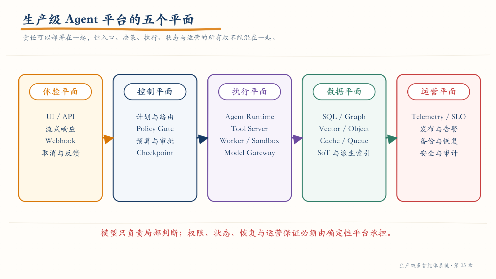
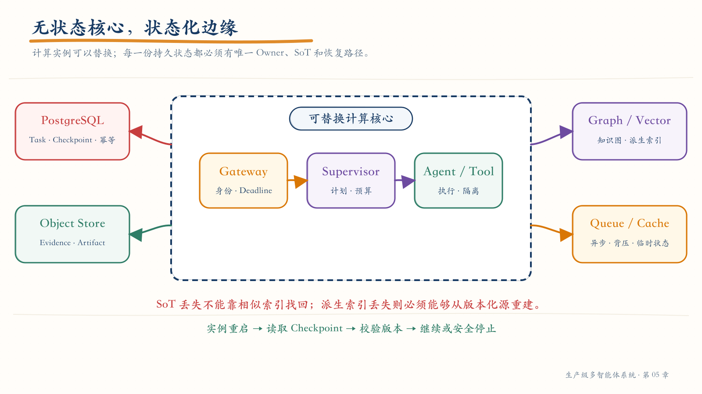
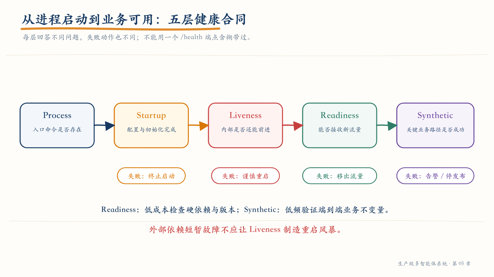
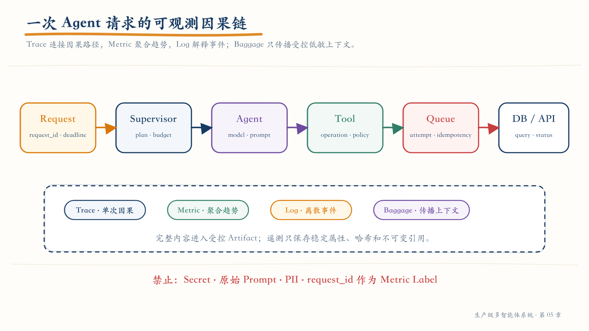
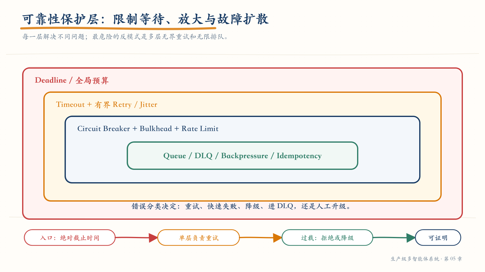
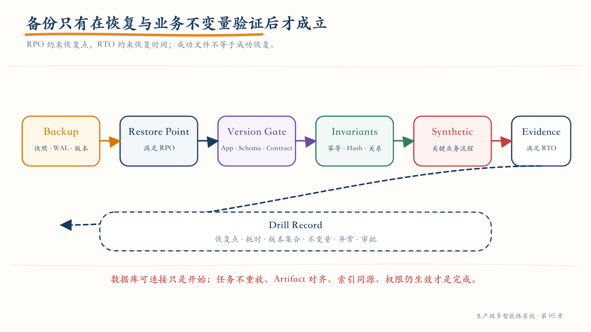
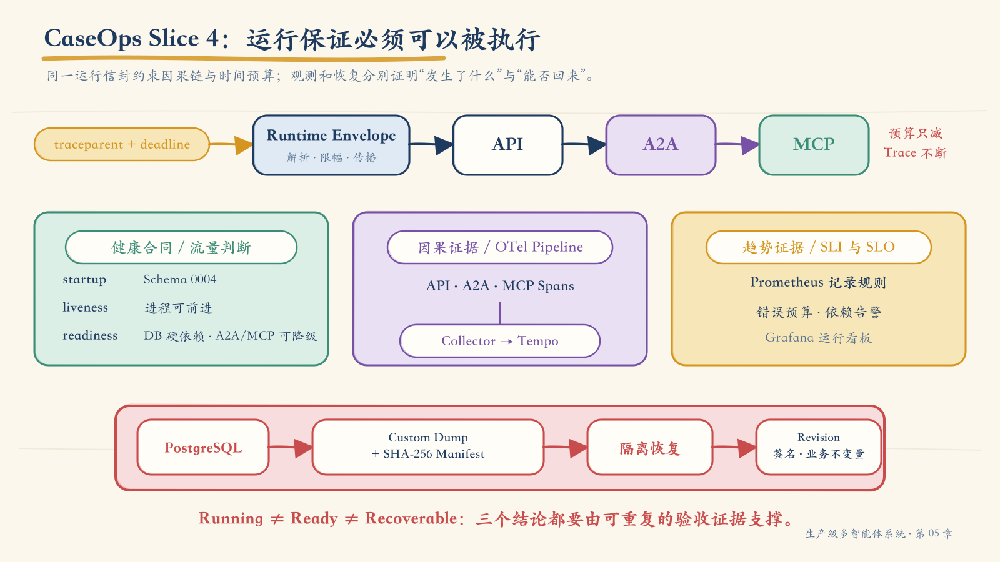

# Chapter 05: Production Foundations: Deployment, Observability, and Failure Recovery

In the previous chapter, the incident-investigation Agents became capable of answering questions within constraints on permissions, time, and evidence. The development team put them into a Compose file together with the Supervisor, Tool Server, PostgreSQL, graph database, vector database, object store, queue, and observability components. They ran one command, and every container soon turned green.

A reassuring message appeared in the project group:

> “The system is up and running.”

Ten minutes later, however, the first user received a `503`. The API process was indeed alive, but the database migration was stuck on an old version. After a network disruption, the Worker replayed a write operation that had already completed. The vector index recovered successfully, but with a different version of the Embedding model. A request passed through three Agents and two tools, yet its Trace broke at the queue boundary. The database password had been rotated, while the connection pool still held the old credential. The backup job reported success every day, but no one had ever performed an actual restore.

All the containers were running, but the business system was not ready. All the logs existed, but the cause of the incident could not be correlated. Backup files existed too, but recovery capability remained an unverified assumption.

Problems like these expose the distance between an agent prototype and a production system that is easiest to underestimate:

> **Being able to start proves only that the process began running at some point. Production readiness requires the system to serve continuously within constraints, expose its true state, contain failure propagation, and recover from data or infrastructure damage to a verifiable business state.**

This chapter does not interpret “productionization” as rewriting `docker compose up` into Kubernetes YAML, nor does it list a series of infrastructure products. We will establish a complete chain of guarantees:

```text
Architectural boundary
  → State ownership
  → Reproducible build
  → Runtime contract
  → Health and traffic gates
  → Telemetry and SLOs
  → Resilience controls
  → Backup, recovery, and business invariants
```

If any link in this chain is missing, the platform may “look healthy” while remaining unable to make credible external commitments.

## 1. First define what “production-grade” actually promises

Production-grade is not an attribute of a particular deployment tool. It is a set of verifiable system guarantees. For a multi-agent system, at least six questions must be answered:

1. **Deliverable**: Can the same source code, dependencies, configuration, and data migrations produce a traceable version?
2. **Serviceable**: When may an instance receive traffic, and when must it stop receiving traffic?
3. **Observable**: Can a business request be traced through Agents, Tools, models, queues, and data stores?
4. **Controllable**: Are there hard boundaries on timeouts, retries, concurrency, cost, and side effects?
5. **Recoverable**: Can state be restored within the RPO / RTO after process, node, region, or data failure?
6. **Evolvable**: Can configuration, Schema, model, Prompt, index, and service versions be upgraded and rolled back compatibly?

“The service has three replicas,” “we are running on Kubernetes,” and “we connected Grafana” are implementation facts. None means that the guarantees above have been established.

### 1.1 Production maturity is a ladder of guarantees

| Level | What it proves | What it still does not prove |
|---|---|---|
| Process started | The entry command can run | It can handle real requests |
| Container healthy | The process is not stuck or can complete a low-cost self-check | Critical dependencies and Schemas are usable |
| Instance ready | The current instance can receive a certain type of traffic | End-to-end business operations will succeed |
| Service available | Business SLIs meet their target over the specified window | Data can always be recovered after a failure |
| System recoverable | A recovery drill passes business invariants | The next version will remain compatible |
| Continuously operable | Releases, alerts, capacity, cost, and recovery all have closed feedback loops | It does not mean the system will never fail |

The higher the maturity level, the closer the evidence is to real business behavior rather than the surface state of the infrastructure.

### 1.2 The CaseOps claims-investigation thread continues in this chapter

We continue with the claims-investigation system for case `C-102` from the preceding chapters. This is not an operations example invented from scratch. It is the same business path that has already completed three engineering slices: a deterministic domain kernel, controlled Agents and MCP, multi-agent collaboration, and a governed Context Pack.

This chapter focuses on how that path becomes an operable system. The current executable topology includes:

- FastAPI: accepts investigation requests, authenticates tenant principals, and enforces request idempotency;
- Supervisor: establishes three delegation contracts and assigns deadlines, scopes, and acceptance conditions;
- A2A Service: hosts the three specialist Agents for coverage, documents, and risk;
- MCP Service: protects five read-only tools with short-lived task tokens;
- Context Pipeline: performs structured, full-text, and relational retrieval to build a Context Pack;
- PostgreSQL: stores cases, runs, Checkpoints, tasks, knowledge objects, audit records, and the Outbox;
- Telemetry Pipeline: receives Traces across the API, A2A, and MCP, and collects SLIs.

It does not yet have a message Broker, object storage, or an independent vector store. This book will explain the conditions under which those capabilities should be added, but the code will not create empty shell components merely to make the topology “look complete.” The first principle of honesty in production design is to describe only capabilities backed by runtime evidence as current facts.

The goal of this chapter is not to select the “one correct” product combination. It is to give every responsibility for state, traffic, failure, and recovery a clear owner, and to turn the critical guarantees into executable evidence through CaseOps Slice 4.

## 2. Five planes: do not put every production responsibility into the Agent Runtime

An operable agent platform can be divided into five explicit planes.



*Figure 5-1 The five planes address different rates of change, risks, and ownership. They may be physically combined, but their responsibilities must not be confused.*

| Plane | Core responsibility | Typical capabilities | Key question |
|---|---|---|---|
| Experience Plane | User and external-system experience | UI, API, streaming responses, Webhook | What did the user see, and can they cancel? |
| Control Plane | Decide what to do and whether it is permitted | Routing, planning, policy, budget, approval | Who may do what, and when must it stop? |
| Execution Plane | Actually execute Agents and Tools | Runtime, Worker, Sandbox, Model Gateway | How are actions executed and isolated? |
| Data Plane | Store authoritative state and derived data | SQL, Graph, Vector, Object, Cache, Queue | Where is the truth, and how is it recovered? |
| Operations Plane | Prove that the system is operating correctly | Telemetry, SLOs, releases, backup, recovery, security | How are failures detected, contained, and repaired? |

This division is first a responsibility model, not a requirement for a particular number of microservices. A small team can run several planes in the same cluster or even the same repository, but it cannot let the boundaries disappear.

For example:

- A model may propose “call the refund tool,” but policy and approval belong to the Control Plane;
- A Tool Runtime may perform a write, but the truth of the business record belongs to the Data Plane;
- A Supervisor may aggregate results, but whether an alert fires cannot be decided by the model itself;
- An Agent may generate a recovery recommendation, but recovery tasks must be executed through a controlled operations process.

### 2.1 Twelve platform capabilities

In engineering terms, the five planes include at least the following capabilities:

1. A unified entry point, authentication, and identity propagation;
2. Orchestration, Checkpoints, idempotency, and cancellation;
3. Agent / Tool discovery, versioning, and compatibility;
4. Model routing, rate limits, quotas, and cost control;
5. Clear roles for SQL, Graph, Vector, Object, and Cache;
6. Queues, asynchronous execution, backpressure, and dead letters;
7. Secrets, certificates, and service identities;
8. Structured logs and distributed Traces;
9. RED / USE metrics, SLOs, and alerts;
10. Startup, Liveness, Readiness, and Synthetic Checks;
11. Backup, recovery, and disaster recovery;
12. Versioned configuration, migration, release gates, and rollback.

If a platform provides only “start an Agent” and “call a model,” the remaining capabilities will eventually emerge anyway as scattered scripts, manual conventions, and incident patches.

## 3. Reference topology: stateless core, stateful edge

One of the most dangerous deployment misconceptions in a multi-agent system is treating every service as a stateless container that can be scaled at will.

Supervisors, Agent Runtimes, and APIs are generally well suited to remaining stateless: request context is read from an explicit State Store, intermediate results are written to a Checkpoint or Artifact, and instances can be replaced. Databases, object stores, queues, and indexes have persistence, ordering, replication, or recovery constraints and cannot be managed with the same lifecycle.



*Figure 5-2 Compute instances are replaceable; authoritative state and recovery responsibilities must not disappear with them.*

### 3.1 Why keep the core as stateless as possible?

Stateless does not mean that the system has no state. It means:

- Requests do not depend on the memory of one fixed instance;
- Checkpoints, Artifacts, and Idempotency Records have external persistent owners;
- After restarting, an instance can resume from persistent state or terminate safely;
- Horizontal scaling does not require session affinity;
- Releases and rollbacks do not require moving local business data.

The following data should not exist only in process memory:

- The current Task Graph and step states;
- Idempotency records for executed Tool Calls;
- Human Approval results;
- Long-running task progress and cancellation flags;
- Immutable references to generated Artifacts;
- Budget consumption and the global deadline.

### 3.2 A stateful edge does not mean “hand the database to a cloud provider”

Managed services can take responsibility for replication, patching, and some backup operations, but the application team must still define:

- What the store contains and does not contain;
- Who is the sole writer;
- Consistency and ordering requirements;
- Schema, index, and Embedding versions;
- Backup frequency and retention policy;
- RPO / RTO;
- Business validation after recovery;
- Degraded, read-only, or stop policies during failures.

Managed capabilities replace some operations, not state ownership.

## 4. Every type of state needs one owner and one recovery path

When a system contains multiple data products, “store a copy everywhere” is easily mistaken for redundancy. In reality, without an authoritative source and explicit derivation relationships, multiple copies merely create conflicts that no one can adjudicate.

### 4.1 State Ownership Catalog

Before deployment, first establish a State Ownership Catalog.

| State | Authoritative owner | Consistency | Rebuildable | Recovery basis | Example objective |
|---|---|---|---|---|---|
| Task / Checkpoint | PostgreSQL | Strong or transactional consistency | No | PITR + business validation | RPO ≤ 5 min |
| Tool Idempotency | PostgreSQL | Strong consistency | Partially | Transaction log | Duplicate calls do not duplicate side effects |
| Evidence / Artifact | Object Store | Read-after-write, immutable | No | Versioning + cross-domain replication | Matching hashes |
| Knowledge Graph | Graph Store | Per import batch | Partially rebuildable | Source manifest + incremental events | Relationships and constraints pass |
| Vector Index | Vector Store | Eventual consistency | Yes | Source text + Chunker + Embedding version | Aligned with the SoT |
| Cache | Redis, etc. | Eventual consistency | Yes | Recompute | Loss does not break correctness |
| Queue Message | Broker | At least once or specified semantics | No | Broker persistence + DLQ | No loss, deduplicable |
| Telemetry | Telemetry Backend | Eventual consistency | Usually no | Sampling and retention policy | Meets the audit window |

For complete, copy-ready templates, see [Production Readiness and Recovery Contract](../toolkit/production-readiness-contract.md).

### 4.2 Source of Truth and Derived Index

A **Source of Truth (SoT)** is the final authority when business facts conflict. A **Derived Index** is a derivative structure generated for query efficiency, relevance, or analysis.

For example:

```text
Original policy documents in the Object Store
  ├─> Chunk + Embedding ─> Vector Index
  ├─> Entity Extraction ─> Knowledge Graph
  └─> Metadata Parsing ─> Search Index
```

Vector, Graph, and Search can coexist, but they must record:

- `source_id` and the content hash;
- Parser / Chunker / Embedding versions;
- Generation time and validity time;
- Deletion and permission-propagation status;
- Rebuild cursor;
- The Schema version accepted by the current index.

If the vector store is lost, the system should rebuild it from the SoT. If the SoT is lost, vector similarity cannot replace the original evidence.

### 4.3 Recover the Knowledge Graph and Context Graph separately

Chapter 4 distinguished between two kinds of graph:

- The Knowledge Graph describes business entities and relationships;
- The Context Graph describes the Goal, Task, Tool, Evidence, and Claim in a particular execution.

They may use the same graph database, but they cannot share the same recovery assumptions. The former can usually be rebuilt from business sources and change events. The latter may carry audit and causal-tracing responsibilities and must be aligned with Task, Trace, and Artifact versions.

### 4.4 One state can have only one final write authority

Parallel multi-agent execution does not mean multiple agents can modify the same fact in parallel. Common strategies include:

- One Owner Agent writes, while other Agents submit recommendations;
- Optimistic locking and version numbers;
- Append-only Event + deterministic projection;
- A single writer partitioned by business key;
- A conflict queue requiring human adjudication.

“Last writer wins” is valid only when the business explicitly accepts losing intermediate updates.

## 5. Service boundaries: split by rate of change, risk, and resource model

Deploying every Agent as a separate microservice does not automatically produce better boundaries. A physical split should address real differences.

### 5.1 Signals that justify an independent deployment

Deploying two responsibility units separately is more valuable when they differ in any of the following ways:

- Release frequency;
- Security domain or data classification;
- CPU, memory, GPU, or concurrency model;
- Autoscaling metrics;
- Need for failure isolation;
- Team ownership;
- Runtime or dependency conflicts;
- SLO or maintenance window.

If none of these differences exists, splitting a process into a dozen services merely adds network calls, version coordination, and failure surface.

### 5.2 Control logic and execution environment for the same Agent

A high-risk Agent often needs two boundaries:

1. **Control logic**: plan, select tools, and evaluate results;
2. **Execution environment**: access databases, run code, and call external systems.

The control logic can run in a general-purpose Runtime, while the execution environment enters a Sandbox, restricted Worker, or dedicated Tool Server according to tool permissions. This avoids the assumption that “the process hosting the model naturally owns every production credential.”

### 5.3 The resource model must be explicit

LLM calls are often constrained by external quotas and latency. Embedding is constrained by batch throughput, browser or code execution by CPU / memory, and graph queries by database connections and query complexity. They should not all share a single “instance count” autoscaling metric.

A basic capacity model can be written as:

```text
Required concurrency ≈ Arrival rate × Average service time
```

Agent tasks must also account for:

- Maximum steps per task;
- Maximum Tool Calls per step;
- Model Token and monetary budgets;
- Queue waiting time;
- Tail latency;
- External API quotas;
- Human approval waiting time;
- Retry amplification factor.

## 6. Budgets propagate from the request entry point

If the entry point imposes a 30-second timeout, but the Supervisor allows three Agents to run for 30 seconds each and lets every tool retry three times, the system does not have a timeout strategy. It has several layers of contradictory timers.

### 6.1 Deadline takes precedence over local Timeout

Generate an absolute deadline when a request enters the system:

```json
{
  "request_id": "req-20260723-1042",
  "deadline_at": "2026-07-23T02:10:30Z",
  "max_agent_steps": 12,
  "max_tool_calls": 24,
  "max_model_tokens": 48000,
  "max_cost_usd": 1.20
}
```

Each downstream layer allocates its local Timeout from the time remaining rather than receiving a fresh copy of the full budget.

```python
remaining = deadline_at - now()
tool_timeout = min(configured_tool_timeout, remaining - response_margin)
if tool_timeout <= 0:
    return DeadlineExceeded()
```

### 6.2 Budgets are control-plane state

Tokens, cost, steps, concurrency, and retry counts must be accounted for by deterministic code. A model may see the remaining budget and adjust its plan, but it cannot expand that budget itself.

When a budget is exhausted, the system should enter a defined terminal state:

- Return the evidence already obtained and the outstanding items;
- Degrade to a cheaper model or retrieval strategy;
- Request human approval for additional budget;
- Stop high-risk actions instead of making a “best effort.”

## 7. A deployment tool is not a maturity label

Docker Compose, Swarm, Kubernetes, and managed platforms provide different capabilities, but a tool name cannot replace a checklist of guarantees.

| Capability | Typical single-host Compose support | Typical cluster-orchestrator support | Evidence to verify |
|---|---|---|---|
| Reproducible startup | Strong | Strong | Pinned versions and configuration |
| Multi-node scheduling | None | Available | Failover after node failure |
| Rolling releases | Must be implemented separately | Usually built in | Lossless traffic cutover |
| Automatic scaling | Requires external implementation | Usually extensible | Metrics and cold-start validation |
| Secret / Identity | Basic or external | Usually more complete | Rotation and least privilege |
| Network policy | Limited | Usually more complete | Default deny and explicit allow |
| Stateful-service recovery | Depends on an external solution | Still depends on the data solution | Restore Drill |
| SLO / Telemetry | Must be integrated | Still must be integrated | Dashboard and alert drill |

Compose is well suited to local experiments, integration tests, single-host delivery, and reproducible demonstrations. It can also be used in some controlled production scenarios, but other mechanisms must fill the gaps in high availability, scheduling, releases, security, and recovery. Kubernetes provides more control primitives, but it does not automatically fix incorrect state ownership, idempotency, or backup design.

The right question is not “should we move to Kubernetes?” It is:

> **What guarantees does the target environment require, which ones does the current platform already provide, who will close the gaps, and how will they be verified?**

## 8. The image is the first executable supply-chain contract

An image is not merely a packaging format for code. It also determines the runtime user, system dependencies, startup behavior, diagnostic entry points, and traceable version.

### 8.1 Minimum requirements for a production image

- Use an exact version or Digest, not a drifting `latest`;
- Use a multi-stage build so the runtime image does not carry build tools;
- Lock language dependencies and verify their hashes;
- Run as a non-Root user;
- Use a read-only Root Filesystem when feasible;
- Do not write Secrets, Tokens, private keys, or production configuration into image layers;
- Produce an SBOM and run vulnerability scans;
- Expose a low-cost health endpoint;
- Handle `SIGTERM` correctly, stopping traffic before exiting;
- Emit the Build Revision, Schema version, and startup diagnostics;
- Establish an update policy for base images and dependencies.

The official Kubernetes documentation explicitly recommends avoiding `:latest` in production deployments and explains that a Digest pins running code to unique image content. The important point here is not Kubernetes itself, but that “a version must be traceable, reproducible, and reversible.”

### 8.2 The startup command must become a contract

A service should not depend on implicit knowledge to start:

```text
entrypoint
  ├─ validate typed config
  ├─ load workload identity
  ├─ check schema compatibility
  ├─ register build metadata
  ├─ start server
  ├─ pass startup probe
  └─ become ready
```

Startup failure should return a clear error category rather than restarting forever:

- `CONFIG_INVALID`
- `SECRET_UNAVAILABLE`
- `SCHEMA_TOO_OLD`
- `SCHEMA_TOO_NEW`
- `DEPENDENCY_PERMISSION_DENIED`
- `MODEL_ROUTE_MISSING`

### 8.3 Graceful termination protects long-running tasks

After an instance receives a termination signal, the sequence is usually:

1. Set Readiness to failed and stop accepting new tasks;
2. Stop taking new messages from the queue;
3. Propagate cancellation to requests in progress or complete their critical sections;
4. Write a Checkpoint;
5. Release leases, connections, and temporary resources;
6. Exit within the Grace Period;
7. Let the platform terminate it forcibly after the timeout.

Without this process, a rolling release can itself create duplicate Tool Calls and corrupted Artifacts.

## 9. Health checks: Running does not mean Ready



*Figure 5-3 Startup, Liveness, Readiness, Dependency Checks, and Synthetic Checks answer different questions.*

### 9.1 Five kinds of checks cannot substitute for one another

| Check | Question answered | Action on failure | Must not include |
|---|---|---|---|
| Process | Does the process exist? | Runtime restarts it | Business dependencies |
| Startup | Did initialization finish within a reasonable time? | Terminate and restart according to policy | An infinite wait loop |
| Liveness | Is the process trapped in an unrecoverable internal failure? | Restart the container | A brief outage of an external database |
| Readiness | Can the current instance accept new traffic? | Remove it from traffic endpoints | Expensive end-to-end queries |
| Synthetic | Does a critical business path actually work? | Alert, stop the release, or switch traffic | High-frequency full regression tests |

Kubernetes semantics are very clear: Liveness and Readiness are not executed until the Startup Probe succeeds; a failed Liveness check triggers a container restart; a failed Readiness check only stops the instance from receiving traffic from matching Services. An incorrect Liveness implementation can also cause restart storms and cascading failures under heavy load.

### 9.2 A Readiness response should explain why

```json
{
  "status": "not_ready",
  "build": "git:a6d42f1",
  "schema": {
    "required": 42,
    "observed": 41,
    "status": "incompatible"
  },
  "dependencies": {
    "postgres": "reachable_but_schema_old",
    "queue": "ready",
    "vector": "degraded_optional"
  }
}
```

The external response should expose only necessary information, while detailed errors go to controlled logs. Health endpoints must not leak connection strings, Secrets, stack traces, or customer data.

### 9.3 Readiness must distinguish hard dependencies from degradable ones

Not every dependency failure should make an API stop accepting all traffic.

| Dependency | Policy on failure |
|---|---|
| Task Store | Hard failure; tasks cannot be persisted safely |
| Idempotency Store | Hard failure for writes; degradation may be evaluated for read-only requests |
| Vector Index | Fall back to FTS, but return a degradation marker |
| Graph Store | Relational investigations degrade, while simple retrieval can still be served |
| Telemetry Backend | Permit short-term buffering; audit-sensitive operations may fail hard |
| Model Provider A | Route to a compatible model; stop if no compatible route exists |

Dependency classification should be written into the Service Runtime Contract, not scattered across exception-handling code.

### 9.4 An open port does not mean business readiness

A TCP check proves only that something is listening. A database may not be truly usable unless:

- TLS and authentication succeed;
- The current role has the required permissions;
- The Schema version is compatible;
- Read-only / read-write mode matches expectations;
- The connection pool is not exhausted;
- Clock skew is within bounds.

These checks also must not run expensive queries every second. Readiness should be low-cost, cacheable, and bounded by a timeout. A lower-frequency Synthetic Check verifies complete business capability.

## 10. Configuration, Schema, and release versions must evolve together

An agent system has more versions than its application code. At minimum, it also includes:

- Configuration Schema;
- Database Schema;
- Tool Contract;
- Prompt / Policy;
- Model Route;
- Chunker / Embedding;
- Knowledge Graph Schema;
- Artifact Schema;
- Telemetry Semantic Convention.

### 10.1 Configuration must be typed

Each configuration item needs:

- A name, type, and unit;
- A default value and permitted range;
- Whether it is sensitive;
- Applicable environments;
- Whether it updates dynamically or takes effect after a restart;
- An Owner;
- A deprecation version;
- Constraints involving other configuration.

`TIMEOUT=30` is incomplete. It should specify whether the value is milliseconds or seconds, which layer it applies to, whether it may exceed the upstream Deadline, and whether retries are allowed after failure.

### 10.2 Data migration follows Expand—Migrate—Contract

Making new code depend directly on a destructive migration puts the release and the database into the same failure window.

A safer sequence is:

1. **Expand**: add backward-compatible fields or tables first;
2. **Deploy Compatible Code**: both old and new code can read and write;
3. **Migrate**: backfill and validate the data;
4. **Switch**: switch the read path or feature flag;
5. **Contract**: remove the old structure after confirming that no old version remains.

The Startup Gate should check a compatibility range rather than letting every replica race to run migrations during startup.

### 10.3 Index migrations must also be versioned

When the Embedding model or Chunker changes, do not overwrite the existing index in place:

```text
documents_v1  ── serving
documents_v2  ── backfill → validate → shadow query → cutover
```

Retain a sufficient rollback window after the cutover. Retrieval results must carry the index and Embedding versions so recovery cannot mix incompatible vector spaces.

## 11. A Secret is a lifecycle, not an `.env` file

Secret management covers creation, distribution, use, rotation, revocation, and audit.

### 11.1 Where Secrets must not appear

- Git repositories;
- Image layers;
- Prompts or model context;
- Trace Attributes;
- Metric Labels;
- Ordinary application logs;
- Build artifacts;
- Unencrypted backups;
- Error responses.

A model usually needs to know only that “the current action is authorized,” not to see the raw credential.

### 11.2 Dual-version rotation

Replacing a Secret directly can put old connections and new credentials out of sync. A safer process is:

```text
Create the new version
  → Let the service accept the old and new versions
  → Refresh instances and connection pools in batches
  → Verify adoption of the new version
  → Revoke the old version
  → Verify that no old connections remain
  → Preserve audit evidence
```

The success criterion for rotation is not that a new value appeared in the Secret Manager, but that all consumers have switched and the old value can no longer be used.

### 11.3 Prefer service identities over shared static keys

When the platform supports them, prefer short-lived Workload Identity, mTLS, or audience-restricted temporary credentials. Authorization should be constrained by at least:

- Calling service identity;
- Target resource;
- Permitted action;
- Tenant and region;
- Validity period;
- Request or task context;
- Whether human approval is required.

### 11.4 Default-deny networking

A common minimum exposure surface is:

- Expose only the Gateway to the public network;
- Access management interfaces through a controlled entry point;
- Do not expose databases publicly;
- Allow an Agent Runtime to reach only permitted Tool Servers;
- Allow a Tool Server to reach only the data sources it owns;
- Send Telemetry one way to the Collector;
- Bind development ports only to `127.0.0.1`;
- Restrict outbound access by domain, destination, and purpose.

Network policy cannot replace application authorization, but it can greatly reduce the blast radius after a credential leak.

## 12. Observability must reconstruct a business causal chain

An agent request crosses models, tools, queues, and multiple data stores. Looking only at a container's CPU or logs makes it difficult to answer, “Why was this conclusion slow, expensive, wrong, or executed twice?”



*Figure 5-4 Traces connect causal paths, Metrics aggregate operational trends, and Logs preserve discrete events. Baggage propagates controlled context but must not carry sensitive data.*

### 12.1 Three telemetry signals and propagated context

OpenTelemetry treats Traces, Metrics, and Logs as its principal telemetry signals. Baggage is key-value context propagated with a request. It can help downstream services correlate tenants, scenarios, or experiments, but it is not a business database and must not carry sensitive information.

| Type | Problem addressed | Typical granularity |
|---|---|---|
| Trace | Where did this request go, and where did it wait or fail? | Individual request / task |
| Metric | How did errors, latency, throughput, and resources change over time? | Aggregated time series |
| Log | What happened in a discrete event? | Structured event |
| Baggage | Which low-sensitivity context must propagate across processes? | Controlled key-value pairs |

The official OpenTelemetry documentation specifically warns that Baggage propagates downstream with network requests and may even enter third-party APIs. It therefore must not contain Secrets, customer details, or unverified identity conclusions.

### 12.2 Traces must cross asynchronous boundaries

A useful call chain might be:

```text
gateway.request
└── supervisor.run
    ├── agent.deployment_investigation
    │   ├── model.plan
    │   └── tool.deployment_query
    │       └── db.query
    ├── queue.publish
    └── worker.consume
        └── agent.evidence_synthesis
            ├── retrieval.hybrid
            └── artifact.write
```

A queue message carries at least:

- Trace Context;
- `request_id`;
- `task_id`;
- `attempt`;
- `idempotency_key`;
- `deadline_at`;
- Nonsensitive tenant or policy labels;
- Producer Build Revision.

The Consumer creates a new Span and establishes the correct parent-child or Link relationship with the Producer. Recording a string in the message body and expecting the platform to stitch the Trace together automatically is not enough.

### 12.3 Spans record decision boundaries, not complete content dumps

Recommended attributes:

```text
agent.name
agent.version
task.id
tool.name
tool.operation
model.provider
model.name
prompt.version
policy.decision
artifact.id
retrieval.index_version
retry.attempt
deadline.remaining_ms
```

Avoid recording:

- Complete Prompts and raw user input;
- PII in Tool parameters;
- Customer values in SQL;
- Model keys and connection strings;
- High-cardinality raw text;
- Unredacted Tool Results.

When raw content is needed for debugging, write it to a controlled Artifact Store and record only an immutable reference, hash, and access classification in the Span.

## 13. Metrics: from service RED to agent quality and cost

### 13.1 Start with user-visible RED

The basics for request-oriented services are:

- **Rate**: request or task rate;
- **Errors**: failures grouped by stable error category;
- **Duration**: end-to-end and critical-stage latency.

For resources and queues, add USE / saturation metrics:

- CPU, memory, connection pools, and thread pools;
- Queue depth, age of the oldest message, and consumer lag;
- Model-quota utilization;
- Worker concurrency and lease occupancy;
- Database lock waits and replication lag.

### 13.2 Agent-specific metrics

| Dimension | Example metrics | Purpose |
|---|---|---|
| Routing | Agent selection rate, fallback rate | Detect incorrect routing |
| Loops | Step count, termination reason, budget-exhaustion rate | Detect failure to converge |
| Tools | Call rate, error rate, retry rate, idempotency hits | Control action reliability |
| Models | Tokens, latency, rate limits, cost | Capacity and cost governance |
| Retrieval | Recall Proxy, empty-result rate, evidence coverage | Detect degradation of the knowledge chain |
| Quality | Citation validity, human rejection rate, task success rate | Connect operations with result quality |
| Security | Policy Deny, approval escalation, injection blocking | Detect changes in risk |

Metrics cannot replace offline evaluation. Online metrics reveal distribution shifts and operational anomalies, while Golden Dataset evaluations validate quality regressions. Versions and Traces must connect the two.

### 13.3 Control metric cardinality

Do not use `user_id`, `request_id`, `prompt_text`, `document_id`, or exception messages as Metric Labels. The official Prometheus guidance notes that every Labelset creates an additional time series and consumes more resources. High-cardinality dimensions should move to Traces, Logs, or analytics systems.

Stable Labels can include:

- `service`
- `environment`
- `agent_name`
- `tool_name`
- `model_route`
- `error_class`
- `result_status`

Use a Trace ID, not a high-cardinality Metric Label, to locate an individual request.

## 14. Dashboards, SLOs, and alerts must point to actions

### 14.1 Layered Dashboards

Establish at least six types of views:

1. **Platform Overview**: requests, errors, P95 / P99, queues, models, and dependencies;
2. **Agent View**: routing, steps, termination, budgets, and quality;
3. **Tool View**: calls, errors, retries, idempotency, and permission denials;
4. **Retrieval View**: index versions, empty results, latency, and evidence coverage;
5. **Dependency View**: databases, queues, object stores, and model providers;
6. **SLO View**: SLIs, error-budget consumption, Burn Rate, and release markers.

Charts should display deployment, configuration, Prompt, model-route, and index-cutover events. Otherwise, the team can see only that “things got worse at 10:02,” without immediately correlating what was released at 10:01.

### 14.2 Define SLOs from user outcomes

Infrastructure metrics are not SLOs. An incident-investigation system can define:

```text
SLI:
  Percentage of investigation tasks that return completed or
  evidence_insufficient within 120 seconds, with every critical Claim
  bound to accessible Evidence

SLO:
  ≥ 99.0% over the past 28 days
```

This definition treats “insufficient evidence, stopped safely” as a valid result rather than forcing an Agent to generate a conclusion without evidence.

### 14.3 Error budgets control release velocity

The error budget is `1 - SLO`. Its value is not merely to produce a chart, but to create operating policy:

- Budget healthy: release normally;
- Rapid consumption: strengthen reviews and reduce change frequency;
- Budget exhausted: pause changes except for urgent security fixes;
- Excessive consumption by one incident: require a postmortem and reliability action items.

The example policies in Google SRE likewise connect error budgets directly to release freezes, postmortems, and reliability investment.

### 14.4 Actionable alerts

An alert includes at least:

- The affected user outcome;
- Current value, threshold, and duration;
- Probable failure domain;
- Related deployment or configuration changes;
- Dashboard, Trace query, and Runbook;
- Owner and escalation path;
- Automated mitigation actions;
- Conditions for silencing or closing it.

“CPU > 80%” is usually not a complete alert. “Investigation-task P99 exceeds the SLO while the age of the oldest queue message continues to rise, and Worker v2.4.1 was released within the past ten minutes” is much closer to actionable information.

## 15. Reliability is a set of layered failure controls



*Figure 5-5 Timeouts, retries, circuit breakers, bulkheads, rate limits, and queues solve different problems. When combined, they must not multiply retries and concurrency.*

### 15.1 Timeout: limit waiting

Every network, model, database, and tool call needs an explicit Timeout. It should cover connection, reading, and the complete operation, and it should be derived from the upstream Deadline.

### 15.2 Retry: retry only failures that may recover and are safe to repeat

Consider retries for:

- Temporary network interruptions;
- Explicit `429` responses or recoverable `5xx` responses;
- Optimistic-lock conflicts;
- Brief Leader transitions.

Usually do not retry automatically:

- Parameter-validation failures;
- Permission denials;
- Schema incompatibility;
- Non-idempotent writes with unknown outcomes;
- Business-rule rejections;
- An exhausted Deadline.

Retries must have:

- A bounded count or Token Budget;
- Exponential backoff;
- Jitter;
- Respect for the server's `Retry-After`;
- An idempotency key;
- An end-to-end retry budget;
- Observable Attempts.

If the Gateway, Supervisor, Tool Runtime, and SDK each retry three times, one request can amplify to `3 × 3 × 3 × 3 = 81` downstream calls in the worst case. Usually, one layer should own retries while the others return stable errors quickly.

### 15.3 Circuit Breaker: stop applying pressure to a known failure

Based on failures and latency within a window, a circuit breaker enters one of three states:

- Closed: calls proceed normally;
- Open: fail fast or use a degraded path;
- Half-open: issue a small number of recovery probes.

Circuit-breaker state must be isolated by the real failure domain. For example, use `provider + model_route + region` rather than one switch shared by all models.

### 15.4 Bulkhead: isolate concurrency and resources

Low-priority batch indexing must not exhaust the connection pool for online investigations. Browser tools must not consume all capacity in the ordinary Agent Worker pool. A long-running task from one tenant must not block the global queue.

Bulkheads can be defined along these dimensions:

- Task type;
- Tenant;
- Risk level;
- Tool;
- Model provider;
- Online / offline;
- Resource type.

### 15.5 Backpressure: reject, queue, or degrade under overload

Without backpressure, a system converts traffic into memory, threads, connections, and bills.

Overload policy should explicitly choose among:

- Fail fast and return a retry time;
- Use a bounded queue;
- Coalesce identical requests;
- Sample or reduce retrieval depth;
- Switch to a lightweight model;
- Become read-only or return only existing Artifacts;
- Reduce quotas for low-priority Workers.

“Accept everything and process it slowly” is not a reliable strategy under unbounded traffic.

## 16. Queues: asynchronous does not automatically mean reliable

Putting long-running tasks into a queue can decouple rates and failures, but it also introduces duplicates, out-of-order delivery, late arrivals, and poison messages.

### 16.1 Queue contract

For each message type, define at least:

```yaml
message_type: evidence_index_requested
schema_version: 3
idempotency_key: source-42:content-sha256
partition_key: source-42
deadline_at: 2026-07-23T02:15:00Z
max_attempts: 5
visibility_timeout: 120s
owner: knowledge-platform
dlq: evidence-index-dlq
```

Also specify:

- Delivery semantics;
- Ordering scope;
- Producer / Consumer compatibility matrix;
- Retries and backoff;
- DLQ admission conditions;
- Replay permissions;
- Message retention;
- PII and encryption;
- Trace Context.

### 16.2 At-least-once delivery requires an idempotent Consumer

A safe Consumer sequence is usually:

1. Read the message and validate its Schema;
2. Check the Deadline;
3. Look up or lock the processing record using the Idempotency Key;
4. Perform the business action;
5. Atomically write the result and completion state;
6. Acknowledge the message;
7. On failure, retry according to error classification or send it to the DLQ.

If the business write and message acknowledgment cannot be completed atomically, the system must use an Outbox / Inbox, transaction log, or repeatable compensation to handle “the write succeeded but acknowledgment failed.”

### 16.3 A DLQ is not a graveyard

A DLQ needs:

- Stable error classification;
- The original message and Attempt history;
- A searchable Dashboard;
- An Owner and response time;
- Controlled replay after remediation;
- Idempotency validation before replay;
- Data-retention and privacy policies.

Emptying the DLQ every day merely turns failure evidence into a second incident.

## 17. A backup exists only after recovery is verified



*Figure 5-6 A backup file is only an input. The restore point, compatibility, business invariants, and Synthetic Checks together constitute recovery evidence.*

### 17.1 RPO and RTO

- **RPO (Recovery Point Objective)**: the time span of data loss that is acceptable;
- **RTO (Recovery Time Objective)**: the maximum permitted time from failure to service restoration.

They must be defined by state type rather than as one vague number for the entire platform.

| Tier | Example state | RPO | RTO | Typical strategy |
|---|---|---:|---:|---|
| Tier 0 | Idempotency, approvals, task state | ≤ 5 min | ≤ 30 min | PITR, cross-domain replicas, frequent drills |
| Tier 1 | Evidence, Artifacts, Knowledge Graph | ≤ 30 min | ≤ 4 h | Versioning, replication, incremental recovery |
| Tier 2 | Vector Index, Search Index | Determined by the SoT | ≤ 8 h | Rebuild from versioned sources |
| Tier 3 | Cache, temporary files | 0 | ≤ 1 h | Discard and rebuild |

Continuous archiving and WAL replay in PostgreSQL can support point-in-time recovery. But restoring to a point in time is only a database capability; application Schema, task state, and external Artifacts still need to be checked for alignment.

### 17.2 Recovery order is determined by dependencies

A common sequence is:

1. Identity, keys, and foundational networking;
2. Authoritative state such as PostgreSQL;
3. Evidence / Artifacts in the Object Store;
4. Queues and unfinished tasks;
5. Knowledge / Context Graphs;
6. Derived indexes such as Vector / Search;
7. Control and Execution Planes;
8. Telemetry;
9. Gateway and traffic;
10. Synthetic Business Flow.

This is not a fixed answer. The key is to write the sequence into a Runbook and prove the prerequisites and fallback actions for every step.

### 17.3 Recovery acceptance must check business invariants

A recovery drill verifies at least:

- The restore point falls within the RPO;
- Application, Schema, Tool Contract, and configuration versions are compatible;
- Completed tasks do not produce side effects again;
- Incomplete tasks can resume safely or stop explicitly;
- Artifact references exist and their content hashes match;
- Knowledge Graph constraints, relationship counts, and critical paths are valid;
- Old keys can decrypt necessary historical data and new keys can be used for new writes;
- The Vector Index aligns with the Source Hash, Chunker, and Embedding versions;
- Permission deletions and revocations remain effective;
- A Synthetic business flow passes within the RTO.

Merely verifying that “the database accepts connections” is nowhere near enough.

### 17.4 Recovery drills produce evidence

Every Drill preserves:

```yaml
drill_id: dr-2026-07-23-01
scenario: primary-region-loss
restore_point: 2026-07-23T01:58:00Z
data_loss_seconds: 92
service_restore_seconds: 1044
versions:
  application: 2.4.1
  schema: 42
  embedding: text-embed-v7
invariants:
  completed_task_replayed: false
  artifact_hash_match: true
  synthetic_investigation: passed
exceptions: []
approved_by: platform-oncall
```

Only this evidence can support the conclusion that the system meets its RPO / RTO.

## 18. Releases: turn change risk into an observable decision

### 18.1 A release unit must declare its version set

One agent release may change all of the following:

- Runtime code;
- Agent / Tool Contract;
- Prompt;
- Model Route;
- Policy;
- Database Schema;
- Graph Schema;
- Embedding and indexes;
- Dashboards and alerts.

The release manifest must record the compatibility matrix for these versions. Recording only an image Tag cannot explain changes in result quality.

### 18.2 Progressive Delivery

A high-risk change can progress through:

1. Static and supply-chain checks;
2. Unit, contract, and migration tests;
3. Integration tests in an Ephemeral Environment;
4. Shadow Traffic;
5. Internal tenants or a small Canary percentage;
6. Observation of operational SLIs, quality metrics, and cost;
7. Expansion in stages;
8. Full rollout after the gates pass;
9. A retained rollback window.

A Canary should compare more than HTTP error rates. It should also compare:

- Task success;
- Citation validity;
- Human rejection;
- Tool side effects;
- Tokens and cost;
- Step counts;
- Security denials;
- Recovery and replay behavior.

### 18.3 Rollback is not a universal answer for every change

Code and Prompts can usually be rolled back. Destructive Schemas, external side effects, and newly persisted formats may not be directly reversible. Before release, therefore, define:

- Forward Fix or Rollback;
- Whether the data migration is reversible;
- Whether old and new Consumers are compatible;
- How executed Tool Calls will be compensated;
- Whether two index versions will be retained;
- Whether a Feature Flag can disable the new path.

## 19. From a local platform experiment to production

The value of a local experiment is to make production responsibilities visible in their smallest form, not to pretend that one laptop provides production-grade high availability.

### 19.1 Recommended local Profiles

```text
core
  Gateway + Supervisor + Agent Runtime
  PostgreSQL + Redis + Object Store

telemetry
  OpenTelemetry Collector
  Prometheus + Grafana + Trace Backend

full
  core + telemetry
  Graph + Vector + Worker + Queue
  optional evaluation services
```

A local Compose setup should:

- Expose only the Gateway and necessary development UIs;
- Bind database ports only to `127.0.0.1` or an internal network;
- Use named volumes and identify which ones may be deleted;
- Make health checks reflect actual Startup / Readiness;
- Use exact image versions;
- Use sample Secrets or local Secret files without committing real values;
- Avoid hiding every phase behind a one-command startup;
- Use `make verify` or an equivalent command to validate the business path.

### 19.2 Acceptance is not counting containers

Do not use:

```text
12/12 containers running
```

as the only completion criterion. The following evidence is more meaningful:

```text
✓ Gateway does not receive traffic before it is ready
✓ Incompatible Schema blocks startup
✓ One request has a complete Agent → Tool → DB Trace
✓ Duplicate Worker consumption does not duplicate side effects
✓ Model rate limits trigger bounded backoff and degradation
✓ Vector can be rebuilt from the SoT after it is lost
✓ Business invariants pass after PostgreSQL recovery
✓ Old credentials fail after Secret rotation
```

### 19.3 Six minimum failure injections

1. A brief database outage;
2. A model-provider `429` or high latency;
3. A Worker crash after a business write but before message acknowledgment;
4. A Vector Index version mismatch;
5. Secret rotation while a connection pool remains alive;
6. An unavailable Telemetry Backend.

For every injection, observe:

- Whether traffic is gated correctly;
- Whether retries are bounded;
- Whether duplicate side effects occur;
- Whether the Trace is preserved;
- Whether the alert is actionable;
- Whether the service degrades as designed;
- Whether it automatically returns to normal after recovery.

### 19.4 Mapping local capabilities to production

| Local capability | Production mapping | Guarantee that must not be treated as already obtained |
|---|---|---|
| Compose Service | Deployment / Managed Workload | Multi-zone high availability |
| Named Volume | Managed Storage / Persistent Volume | Verified backups |
| `.env.example` | Secret Manager / Workload Identity | Automatic rotation |
| Single-host network | Network Policy / Gateway | Zero trust |
| Local Collector | HA Telemetry Pipeline | Audit-grade losslessness |
| Manual restart | Self-healing / Rollout | Correct business recovery |
| Local Snapshot | PITR / Replication | Meeting the RPO / RTO |

The value of this mapping is that it honestly distinguishes “the code path has been verified” from “the production guarantee still requires validation on the target platform.”

## 20. Production-readiness acceptance

### 20.1 Build and supply chain

- [ ] The core Profile can start reproducibly from a clean environment;
- [ ] Every image uses an exact version or Digest, with no `latest`;
- [ ] Dependencies are locked, and image scans and the SBOM are traceable;
- [ ] Processes run as non-Root, and Secrets do not enter images;
- [ ] The Build Revision and all contract versions can be queried.

### 20.2 Runtime and traffic

- [ ] Startup, Liveness, and Readiness have distinct semantics;
- [ ] Incompatible Schema or configuration fails before traffic is accepted;
- [ ] Graceful termination neither loses tasks nor duplicates side effects;
- [ ] Deadline, Timeout, Retry, and the global budget are consistent;
- [ ] Overload triggers a bounded queue, rejection, or degradation.

### 20.3 State and recovery

- [ ] Every state type records its Owner, SoT, consistency, and rebuildability;
- [ ] RPO / RTO objectives are tiered by state;
- [ ] Backup, recovery, and business-invariant validation can be repeated;
- [ ] Vector / Graph / Search can be aligned with source versions;
- [ ] Completed tasks do not execute again after recovery.

### 20.4 Security

- [ ] Secrets do not appear in Git, images, Prompts, Logs, Traces, or Metrics;
- [ ] Service identities and least privilege are auditable;
- [ ] Secret rotation and revocation of old versions have been verified;
- [ ] Networking is default-deny, with minimal public exposure;
- [ ] High-risk Tools remain constrained by policy, approval, and idempotency.

### 20.5 Observability and operations

- [ ] At least one complete Agent → Tool → DB / External API Trace exists;
- [ ] Dashboards cover RED, queues, Agents, Tools, cost, and quality;
- [ ] Metric Labels contain no high-cardinality or sensitive fields;
- [ ] SLOs are defined from user outcomes, and error budgets connect to release policy;
- [ ] Alerts include an Owner, Runbook, change context, and validation action;
- [ ] At least six types of failure injection have passed with preserved evidence.

Copy-ready templates for the State Ownership Catalog, Service Runtime Contract, Deployment Verification, and Restore Drill are available in the [Production Readiness and Recovery Contract](../toolkit/production-readiness-contract.md).

## 21. CaseOps Slice 4: turn runtime guarantees into executable evidence

The preceding twenty sections answered, “What should a production system provide?” If the chapter ended here, however, it could still become nothing more than a thorough set of architectural recommendations. The difficult part is to press those recommendations into code, configuration, and acceptance checks so incorrect designs fail automatically.

In CaseOps Slice 4, I selected four interlocking guarantees:

| Guarantee | Where it is enforced in code | Acceptance evidence |
|---|---|---|
| Requests do not execute without bounds | API / A2A / MCP Runtime Envelope | One Trace, an absolute deadline, and `408` for expired requests |
| Health status does not lie | startup / liveness / readiness | Schema-version gate, critical-dependency failure, optional-dependency degradation |
| The causal chain of one collaboration can be reconstructed | OTel SDK → Collector → Tempo | API, A2A, and MCP all appear within one Trace |
| Business state can be recovered after data corruption | `pg_dump` → isolated restore → validation | revision, content signature, and the `tenant-demo/C-102` invariant |

These four guarantees do not mean “all production infrastructure is complete.” They form a minimum vertical slice: requests have boundaries, services can express their actual state, failures can be located, and authoritative data can be recovered. Without any one of them, the other three are incomplete.

### 21.1 Runtime Envelope: put the time budget and causal identifiers into one envelope

Many systems set `timeout=30s` at every hop. Once a request has passed through the API, A2A, and MCP, its worst-case wait is no longer 30 seconds; it may exceed 90 seconds. With retries and a parallel Join, the total duration becomes even harder to predict.

Slice 4 accepts two contracts at the entry point:

- `X-Request-Timeout-Ms`: a relative budget provided by the client;
- `X-Request-Deadline`: an RFC 3339 absolute deadline.

The two cannot appear together. The entry point converts the relative budget to an absolute time and caps it at the platform maximum. Downstream calls propagate only the absolute deadline and calculate their local timeout as “deadline minus current time.” This makes the budget monotonic:

$$
B_{i+1}=\max(0,\ D-t_{i+1})\le B_i
$$

Here, $D$ is the single end-to-end deadline, and $B_i$ is the remaining budget seen at hop $i$. No downstream component can receive another 30 seconds merely because it begins a new call.

The same middleware also parses or creates the W3C `traceparent` and returns:

```text
X-Trace-ID: 11111111111111111111111111111115
traceparent: 00-11111111111111111111111111111115-<span-id>-01
X-Request-Deadline: 2026-07-27T09:32:18.267003+00:00
```

Each of these three items has a different responsibility: the Trace ID correlates the causal chain, the Span ID distinguishes the current operation, and the deadline determines whether continuing execution is still worthwhile. Calling all of them `request_id` discards their semantics.

If the entry point finds that the deadline has already passed, it returns `408` directly without entering domain logic. The A2A Client and MCP Client inject the current Trace Context and set their HTTP timeouts from the remaining budget. When the Supervisor creates specialist tasks, a child-task deadline may not be later than that of its parent request. In this way, “when must we stop?” becomes control-plane state rather than a magic number scattered across three HTTP Clients.

### 21.2 Health checks must express capabilities, not merely processes

Slice 4 provides three APIs:

| API | Question answered | Correct action after failure |
|---|---|---|
| `/health/live` | Can the process event loop still respond? | Restart after consecutive failures |
| `/health/startup` | Has the database reached expected migration `0004`? | Do not allow the instance to enter service |
| `/health/ready` | Which business capabilities can currently be provided? | Stop or restrict new traffic |

In Readiness, PostgreSQL is a critical dependency because cases, tenant boundaries, the run ledger, and idempotency all reside there. A2A and MCP are optional dependencies because, when they are unavailable, the API can still provide limited capabilities such as liveness checks and retrieval of historical results. The health response is therefore more than a Boolean:

```json
{
  "status": "degraded",
  "checks": [
    {"name": "database", "status": "ok", "critical": true},
    {"name": "mcp", "status": "ok", "critical": false},
    {"name": "a2a", "status": "unavailable", "critical": false}
  ]
}
```

When the database fails, Readiness returns `503 unavailable`; when A2A fails temporarily, it returns `200 degraded`. Retaining `200` here does not conceal a failure. It expresses that “the process still has a limited set of capabilities.” Whether an upstream gateway continues routing a given type of request should be determined by a capability-routing contract. If there is only one unified traffic entry point, `degraded` can instead be mapped to rejection of write traffic.

In the acceptance script, I actually run `docker compose stop a2a`. The expected outcome is not an API restart, but:

```text
liveness = ok
readiness.status = degraded
checks.a2a = unavailable
```

The script then restarts A2A and continues with the recovery drill. This is closer to the actual state seen by an orchestrator than Mocking the health endpoint.

### 21.3 Telemetry pipeline: services produce signals, the Collector routes them

All three services use the OpenTelemetry SDK to create Tracer Providers with stable resource attributes:

```text
service.name
service.version = 0.5.0
deployment.environment
```

The services do not depend directly on Tempo's storage protocol. Instead, they send Spans to the OpenTelemetry Collector through OTLP/HTTP. The Collector applies memory limits and batching before sending Traces to Tempo. This boundary keeps backend replacement, sampling, and multi-destination routing in the Operations Plane rather than introducing them into business services.



*Figure 5-7 The same runtime envelope connects request budgets with cross-service Traces. Prometheus proves service trends, while the recovery drill proves that authoritative state can be reconstructed.*

A `C-102` multi-agent collaboration forms a single Trace in Tempo:

```text
caseops-api
  POST /v1/cases/C-102/collaboration-runs
    caseops-a2a
      GET /.well-known/agent-card.json
      POST /a2a/rest/message:send
        caseops-mcp
          POST /mcp
```

Acceptance does not pass as soon as it finds the first Span. The Batch Exporter and Collector can both introduce a short visibility delay, so the script polls until all three `service.name` values appear in the same Trace. This test reveals an easily overlooked issue: **telemetry becomes visible eventually, so acceptance conditions must wait for the complete causal chain, not merely for “a Trace to exist.”**

### 21.4 Metrics and alerts: use Labels only for aggregatable dimensions

Prometheus scrapes request volume, errors, latency, in-progress requests, deadline rejections, and dependency-readiness status from the API's `/metrics` endpoint. `case_id`, `tenant_id`, Trace ID, and exception text never become Labels. Those high-cardinality details belong in Traces, Logs, or controlled business analytics.

Slice 4 provides four recording rules and three alerting rules. The core error-rate recording rule is:

$$
\text{error ratio}_{5m}
=
\frac{\sum \operatorname{rate}(\text{5xx requests}[5m])}
{\sum \operatorname{rate}(\text{all requests}[5m])}
$$

Recording rules standardize expressions that are frequently used, expensive, or easy to get wrong. Alerting rules focus only on user symptoms and actionable states:

- Rapid burn of the availability error budget;
- A critical dependency is unavailable;
- An optional dependency remains degraded.

Every alert includes an owner, severity, and Runbook URL. Grafana comes with a preprovisioned operations Dashboard, but the Dashboard is not the basis for acceptance. The underlying evidence is that the correct rules exist in the Prometheus API and that real metrics are successfully scraped.

The local observability stack uses exact versions:

```text
OpenTelemetry Collector 0.153.0
Tempo 2.10.5
Prometheus 3.12.0
Grafana 13.1.0
```

These versions make the experiment reproducible; they do not mean the components will never be upgraded. An upgrade must pass configuration validation, rule validation, and full acceptance again.

### 21.5 Recovery drill: compare content and business invariants, not just exit codes

`scripts/backup-postgres.sh` produces a PostgreSQL custom-format archive and saves a Manifest alongside it:

```json
{
  "schema_version": "caseops.backup-manifest.v1",
  "database": "caseops",
  "alembic_revision": "0004",
  "archive_format": "postgresql-custom",
  "archive_bytes": 0,
  "sha256": "<archive-sha256>"
}
```

In an actual file, `archive_bytes` contains the real size. The example uses `0` to avoid mistaking an ephemeral value from one development-machine run for part of the contract. The real contract consists of the fields, format, and validation method.

The recovery script does not overwrite the source database. It creates the isolated database `caseops_restore_drill_ch05`, runs `pg_restore --exit-on-error`, and then validates three layers of evidence:

1. **Schema**: `alembic_version` must equal `0004`;
2. **Content**: core tables must be concatenated in stable order and hashed with MD5, with identical results for the source and restored databases;
3. **Business**: the restored database must contain tenant `tenant-demo`'s case `C-102`.

The third layer caused the first acceptance run to fail. The script mistakenly wrote the external business key `case_id` as the internal primary key `id`. The database had restored successfully, and the content signatures matched, but the business invariant still did not hold. After correcting the field, the complete drill passed:

```text
isolated PostgreSQL restore accepted:
rto=6s
signature=59be10a6b8c65e14c9d3482f57323163
```

This `6s` value is one measurement from a small dataset on a development machine, not a production RTO. It proves that the recovery procedure can be timed and repeated and can fail on a business assertion. A production RTO must still be measured in an environment close to real data volumes, topology, and bandwidth. Stricter RPOs also require WAL archiving and PITR; increasing the frequency of `pg_dump` is not a substitute for continuous recovery.

### 21.6 The order of one-command acceptance is itself a recovery contract

The Chapter 5 acceptance script runs in this order:

```text
startup / readiness
  → expired deadline fails
  → C-102 multi-agent collaboration
  → complete Tempo Trace
  → Prometheus rules
  → stop A2A and observe degradation
  → restart A2A
  → backup
  → isolated restore
  → content signature and business invariants
```

The order matters. If recovery is not verified after a failure injection, the team has proved only that the system can fail. If state is not verified again after recovery, the team has proved only that the containers can turn green again. If original data is deleted before the backup is validated, a drill has become an irreversible operation.

For this slice, the runtime and quality evidence is:

```text
45 tests passed
Mypy strict passed
coverage 86.29%
Bandit passed
pip-audit: no known vulnerabilities
Prometheus rules: 7 passed
cross-service W3C trace: api / a2a / mcp passed
optional dependency degradation passed
isolated PostgreSQL restore passed
```

### 21.7 Pinned version and reproduction entry point

The complete implementation is in the standalone project [production-grade-multi-agent-caseops](https://github.com/dataPro-lgtm/production-grade-multi-agent-caseops/tree/chapter-05-slice-4), version `v0.5.0`, at commit `2834e50`.

```bash
git clone https://github.com/dataPro-lgtm/production-grade-multi-agent-caseops.git
cd production-grade-multi-agent-caseops
git checkout chapter-05-slice-4

docker compose \
  -f compose.yaml \
  -f deploy/compose.observability.yaml \
  up --build -d

make acceptance-chapter-05
```

Grafana maps to `http://localhost:3300` by default to avoid conflicting with port `3000`, which is commonly occupied by local development services. For the full commands, manual Trace queries, backup manifest, and shutdown procedure, see the [Chapter 5 Runbook](https://github.com/dataPro-lgtm/production-grade-multi-agent-caseops/blob/chapter-05-slice-4/docs/chapter-05-runbook.md).

This engineering work does not replace the theoretical framework. On the contrary, the code lets us see whether the terms in that framework have real execution semantics: whether the deadline propagates, whether Readiness degrades, whether the Trace crosses protocol boundaries, and whether a backup can be restored to a business-usable state. Architectural judgment is more than a slogan only if tests like these can prove it wrong.

## 22. Incident review: why container health does not equal system availability

We can now reinterpret the incident from the beginning of the chapter:

- The API process was alive, but the Schema Gate failed, so the instance should not have been Ready;
- The Worker replayed a write, showing that the Idempotency Record or queue-processing contract was missing;
- The Vector store recovered with the wrong Embedding, showing that the derived index was not aligned with the SoT by version;
- The Trace broke at the queue, showing that the asynchronous message did not propagate Trace Context;
- The Secret had been rotated while the connection pool still used the old credential, showing that the rotation updated only the store and did not verify consumers;
- The backup had never been restored, showing that the team had a file but no evidence of recovery capability.

None of these problems can be solved by “adding a few more Agents.” They belong to platform boundaries, state ownership, and operational guarantees.

What truly matters in a production-grade agent system is not never failing, but:

> **Failures can be detected promptly, their impact can be contained, actions can be traced, state can be recovered, and the result of recovery can be proved by business invariants.**

Only when a team can provide this evidence does “the system is live” cease to be an optimistic judgment and become an auditable engineering conclusion.

## References

- [Kubernetes: Liveness, Readiness, and Startup Probes](https://kubernetes.io/docs/concepts/workloads/pods/probes/)
- [Kubernetes: Container Images](https://kubernetes.io/docs/concepts/containers/images/)
- [Kubernetes: Container Lifecycle Hooks](https://kubernetes.io/docs/concepts/containers/container-lifecycle-hooks/)
- [OpenTelemetry: Signals](https://opentelemetry.io/docs/concepts/signals/)
- [OpenTelemetry: Baggage](https://opentelemetry.io/docs/concepts/signals/baggage/)
- [OpenTelemetry: Instrumentation](https://opentelemetry.io/docs/concepts/instrumentation/)
- [OpenTelemetry: Collector Configuration](https://opentelemetry.io/docs/collector/configuration/)
- [Prometheus: Instrumentation Best Practices](https://prometheus.io/docs/practices/instrumentation/)
- [Prometheus: Metric and Label Naming](https://prometheus.io/docs/practices/naming/)
- [Prometheus: Alerting Rules](https://prometheus.io/docs/prometheus/latest/configuration/alerting_rules/)
- [Prometheus: Alerting Best Practices](https://prometheus.io/docs/practices/alerting/)
- [Google SRE Workbook: Error Budget Policy](https://sre.google/workbook/error-budget-policy/)
- [Google SRE Workbook: Monitoring](https://sre.google/workbook/monitoring/)
- [AWS Builders’ Library: Timeouts, Retries and Backoff with Jitter](https://aws.amazon.com/builders-library/timeouts-retries-and-backoff-with-jitter/)
- [PostgreSQL: pg_dump](https://www.postgresql.org/docs/current/app-pgdump.html)
- [PostgreSQL: pg_restore](https://www.postgresql.org/docs/current/app-pgrestore.html)
- [PostgreSQL: Continuous Archiving and Point-in-Time Recovery](https://www.postgresql.org/docs/current/continuous-archiving.html)
- [CaseOps Slice 4](https://github.com/dataPro-lgtm/production-grade-multi-agent-caseops/tree/chapter-05-slice-4): The runtime envelope, health contract, observability stack, SLO rules, recovery drill, and acceptance script for this chapter.
