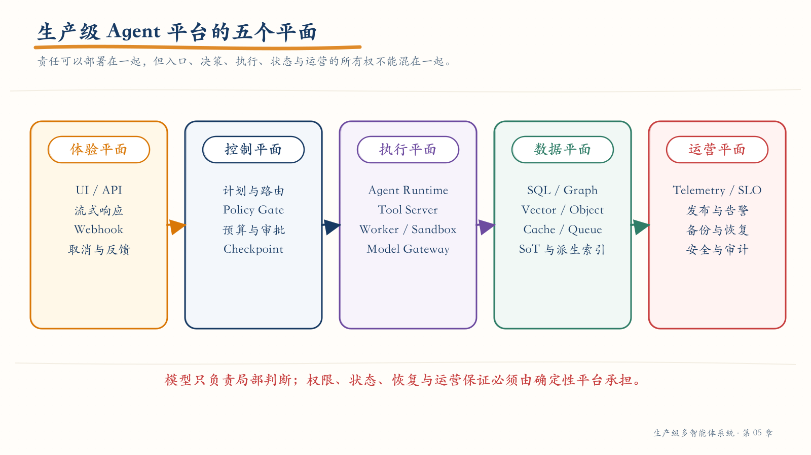
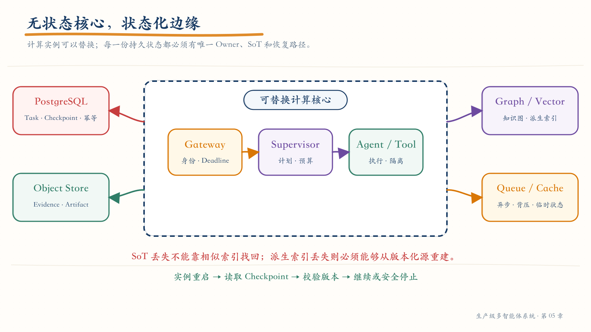
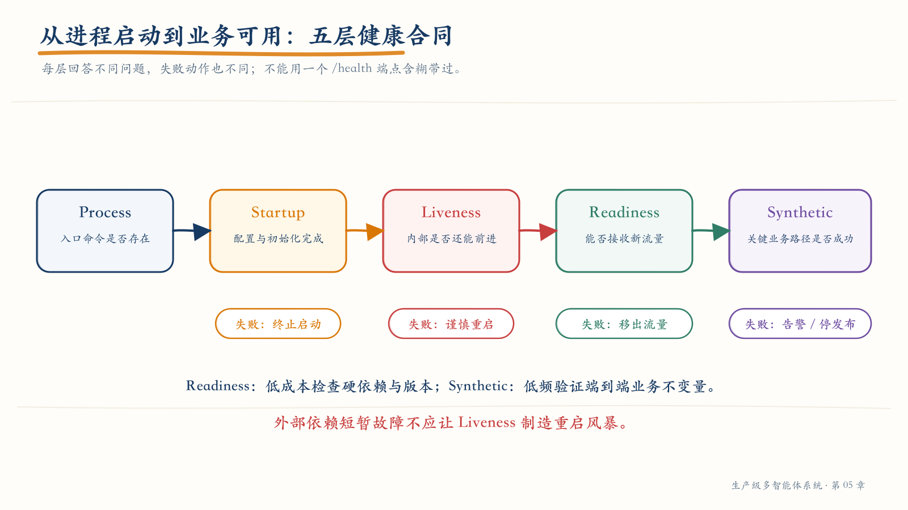
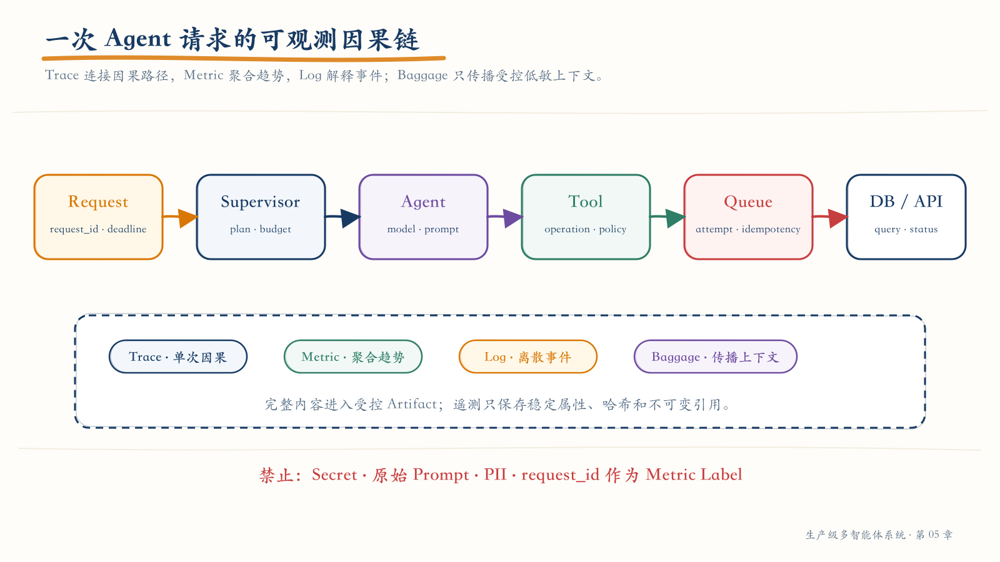
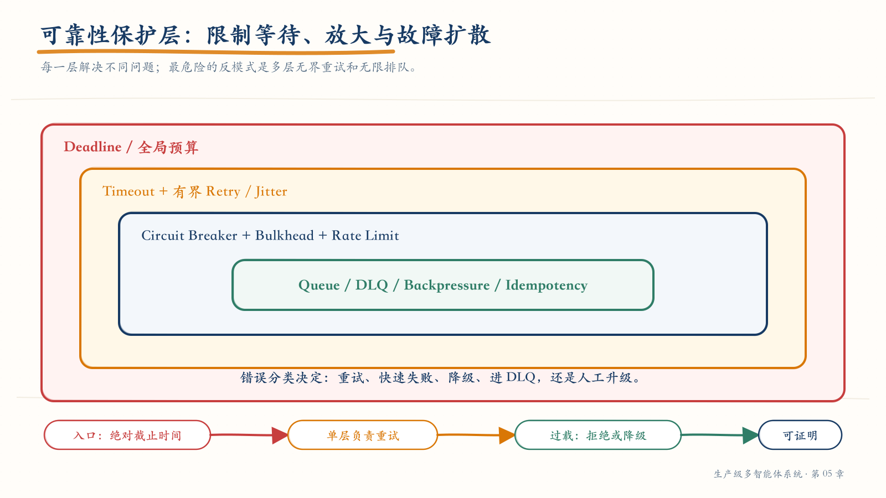
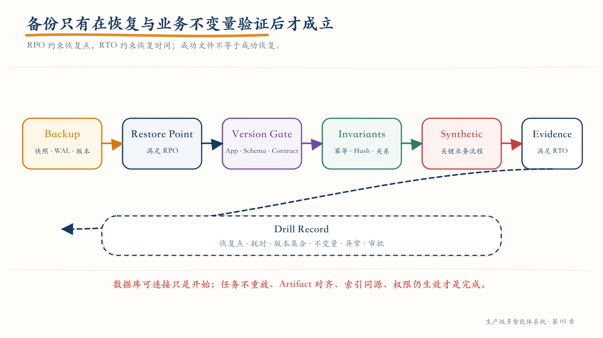
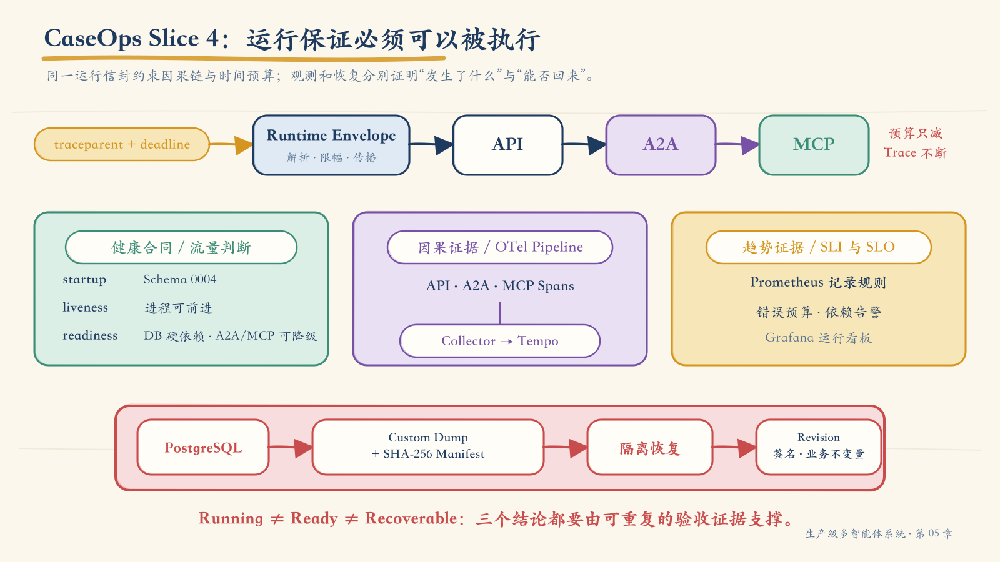

# 第05章　本番基盤：デプロイ、オブザーバビリティ、障害復旧

前章では、インシデント調査 Agent が権限、時間、エビデンスの制約下で質問に回答できるようになりました。開発チームは、この Agent と Supervisor、Tool Server、PostgreSQL、グラフデータベース、ベクトルデータベース、オブジェクトストレージ、キュー、オブザーバビリティコンポーネントをまとめて Compose ファイルに記述しました。コマンドを1つ実行すると、すべてのコンテナがすぐにグリーンになりました。

プロジェクトのグループチャットには、安心感を与える一言が投稿されました。

> 「システムはもう動いています。」

ところが10分後、最初のユーザーが受け取ったのは `503` でした。API プロセスは確かに稼働していましたが、データベースマイグレーションは古いバージョンで止まっていました。Worker はネットワークの揺らぎの後、完了済みの書き込み操作を再実行していました。ベクトルインデックスの復旧自体は成功したものの、別バージョンの Embedding が使われていました。リクエストは3つの Agent と2つのツールを通過しましたが、Trace はキュー境界で途切れていました。データベースパスワードはローテーション済みなのに、コネクションプールは古い認証情報を保持したままでした。バックアップジョブは毎日成功と表示されていましたが、実際に復元した人は一人もいませんでした。

コンテナはすべて稼働していても、業務システムは準備できていませんでした。ログはすべて存在していても、インシデントの原因を関連付けられませんでした。バックアップファイルも存在していましたが、復旧能力は検証されていない仮説にすぎませんでした。

この種の問題は、Agent のプロトタイプと本番システムの間で最も過小評価されやすい距離を浮き彫りにします。

> **起動できるという事実は、プロセスが一度は動き始めたことしか証明しません。本番準備完了とは、システムが制約内で継続的にサービスを提供し、実際の状態を可視化し、障害の波及を制御し、データやインフラストラクチャの破損後に検証可能な業務状態まで復旧できることを意味します。**

本章では、「本番化」を `docker compose up` から Kubernetes YAML への書き換えとは捉えません。また、インフラストラクチャ製品を羅列することもしません。代わりに、次の完全な保証チェーンを構築します。

```text
アーキテクチャ境界
  → 状態の所有権
  → 再現可能なビルド
  → ランタイム契約
  → ヘルスチェックとトラフィックゲート
  → テレメトリと SLO
  → レジリエンス制御
  → バックアップ、復旧、業務不変条件
```

このチェーンのどれか1つでも欠ければ、プラットフォームは「正常に見える」のに、外部に対して信頼できる約束を示せない可能性があります。

## 1. まず「本番運用級」が何を保証するのかを定義する

本番運用級とは、特定のデプロイツールが持つ属性ではなく、検証可能な一連のシステム保証です。マルチエージェントシステムでは、少なくとも次の6つの問いに答える必要があります。

1. **デリバリー可能性**：同じソースコード、依存関係、設定、データマイグレーションから、追跡可能なバージョンをビルドできるか。
2. **サービス提供可能性**：インスタンスはいつトラフィックを受け付けられ、いつ受け付けを停止すべきか。
3. **オブザーバビリティ**：1つの業務リクエストを、Agent、Tool、モデル、キュー、データストアまで追跡できるか。
4. **制御可能性**：タイムアウト、リトライ、並行処理、コスト、副作用に明確な上限があるか。
5. **復旧可能性**：プロセス、ノード、リージョン、またはデータの破損後、RPO / RTO 内に状態を復旧できるか。
6. **進化可能性**：設定、Schema、モデル、Prompt、インデックス、サービスの各バージョンを、互換性を保ってアップグレードおよびロールバックできるか。

「サービスに3つのレプリカがある」「Kubernetes に載せた」「Grafana を接続した」といった事実は、いずれも実装上の事実にすぎず、上記の保証が成立したことを意味しません。

### 1.1 本番成熟度は保証の階段である

| レベル | 証明できること | まだ証明できないこと |
|---|---|---|
| プロセス起動 | エントリコマンドを実行できる | 実際のリクエストを処理できる |
| コンテナ正常性 | プロセスが停止していない、または低コストの自己診断を完了できる | 重要な依存先と Schema が利用できる |
| インスタンス準備完了 | 現在のインスタンスが特定種類のトラフィックを受け付けられる | エンドツーエンドの業務が必ず成功する |
| サービス利用可能 | 業務 SLI が目標期間内に基準を満たす | 障害後に必ずデータを復旧できる |
| システム復旧可能 | 復旧訓練で業務不変条件を満たす | 次のバージョンにも互換性がある |
| 継続運用可能 | リリース、アラート、キャパシティ、コスト、復旧がすべて閉ループ化されている | 決して失敗しないという意味ではない |

成熟度が高いほど、エビデンスはインフラストラクチャの表面的な状態ではなく、実際の業務に近づきます。

### 1.2 本章でも扱う CaseOps 保険金請求調査の流れ

本章でも、これまでの章で扱った案件 `C-102` の保険金請求調査システムを使用します。これは運用例としてゼロから新たに作ったものではなく、決定論的なドメインコア、制御された Agent と MCP、マルチエージェント協調、ガバナンスされた Context Pack という3つのエンジニアリングスライスをすでに完成させた、同一の業務チェーンです。

本章で扱うのは、このチェーンをどのように運用可能なシステムへ変えるかです。現在の実行可能なトポロジーには、次の要素が含まれます。

- FastAPI：調査リクエストを受け付け、テナント主体を認証し、リクエストの冪等性を適用します。
- Supervisor：3つの委任契約を作成し、deadline、scope、受け入れ条件を割り当てます。
- A2A Service：coverage、document、risk の3つの専門 Agent をホストします。
- MCP Service：短期タスクトークンで5つの読み取り専用ツールを保護します。
- Context Pipeline：構造化検索、全文検索、関係検索を実行し、Context Pack を構築します。
- PostgreSQL：案件、実行、Checkpoint、タスク、ナレッジオブジェクト、監査、Outbox を保存します。
- Telemetry Pipeline：API、A2A、MCP をまたぐ Trace を受信し、SLI を収集します。

現時点では、メッセージ Broker、オブジェクトストレージ、独立したベクトルストアはありません。本書では、これらの機能をどの条件で追加すべきかを明確に説明しますが、トポロジーを「完全に見せる」ためだけに空のコンポーネントを作ることはしません。本番設計における第一の誠実な原則は、実行エビデンスがすでにある機能だけを現在の事実として記述することです。

本章の目的は、「唯一正しい」製品の組み合わせを選ぶことではありません。それぞれの状態、トラフィック、障害、復旧の責任に明確な所有者を定め、CaseOps Slice 4 によって主要な保証を実行可能なエビデンスへ変えることです。

## 2. 5つのプレーン：すべての本番責任を Agent Runtime に詰め込まない

運用可能な Agent プラットフォームは、5つの明示的なプレーンに分けられます。



*図5-1　5つのプレーンは、変化の速度、リスク、所有権のそれぞれ異なる側面に焦点を当てます。物理的に統合することはできますが、責任を混同してはいけません。*

| プレーン | 中核となる責任 | 代表的な機能 | 主要な問い |
|---|---|---|---|
| Experience Plane | ユーザーと外部システムの体験 | UI、API、ストリーミングレスポンス、Webhook | ユーザーには何が見え、キャンセルできるか |
| Control Plane | 何を実行するか、許可するかを決定する | ルーティング、計画、ポリシー、予算、承認 | 誰が何を実行でき、いつ停止すべきか |
| Execution Plane | Agent と Tool を実際に実行する | Runtime、Worker、Sandbox、Model Gateway | アクションをどのように実行し、隔離するか |
| Data Plane | 権威ある状態と派生データを保存する | SQL、Graph、Vector、Object、Cache、Queue | 真実はどこにあり、どう復旧するか |
| Operations Plane | システムが正しく稼働していることを証明する | Telemetry、SLO、リリース、バックアップ、復旧、セキュリティ | 障害をどう検知、限定、修復するか |

この分類は第一に責任モデルであり、マイクロサービス数の要件ではありません。小規模なチームなら、複数のプレーンを同じクラスター、さらには同じコードリポジトリで稼働させても構いません。ただし、境界を消してはいけません。

たとえば、次のように考えます。

- モデルは「返金ツールを呼び出す」ことを提案できますが、ポリシーと承認は Control Plane の責任です。
- Tool Runtime は書き込みを実行できますが、業務記録の真実は Data Plane に属します。
- Supervisor は結果を集約できますが、アラートを発報するかどうかをモデル自身に決めさせてはいけません。
- Agent は復旧案を生成できますが、復旧タスクは制御された運用プロセスで実行しなければなりません。

### 2.1 12のプラットフォーム機能

5つのプレーンをエンジニアリングへ落とし込むと、少なくとも次の機能が必要です。

1. 統一エントリポイント、認証、アイデンティティ伝播。
2. オーケストレーション、Checkpoint、冪等性、キャンセル。
3. Agent / Tool のディスカバリー、バージョン、互換性。
4. モデルルーティング、レート制限、クォータ、コスト制御。
5. SQL、Graph、Vector、Object、Cache の役割分担。
6. キュー、非同期実行、バックプレッシャー、デッドレター。
7. Secret、証明書、サービスアイデンティティ。
8. 構造化ログと分散 Trace。
9. RED / USE メトリクス、SLO、アラート。
10. Startup、Liveness、Readiness、Synthetic Check。
11. バックアップ、復旧、災害復旧。
12. バージョン管理された設定、マイグレーション、リリースゲート、ロールバック。

プラットフォームが「Agent の起動」と「モデルの呼び出し」しか提供しないなら、残りの機能は最終的に、散在するスクリプト、口頭の取り決め、インシデント後のパッチという形で現れます。

## 3. 参照トポロジー：ステートレスなコア、ステートフルなエッジ

マルチエージェントシステムのデプロイで最も危険な誤解は、すべてのサービスを自由にスケールアウトできるステートレスコンテナとして扱うことです。

Supervisor、Agent Runtime、API は通常、ステートレスに保つのが適しています。リクエストコンテキストは明示的な State Store から読み取り、各段階の結果を Checkpoint または Artifact に書き込むため、インスタンス自体は置き換えられます。一方、データベース、オブジェクトストレージ、キュー、インデックスには、永続性、順序、レプリケーション、復旧に関する制約があります。同じライフサイクルで管理することはできません。



*図5-2　コンピュートインスタンスは置き換えられますが、権威ある状態と復旧責任をインスタンスとともに消してはいけません。*

### 3.1 コアをできる限りステートレスにする理由

ステートレスとは、システムに状態がないという意味ではありません。次の条件を満たすことを意味します。

- リクエストが特定インスタンスのメモリに依存しない。
- Checkpoint、Artifact、Idempotency Record に外部の永続化所有者がいる。
- インスタンスの再起動後、永続状態から処理を継続するか、安全に終了できる。
- 水平スケーリングにセッションアフィニティを必要としない。
- リリースとロールバックでローカルの業務データを移動する必要がない。

次のデータは、プロセスメモリ内だけに存在してはなりません。

- 現在の Task Graph とステップの状態。
- 実行済み Tool Call の冪等性記録。
- Human Approval の結果。
- 長時間タスクの進捗とキャンセルフラグ。
- 生成済み Artifact の不変参照。
- 予算消費量と全体の締切時刻。

### 3.2 ステートフルなエッジは「データベースをクラウドベンダーに預ける」ことではない

マネージドサービスは、レプリケーション、パッチ適用、一部のバックアップを担えます。しかし、アプリケーションチームは引き続き次の事項を定義する必要があります。

- そのストレージが何を保存し、何を保存しないか。
- 唯一の書き込み主体は誰か。
- 一貫性と順序に関する要件。
- Schema、インデックス、Embedding のバージョン。
- バックアップ頻度と保持ポリシー。
- RPO / RTO。
- 復旧後の業務検証。
- 障害時に縮退、読み取り専用、停止のどれを選ぶか。

マネージド機能が代替するのは一部の操作であって、状態の所有権ではありません。

## 4. すべての状態に1人の所有者と1本の復旧経路を定める

システムに複数のデータプロダクトがあると、「すべてに1部ずつ保存する」ことが冗長性だと誤認されがちです。実際には、権威あるソースと派生関係がなければ、複数のコピーは裁定不能な競合を生むだけです。

### 4.1 State Ownership Catalog

デプロイの前に、State Ownership Catalog を作成します。

| 状態 | 権威ある所有者 | 一貫性 | 再構築可能 | 復旧根拠 | 目標例 |
|---|---|---|---|---|---|
| Task / Checkpoint | PostgreSQL | 強一貫性またはトランザクション一貫性 | いいえ | PITR + 業務検証 | RPO ≤ 5 min |
| Tool Idempotency | PostgreSQL | 強一貫性 | 一部 | トランザクションログ | 呼び出しが重複しても副作用は重複しない |
| Evidence / Artifact | Object Store | 書き込み後の読み取り一貫性、不変 | いいえ | バージョニング + リージョン間レプリケーション | ハッシュが一致 |
| Knowledge Graph | Graph Store | インポートバッチ単位 | 一部を再構築可能 | ソースマニフェスト + 増分イベント | 関係と制約を満たす |
| Vector Index | Vector Store | 結果整合性 | はい | 原文 + Chunker + Embedding バージョン | SoT と整合 |
| Cache | Redis など | 結果整合性 | はい | 再計算 | 消失しても正しさを損なわない |
| Queue Message | Broker | 少なくとも1回、または指定したセマンティクス | いいえ | Broker の永続化 + DLQ | 消失せず、重複排除可能 |
| Telemetry | Telemetry Backend | 結果整合性 | 通常は不可 | サンプリングと保持ポリシー | 監査期間を満たす |

コピーして使える完全なテンプレートは、[本番準備と復旧の契約](../toolkit/production-readiness-contract.md)を参照してください。

### 4.2 Source of Truth と Derived Index

**Source of Truth（SoT）**とは、ある業務上の事実が競合したときに最終判断の根拠となるソースです。**Derived Index** は、クエリ効率、関連性、分析のために生成される派生構造です。

たとえば、次のようになります。

```text
Object Store 内の元のポリシー文書
  ├─> Chunk + Embedding ─> Vector Index
  ├─> Entity Extraction ─> Knowledge Graph
  └─> Metadata Parsing ─> Search Index
```

Vector、Graph、Search は同時に存在できますが、次の情報を記録しなければなりません。

- `source_id` とコンテンツハッシュ。
- Parser / Chunker / Embedding のバージョン。
- 生成時刻と有効時刻。
- 削除と権限伝播の状態。
- 再構築カーソル。
- 現在のインデックスが受け入れる Schema バージョン。

ベクトルストアが失われた場合、システムは SoT から再構築すべきです。SoT が失われた場合、ベクトル類似度で元のエビデンスを代替することはできません。

### 4.3 Knowledge Graph と Context Graph は分けて復旧する

第4章では、2種類のグラフを区別しました。

- Knowledge Graph は業務エンティティと関係を記述します。
- Context Graph は1回の実行における Goal、Task、Tool、Evidence、Claim を記述します。

同じ種類のグラフデータベースを使用していても、両者に同じ復旧前提を適用することはできません。前者は通常、業務ソースと変更イベントから再構築できます。後者は監査と因果追跡を担うことがあるため、Task、Trace、Artifact の各バージョンと整合させる必要があります。

### 4.4 1つの状態に対する最終書き込み権限は1つだけ

マルチエージェントによる並行処理は、同じ事実を並行して変更できるという意味ではありません。代表的な戦略には次のものがあります。

- 単一の Owner Agent が書き込み、他の Agent は提案を提出する。
- 楽観的ロックとバージョン番号。
- Append-only Event と決定論的プロジェクション。
- 業務キーでパーティション分割したシングルライター。
- 人間による裁定が必要な競合キュー。

「最後の書き込みを優先する」が成立するのは、中間更新の消失を業務が明示的に許容している場合だけです。

## 5. サービス境界：変化率、リスク、リソースモデルに応じて分割する

Agent ごとに独立したマイクロサービスとしてデプロイしても、境界が自動的に改善されるわけではありません。物理的な分割は、実在する差異を解決するために行うべきです。

### 5.1 独立デプロイに値するシグナル

2つの責任単位に次のような差異がある場合、独立デプロイの価値が高まります。

- リリース頻度が明らかに異なる。
- セキュリティドメインまたはデータ分類が異なる。
- CPU、メモリ、GPU、並行処理モデルが異なる。
- スケーリング指標が異なる。
- 障害を隔離する必要がある。
- 担当チームが異なる。
- ランタイムまたは依存関係が競合する。
- SLO とメンテナンスウィンドウが異なる。

これらの差異がなければ、プロセスを十数個のサービスに分割しても、ネットワーク呼び出し、バージョン調整、障害面が増えるだけです。

### 5.2 同じ Agent の制御ロジックと実行環境

高リスクの Agent には、しばしば2つの境界が必要です。

1. **制御ロジック**：計画、ツール選択、結果判定。
2. **実行環境**：データベースアクセス、コード実行、外部システム呼び出し。

制御ロジックは汎用 Runtime 上で動かせますが、実行環境はツール権限に応じて Sandbox、制限付き Worker、専用 Tool Server に配置します。これにより、「モデルが動くプロセスが本番のすべての認証情報を当然のように持つ」状態を避けられます。

### 5.3 リソースモデルを明示する

LLM 呼び出しは外部のクォータとレイテンシに左右されることが多く、Embedding はバッチスループット、ブラウザやコードの実行は CPU / メモリ、グラフクエリはデータベース接続数とクエリ複雑度に左右されます。これらすべてで、単一の「インスタンス数」をスケーリング指標として共有すべきではありません。

基本的なキャパシティモデルは、次のように表せます。

```text
必要な並行数 ≈ 到着率 × 平均サービス時間
```

ただし、Agent タスクにはさらに次の要素を含める必要があります。

- タスクごとの最大ステップ数。
- ステップごとの最大 Tool Call 数。
- モデルの Token 予算と金額予算。
- キュー待ち時間。
- ロングテールレイテンシ。
- 外部 API クォータ。
- 人手承認の待ち時間。
- リトライ増幅係数。

## 6. 予算はリクエスト入口から伝播させる

入口で30秒のタイムアウトを設定していても、Supervisor が3つの Agent にそれぞれ30秒の実行を許し、さらに各ツールが3回リトライするなら、システムにタイムアウト戦略はありません。あるのは、階層ごとに矛盾した複数のタイマーだけです。

### 6.1 局所的な Timeout より Deadline を優先する

リクエストがシステムに入った時点で、絶対時刻の締切を生成します。

```json
{
  "request_id": "req-20260723-1042",
  "deadline_at": "2026-07-23T02:10:30Z",
  "max_agent_steps": 12,
  "max_tool_calls": 24,
  "max_model_tokens": 48000,
  "max_cost_usd": 1.20
}
```

下流の各階層は、完全な予算を新たに獲得するのではなく、残り時間に応じてローカル Timeout を割り当てます。

```python
remaining = deadline_at - now()
tool_timeout = min(configured_tool_timeout, remaining - response_margin)
if tool_timeout <= 0:
    return DeadlineExceeded()
```

### 6.2 予算はコントロールプレーンの状態である

Token、コスト、ステップ数、並行数、リトライ回数は、決定論的なコードで記録しなければなりません。モデルは残りの予算を確認して計画を調整できますが、自ら予算を増やすことはできません。

予算を使い切った場合、システムは定義済みの終了状態へ移行すべきです。

- 既存のエビデンスと未完了項目を返す。
- より安価なモデルまたは検索戦略へ縮退する。
- 予算追加の人手承認を求める。
- 高リスクのアクションは「可能な限り実行する」のではなく停止する。

## 7. デプロイツールは成熟度のラベルではない

Docker Compose、Swarm、Kubernetes、マネージドプラットフォームが提供する機能はそれぞれ異なりますが、ツール名自体は保証リストの代わりになりません。

| 機能 | 単一マシンの Compose で一般的な状態 | クラスターオーケストレーションで一般的な状態 | 検証すべきエビデンス |
|---|---|---|---|
| 再現可能な起動 | 強い | 強い | バージョンと設定の固定 |
| 複数ノードのスケジューリング | なし | あり | ノード障害時の移行 |
| ローリングリリース | 独自実装が必要 | 通常は組み込み済み | 無損失のトラフィック切り替え |
| 自動スケーリング | 外部実装が必要 | 通常は拡張可能 | メトリクスとコールドスタートの検証 |
| Secret / Identity | 基本機能または外部連携 | 通常はより充実 | ローテーション、最小権限 |
| ネットワークポリシー | 限定的 | 通常はより充実 | デフォルト拒否と明示的な許可 |
| ステートフルサービスの復旧 | 外部方式に依存 | 依然としてデータ方式に依存 | Restore Drill |
| SLO / Telemetry | 接続が必要 | 接続が依然必要 | Dashboard とアラート訓練 |

Compose は、ローカル実験、統合テスト、単一マシンへのデリバリー、再現可能なデモに非常に適しています。制御された本番シナリオで使うこともできますが、高可用性、スケジューリング、リリース、セキュリティ、復旧の機能を別の仕組みで補う必要があります。Kubernetes はより多くの制御プリミティブを提供しますが、誤った状態所有権、冪等性、バックアップ設計を自動的に修正してはくれません。

正しい問いは「Kubernetes を採用すべきか」ではなく、次の問いです。

> **対象環境にはどの保証が必要か。現在のプラットフォームはそのうち何を提供しているか。不足分は誰が補い、どのように検証するか。**

## 8. イメージは最初の実行可能なサプライチェーン契約である

イメージは、コードのパッケージ形式にすぎないものではありません。実行ユーザー、システム依存関係、起動時の振る舞い、診断エントリポイント、追跡可能なバージョンも同時に決定します。

### 8.1 本番イメージの最低要件

- 変動し得る `latest` ではなく、特定バージョンまたは Digest を使用する。
- マルチステージビルドを使い、ランタイムイメージにコンパイルツールを含めない。
- 言語の依存関係を固定し、ハッシュを検証する。
- 非 Root ユーザーとして実行する。
- 可能であれば、読み取り専用の Root Filesystem を使用する。
- Secret、Token、秘密鍵、本番設定をイメージレイヤーに書き込まない。
- SBOM を出力し、脆弱性スキャンを実施する。
- 低コストのヘルスエンドポイントを公開する。
- `SIGTERM` を正しく処理し、トラフィックの受け付けを停止してから終了する。
- Build Revision、Schema バージョン、起動診断を出力する。
- ベースイメージと依存関係に更新戦略を定める。

Kubernetes の公式ドキュメントは、本番デプロイで `:latest` を避けることを明確に推奨しており、Digest によって実行コードを一意のイメージ内容に固定できると説明しています。ここで重要なのは Kubernetes そのものではなく、「バージョンが追跡可能、再現可能、ロールバック可能でなければならない」という点です。

### 8.2 起動コマンドを契約にする

サービスの起動を暗黙知に依存させてはいけません。

```text
entrypoint
  ├─ validate typed config
  ├─ load workload identity
  ├─ check schema compatibility
  ├─ register build metadata
  ├─ start server
  ├─ pass startup probe
  └─ become ready
```

起動に失敗したら、際限なく再起動するのではなく、明確なエラーカテゴリを返すべきです。

- `CONFIG_INVALID`
- `SECRET_UNAVAILABLE`
- `SCHEMA_TOO_OLD`
- `SCHEMA_TOO_NEW`
- `DEPENDENCY_PERMISSION_DENIED`
- `MODEL_ROUTE_MISSING`

### 8.3 グレースフルシャットダウンで長時間タスクを保護する

インスタンスが終了シグナルを受け取った後の一般的な順序は、次のとおりです。

1. Readiness を失敗状態にし、新規タスクの受け付けを停止する。
2. キューから新しいメッセージを取得するのを停止する。
3. 処理中のリクエストへキャンセルを伝播するか、クリティカルセクションを完了させる。
4. Checkpoint を書き込む。
5. リース、接続、一時リソースを解放する。
6. Grace Period 内に終了する。
7. タイムアウト後はプラットフォームが強制終了する。

このプロセスがなければ、ローリングリリース自体が Tool Call の重複や破損した Artifact を生みかねません。

## 9. ヘルスチェック：Running は Ready を意味しない



*図5-3　Startup、Liveness、Readiness、Dependency Check、Synthetic Check は、それぞれ異なる問いに答えます。*

### 9.1 5種類のチェックは互いに代替できない

| チェック | 答える問い | 失敗時のアクション | 含めるべきでないもの |
|---|---|---|---|
| Process | プロセスが存在するか | ランタイムが再起動する | 業務依存先 |
| Startup | 初期化が妥当な時間内に完了したか | 終了し、ポリシーに従って再起動する | 永久に待ち続けるループ |
| Liveness | プロセスが復旧不能な内部障害に陥っていないか | コンテナを再起動する | 外部データベースの一時的な利用不能 |
| Readiness | 現在のインスタンスが新しいトラフィックを受け付けられるか | トラフィックエンドポイントから外す | 高コストなエンドツーエンドクエリ |
| Synthetic | 重要な業務経路が実際に機能するか | アラート、リリース停止、またはトラフィック切り替え | 高頻度で実行する全量回帰テスト |

Kubernetes のセマンティクスは非常に明確です。Startup Probe が成功するまで Liveness と Readiness は実行されません。Liveness の失敗はコンテナの再起動を引き起こします。Readiness の失敗は、そのインスタンスが該当 Service のトラフィックを受け付けなくなるだけです。Liveness の実装を誤ると、高負荷時に再起動ストームとカスケード障害を引き起こすこともあります。

### 9.2 Readiness レスポンスは理由を説明する

```json
{
  "status": "not_ready",
  "build": "git:a6d42f1",
  "schema": {
    "required": 42,
    "observed": 41,
    "status": "incompatible"
  },
  "dependencies": {
    "postgres": "reachable_but_schema_old",
    "queue": "ready",
    "vector": "degraded_optional"
  }
}
```

外部レスポンスでは必要な情報だけを公開し、詳細なエラーはアクセス制御されたログへ書き込みます。ヘルスエンドポイントから接続文字列、Secret、スタック、顧客データを漏えいさせてはいけません。

### 9.3 Readiness ではハード依存と縮退可能な依存を区別する

依存先の障害すべてで、API がトラフィックを完全に停止すべきとは限りません。

| 依存先 | 障害時の戦略 |
|---|---|
| Task Store | ハードエラー。タスクを安全に永続化できない |
| Idempotency Store | 書き込み操作はハードエラー。読み取り専用リクエストは縮退を検討可能 |
| Vector Index | FTS にフォールバックできるが、縮退マーカーを返す |
| Graph Store | 関係調査は縮退するが、単純検索は引き続き提供可能 |
| Telemetry Backend | 短時間のバッファリングを許可。監査対象の操作ではハードエラーになる場合がある |
| Model Provider A | 互換モデルへルーティング。互換ルートがなければ停止 |

依存先の分類は Service Runtime Contract に記述し、例外処理コードに散在させてはいけません。

### 9.4 ポートが開いていても業務の準備ができているとは限らない

TCP チェックで証明できるのは、リスナーが存在することだけです。データベースが本当に利用可能であるためには、少なくとも次の条件が求められる場合があります。

- TLS と認証が成功する。
- 現在のロールに必要な権限がある。
- Schema のバージョンに互換性がある。
- 読み取り専用 / 読み書きモードが期待どおりである。
- コネクションプールを使い切っていない。
- クロックのずれが許容範囲内である。

ただし、これらのチェックでも高コストなクエリを毎秒実行してはいけません。Readiness は低コストで、キャッシュ可能かつタイムアウト付きにします。完全な業務能力は、より低い頻度で Synthetic Check によって検証します。

## 10. 設定、Schema、リリースバージョンをともに進化させる

Agent システムのバージョンは、アプリケーションコードだけではありません。少なくとも次の要素を含みます。

- 設定 Schema。
- データベース Schema。
- Tool Contract。
- Prompt / Policy。
- Model Route。
- Chunker / Embedding。
- Knowledge Graph Schema。
- Artifact Schema。
- Telemetry Semantic Convention。

### 10.1 設定を型付けする

設定項目ごとに、次の情報が必要です。

- 名前、型、単位。
- デフォルト値と許容範囲。
- 機密性の有無。
- 適用環境。
- 動的更新か、再起動後に反映されるか。
- Owner。
- 非推奨となるバージョン。
- 他の設定との制約。

`TIMEOUT=30` だけでは不十分です。単位がミリ秒か秒か、どの階層に作用するか、上流の Deadline を超えてよいか、失敗後にリトライできるかを明示する必要があります。

### 10.2 データマイグレーションでは Expand—Migrate—Contract に従う

新しいコードを一度の破壊的マイグレーションに直接依存させると、リリースとデータベースが同じ障害ウィンドウに固定されます。

より堅牢な順序は次のとおりです。

1. **Expand**：後方互換性のあるフィールドまたはテーブルを先に追加します。
2. **Deploy Compatible Code**：新旧どちらのコードでも読み書きできるようにします。
3. **Migrate**：データをバックフィルして検証します。
4. **Switch**：読み取り経路または機能フラグを切り替えます。
5. **Contract**：古いバージョンが残っていないことを確認してから、古い構造を削除します。

Startup Gate は、すべてのレプリカの起動時に先を争ってマイグレーションを実行するのではなく、互換範囲をチェックすべきです。

### 10.3 インデックスマイグレーションもバージョン管理する

Embedding または Chunker を変更するときは、その場で上書きしてはいけません。

```text
documents_v1  ── serving
documents_v2  ── backfill → validate → shadow query → cutover
```

切り替え後は、十分なロールバック期間を確保します。検索結果にはインデックスと Embedding のバージョンを必ず含め、復旧後に異なるベクトル空間が混在しないようにします。

## 11. Secret はライフサイクルであり、`.env` ファイルではない

Secret 管理には、作成、配布、使用、ローテーション、失効、監査が含まれます。

### 11.1 Secret を置いてはいけない場所

- Git リポジトリ。
- イメージレイヤー。
- Prompt またはモデルコンテキスト。
- Trace Attribute。
- Metric Label。
- 通常のアプリケーションログ。
- ビルド成果物。
- 暗号化されていないバックアップ。
- エラーレスポンス。

通常、モデルが知る必要があるのは「現在のアクションが承認済みである」という事実だけであり、生の認証情報を見る必要はありません。

### 11.2 2バージョンでのローテーション

Secret を直接置き換えると、古い接続と新しい認証情報の間に不整合が生じやすくなります。より安全なプロセスは次のとおりです。

```text
新バージョンを作成
  → サービスが旧 / 新バージョンを受け入れる
  → インスタンスとコネクションプールを段階的に更新
  → 新バージョンの使用率を検証
  → 旧バージョンを失効
  → 古い接続が残っていないことを検証
  → 監査エビデンスを保存
```

ローテーションの成功基準は、Secret Manager に新しい値が現れたことではありません。すべての利用側が切り替わり、古い値を二度と使用できないことです。

### 11.3 共有静的キーよりサービスアイデンティティを優先する

プラットフォームが対応している場合は、短期 Workload Identity、mTLS、またはオーディエンスを限定した一時認証情報を優先すべきです。認可は少なくとも次の条件で制約します。

- 呼び出し元サービスのアイデンティティ。
- 対象リソース。
- 許可されたアクション。
- テナントとリージョン。
- 有効期間。
- リクエストまたはタスクのコンテキスト。
- 人手承認の要否。

### 11.4 ネットワークはデフォルトで拒否する

一般的な最小公開範囲は次のとおりです。

- パブリックネットワークには Gateway のみを公開する。
- 管理画面には制御された入口からアクセスする。
- データベースはパブリックネットワークに公開しない。
- Agent Runtime は、許可された Tool Server だけにアクセスできる。
- Tool Server は、自身が担当するデータソースだけにアクセスできる。
- Telemetry は Collector へ一方向に送信する。
- 開発用ポートは `127.0.0.1` のみにバインドする。
- アウトバウンドアクセスはドメイン名、宛先、用途に基づいて制限する。

ネットワークポリシーはアプリケーションの認可に代わるものではありませんが、認証情報が漏えいした場合の爆発半径を大幅に縮小できます。

## 12. オブザーバビリティで1本の業務因果チェーンを再構築する

Agent のリクエストは、モデル、ツール、キュー、複数のデータストアをまたぎます。特定コンテナの CPU やログを見るだけでは、「なぜこの結論は遅い、高コスト、誤っている、または重複して実行されたのか」に答えるのは困難です。



*図5-4　Trace は因果経路を結び、Metric は運用傾向を集約し、Log は個別イベントを保存します。Baggage は制御されたコンテキストを伝播しますが、機密データを運ぶべきではありません。*

### 12.1 3種類のテレメトリシグナルと伝播コンテキスト

OpenTelemetry では、Trace、Metric、Log を主要なテレメトリシグナルとして扱います。Baggage はリクエストとともに伝播するキーと値のコンテキストであり、下流でテナント、シナリオ、実験を関連付けるのに役立ちます。ただし、これは業務データベースではなく、機密情報を含めるべきでもありません。

| 種類 | 解決する問い | 代表的な粒度 |
|---|---|---|
| Trace | このリクエストはどこを通り、どこで待機または失敗したか | リクエスト / タスク単位 |
| Metric | 一定期間のエラー、レイテンシ、スループット、リソースがどう変化したか | 集約された時系列 |
| Log | ある個別イベントで何が起きたか | 構造化イベント |
| Baggage | どの低機密コンテキストをプロセス間で伝播させるか | 制御されたキーと値 |

OpenTelemetry の公式ドキュメントでは、Baggage がネットワークリクエストとともに下流へ伝播し、場合によってはサードパーティー API にまで届く可能性があると特に注意を促しています。そのため、Secret、顧客の詳細情報、未検証のアイデンティティ判断を含めてはいけません。

### 12.2 Trace は非同期境界を越えなければならない

有用な呼び出しチェーンは、次のようになります。

```text
gateway.request
└── supervisor.run
    ├── agent.deployment_investigation
    │   ├── model.plan
    │   └── tool.deployment_query
    │       └── db.query
    ├── queue.publish
    └── worker.consume
        └── agent.evidence_synthesis
            ├── retrieval.hybrid
            └── artifact.write
```

キューメッセージには、少なくとも次の情報を含めます。

- Trace Context。
- `request_id`。
- `task_id`。
- `attempt`。
- `idempotency_key`。
- `deadline_at`。
- 機密でないテナントまたはポリシーのラベル。
- Producer Build Revision。

Consumer は新しい Span を作成し、Producer との間に正しい親子関係または Link 関係を確立します。メッセージ本文に文字列を1つ記録しただけで、プラットフォームが自動的に Trace を連結してくれると期待してはいけません。

### 12.3 Span には全内容を流し込まず、意思決定境界を記録する

推奨する属性は次のとおりです。

```text
agent.name
agent.version
task.id
tool.name
tool.operation
model.provider
model.name
prompt.version
policy.decision
artifact.id
retrieval.index_version
retry.attempt
deadline.remaining_ms
```

次の情報は記録しないようにします。

- 完全な Prompt とユーザーの原文。
- Tool パラメーター内の PII。
- SQL 内の顧客値。
- モデルキーと接続文字列。
- 高カーディナリティの生テキスト。
- マスキングされていない Tool Result。

デバッグに原文が必要な場合は、アクセス制御された Artifact Store へ書き込み、Span には不変参照、ハッシュ、アクセス分類だけを記録します。

## 13. メトリクス：サービスの RED から Agent の品質とコストまで

### 13.1 まずユーザーが認識できる RED を見る

リクエスト型サービスの基本は次のとおりです。

- **Rate**：リクエストまたはタスクのレート。
- **Errors**：安定したエラーカテゴリ別に集計した失敗。
- **Duration**：エンドツーエンドおよび主要段階のレイテンシ。

リソースとキューについては、USE / 飽和度に関する指標も追加します。

- CPU、メモリ、コネクションプール、スレッドプール。
- キュー深度、最古メッセージの経過時間、消費レイテンシ。
- モデルクォータ使用率。
- Worker の並行数とリース使用量。
- データベースのロック待ちとレプリケーション遅延。

### 13.2 Agent 固有のメトリクス

| ディメンション | メトリクス例 | 目的 |
|---|---|---|
| ルーティング | Agent 選択率、フォールバック率 | 誤ったルーティングの検出 |
| ループ | ステップ数、終了理由、予算枯渇率 | 非収束の検出 |
| ツール | 呼び出し率、エラー率、リトライ率、冪等性ヒット | アクションの信頼性を制御 |
| モデル | Token、レイテンシ、レート制限、コスト | キャパシティとコストのガバナンス |
| 検索 | Recall Proxy、空結果率、エビデンスカバレッジ | ナレッジチェーンの劣化を検出 |
| 品質 | 引用有効率、人手却下率、タスク成功率 | 運用と結果品質を結び付ける |
| セキュリティ | Policy Deny、承認エスカレーション、インジェクション遮断 | リスク変化の検出 |

メトリクスはオフライン評価の代わりにはなりません。オンラインメトリクスは分布と運用上の異常を検出し、Golden Dataset による評価は品質の回帰を検証します。両者はバージョンと Trace を介して関連付ける必要があります。

### 13.3 メトリクスのカーディナリティを制御する

`user_id`、`request_id`、`prompt_text`、`document_id`、例外メッセージを Metric Label にしてはいけません。Prometheus の公式プラクティスが示すように、Labelset ごとに時系列とリソースコストが増えるため、高カーディナリティのディメンションは Trace、Log、または分析システムへ移すべきです。

安定した Label には、次のものがあります。

- `service`
- `environment`
- `agent_name`
- `tool_name`
- `model_route`
- `error_class`
- `result_status`

個別リクエストの特定には Trace ID を使用し、高カーディナリティの Metric Label は使用しません。

## 14. Dashboard、SLO、アラートをアクションにつなげる

### 14.1 階層化された Dashboard

少なくとも次の6種類のビューを用意することを推奨します。

1. **Platform Overview**：リクエスト、エラー、P95 / P99、キュー、モデル、依存先。
2. **Agent View**：ルーティング、ステップ、終了、予算、品質。
3. **Tool View**：呼び出し、エラー、リトライ、冪等性、権限拒否。
4. **Retrieval View**：インデックスバージョン、空結果、レイテンシ、エビデンスカバレッジ。
5. **Dependency View**：データベース、キュー、オブジェクトストレージ、モデルプロバイダー。
6. **SLO View**：SLI、エラーバジェット消費量、Burn Rate、リリースマーカー。

グラフには、デプロイ、設定、Prompt、モデルルート、インデックス切り替えのイベントを表示すべきです。そうしなければ、「10:02 に悪化した」ことは分かっても、「10:01 に何をリリースしたか」とすぐに関連付けられません。

### 14.2 SLO はユーザーの結果から定義する

インフラストラクチャのメトリクスは SLO ではありません。インシデント調査システムでは、次のように定義できます。

```text
SLI:
  120秒以内に completed または evidence_insufficient の状態を返し、
  かつ、すべての重要な Claim がアクセス可能な Evidence に紐付いた調査タスクの割合

SLO:
  過去28日間で ≥ 99.0%
```

ここでは、「エビデンスが不足しているため安全に停止する」ことを有効な結果として扱い、エビデンスがない状況で Agent に結論を生成させることはしません。

### 14.3 エラーバジェットでリリース速度を制御する

エラーバジェットは `1 - SLO` です。その価値はグラフを1つ作ることではなく、運用ポリシーを形成することにあります。

- バジェットが健全：通常どおりリリースする。
- 急速に消費：レビューを強化し、変更頻度を下げる。
- バジェットを使い切った：緊急のセキュリティ修正を除き、変更を停止する。
- 1回のインシデントによる消費が大きすぎる：ポストモーテムと信頼性のアクション項目を必須にする。

Google SRE のポリシー例も同様に、エラーバジェットをリリース凍結、ポストモーテム、信頼性への投資へ直接結び付けています。

### 14.4 実行可能なアラート

アラートには、少なくとも次の情報を含めます。

- どのユーザー結果が影響を受けているか。
- 現在値、しきい値、継続時間。
- 想定される障害ドメイン。
- 関連するデプロイまたは設定変更。
- Dashboard、Trace クエリ、Runbook。
- Owner とエスカレーション経路。
- 自動緩和アクション。
- いつ抑止またはクローズするか。

「CPU > 80%」だけでは通常、完全なアラートになりません。「調査タスクの P99 が SLO を超え、キューの最古メッセージの経過時間が増え続けており、直近10分以内に Worker v2.4.1 がリリースされた」のであれば、実行可能な情報に近づきます。

## 15. 信頼性は階層化された障害制御の集合である



*図5-5　タイムアウト、リトライ、サーキットブレーカー、バルクヘッド、レート制限、キューはそれぞれ異なる問題を解決します。重ねて使うときは、リトライと並行数が乗算的に増えないようにしなければなりません。*

### 15.1 Timeout：待ち時間を制限する

ネットワーク、モデル、データベース、ツールの各呼び出しには、明確な Timeout が必要です。Timeout は接続、読み取り、操作全体を対象とし、上流の Deadline から導出します。

### 15.2 Retry：復旧可能で、安全に繰り返せる失敗だけを再試行する

次の場合はリトライを検討できます。

- 一時的なネットワーク切断。
- 明示的な `429` または復旧可能な `5xx`。
- 楽観的ロックの競合。
- 短時間の Leader 切り替え。

通常、次の場合は自動リトライすべきではありません。

- パラメーター検証の失敗。
- 権限拒否。
- Schema の非互換。
- 結果が不明な非冪等書き込み。
- 業務ルールによる拒否。
- Deadline を使い切った場合。

リトライには、次の要素が必要です。

- 上限のある回数または Token Budget。
- 指数バックオフ。
- Jitter。
- サーバー側の `Retry-After` の尊重。
- 冪等キー。
- エンドツーエンドのリトライ予算。
- 観測可能な Attempt。

Gateway、Supervisor、Tool Runtime、SDK がそれぞれ3回リトライすると、1つのリクエストが最悪の場合 `3 × 3 × 3 × 3 = 81` 回の下流呼び出しへ増幅される可能性があります。通常はリトライを担当する階層を1つ選び、他の階層は安定したエラーを速やかに返すべきです。

### 15.3 Circuit Breaker：既知の障害へ継続的に負荷をかけない

サーキットブレーカーは、一定期間の失敗とレイテンシに応じて、次の状態へ移行します。

- Closed：通常どおり呼び出す。
- Open：速やかに失敗させるか縮退経路へ進む。
- Half-open：少量のプローブで復旧を確認する。

サーキットブレーカーの状態は、実際の障害ドメインごとに隔離する必要があります。たとえば、すべてのモデルで1つのスイッチを共有するのではなく、`provider + model_route + region` ごとに分けます。

### 15.4 Bulkhead：並行処理とリソースを隔離する

低優先度のバッチインデックス作成によって、オンライン調査のコネクションプールを枯渇させてはいけません。ブラウザツールによって通常の Agent Worker を占有してはいけません。あるテナントの長時間タスクによって、グローバルキューを詰まらせてもいけません。

バルクヘッドは、次のディメンションに基づいて設定できます。

- タスク種類。
- テナント。
- リスクレベル。
- Tool。
- モデルプロバイダー。
- オンライン / オフライン。
- リソース種類。

### 15.5 Backpressure：過負荷時に拒否、キューイング、縮退を行う

バックプレッシャーのないシステムは、トラフィックをメモリ、スレッド、接続、請求額へ変換します。

過負荷戦略では、次の選択肢を明示的に選びます。

- 速やかに拒否し、リトライ可能な時刻を返す。
- 有界キューを使う。
- 同一リクエストを統合する。
- サンプリングするか、検索の深さを下げる。
- 軽量モデルへ切り替える。
- 読み取り専用にするか、既存の Artifact だけを返す。
- 低優先度 Worker のクォータを下げる。

「すべて受け付けて、ゆっくり処理する」は、無制限のトラフィックに対する信頼性戦略ではありません。

## 16. キュー：非同期にしても自動的に信頼できるわけではない

長時間タスクをキューに入れると、処理レートと障害を分離できますが、同時に重複、順序の乱れ、遅延到着、ポイズンメッセージが発生します。

### 16.1 キュー契約

メッセージ種類ごとに、少なくとも次の情報を定義します。

```yaml
message_type: evidence_index_requested
schema_version: 3
idempotency_key: source-42:content-sha256
partition_key: source-42
deadline_at: 2026-07-23T02:15:00Z
max_attempts: 5
visibility_timeout: 120s
owner: knowledge-platform
dlq: evidence-index-dlq
```

さらに次の事項も説明します。

- Delivery セマンティクス。
- 順序保証の範囲。
- Producer / Consumer の互換性マトリクス。
- リトライとバックオフ。
- DLQ への移動条件。
- リプレイ権限。
- メッセージ保持期間。
- PII と暗号化。
- Trace Context。

### 16.2 少なくとも1回の配信には冪等な Consumer が必要

Consumer の安全な処理順序は通常、次のとおりです。

1. メッセージを読み取り、Schema を検証する。
2. Deadline を確認する。
3. Idempotency Key で処理記録を照会またはロックする。
4. 業務アクションを実行する。
5. 結果と完了状態をアトミックに書き込む。
6. メッセージを確認応答する。
7. 失敗した場合は、エラーカテゴリに応じてリトライするか DLQ へ移動する。

業務書き込みとメッセージの確認応答をアトミックに完了できない場合は、Outbox / Inbox、トランザクションログ、または反復可能な補償処理によって、「書き込みは成功したが確認応答に失敗した」状況を処理しなければなりません。

### 16.3 DLQ は墓場ではない

DLQ には次のものが必要です。

- 安定したエラーカテゴリ。
- 元のメッセージと Attempt の履歴。
- 検索可能な Dashboard。
- Owner と応答時間。
- 修正後の制御されたリプレイ。
- リプレイ前の冪等性検証。
- データ保持とプライバシーポリシー。

DLQ を毎日空にするだけでは、障害のエビデンスが二次災害に変わるだけです。

## 17. バックアップは復旧を検証して初めて成立する



*図5-6　バックアップファイルは入力にすぎません。復旧ポイント、互換性、業務不変条件、Synthetic Check がそろって復旧エビデンスになります。*

### 17.1 RPO と RTO

- **RPO（Recovery Point Objective）**：どの程度の期間のデータ損失まで許容できるか。
- **RTO（Recovery Time Objective）**：障害発生からサービス復旧までに許容される最長時間。

これらはプラットフォーム全体で1つの曖昧な値を共有するのではなく、状態の種類ごとに定義する必要があります。

| Tier | 状態の例 | RPO | RTO | 代表的な戦略 |
|---|---|---:|---:|---|
| Tier 0 | Idempotency、承認、タスク状態 | ≤ 5 min | ≤ 30 min | PITR、リージョン間レプリカ、頻繁な訓練 |
| Tier 1 | Evidence、Artifact、Knowledge Graph | ≤ 30 min | ≤ 4 h | バージョニング、レプリケーション、増分復旧 |
| Tier 2 | Vector Index、Search Index | SoT によって決定 | ≤ 8 h | バージョン管理されたソースから再構築 |
| Tier 3 | Cache、一時ファイル | 0 | ≤ 1 h | 破棄して再構築 |

PostgreSQL の継続的アーカイブと WAL リプレイはポイントインタイムリカバリを実現できますが、ある時点に復旧できるという事実はデータベースレイヤーの機能にすぎません。アプリケーションの Schema、タスク状態、外部 Artifact の整合性も検証する必要があります。

### 17.2 復旧順序は依存関係で決まる

一般的な順序の一例は、次のとおりです。

1. アイデンティティ、キー、基盤ネットワーク。
2. PostgreSQL などの権威ある状態。
3. Object Store 内の Evidence / Artifact。
4. Queue と未完了タスク。
5. Knowledge / Context Graph。
6. Vector / Search などの派生インデックス。
7. Control Plane と Execution Plane。
8. Telemetry。
9. Gateway とトラフィック。
10. Synthetic Business Flow。

これは固定された正解ではありません。重要なのは順序を Runbook に記述し、各ステップの前提条件とフォールバックアクションを証明することです。

### 17.3 復旧の受け入れでは業務不変条件を確認する

復旧訓練では、少なくとも次の事項を検証します。

- 復旧ポイントが RPO 内に収まっている。
- アプリケーション、Schema、Tool Contract、設定の各バージョンに互換性がある。
- 完了済みタスクによって副作用が再度発生しない。
- 未完了タスクを安全に継続するか、明示的に停止できる。
- Artifact の参照が存在し、コンテンツハッシュが一致する。
- Knowledge Graph の制約、関係数、重要経路が有効である。
- 古いキーで必要な履歴データを復号でき、新しいキーで新規書き込みを行える。
- Vector Index が Source Hash、Chunker、Embedding の各バージョンと整合している。
- 権限の削除と失効が引き続き有効である。
- Synthetic の業務フローが RTO 内に成功する。

「データベースに接続できる」ことだけを確認しても、まったく不十分です。

### 17.4 復旧訓練でエビデンスを生成する

Drill ごとに次の情報を保存します。

```yaml
drill_id: dr-2026-07-23-01
scenario: primary-region-loss
restore_point: 2026-07-23T01:58:00Z
data_loss_seconds: 92
service_restore_seconds: 1044
versions:
  application: 2.4.1
  schema: 42
  embedding: text-embed-v7
invariants:
  completed_task_replayed: false
  artifact_hash_match: true
  synthetic_investigation: passed
exceptions: []
approved_by: platform-oncall
```

このエビデンスがあって初めて、「RPO / RTO を満たしている」という結論を裏付けられます。

## 18. リリース：変更リスクを観測可能な意思決定へ変える

### 18.1 リリース単位でバージョンの組み合わせを宣言する

1回の Agent リリースで、次の要素が同時に変わる可能性があります。

- Runtime コード。
- Agent / Tool Contract。
- Prompt。
- Model Route。
- Policy。
- Database Schema。
- Graph Schema。
- Embedding とインデックス。
- Dashboard とアラート。

リリースマニフェストには、これらのバージョンの互換性マトリクスを記録する必要があります。イメージ Tag だけを記録しても、結果品質の変化を説明できません。

### 18.2 Progressive Delivery

高リスクの変更は、次の段階を順に通過させることができます。

1. 静的チェックとサプライチェーンチェック。
2. 単体テスト、契約テスト、マイグレーションテスト。
3. Ephemeral Environment での統合テスト。
4. Shadow Traffic。
5. 内部テナントまたは少量の Canary。
6. 運用 SLI、品質メトリクス、コストの観測。
7. 段階的な拡大。
8. ゲートを満たした後の全面展開。
9. ロールバック期間の確保。

Canary では HTTP エラー率だけでなく、次の項目も比較すべきです。

- タスクの成功。
- 引用の有効性。
- 人手による却下。
- Tool の副作用。
- Token とコスト。
- ステップ数。
- セキュリティ上の拒否。
- 復旧とリプレイの振る舞い。

### 18.3 すべての変更をロールバックできるわけではない

コードと Prompt は通常ロールバックできますが、破壊的な Schema、外部への副作用、すでに書き込まれた新形式は、直接ロールバックできない場合があります。そのため、リリース前に次の事項を定義します。

- Forward Fix か Rollback か。
- データマイグレーションが可逆か。
- 新旧 Consumer に互換性があるか。
- 実行済み Tool Call をどのように補償するか。
- インデックスの2バージョンを保持するか。
- Feature Flag で新しい経路を遮断できるか。

## 19. ローカルプラットフォーム実験から本番環境へ

ローカル実験の価値は、本番責任を最小限の形で可視化することにあります。1台のノートPCに本番の高可用性が備わっていると見せかけることではありません。

### 19.1 推奨するローカル Profile

```text
core
  Gateway + Supervisor + Agent Runtime
  PostgreSQL + Redis + Object Store

telemetry
  OpenTelemetry Collector
  Prometheus + Grafana + Trace Backend

full
  core + telemetry
  Graph + Vector + Worker + Queue
  optional evaluation services
```

ローカルの Compose では、次の条件を満たすべきです。

- Gateway と必要な開発用 UI だけを公開する。
- データベースポートを `127.0.0.1` または内部ネットワークだけにバインドする。
- 名前付きボリュームを使用し、削除可能なものを明記する。
- ヘルスチェックで実際の Startup / Readiness を反映する。
- 特定バージョンのイメージを使用する。
- サンプル Secret またはローカルの Secret ファイルを使用し、実際の値はコミットしない。
- 1つのコマンドで起動できることを、すべての段階を隠す口実にしない。
- `make verify` または同等のコマンドで業務経路を検証する。

### 19.2 受け入れはコンテナ数を数えることではない

次の結果を、

```text
12/12 containers running
```

唯一の完了条件にすべきではありません。次のような結果のほうが意味があります。

```text
✓ Gateway は準備完了になるまでトラフィックを受け付けない
✓ Schema に互換性がなければ起動を阻止する
✓ 1つのリクエストに完全な Agent → Tool → DB Trace がある
✓ Worker が重複して消費しても副作用は重複しない
✓ モデルのレート制限で有界バックオフと縮退が発動する
✓ Vector が失われた後、SoT から再構築できる
✓ PostgreSQL の復旧後、業務不変条件を満たす
✓ Secret のローテーション後、古い認証情報が無効になる
```

### 19.3 最小限の6種類の障害注入

1. データベースの一時的な利用不能。
2. モデルプロバイダーの `429` または高レイテンシ。
3. 業務書き込み後、メッセージ確認応答前の Worker クラッシュ。
4. Vector Index のバージョン不一致。
5. コネクションプールが存続している間の Secret ローテーション。
6. Telemetry Backend の利用不能。

注入のたびに次の点を観測します。

- トラフィックが正しくゲートされているか。
- リトライが有界か。
- 副作用が重複していないか。
- Trace が維持されているか。
- アラートが実行可能か。
- 設計どおりにサービスが縮退するか。
- 復旧後に自動的に正常状態へ戻るか。

### 19.4 ローカル環境から本番環境への対応付け

| ローカル機能 | 本番環境での対応 | すでに得たかのように見せてはいけない保証 |
|---|---|---|
| Compose Service | Deployment / Managed Workload | マルチゾーン高可用性 |
| Named Volume | Managed Storage / Persistent Volume | 検証済みのバックアップ |
| `.env.example` | Secret Manager / Workload Identity | 自動ローテーション |
| 単一マシンのネットワーク | Network Policy / Gateway | ゼロトラスト |
| ローカル Collector | HA Telemetry Pipeline | 監査レベルでの無損失 |
| 手動再起動 | Self-healing / Rollout | 正しい業務復旧 |
| ローカル Snapshot | PITR / Replication | RPO / RTO の達成 |

この対応表の価値は、「コード経路を検証済み」と「本番保証は対象プラットフォームでの検証が依然必要」を誠実に区別できることです。

## 20. 本番準備完了の受け入れ

### 20.1 ビルドとサプライチェーン

- [ ] 中核 Profile をクリーンな環境から再現可能な形で起動できる。
- [ ] すべてのイメージが特定バージョンまたは Digest を使用し、`latest` は使っていない。
- [ ] 依存関係が固定され、イメージスキャンと SBOM を追跡できる。
- [ ] プロセスが非 Root で実行され、Secret がイメージに含まれない。
- [ ] Build Revision とすべての契約バージョンを照会できる。

### 20.2 ランタイムとトラフィック

- [ ] Startup、Liveness、Readiness のセマンティクスが分離されている。
- [ ] Schema と設定に互換性がなければ、トラフィックの受け付け前に失敗する。
- [ ] グレースフルシャットダウンでタスクを失わず、副作用を重複させない。
- [ ] Deadline、Timeout、Retry がグローバル予算と一致している。
- [ ] 過負荷時に有界キュー、拒否、または縮退がある。

### 20.3 状態と復旧

- [ ] 状態の種類ごとに Owner、SoT、一貫性、再構築可能性が記録されている。
- [ ] RPO / RTO が状態ごとに階層化されている。
- [ ] バックアップ、復旧、業務不変条件の検証を繰り返し実行できる。
- [ ] Vector / Graph / Search をソースのバージョンと整合させられる。
- [ ] 完了済みタスクが復旧後に重複実行されない。

### 20.4 セキュリティ

- [ ] Secret が Git、イメージ、Prompt、Log、Trace、Metric に含まれない。
- [ ] サービスアイデンティティと最小権限を監査できる。
- [ ] Secret のローテーションと旧バージョンの失効が検証されている。
- [ ] ネットワークがデフォルト拒否で、パブリック公開範囲が最小化されている。
- [ ] 高リスクの Tool が引き続きポリシー、承認、冪等性の制約を受ける。

### 20.5 オブザーバビリティと運用

- [ ] 完全な Agent → Tool → DB / External API Trace が少なくとも1つある。
- [ ] Dashboard が RED、キュー、Agent、Tool、コスト、品質をカバーしている。
- [ ] Metric Label に高カーディナリティまたは機密フィールドが含まれない。
- [ ] SLO がユーザー結果から定義され、エラーバジェットがリリースポリシーにつながっている。
- [ ] アラートに Owner、Runbook、変更内容、検証アクションが含まれている。
- [ ] 少なくとも6種類の障害注入に成功し、エビデンスが保存されている。

コピーして使える State Ownership Catalog、Service Runtime Contract、Deployment Verification、Restore Drill の各テンプレートは、[本番準備と復旧の契約](../toolkit/production-readiness-contract.md)を参照してください。

## 21. CaseOps Slice 4：運用保証を実行可能なエビデンスへ変える

これまでの20節では、「本番システムには何が必要か」を説明しました。ここで終われば、本章はよく書かれたアーキテクチャ提案書へ退化する可能性が依然としてあります。本当に難しいのは、提案をコード、設定、受け入れへ落とし込み、誤った設計を自動的に失敗させることです。

CaseOps Slice 4 では、互いにかみ合う4つの保証を選びました。

| 保証 | コード内の適用箇所 | 受け入れ検証エビデンス |
|---|---|---|
| リクエストが無制限に実行されない | API / A2A / MCP Runtime Envelope | 同一 Trace、絶対 deadline、期限切れリクエストは `408` を返す |
| ヘルス状態が虚偽を示さない | startup / liveness / readiness | Schema バージョンゲート、重要な依存先の障害、オプション依存先の縮退 |
| 1回の協調から因果チェーンを再構築できる | OTel SDK → Collector → Tempo | 1つの Trace 内に API、A2A、MCP が同時に現れる |
| データ破損後に業務状態を復旧できる | `pg_dump` → 隔離復旧 → 検証 | revision、コンテンツ署名、`tenant-demo/C-102` 不変条件 |

この4項目だけで「本番インフラストラクチャがすべて完成した」ことにはなりません。これは最小限の垂直スライスです。リクエストには境界があり、サービスは実際の状態を表現でき、障害を特定でき、権威あるデータを復旧できます。どれか1つでも欠ければ、他の3つも完全ではありません。

### 21.1 Runtime Envelope：時間予算と因果識別子を1つのエンベロープに収める

多くのシステムは、各ホップで `timeout=30s` と記述します。1つのリクエストが API、A2A、MCP を通過すると、最悪の待ち時間は30秒ではなく、90秒以上になる可能性があります。リトライと並列 Join もあれば、合計時間の予測はさらに難しくなります。

Slice 4 は、入口で2種類の契約を受け付けます。

- `X-Request-Timeout-Ms`：クライアントが指定する相対予算。
- `X-Request-Deadline`：RFC 3339 形式の絶対締切時刻。

両方を同時に指定することはできません。入口は相対予算を絶対時刻に変換し、プラットフォームの最大値以内に制限します。下流呼び出しには絶対 deadline だけを伝播し、「deadline から現在時刻を引く」ことでローカル timeout を計算します。これにより、予算は単調性を持ちます。

$$
B_{i+1}=\max(0,\ D-t_{i+1})\le B_i
$$

ここで $D$ はエンドツーエンドで唯一の締切時刻、$B_i$ は第 $i$ ホップから見た残り予算です。下流は、新しい呼び出しを開始したという理由で30秒を新たに獲得することはできません。

同じミドルウェアが W3C `traceparent` の解析または作成も担当し、レスポンスで次の情報を返します。

```text
X-Trace-ID: 11111111111111111111111111111115
traceparent: 00-11111111111111111111111111111115-<span-id>-01
X-Request-Deadline: 2026-07-27T09:32:18.267003+00:00
```

この3項目には、それぞれ異なる責任があります。Trace ID は因果チェーンの関連付けに使い、Span ID は現在の操作を識別し、deadline は実行を続ける価値があるかどうかを決定します。これらをすべて `request_id` と呼ぶと、セマンティクスが失われます。

入口で deadline がすでに過ぎていることを検出した場合は、ドメインロジックに入らず、直接 `408` を返します。A2A Client と MCP Client は現在の Trace Context を注入し、残り予算を HTTP timeout に設定します。Supervisor が専門タスクを作成するとき、子タスクの deadline を親リクエストより後に設定してはいけません。こうして、「いつ停止しなければならないか」がコントロールプレーンの状態となり、3つの HTTP Client に散在するマジックナンバーではなくなります。

### 21.2 ヘルスチェックではプロセスだけでなく能力を表現する

Slice 4 は3つの API を提供します。

| API | 答える問い | 失敗後の正しいアクション |
|---|---|---|
| `/health/live` | プロセスのイベントループが引き続き応答できるか | 連続して失敗した場合に再起動する |
| `/health/startup` | データベースが期待するマイグレーション `0004` に達しているか | インスタンスをサービスに参加させない |
| `/health/ready` | 現在どの業務能力を提供できるか | 新しいトラフィックを停止または制限する |

Readiness では、案件、テナント境界、実行台帳、冪等性を PostgreSQL に保存しているため、PostgreSQL は重要な依存先です。一方、A2A と MCP はオプションの依存先です。これらが利用できないときも、API は存続確認、過去結果の読み取りなど、限定的な機能を提供できます。そのため、ヘルスレスポンスは単なる真偽値ではありません。

```json
{
  "status": "degraded",
  "checks": [
    {"name": "database", "status": "ok", "critical": true},
    {"name": "mcp", "status": "ok", "critical": false},
    {"name": "a2a", "status": "unavailable", "critical": false}
  ]
}
```

データベースに障害がある場合、Readiness は `503 unavailable` を返します。A2A に一時的な障害がある場合は、`200 degraded` を返します。ここで `200` を維持するのは障害を隠すためではなく、「プロセスには依然として限定された一連の能力がある」と表現するためです。上位のゲートウェイが特定種類のリクエストを引き続きルーティングするかは、能力ルーティング契約に基づいて決定すべきです。現在の入口が統一されたトラフィック入口1つだけなら、`degraded` を書き込みトラフィックの受け付け停止にマッピングすることもできます。

受け入れスクリプトでは、実際に `docker compose stop a2a` を実行します。期待するのは API の再起動ではなく、次の結果です。

```text
liveness = ok
readiness.status = degraded
checks.a2a = unavailable
```

その後、スクリプトは A2A を再起動し、復旧訓練を続行します。これは、ヘルスエンドポイントを Mock するよりも、オーケストレーターから実際に見える状態に近い検証です。

### 21.3 テレメトリチェーン：サービスはシグナルを生成し、Collector はルーティングを担う

3つのサービスはすべて OpenTelemetry SDK を使用し、安定したリソース属性を持つ Tracer Provider を作成します。

```text
service.name
service.version = 0.5.0
deployment.environment
```

サービスは Tempo のストレージプロトコルに直接依存しません。OTLP/HTTP を介して Span を OpenTelemetry Collector へ送り、Collector がメモリ制限とバッチ処理を行った後、Trace を Tempo へ送信します。この境界により、バックエンドの変更、サンプリング、複数宛先へのルーティングを Operations Plane に残し、業務サービスへ侵入させずに済みます。



*図5-7　同一のランタイムエンベロープがリクエスト予算とサービス間 Trace を結びます。Prometheus はサービスの傾向を証明し、復旧訓練は権威ある状態を再構築できることを証明します。*

1回の `C-102` マルチエージェント協調は、Tempo 内で同一の Trace を形成します。

```text
caseops-api
  POST /v1/cases/C-102/collaboration-runs
    caseops-a2a
      GET /.well-known/agent-card.json
      POST /a2a/rest/message:send
        caseops-mcp
          POST /mcp
```

受け入れは、最初の Span が見つかった時点ですぐに成功とはしません。Batch Exporter と Collector のどちらでも、一時的な可視化の遅延が生じる可能性があります。そのため、スクリプトは3つの `service.name` が同一 Trace 内に同時に現れるまでポーリングします。このテストから、見落としやすい問題が明らかになります。**テレメトリは結果整合的に可視化されます。受け入れ条件では「Trace が存在する」ことではなく、完全な因果チェーンがそろうまで待たなければなりません。**

### 21.4 メトリクスとアラート：集約可能なディメンションだけを Label にする

Prometheus は、API の `/metrics` からリクエスト数、エラー、レイテンシ、処理中リクエスト、deadline による拒否、依存先の準備状態を取得します。`case_id`、`tenant_id`、Trace ID、例外テキストを Label にすることはありません。こうした高カーディナリティの詳細は、Trace、Log、またはアクセス制御された業務分析に属します。

Slice 4 は、4つのレコーディングルールと3つのアラートルールを提供します。中核となるエラー率は次のように記録します。

$$
\text{error ratio}_{5m}
=
\frac{\sum \operatorname{rate}(\text{5xx requests}[5m])}
{\sum \operatorname{rate}(\text{all requests}[5m])}
$$

レコーディングルールは、よく使われる式、高コストな式、誤記しやすい式を固定します。アラートルールが注目するのは、ユーザーの症状と実行可能な状態だけです。

- 可用性のエラーバジェットが急速に消費されている。
- 重要な依存先が利用できない。
- オプションの依存先が継続的に縮退している。

各アラートには owner、severity、Runbook URL が含まれます。Grafana には運用 Dashboard があらかじめ用意されていますが、Dashboard 自体は受け入れの根拠ではありません。Prometheus API に正しいルールが存在し、実際のメトリクスを収集できることが、基盤となるエビデンスです。

ローカルのオブザーバビリティスタックでは、次の特定バージョンを使用します。

```text
OpenTelemetry Collector 0.153.0
Tempo 2.10.5
Prometheus 3.12.0
Grafana 13.1.0
```

これらのバージョンは実験を再現するために使用するものであり、今後決してアップグレードしないという意味ではありません。アップグレード時には、設定検証、ルール検証、完全な受け入れを再び通過させる必要があります。

### 21.5 復旧訓練：終了コードだけでなく、内容と業務不変条件を比較する

`scripts/backup-postgres.sh` は PostgreSQL の custom-format archive を生成し、同時に Manifest も保存します。

```json
{
  "schema_version": "caseops.backup-manifest.v1",
  "database": "caseops",
  "alembic_revision": "0004",
  "archive_format": "postgresql-custom",
  "archive_bytes": 0,
  "sha256": "<archive-sha256>"
}
```

ここで、実際のファイル内の `archive_bytes` には実サイズが入ります。この例で `0` としているのは、開発マシンでの1回の実行による一時的な値を契約と誤認させないためです。実際の契約は、フィールド、形式、検証方法です。

復旧スクリプトはソースデータベースを上書きしません。隔離されたデータベース `caseops_restore_drill_ch05` を作成し、`pg_restore --exit-on-error` を実行してから、3層のエビデンスを検証します。

1. **Schema**：`alembic_version` が `0004` と等しくなければなりません。
2. **内容**：中核テーブルを安定した順序で連結して MD5 を計算し、ソースデータベースと復旧先データベースで一致しなければなりません。
3. **業務**：復旧先データベースに、テナント `tenant-demo` の案件 `C-102` が存在しなければなりません。

3層目の検証によって、初回の受け入れは実際に失敗しました。スクリプトは外部業務キー `case_id` を、内部主キー `id` と誤って記述していました。データベースの復旧は成功し、コンテンツ署名も一致していましたが、業務不変条件は成立していませんでした。フィールドを修正すると、完全な訓練は成功しました。

```text
isolated PostgreSQL restore accepted:
rto=6s
signature=59be10a6b8c65e14c9d3482f57323163
```

この `6s` は、小規模なデータセットを開発マシンで測定した1回の値であり、本番 RTO ではありません。これは、復旧プロセスを計時でき、繰り返し実行でき、業務アサーションによって失敗させられることを証明しています。本番 RTO は、実際に近いデータ量、トポロジー、帯域幅の環境で測定する必要があります。より厳しい RPO には、`pg_dump` の頻度を増やして継続的な復旧能力に見せかけるのではなく、WAL アーカイブと PITR が必要です。

### 21.6 ワンコマンド受け入れの順序自体が復旧契約である

第5章の受け入れスクリプトは、次の順序で実行されます。

```text
startup / readiness
  → 期限切れ deadline の失敗
  → C-102 マルチエージェント協調
  → Tempo の完全な Trace
  → Prometheus ルール
  → A2A を停止して縮退を観測
  → A2A を再起動
  → バックアップ
  → 隔離復旧
  → コンテンツ署名と業務不変条件
```

この順序には意味があります。障害注入後に復旧を検証しなければ、チームが証明したのはシステムが壊れることだけです。復旧後も状態を検証しなければ、チームが証明したのはコンテナが再びグリーンになることだけです。バックアップの検証前に元データを削除すれば、訓練が不可逆な操作へ変わってしまいます。

このスライスにおける運用と品質のエビデンスは、次のとおりです。

```text
45 tests passed
Mypy strict passed
coverage 86.29%
Bandit passed
pip-audit: no known vulnerabilities
Prometheus rules: 7 passed
cross-service W3C trace: api / a2a / mcp passed
optional dependency degradation passed
isolated PostgreSQL restore passed
```

### 21.7 バージョン固定と再現用エントリポイント

完全な実装は独立プロジェクト [production-grade-multi-agent-caseops](https://github.com/dataPro-lgtm/production-grade-multi-agent-caseops/tree/chapter-05-slice-4) にあり、バージョンは `v0.5.0`、対応するコミットは `2834e50` です。

```bash
git clone https://github.com/dataPro-lgtm/production-grade-multi-agent-caseops.git
cd production-grade-multi-agent-caseops
git checkout chapter-05-slice-4

docker compose \
  -f compose.yaml \
  -f deploy/compose.observability.yaml \
  up --build -d

make acceptance-chapter-05
```

Grafana はデフォルトで `http://localhost:3300` にマッピングされ、一般的なローカル開発サービスが使用する `3000` ポートとの競合を避けています。完全なコマンド、手動での Trace クエリ、バックアップマニフェスト、停止方法は、[第5章ランブック](https://github.com/dataPro-lgtm/production-grade-multi-agent-caseops/blob/chapter-05-slice-4/docs/chapter-05-runbook.md)を参照してください。

このエンジニアリング実践は、理論的なフレームワークの代わりにはなりません。むしろコードによって、フレームワーク内の言葉が本当に実行上の意味を持つかどうかが見えてきます。deadline は伝播するか、Readiness は縮退を表現するか、Trace はプロトコル境界を越えるか、バックアップから業務に利用可能な状態へ復旧できるか。このようなテストによって覆せるときに初めて、アーキテクチャ判断はスローガンではなくなります。

## 22. 障害の振り返り：コンテナの正常性がシステムの利用可能性を意味しない理由

ここまでの内容から、本章冒頭のインシデントを改めて説明できます。

- API プロセスは稼働していても Schema Gate に失敗しているため、Ready になるべきではありません。
- Worker が書き込み操作をリプレイしたことは、Idempotency Record またはキュー処理契約が欠けていることを示します。
- Vector が誤った Embedding で復旧したことは、派生インデックスのバージョンが SoT と整合していないことを示します。
- Trace がキューで途切れたことは、非同期メッセージが Trace Context を伝播していないことを示します。
- Secret のローテーション後もコネクションプールが古い認証情報を使用していたことは、ローテーションでストレージだけを更新し、利用側を検証していないことを示します。
- バックアップを復元したことが一度もないという事実は、チームがファイルは持っていても、復旧能力のエビデンスを持っていないことを示します。

これらの問題は、どれも「Agent をいくつか追加する」ことでは解決できません。プラットフォーム境界、状態の所有権、運用保証に属する問題だからです。

本番運用級の Agent システムで本当に重要なのは、決して失敗しないことではありません。

> **障害を速やかに検出でき、影響を限定でき、アクションを追跡でき、状態を復旧でき、その復旧結果を業務不変条件で証明できることです。**

チームがこれらのエビデンスを提示できるようになって初めて、「システムは本番稼働した」という言葉が楽観的な判断ではなく、監査可能なエンジニアリング上の結論になります。

## 参考資料

- [Kubernetes：Liveness、Readiness、Startup Probes](https://kubernetes.io/docs/concepts/workloads/pods/probes/)
- [Kubernetes：Container Images](https://kubernetes.io/docs/concepts/containers/images/)
- [Kubernetes：Container Lifecycle Hooks](https://kubernetes.io/docs/concepts/containers/container-lifecycle-hooks/)
- [OpenTelemetry：Signals](https://opentelemetry.io/docs/concepts/signals/)
- [OpenTelemetry：Baggage](https://opentelemetry.io/docs/concepts/signals/baggage/)
- [OpenTelemetry：Instrumentation](https://opentelemetry.io/docs/concepts/instrumentation/)
- [OpenTelemetry：Collector Configuration](https://opentelemetry.io/docs/collector/configuration/)
- [Prometheus：Instrumentation Best Practices](https://prometheus.io/docs/practices/instrumentation/)
- [Prometheus：Metric and Label Naming](https://prometheus.io/docs/practices/naming/)
- [Prometheus：Alerting Rules](https://prometheus.io/docs/prometheus/latest/configuration/alerting_rules/)
- [Prometheus：Alerting Best Practices](https://prometheus.io/docs/practices/alerting/)
- [Google SRE Workbook：Error Budget Policy](https://sre.google/workbook/error-budget-policy/)
- [Google SRE Workbook：Monitoring](https://sre.google/workbook/monitoring/)
- [AWS Builders’ Library：Timeouts, Retries and Backoff with Jitter](https://aws.amazon.com/builders-library/timeouts-retries-and-backoff-with-jitter/)
- [PostgreSQL：pg_dump](https://www.postgresql.org/docs/current/app-pgdump.html)
- [PostgreSQL：pg_restore](https://www.postgresql.org/docs/current/app-pgrestore.html)
- [PostgreSQL：Continuous Archiving and Point-in-Time Recovery](https://www.postgresql.org/docs/current/continuous-archiving.html)
- [CaseOps Slice 4](https://github.com/dataPro-lgtm/production-grade-multi-agent-caseops/tree/chapter-05-slice-4)：本章のランタイムエンベロープ、ヘルス契約、オブザーバビリティスタック、SLO ルール、復旧訓練、受け入れスクリプト。
