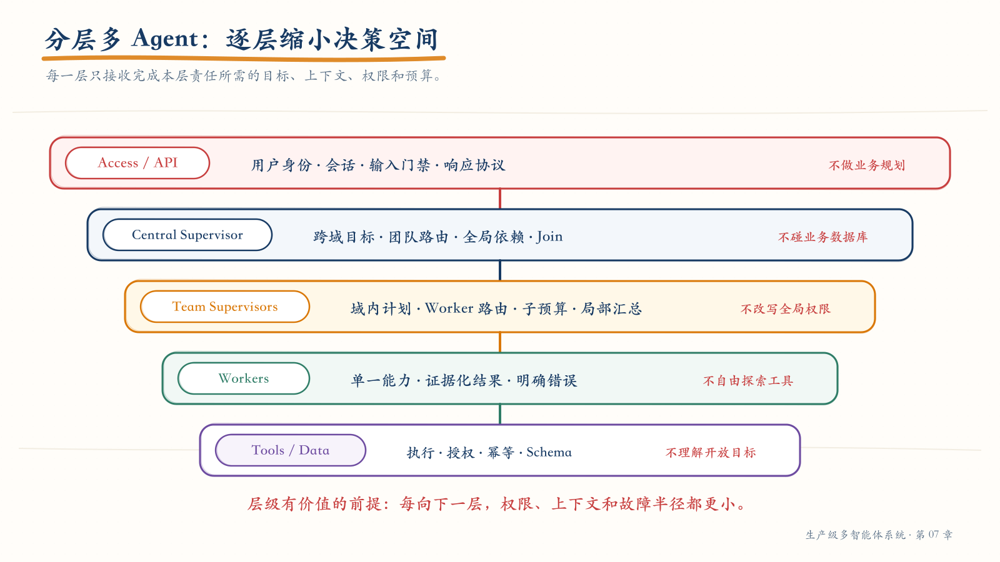
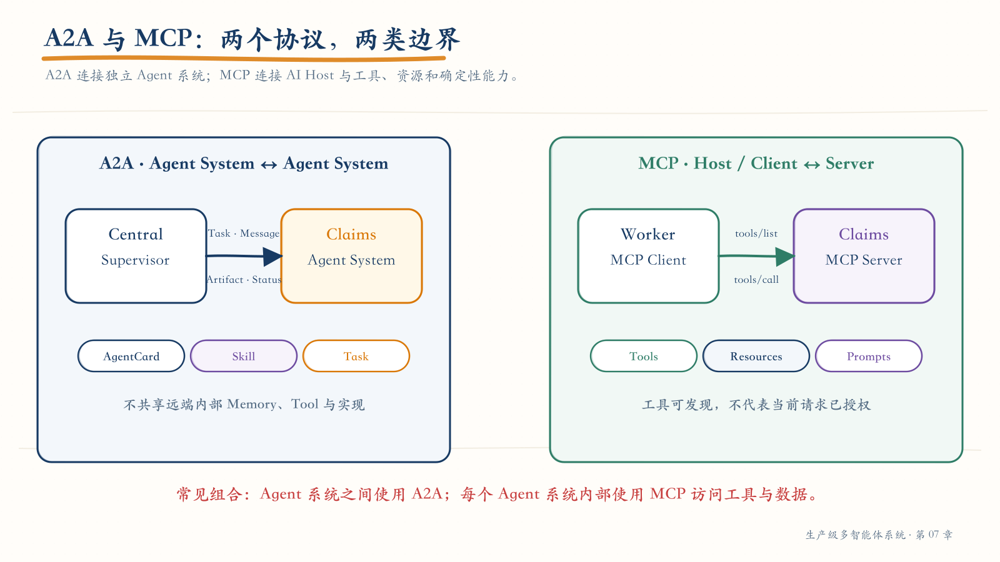
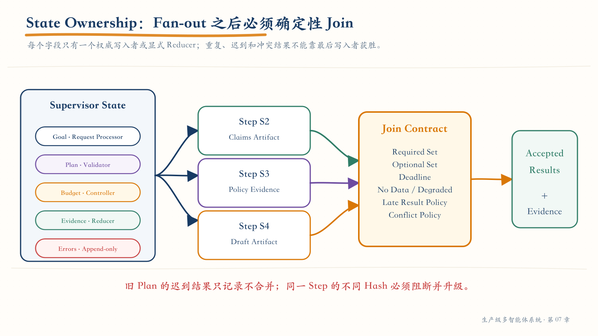
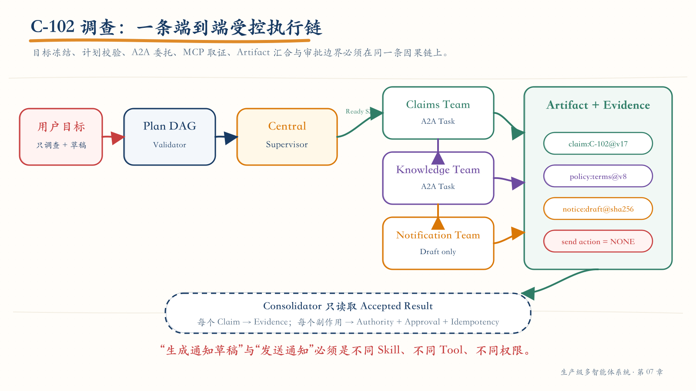
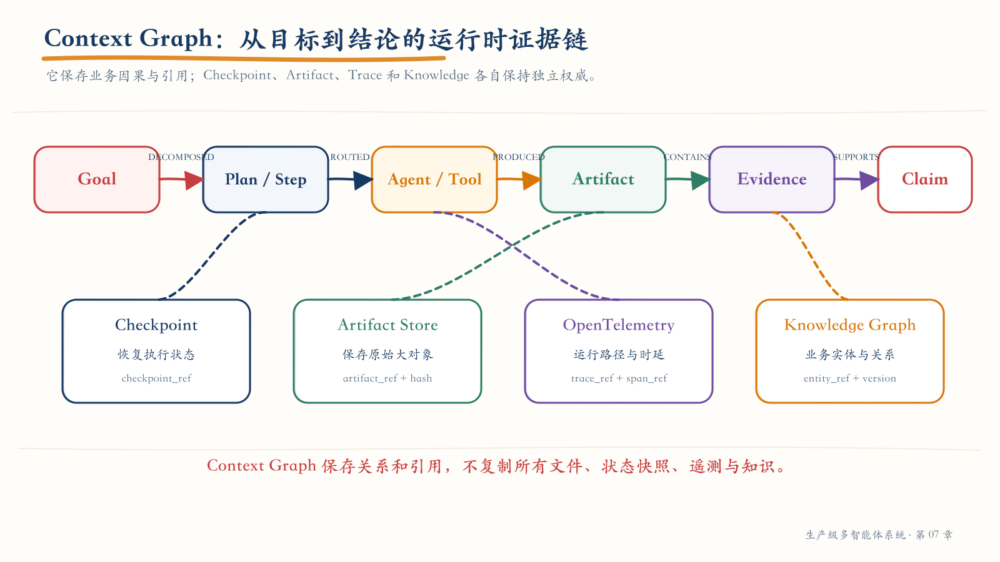
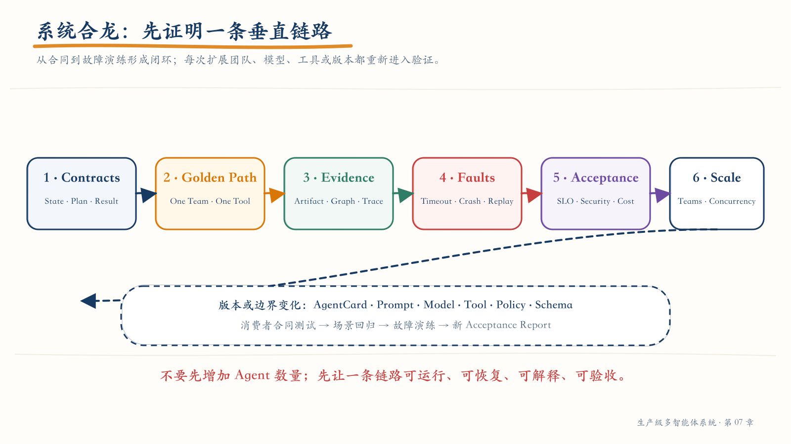
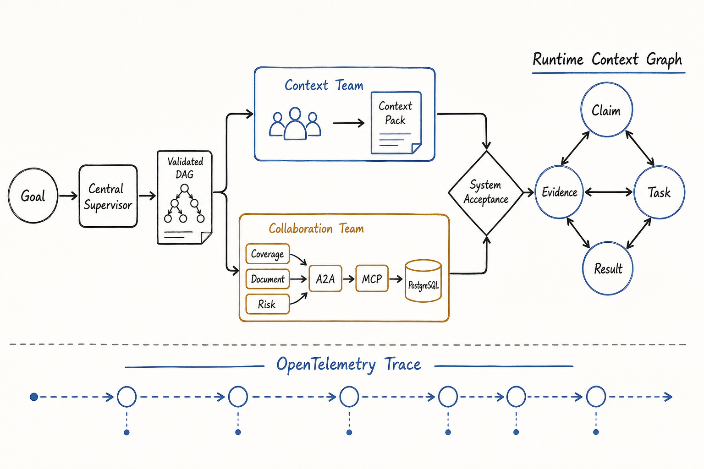

# Chapter 07: System Integration: Supervisor, A2A, MCP, and the Context Graph

The first six chapters addressed agent boundaries, tool calling, collaboration patterns, context, production platforms, and security controls. This chapter tackles a harder question:

> **How do these capabilities become a single system that can run, recover, explain itself, and pass acceptance?**

The insurance claims investigation system can already retrieve knowledge, call tools, record traces, and run Tool Guard before high-risk actions. At this point, a claims operations specialist makes a seemingly ordinary request:

> “Find out why C-102 has not been completed and tell me what is missing. If the customer needs to be notified, generate a notification draft first; do not send it directly.”

This request spans at least four kinds of responsibility:

- the member team confirms the customer and tenant identities;
- the claims team queries the case, its documents, and its processing status;
- the knowledge team explains the current policy and supplemental-document rules;
- the notification team generates a draft but must not bypass approval to send it.

For a demo, we could simply have four agents take turns talking. A production system, however, must continue to answer:

- Who turns the natural-language goal into an executable plan?
- Which steps may run in parallel, and which must wait?
- Is the central layer authorized to access the claims database directly?
- How do agents discover capabilities, pass tasks, and receive artifacts from one another?
- Within an agent, how are databases, APIs, and file tools called?
- When one team times out, does the system return failure, a partial result, or a degraded result?
- If a tool succeeds but the worker crashes before writing state, can the system recover safely?
- Can the final conclusion be traced back to specific data versions, tool calls, permissions, and approvals?

System integration is not about “connecting” agents. It is about keeping **goals, permissions, state, dependencies, evidence, errors, budgets, and recovery semantics** consistent after they cross multiple processes.

This chapter follows the C-102 investigation request. We first determine when layering is worthwhile, then define the boundaries among the Supervisor, A2A, and MCP. Next, we compile the goal into a DAG, incorporate state, evidence, and recovery points into the Context Graph, and finally use fault injection and an acceptance report to prove that this is not a system that works only in the happy-path demo.

To explain the principles fully, the first half of this chapter uses four responsibility domains—member, claims, knowledge, and notification—to present the complete method. The accompanying implementation chooses a narrower but genuinely testable vertical slice: the Context Team and Collaboration Team produce evidence in parallel, and the Central Supervisor performs system-level integration. The conceptual model is broader than the current code, while the code evidence is stricter than the conceptual examples. Neither should pretend to be the other.

!!! note "The Context Graph in this chapter"
    `Context Graph` is the runtime evidence model used in this book. It records the relationships among Goal, Plan, Step, Agent, Tool, Evidence, Claim, Decision, Approval, and Artifact. It is not a standard object defined by A2A, MCP, or OpenTelemetry, nor is it the Knowledge Graph from Chapter 4. A team may implement this responsibility with a graph database, relational tables, event projections, or hybrid storage.

## 1. Criteria for system integration

A multi-agent system is not integrated merely because “every service returned 200.” A more meaningful criterion is whether the system can explain any final conclusion backward and recover when necessary.

```text
Final Claim
  → which TeamResult / Artifact it came from
  → which Step and which Plan Version produced it
  → which Agent / Worker executed it
  → which version of which Tool / MCP Server was called
  → which identity, Scope, and approval were used
  → which version of the data or document was read
  → which retry, degradation, or compensation ran after a failure
```

This chain must satisfy at least six properties:

| Property | What the system must prove |
|---|---|
| Executable | The natural-language goal has become a plan with dependencies, inputs, budgets, and completion conditions |
| Constrained | Every delegation and tool call is restricted by identity, permissions, task scope, and risk policy |
| Mergeable | Concurrent, late, duplicate, and conflicting results have deterministic merge rules |
| Traceable | A final Claim can be traced to Evidence, Artifacts, data versions, and execution traces |
| Recoverable | Timeouts, crashes, cancellation, and unknown side effects do not automatically turn into duplicate actions |
| Acceptable | Business correctness, evidence coverage, security invariants, SLOs, and drill results are measurable |

The architectural principle of this chapter is therefore:

> **The LLM proposes plans and semantic judgments; Schema, Policy, State Machine, Scheduler, Reducer, Executor, and Audit determine what may happen and what facts remain afterward.**

## 2. More agents do not make layering better

A single agent centralizes context, has a short call chain, and is easy to debug. For low-risk tasks with few tools and strongly shared context, it is often the better design.

Layering has engineering value only when the system has genuine **domain, permission, state, deployment, or failure boundaries**.

### 2.1 Four axes for deciding whether to layer

1. **Domain coupling**: Can the task be decomposed consistently into subgoals with explicit contracts? Do different domains have their own entities, rules, and owners?
2. **Risk isolation**: Which capabilities involve financial operations, privacy, external notification, or infrastructure side effects? Do they require separate identities and approvals?
3. **Deployment boundaries**: Which capabilities require independent scaling, separate secrets, independent release cadences, or maintenance by different teams?
4. **Latency budget**: Does the user-acceptable critical path still accommodate another round of planning, network round trips, and consolidation?

| Scenario | Better form | Reason |
|---|---|---|
| One domain, three read-only tools, single-turn Q&A | Single agent | Layering would add only protocol overhead and latency |
| Stable path, explicit rules, high-risk actions | Deterministic workflow | The model should have less influence over control flow |
| Multiple domains, different permissions, contractible results | Layered multi-agent | Narrows context, permissions, and the failure radius |
| Independent agent systems across organizations or technology stacks | A2A + internal orchestration | Enables interoperability without exposing internal implementation |

!!! warning "An organizational structure is not a system boundary"
    “Finance has an agent, and Legal has an agent” is not sufficient justification. A split is warranted only when they have different data, tools, permissions, state, or lifecycles and can be isolated with result contracts.

## 3. Five layers of responsibility: each must state what it does not own



*Figure 7-1. The value of layering is to progressively narrow the decision space, permissions, and failure radius—not to reproduce the organizational hierarchy.*

This book uses five layers as its discussion model:

| Layer | Its sole responsibilities | Explicitly not responsible for |
|---|---|---|
| Access / API | User identity, sessions, input gates, response protocols | Business planning and tool execution |
| Central Supervisor | Cross-domain goal decomposition, team selection, global dependencies, budgets, and consolidation | Direct access to business databases or arbitrary tools |
| Team Supervisor | In-domain entity resolution, worker routing, team sub-budgets, and local consolidation | Rewriting the global goal or expanding user permissions |
| Worker | One named capability, controlled tool calling, evidence-bound results | Freely exploring other teams or replanning the global task |
| Tool / Data | Deterministic execution, resource-level authorization, idempotency, and Schema | Understanding open-ended user goals |

These five layers do not mean five kinds of large language models. Access, Scheduler, Reducer, Policy, and many Workers can be ordinary code.

### 3.1 Control plane and execution plane

Putting all logic into the Supervisor Prompt mixes the control plane and execution plane all over again.

The **control plane** owns:

- Goal and constraints;
- Plan Version;
- Ready Set and dependencies;
- Budget and Deadline;
- Policy Decision;
- Approval and Cancellation;
- Result Acceptance and final state transitions.

The **execution plane** owns:

- Team / Worker execution;
- model calls;
- MCP Tool Calls;
- Sandboxes and adapters;
- raw Artifact generation.

The Supervisor may propose `dispatch claims-team`, but it may not cross Team and Tool boundaries merely because it “knows SQL.” The execution plane may return evidence and errors, but it cannot declare the global goal complete on its own.

### 3.2 The Supervisor is not “the boss agent with every permission”

The Supervisor is an orchestration responsibility, not a superuser.

At minimum, it should be decomposed into three independently verifiable nodes:

| Node | Input | Output | Deterministic gate |
|---|---|---|---|
| Planner | Goal, capability snapshot, constraints | ExecutionPlan | Plan Validator |
| Router / Scheduler | Ready Steps, Registry, Budget | Dispatches | Policy, concurrency, Deadline |
| Consolidator | Accepted Results, Evidence | FinalAnswer | Claim-Evidence Validator |

The purpose is not to add services. It is to keep a single super-prompt from planning, authorizing, executing, and validating itself all at once.

## 4. Central, Team, and Worker: three stages of convergence

The decision space of a cross-domain request should shrink layer by layer.

### 4.1 Central Supervisor: from user goal to team tasks

The central layer understands the cross-domain goal:

```text
Find out why C-102 has not been completed
├── Verify customer and tenant identity
├── Query claim status and missing documents
├── Explain the applicable rules
└── Generate a notification draft; sending is prohibited
```

It selects the `member`, `claims`, `knowledge`, and `notification` teams and manages strong and weak dependencies, the global budget, and final consolidation. It does not need to know which tables exist in the claims database.

### 4.2 Team Supervisor: from team task to named capability

The claims team receives a bounded task:

```text
skill: claim_status_and_missing_documents
claim_id: C-102
subject: tenant=t9, member=m42
allowed_actions: [read_claim, read_required_documents]
forbidden_actions: [update_claim, contact_customer]
deadline: 2026-07-23T09:00:08Z
```

The Team Supervisor may select workers that query status and the list of missing documents, then consolidate those results locally. It cannot expand `claims:read` into `claims:update`.

### 4.3 Worker: from named capability to controlled Tool Call

The Worker has the smallest workspace:

1. Validate the input Schema, entities, tenant, and required context.
2. Validate the calling principal, Scope, Resource ACL, and Purpose.
3. Check the Deadline, Budget, Cancellation, and Circuit Breaker.
4. Construct structured parameters instead of passing free-form text directly to an interpreter.
5. Call the bound MCP Tool.
6. Validate the returned Schema, source, time, and business invariants.
7. Generate a WorkerResult and bind it to an EvidenceRef.
8. Write Trace and Context Graph references; return a structured error on failure.

If a Worker needs to see the entire conversation, every team, and every tool, the boundary has already failed.

## 5. A2A and MCP: do not let the two protocols impersonate each other



*Figure 7-2. A2A connects independent agent systems; MCP connects an AI Host to tools, resources, and external capabilities.*

A2A 1.0 addresses interoperability among independent and potentially opaque agent systems. It defines AgentCard, Message, Task, Part, and Artifact, together with task interaction methods such as polling, streaming, and push.

The current MCP protocol version is `2025-11-25`. It standardizes capability discovery and invocation across Host, Client, and Server; a Server can expose Prompts, Resources, and Tools. MCP also added the experimental Tasks capability, but that does not mean MCP has become an agent collaboration protocol.

| Question | A2A | MCP |
|---|---|---|
| Primary boundary | Between independent agent systems | Between AI Host / Client and Server capabilities |
| Discovery objects | AgentCard, Skills, Interfaces | Server Capabilities, Tools, Resources, Prompts |
| Primary interaction | Message, Task, Artifact | JSON-RPC requests, Tool / Resource / Prompt |
| Long-running tasks | A2A Task is a core object | The MCP Tasks capability remains experimental in 2025-11-25 |
| Internal state | Does not require exposing remote internal state, Memory, or Tool | Does not define team collaboration among business agents |
| Authorization | Declares security schemes; the receiver must still authorize every operation | HTTP authorization framework; resources and tools still require business authorization |

### 5.1 A practical boundary

```text
Central Supervisor (A2A Client)
  ── A2A Task / Message ──▶ Claims Agent System (A2A Server)
                               │
                               ├─ Team Supervisor
                               ├─ Claim Worker
                               └─ MCP Client ──▶ Claims MCP Server ──▶ Claims DB
```

The A2A Server exposes the business capability “query claim status.” The framework, number of Workers, and database it uses internally should not be prerequisite knowledge for the central layer.

### 5.2 A protocol does not grant business permissions

None of the following inferences is valid:

- “The Skill is listed in the AgentCard, so the current user can call it.”
- “mTLS succeeded, so the peer can access this tenant's data.”
- “The A2A Token is valid, so the receiver can skip resource-level ACLs.”
- “The MCP Tool appears in the list, so the model can run it with any parameters.”

A capability description answers “what do you claim to be able to do?” Authentication answers “who are you?” Only authorization answers “may you represent this user, for this purpose, to perform this action on this resource?”

## 6. Capability discovery: from AgentCard to a controlled snapshot

An A2A AgentCard describes an agent's identity, capabilities, skills, service interfaces, and security requirements. A production system must not feed a Card discovered on the internet directly into the Planner.

Before a capability enters a plan, it must pass through four stages:

| Stage | Control |
|---|---|
| Registry Ingest | Source, signature, owner, protocol version, health, change history |
| Capability Filter | User, tenant, environment, risk, region, and data classification |
| Prompt Projection | Project only the Skill summaries the Planner actually needs |
| Dispatch Revalidation | Endpoint, Audience, Scope, protocol, and contract versions |

An internal normalized snapshot can look like this:

```yaml
snapshot_id: cap-20260723-0900
source_agent_card:
  name: Claims Agent
  protocol_version: "1.0"
  signature_verified: true
interface:
  binding: HTTP+JSON
  url_ref: registry://agents/claims/v1
skills:
  - skill_id: claim-status
    description: Query claim status and missing documents
    input_schema: contracts/claim-status-input/1.2.0
    artifact_schema: contracts/claim-status-artifact/1.3.0
    risk: read_only
    latency_slo_ms: 2500
policy_projection:
  allowed_tenants: [t9]
  allowed_purposes: [claim_investigation]
  scopes: [claims:read]
expires_at: 2026-07-23T09:05:00Z
```

This is an internal contract for our system, not a replacement Schema for the A2A AgentCard. Keeping them separate prevents local permission decisions from being written accidentally into an externally declared capability.

!!! tip "Do not disclose sensitive capabilities in full"
    The official A2A discovery guide recommends authentication, authorization, and selective disclosure for AgentCards containing sensitive URLs or Skills. Static secrets must not be written into a Card.

## 7. Compile the goal into a verifiable DAG

The Planner's output cannot be merely a passage that says “query A, then query B.” A deterministic Validator and Scheduler must be able to read it.

```yaml
plan_id: plan-c102-18
version: 3
goal_id: goal-c102-7
steps:
  - id: s1
    team: member
    skill: resolve-member
    depends_on: []
    required: true
  - id: s2
    team: claims
    skill: claim-status
    depends_on: [s1]
    input_map:
      member_id: s1.artifact.member_id
    required: true
  - id: s3
    team: knowledge
    skill: policy-guidance
    depends_on: [s2]
    required: false
  - id: s4
    team: notification
    skill: draft-notice
    depends_on: [s2, s3]
    required: false
    side_effect: none
join:
  strategy: evidence_consolidation
  required_steps: [s1, s2]
  optional_steps: [s3, s4]
budget:
  max_steps: 6
  max_model_tokens: 12000
  max_tool_calls: 8
  deadline_ms: 9000
```

### 7.1 Plan Validator

Before executing any step, the Validator checks at least that:

- the Schema is valid and each `step_id` is unique;
- the Team / Skill exists and its protocol and contract versions are compatible;
- every dependency exists and the graph is acyclic;
- required inputs can be mapped from upstream Artifacts;
- Step, Token, Tool, concurrency, and Deadline remain within budget;
- the user, Workload, and task have effective permission for each Skill;
- high-risk steps have approval requirements;
- the Join rules can distinguish complete, partial, degraded, failed, and cancelled outcomes;
- the Evidence required by the final Claim is declared in the contract.

The Validator must not silently fill unknown fields and continue execution. It may return structured diagnostics so that the Planner can perform bounded replanning, but `replan_count` must be controlled.

### 7.2 The Scheduler dispatches only the Ready Set

```python
def ready(step, state):
    return (
        step.status == "pending"
        and all(state.steps[d].status == "completed"
                for d in step.strong_dependencies)
        and state.plan.version == step.plan_version
        and state.budget.remaining_ms > step.minimum_runtime_ms
        and not state.cancel_requested
    )
```

The model may suggest dependencies. Deterministic code must calculate the final Ready Set.

## 8. State Contract: share state across processes, not chat history



*Figure 7-3. Every state field needs a single owner or an explicit Reducer; concurrent tasks can converge only through result contracts.*

Chat messages are suitable for conversation, not for carrying distributed transaction state. Supervisor State must distinguish at least:

```python
class SupervisorState(TypedDict):
    request_id: str
    session_id: str
    goal: Goal
    constraints: list[Constraint]
    plan: ExecutionPlan | None
    step_results: Annotated[dict[str, StepResult], merge_by_step_id]
    evidence: Annotated[list[EvidenceRef], dedupe_by_source_anchor]
    errors: Annotated[list[AgentError], append_only]
    approvals: dict[str, Approval]
    budget: BudgetState
    final_answer: FinalAnswer | None
    status: Literal[
        "received", "planned", "running", "blocked",
        "completed", "failed", "cancelled"
    ]
```

### 8.1 Field ownership

| Field | Authoritative writer | Merge rule / invariant |
|---|---|---|
| Goal / Constraints | Request Processor | After creation, may be changed only by explicit revision; silent rewriting is prohibited |
| Plan | Planner + Plan Validator | Versioned; modifications after execution starts must produce a Replan Event |
| StepResult | Corresponding Step Executor | Idempotent merge on `step_id + plan_version` |
| Evidence | Worker / Tool Adapter | Deduplicate by Source + Anchor + Version |
| Errors | All execution nodes | Append-only; errors must not be swallowed |
| Budget | Budget Controller | Atomic deduction; do not accept self-reported usage from an agent |
| Approval | Approval Service | Bound to the action, resource, parameter hash, version, and expiration |
| FinalAnswer | Consolidator | May reference only Accepted Results and Evidence |

### 8.2 Four system invariants

1. Every `completed` Step has a contract-conforming Result; a query that returns no result must be recorded as `no_data`.
2. A downstream Step cannot start while any strong dependency is incomplete.
3. Every final business Claim is bound to an `evidence_id`, or explicitly marked as an inference together with its uncertainty.
4. Every side effect can be traced to authorization, approval, Expected Version, and Idempotency Key.

### 8.3 Do not conflate result states

A2A Task State, MCP Task Status, and the business Result Status of our system are states at three different levels.

This book uses the following business result vocabulary:

| Status | Business meaning |
|---|---|
| completed | The contract is satisfied, with all required results and evidence present |
| no_data | The query succeeded but returned no records; this is not a technical failure |
| partial | Some results are available, and missing items are listed explicitly |
| degraded | A fallback path was used, affecting quality or freshness |
| blocked | Waiting for input, permission, approval, or an external condition |
| failed | Unable to satisfy the result contract; includes a structured error |
| cancelled | Cancelled by the user, parent task, or system |

Protocol adapters must map these states explicitly rather than assuming similar names mean the same thing. For example, A2A's `TASK_STATE_INPUT_REQUIRED` can map to local `blocked`, but the reason for the mapping and the recovery condition must be retained.

## 9. How a request runs from start to finish



*Figure 7-4. A user goal is compiled into a contract-bound task graph, and every conclusion ultimately converges at evidence and approval boundaries.*

Now let us follow the C-102 request through the system.

### 9.1 Access: freeze the goal and security boundary first

The Gateway performs user authentication, tenant resolution, rate limiting, and input validation, then creates:

```yaml
request_id: req-7f2
session_id: ses-91
trace_id: 4bf92f3577b34da6a3ce929d0e0e4736
goal:
  purpose: claim_investigation
  claim_id: C-102
  requested_outputs:
    - cause
    - missing_documents
    - next_action
    - notification_draft
constraints:
  - notification_must_not_be_sent
  - no_claim_update
  - evidence_required_for_business_claims
```

“Do not send” is not an ordinary prompt. It enters the Goal Contract as a prohibited action.

### 9.2 Planning: the model proposes; the Validator decides

Based on a permission-filtered capability snapshot, the Planner generates a DAG. The Validator finds that the notification Skill contains only `draft-notice`, not `send-notice`, so the plan is valid.

Plan Version 3 is written to state and the event log. Every subsequent Dispatch and Result must carry that version.

### 9.3 Central routing: issue least-privilege delegations according to dependencies and budget

The Scheduler first dispatches `s1`. When `s1` completes, `s2` enters the Ready Set. Each Dispatch receives only the Scope and Deadline required for the current Step.

```yaml
dispatch_id: dsp-s2-v3
task_ref: req-7f2
step_id: s2
plan_version: 3
target_agent: claims-agent
skill: claim-status
scopes: [claims:read]
forbidden_actions: [claims:update, notify:send]
deadline: 2026-07-23T09:00:08Z
input_ref: artifact://req-7f2/s1/member-resolution@sha256:...
```

### 9.4 A2A delegation: the remote system authorizes independently

The Claims Agent validates:

- the A2A protocol version and interface;
- the caller's workload identity;
- Token Audience, Expiry, and Scope;
- Task / Context visibility;
- whether the Skill exists;
- the user, tenant, Purpose, and resource ACL;
- the media types and Schemas of Message / Part.

Successful authentication does not imply successful authorization. The Claims Agent must recalculate permissions against its own Policy.

### 9.5 Team execution: the Worker collects evidence through MCP

The Team Supervisor selects `claim-status-worker`. The Worker's MCP Client connects only to a read-only Claims MCP Server and exposes only:

```text
claims.get_status
claims.list_missing_documents
```

Before the tool result enters WorkerResult, its output Schema, tenant, version, and Evidence Anchor are checked.

### 9.6 Artifact: the result is not a chat message

A2A 1.0 explicitly distinguishes Message from Artifact: Message initiates tasks, clarifies them, and handles status interactions; task output should be delivered through Artifact.

The claims team returns:

```yaml
artifact_id: art-claims-c102-v17
name: claim-status
media_type: application/json
schema: contracts/claim-status-artifact/1.3.0
data:
  claim_id: C-102
  status: pending_documents
  missing_documents:
    - accident_report
  updated_at: 2026-07-22T14:11:09Z
evidence:
  - evidence_id: ev-391
    source: claims-db
    anchor: claim:C-102@v17
    observed_at: 2026-07-23T09:00:02Z
content_hash: sha256:...
```

### 9.7 Dependency progression: produce the policy explanation before drafting the notification

After `s2` completes, the knowledge team explains why the missing accident report blocks processing. Once `s3` is accepted, the notification team receives only the claims facts and accepted policy conclusions and generates a draft Artifact. Other independent read-only investigation steps may still run in parallel, but this chain cannot skip content dependencies merely to reduce latency.

Drafting is not a side effect; sending is a separate protected action. They must be different Skills, different Tools, and different permissions.

### 9.8 Join: contracts determine complete, partial, and degraded outcomes

If the knowledge team times out but `s1` and `s2` have completed:

- the claim status and missing-document facts can still be returned;
- the policy explanation is marked as missing;
- the notification draft may be skipped because policy wording is unavailable;
- the global state is `degraded` and must not masquerade as `completed`;
- the user sees what is missing and the resulting impact.

### 9.9 Consolidation: generate the answer only from Accepted Results

The Consolidator does not read arbitrary Worker conversations. It reads only:

- contract-validated Artifacts;
- Accepted StepResults;
- EvidenceRefs;
- Warnings, Missing Steps, and Policy Decisions.

In the final answer, “C-102 is waiting for an accident report” is bound to `ev-391`; “review will continue after it is submitted” is bound to Evidence for the current policy terms. The notification content is marked as a draft, and no send action has been executed.

## 10. The A2A contract: keep context, tasks, and artifacts separate

A2A's `contextId` logically groups related Tasks and Messages, while `taskId` identifies a unit of work with a lifecycle. Do not conflate them with internal `request_id`, `plan_id`, and `step_id` fields.

Maintain an explicit correlation mapping:

```yaml
correlation:
  request_id: req-7f2
  goal_id: goal-c102-7
  plan_id: plan-c102-18
  plan_version: 3
  step_id: s2
  a2a_context_id: ctx-claims-92
  a2a_task_id: task-claims-882
  trace_id: 4bf92f3577b34da6a3ce929d0e0e4736
```

### 10.1 Task status is not a reliable event log

A2A supports polling, streaming updates, and Push Notification. A disconnected client may miss transient status messages; critical facts must not exist only in streamed text.

Therefore:

- business results go into Artifacts;
- state changes go into persistent events;
- the current view goes into the State Store;
- observability data goes into Trace / Metric / Log;
- causal and evidentiary relationships go into the Context Graph.

### 10.2 Versions must be explicit

An A2A 1.0 client should declare `A2A-Version` in requests. The system must manage each of the following separately:

- A2A Protocol Version;
- AgentCard / Interface Version;
- local Skill Contract Version;
- Artifact Schema Version;
- Plan Version.

Protocol backward compatibility does not make a business Schema automatically compatible. Consumer contract tests remain essential.

## 11. The MCP contract: tool calling remains a privileged boundary

An MCP Tool Description helps the model understand a capability, and a Tool Input Schema constrains its structure. Neither replaces resource-level authorization.

A production Tool Contract should register at least:

```yaml
tool: claims.get_status
server: claims-read-mcp
protocol_version: "2025-11-25"
input_schema: contracts/claims-get-status-input/2.0.0
output_schema: contracts/claims-get-status-output/2.1.0
side_effect: none
required_scopes: [claims:read]
resource_binding: tenant_id + claim_id
timeout_ms: 1200
idempotency: not_applicable_read
evidence:
  source_field: source
  anchor_field: record_version
task_support: forbidden
```

### 11.1 Boundaries for using MCP Tasks

MCP `2025-11-25` introduced experimental Tasks, which can give some long-running Tool Calls persistent status, polling, result retrieval, and cancellation. Before using them:

- both parties must declare the Tasks Capability during initialization;
- the Tool must declare required, optional, or forbidden through `execution.taskSupport`;
- the caller must handle `working`, `input_required`, `completed`, `failed`, and `cancelled`;
- optional status notifications must not be treated as the only reliable source.

If the remote side is an agent system with its own goals, skills, Artifacts, and collaboration lifecycle, prefer A2A. If it is merely a long-running deterministic tool, consider an MCP Task. The responsibility model determines the boundary; duration alone does not.

## 12. Join and Reducer: concurrency must converge deterministically

Fan-out is easy. Join is the real systems design.

### 12.1 Join Contract

```yaml
join_id: join-c102
required_steps: [s1, s2]
optional_steps: [s3, s4]
completion_rule: all_required_terminal
success_rule: all_required_completed
deadline: 2026-07-23T09:00:09Z
on_optional_failure: degraded
on_required_no_data: completed_with_no_data
on_required_failure: failed
late_result_policy: record_but_do_not_merge
conflict_policy: block_and_escalate
```

The Join must answer:

- Whom are we waiting for?
- Until when?
- Which steps are required?
- Does `no_data` satisfy the completion condition?
- Does an optional-step failure produce `partial` or `degraded`?
- Can a Late Result still enter the final answer?
- Who has adjudication authority when two pieces of Evidence conflict?

### 12.2 Reducer

```python
def apply(result, state):
    if result.plan_version != state.plan.version:
        return state.record_stale_result(result)

    existing = state.step_results.get(result.step_id)
    if existing:
        return state.require_same_hash(existing, result)

    contract = state.plan.contract_for(result.step_id)
    validated = contract.validate(result)
    state.step_results[result.step_id] = validated
    state.evidence = merge_evidence(state.evidence, validated.evidence)
    return state
```

For duplicate results from the same step:

- same Hash: accept idempotently;
- different Hash: do not use “last writer wins”; record the conflict and block instead.

## 13. Context Graph: preserve explainable causality without becoming the only storage system



*Figure 7-5. The Context Graph connects Goal, Task, execution, evidence, conclusions, and approvals, while the Artifact Store retains the large raw objects.*

A minimal node model:

| Node | Key fields | Typical edges |
|---|---|---|
| Goal | Owner, Purpose, Constraints, Status | DECOMPOSED_INTO |
| Plan / Step | Version, Team, Skill, Required, Status | DEPENDS_ON, ROUTED_TO |
| Agent / Tool | Identity, Contract, Deployment | EXECUTED_BY, CALLED |
| Result / Artifact | Schema, Status, Hash, Trace Ref | PRODUCED |
| Evidence | Source, Anchor, Observed At, ACL | SUPPORTS |
| Claim / Decision | Text, Confidence, Policy | DERIVED_FROM |
| Error / Approval | Category, Actor, Expiry, Resolution | BLOCKED_BY, AUTHORIZED_BY |

### 13.1 The Context Graph is not the Knowledge Graph

The Knowledge Graph answers:

> Which customer owns C-102? What business relationships connect the policy, incident, and documents?

The Context Graph answers:

> Why did this run conclude “waiting for an accident report”? Which step read which version of the data? Which approval authorized which action?

They may reference each other, but their lifecycles, permissions, and fact semantics differ.

### 13.2 The Context Graph is not a Trace

An OpenTelemetry Trace describes which operations a request traversed, how long they took, and where errors occurred. The Context Graph describes relationships among business goals, plans, evidence, and decisions.

Use bidirectional references:

```text
Step Node ── trace_ref ──▶ Span / Trace
Span Attributes ── goal.id / task.id / step.id ──▶ Context Graph Node
```

When an asynchronous queue starts a new Trace, an OpenTelemetry Span Link can express causality across Traces.

## 14. Checkpoint, Event Log, Artifact, and Context Graph each need an owner

| Mechanism | Responsible for | Should not be responsible for |
|---|---|---|
| Checkpoint | Recovering a particular execution state | Complete auditing and business-causality explanations |
| Event Log | Preserving immutable state changes and replay inputs | Directly serving as a query-friendly current view |
| State Store | Current tasks, steps, budgets, and locks | Preserving all history and large objects |
| Context Graph | Relationships among plans, execution, evidence, Claims, and approvals | Storing large files or every telemetry detail |
| Artifact Store | Raw tool output, reports, files, and snapshots | Process scheduling |
| Trace / Metric / Log | Runtime diagnosis, latency, errors, capacity, and alerts | Final adjudication of business facts |

“One database for everything” may be physically viable, but the logical owners must still remain separate. Otherwise, recovery logic may mistake audit events for current state or treat sampled traces as complete business evidence.

### 14.1 Recommended write order

For a read-only step:

1. Write the Step Started Event.
2. Execute the Tool Call.
3. Save the raw Artifact.
4. Validate the Result and Evidence.
5. Atomically write StepResult / Outbox.
6. Project the Context Graph.
7. Complete the Trace Span.
8. Let the Scheduler unlock downstream steps.

For a side effect:

1. Fix the `command_id / idempotency_key`.
2. Write the Intent.
3. Reauthorize and bind the Approval.
4. Execute the external action.
5. Query or record the Side Effect State.
6. Write the Completed / Failed Event.
7. Update State, Artifact, and Context Graph.
8. Send every uncertain outcome to Reconcile; never retry blindly.

## 15. Recovery, cancellation, and unknown side effects

The most dangerous failure is not an explicit failure but uncertainty about whether an external action succeeded.

| Side Effect State | Safe to Retry | Recovery action |
|---|---|---|
| not_started | Yes | Perform a bounded retry with the same Idempotency Key |
| unknown | No | Query the external system or request human verification |
| completed | No | Read the existing result and merge idempotently |
| partially_completed | Conditional | Compensate or require human intervention |

### 15.1 Checkpoint recovery does not mean continuing with old credentials

During recovery, recheck:

- whether the user and Workload identities remain valid;
- whether the Delegation and Approval have expired;
- whether the resource version has changed;
- whether the Deadline and Budget have remaining capacity;
- whether the Plan Version is still current;
- whether completed external actions can be identified through Idempotency / Reconcile;
- whether Cancellation has propagated.

Tokens, nonces, and short-lived approvals do not acquire a longer lifetime merely because they were written into a Checkpoint.

### 15.2 Cancellation is a distributed state transition

After the parent Goal enters `cancelling`:

1. Do not start any new Ready Step.
2. Send cancellation to Running A2A / MCP Tasks.
3. Have Workers check the Cancellation Token periodically.
4. Move side effects already in progress into Reconcile or compensation.
5. Record Late Results without contaminating the cancelled state.
6. Record `CANCELLED_BY` and unresolved actions in the Context Graph.

A successful response to a cancellation request proves only that “the system accepted the intent to cancel,” not that every external action stopped instantly.

## 16. Context compression: three compression points, three loss budgets

A layered system should not copy the full session and global State into every agent. Compression occurs in three different places:

| Location | May be compressed | Must be preserved |
|---|---|---|
| Session → Central | Greetings, repeated statements, completed details | Goal, constraints, entities, negations, open work |
| Central → Team | Other teams' information, redundant explanations | Dependency fields, Scope, Deadline, risk |
| Tool Result → Result | Display fields, duplicate rows, low-relevance passages | Source, Anchor, key facts, anomalies, freshness |

A compression contract should contain at least:

```yaml
compressed_context:
  preserved_constraints:
    - notification_must_not_be_sent
    - evidence_required
  resolved_entities:
    claim_id: C-102
    member_id: m42
  facts:
    - claim_status: pending_documents
  open_questions:
    - policy_effective_date
  evidence_refs: [ev-391]
  omitted_sections:
    - greeting
    - unrelated_session_history
  source_hash: sha256:...
  compressor_version: 2.1.0
```

Compression quality cannot be evaluated by token reduction alone. Tests must also measure the retention of amounts, dates, negations, prohibited actions, errors, and Evidence Anchors.

## 17. Observability: one Trace across multiple responsibility planes

A single request should connect the following through shared correlation keys:

```text
goal.id
request.id
plan.id + plan.version
task.id
step.id
agent.id
tool.name
trace.id + span.id
artifact.id
evidence.id
```

| Plane | Key metrics |
|---|---|
| Business | Goal Success, escalation rate, business accuracy, end-to-end SLA |
| Agent | Plan Valid, Routing Precision, Handoff, Replan, Step Retry |
| Model | Prompt Version, Token, Latency, Structured Output Failure |
| Tool / Infra | Tool Success, Queue Depth, DB Latency, CPU / Memory |
| Security | Denied Action, Approval, Replay, Injection, DLP |
| Cost | Cost attributed by Request / Team / Worker / Model / Tool |

### 17.1 Do not watch average latency alone

The user experience of a layered system is determined by the DAG Critical Path and its slowest dependency. Core metrics include:

| Metric | Definition | Diagnostic value |
|---|---|---|
| Goal Success Rate | Percentage of requests that satisfy the user goal and pass business acceptance | North-star metric; not equivalent to HTTP 200 |
| Plan Valid Rate | Percentage of initial plans that pass validation | Quality of capability descriptions and the Planner |
| Routing Precision | Percentage of goals routed to the correct Team / Worker | Router quality |
| Evidence Coverage | Claims with evidence / Claims requiring evidence | Trustworthiness and compliance |
| Critical Path Latency | Duration of the longest dependency path in the DAG | The true experience bottleneck |
| Recovery Success | Percentage of recoverable failures recovered automatically | Resilience |
| Cost per Successful Goal | Total cost / successful goals | Prevents optimizing for “cheap but ineffective” |

Security invariants must not be diluted by averages. For example:

```yaml
unauthorized_side_effects: 0
cross_tenant_data_leaks: 0
duplicate_high_risk_actions: 0
```

## 18. Build a vertical slice before adding agents horizontally



*Figure 7-6. First prove the contracts, evidence, and recovery of one end-to-end path; only then add teams, concurrency, and dynamic capabilities.*

Recommended milestones:

| Milestone | What must be proven |
|---|---|
| M1 Contracts | State, Plan, Dispatch, Result, Error, Evidence, and versions can be validated independently |
| M2 Single path | One Team / Worker / MCP completes correctly and produces Evidence |
| M3 Multiple teams | Dependencies, parallelism, Join, Artifact, and Context Graph work correctly |
| M4 Failures | Timeouts, duplicates, crashes, cancellation, and unknown side effects recover safely |
| M5 Production gate | Permissions, budgets, observability, SLOs, rollback, and acceptance evidence are complete |

A reasonable code structure is:

```text
contracts/
  state/ plan/ dispatch/ result/ error/ evidence/
services/
  access_api/
  central_supervisor/
  teams/member/
  teams/claims/
  teams/knowledge/
  teams/notification/
mcp/
  member_tools/
  claims_tools/
  knowledge_tools/
runtime/
  scheduler.py
  reducer.py
  checkpoint.py
  context_graph.py
security/
  delegation.py
  policy.py
  approval.py
observability/
  tracing.py
  metrics.py
  audit.py
tests/
  contract/
  planner/
  routing/
  recovery/
  e2e/
```

The directory structure is not the architecture itself, but it reveals an important fact: if the Plan Validator, Policy, Reducer, and Context Graph are all hidden in `supervisor_prompt.py`, the system has not established real control boundaries.

## 19. Testing and failure drills: prove correctness under failure

| Layer | Test subject | Representative assertion |
|---|---|---|
| Static | Schema, AgentCard, configuration, Prompt Variables | Versions are compatible; no undeclared fields |
| Unit | Validator, Scheduler, Reducer, Policy | Deterministic invariants hold |
| Contract | A2A, MCP, Result, Error, Artifact | Producers and consumers are compatible |
| Component | Team + Fake MCP | Routing, evidence, and error semantics are correct |
| Integration | Real DB, Queue, Graph, Trace | State and observability agree |
| Failure | Timeout, replay, crash, partial side effect | Safe recovery with no duplicate actions |
| E2E | Real user goal | Business correctness, complete evidence, and SLO compliance |

### 19.1 Eight mandatory failure experiments

| Experiment | Injection method | Pass criterion |
|---|---|---|
| F1 Invalid plan | Unknown Skill, cyclic dependency, over budget | Validator blocks it; no Tool Call |
| F2 A2A timeout | Delay the Team response | Recover within Deadline or report explicit Degraded state |
| F3 Malformed MCP Schema | Remove a required field | Worker rejects it; Result does not enter State |
| F4 Worker crash | Kill after Tool succeeds but before state is written | Reconcile; no duplicate side effect |
| F5 Expired Token | Recover from an old Checkpoint | Reauthenticate and reauthorize; do not reuse the old Token |
| F6 Context Graph unavailable | Block graph writes | Fail Closed or buffer under control according to criticality |
| F7 Cancellation race | Cancel while Running | Stop downstream work and record unresolved actions |
| F8 Provider failure | Primary model returns sustained 5xx errors | Circuit breaking and controlled Fallback; record the version change |

Scenario Fixture:

```yaml
scenario_id: E2E-CLAIM-007
goal: Query C-102 status and recommend the next step
faults:
  - at: knowledge.worker
    inject: timeout
expected:
  status: degraded
  required_steps: [s1, s2]
  missing_steps: [s3, s4]
  answer_contains: [pending_documents, accident_report]
  evidence_min: 1
  notification_sent: false
  duplicate_side_effects: 0
  audit_complete: true
```

## 20. System Acceptance: from “it runs” to “it may be released”

The definition of system completion should not be “all agents are connected.” It should cover:

### 20.1 Architecture and contracts

- The five layers of responsibility, deployment boundaries, trust boundaries, and ADRs have been reviewed.
- State, Plan, Step, Result, Error, Evidence, and AgentCard mappings are all versioned.
- Every cross-layer field has an owner, Reducer, and compatibility strategy.
- The A2A and MCP boundaries are explicit, and protocols do not substitute for business authorization.

### 20.2 Correctness and recovery

- Plan validation, dependency scheduling, Join, and degradation semantics pass their tests.
- Checkpoint, Event Log, Context Graph, Artifact, and Trace have explicit owners.
- Duplicates, out-of-order results, old-Plan Results, cancellation, and unknown side effects can be handled.
- Failure drills pass with no duplicate high-risk actions.

### 20.3 Security and operations

- The user → Workload → Delegation → Task → Tool permission chain is traceable.
- Token and Approval are not reused when recovering from a Checkpoint.
- Business, agent, model, tool, security, and cost metrics can be correlated by Trace.
- Alerts have a Runbook, owner, escalation path, and drill record.
- Canary release, rollback, backup, retention, and deletion policies are executable.

### 20.4 Business acceptance

- Required business results are correct in Golden Scenarios.
- Evidence Coverage for high-risk Claims meets the target.
- Users can distinguish `partial`, `degraded`, `no_data`, and `failed`.
- The business owner signs off on residual risks, SLOs, and known limitations.

```yaml
release: chapter07-reference-v1.0
scope:
  teams: [member, claims, knowledge, notification]
  skills: [resolve-member, claim-status, policy-guidance, draft-notice]
quality:
  goal_success_rate: 98.2%
  plan_valid_rate: 96.4%
  evidence_coverage: 100%
  p95_latency_ms: 7420
reliability:
  recovery_success_rate: 97.5%
  failure_drills_passed: 8/8
  duplicate_side_effects: 0
security:
  unauthorized_side_effects: 0
  notification_sent_without_approval: 0
  replay_block_rate: 100%
decision: go_with_guardrails
known_limits:
  - knowledge team may degrade during index rebuild
owners:
  business: claims-ops
  engineering: agent-platform
  security: appsec
```

| Gate | Go | No-Go |
|---|---|---|
| Contracts | Producers and consumers are compatible; Migration has been rehearsed | Unversioned or compatibility-breaking |
| Business | Critical scenarios meet targets; limitations are accepted | Goal Success / Evidence targets are not met |
| Recovery | Drills pass; duplicate side effects are 0 | Unknown Side Effect has no response procedure |
| Security | Least privilege, approval, audit, and DLP pass | Privilege escalation, replay, or cross-tenant access is possible |
| Operations | SLOs, alerts, Runbook, and on-call coverage are ready | Requires manual observation by developers |
| Rollback | Previous versions and data migrations can be rolled back | Irreversible change without compensation |

## 21. CaseOps Slice 6: integrate the first six chapters into a runnable system

At this point, it is easy to fall into one of two extremes. One discusses only architecture diagrams, leaving readers unable to tell whether the boundaries can actually run. The other dives directly into code, leaving readers with a handful of class names but no understanding of why the system was designed this way. This section therefore retains the preceding judgment framework and uses one bounded CaseOps slice to validate its key propositions.



*Figure 7-7. The Context Team and Collaboration Team converge independently, while the Central Supervisor performs only system-level acceptance; the Runtime Context Graph and OpenTelemetry Trace have distinct responsibilities.*

### 21.1 Which system responsibilities the reference implementation carries

Across the first six chapters, CaseOps has established two independently functioning paths:

- The Context Team can build a Context Pack constrained by time, permissions, provenance, completeness, and token budget.
- Through A2A, the Collaboration Team can delegate tasks to three specialist nodes—Coverage, Document, and Risk. Each node then accesses governed tools through MCP, and the results finally converge through Evidence Join.

Even when both paths return success, they do not prove that the system's conclusion is correct. They may use different rule versions, reach contradictory conclusions about whether the accident report satisfies the requirement, or disagree on whether human review is needed. Slice 6 therefore adds not a fourth specialist agent, but a more important responsibility: **cross-team acceptance**.

The DAG for one system run contains only three steps:

| Step | Owner | Dependencies | Deliverable |
|---|---|---|---|
| `context-evidence` | Context Team | None | Context Pack, Evidence-bound Claims |
| `specialist-collaboration` | Collaboration Team | None | A2A Tasks, specialist Claims, Join Result |
| `system-acceptance` | Central Supervisor | The first two steps | System Result, Runtime Context Graph |

The first two steps can run in parallel according to their dependencies. To preserve the boundaries of a single-process database session, the local executor in `v0.7.0` executes the Ready Set in a stable order; the DAG contract does not pretend to be cross-process queue scheduling. If queues, leases, and Worker heartbeats are introduced, the plan itself will not need to be rewritten.

### 21.2 The Central Supervisor does not reinvestigate the case

The Central Supervisor does not read claims tables, call MCP, or inspect a Worker's chain of thought. It consumes only the validated structured results from the two teams and performs seven checks:

| Check | Pass condition | Why failure must block |
|---|---|---|
| Context complete | Every required claim has evidence | A complete business judgment cannot be formed when evidence is missing |
| Collaboration complete | Required specialist nodes and the Join contract are satisfied | A partial specialist failure cannot masquerade as a complete conclusion |
| Rule versions consistent | The Context's `2026.1` appears in the rule evidence bound to the case | Mixing old and new rules changes document and risk judgments |
| Document status consistent | `satisfied:ACCIDENT_CERTIFICATE` corresponds to specialist conclusion `complete` | The same document cannot be both “satisfied” and “missing” across two teams |
| Risk gate consistent | `required=true` corresponds to `manual_review_required` | Automated disposition must not bypass the human risk gate |
| Claim has evidence | Every accepted Claim has at least one Evidence Ref | An untraceable conclusion cannot enter the system result |
| No side effects | Both teams return `side_effect=none` | An investigation request must not quietly turn into a disposition action |

These checks are implemented in a deterministic Reducer. A model may help explain why a check failed, but it is not authorized to turn failure into a pass. The result for a normal C-102 run is:

```json
{
  "status": "needs_human",
  "result": {
    "outcome": "SYSTEM_ACCEPTED_WITH_HUMAN_REVIEW",
    "checks": [
      {"check_id": "context-complete", "status": "passed"},
      {"check_id": "collaboration-complete", "status": "passed"},
      {"check_id": "policy-version-consistent", "status": "passed"},
      {"check_id": "document-status-consistent", "status": "passed"},
      {"check_id": "risk-gate-consistent", "status": "passed"},
      {"check_id": "claims-evidence-bound", "status": "passed"},
      {"check_id": "side-effect-free", "status": "passed"}
    ],
    "side_effect": "none"
  }
}
```

Here, `needs_human` is not a system failure. It means the system successfully proved that “the accident report satisfies the current rules, but the high amount and short policy duration trigger human review,” without performing a denial, freeze, or notification on behalf of a person.

### 21.3 What the Runtime Context Graph preserves

I implemented the runtime provenance graph as two relational tables: `runtime_context_nodes` and `runtime_context_edges`. Nodes include Goal, Plan, Step, Context Pack, Delegated Task, Claim, Evidence, Acceptance, and Result; edges include `DECOMPOSED_INTO`, `DEPENDS_ON`, `PRODUCED`, `USED`, `SUPPORTED_BY`, `VALIDATED_BY`, and `DERIVED_FROM`.

The graph does not copy Prompt content, Context Pack bodies, tool parameters, or tool results. It stores only:

- stable object references;
- responsible principals and status;
- data classification;
- SHA-256 digests of Payloads.

This design makes it possible to trace backward from a final Claim to its Evidence without creating a second sensitive-data warehouse “for observability.” The builder also enforces a critical invariant: every Claim node must have at least one `SUPPORTED_BY` edge, or construction of the entire graph fails.

This model draws on the W3C PROV distinction among Entity, Activity, and Agent, but CaseOps does not claim full PROV compatibility. Until protocol names, constraints, and interoperability tests are complete, a similar concept must not be presented as a standards-compliant implementation.

### 21.4 How state is persisted and replayed

`system_runs` stores the top-level goal, question, `as_of`, plan, child-run references, and final result. `system_steps` stores the owner, dependencies, attempt count, result reference, result summary, and errors. The original team services continue to own Context Runs and Collaboration Runs; the top level stores only foreign-key references.

The system-level idempotency key is bound to the normalized request hash:

- Same key, same request: return the original `system_run_id` without recreating steps, child runs, or the provenance graph.
- Same key, different request: return `409 IDEMPOTENCY_KEY_REUSED`.
- Previous run failed partway through: reuse the idempotent results of completed child runs and continue from unfinished steps.
- Already completed: replay the final result directly.

This is not “Exactly Once.” It proves that, within the current read-only boundary, a duplicate request does not create a second business run. When write tools are added later, the system will still need the Effect Ledger, external idempotency, and Reconcile discussed in Chapter 5.

### 21.5 Read the code along the execution path

The accompanying [CaseOps repository](https://github.com/dataPro-lgtm/production-grade-multi-agent-caseops) keeps the responsibilities separate:

```text
src/caseops/orchestration/
  contracts.py     # SystemPlan, SystemResult, and Runtime Context Graph contracts
  acceptance.py    # Seven deterministic cross-team acceptance checks
  graph.py         # Provenance graph construction and Claim-Evidence invariant
  service.py       # Parent-child runs, step state, replay, audit, and Outbox

migrations/versions/
  0006_add_hierarchical_system_runs.py

tests/
  test_system_orchestration.py

scripts/
  acceptance-chapter-07.sh
```

The release for this chapter is [`v0.7.0`](https://github.com/dataPro-lgtm/production-grade-multi-agent-caseops/tree/v0.7.0), with milestone tag [`chapter-07-slice-6`](https://github.com/dataPro-lgtm/production-grade-multi-agent-caseops/tree/chapter-07-slice-6), pinned to commit `14e08f3`. The one-command acceptance flow reads real Agent Cards, runs the full API → A2A → MCP → PostgreSQL path, executes the seven checks, queries the Runtime Context Graph, replays the same request, and confirms that the ToolGuard decision entered the database.

### 21.6 Deliberate limitations of the reference implementation

A professional implementation does not turn on every new feature. This slice explicitly retains the following boundaries:

- A2A is used for business tasks between independent agent systems. The Context Team remains an in-process domain service; we did not fabricate another A2A Server merely to create the appearance of hierarchy.
- The Tasks capability in MCP `2025-11-25` remains experimental, and all five CaseOps tools are bounded, synchronous, read-only queries, so they declare `task_support=false`.
- The current scheduler has no cross-process leases, heartbeats, preemption, or work stealing and cannot claim to be a distributed workflow platform.
- The Runtime Context Graph is a runtime provenance index, not a new Knowledge Graph, and it does not replace OpenTelemetry Trace.
- The seven checks cover the current C-102 claims. A new domain, Claim, or side effect requires explicit mappings, failure semantics, and regression scenarios.

These limitations do not weaken the engineering value. On the contrary, they show that each technology appears at the responsibility boundary where it is needed, instead of being forced into the system to satisfy a technology checklist.

## 22. Common misjudgments

### 22.1 “The Supervisor can call every agent, so it should have every permission”

Wrong. The Supervisor owns only the orchestration responsibility. The effective permissions for each delegation remain the intersection of user, Workload, task, Skill, resource, environment, and approval.

### 22.2 “With A2A, we no longer need an internal state machine”

Wrong. A2A defines interoperability objects and operations across agent systems. It does not define your business DAG, Join, Budget, Policy, or Reducer.

### 22.3 “With an MCP Task, we can treat the remote agent as a tool”

Not necessarily. An MCP Task provides persistent execution for a long-running request. If the remote system has independent goals, skill discovery, collaboration state, and Artifacts, the A2A responsibility model is a better fit.

### 22.4 “The Context Graph is the new single database”

Wrong. It is the authoritative view of causal and evidentiary relationships. It should not absorb the responsibilities of Artifact, Checkpoint, Event, and Trace.

### 22.5 “A Trace is enough to explain the final answer”

A Trace can tell you which operations occurred, but it does not automatically prove which data version produced a Claim. Business explanations still require Evidence and the Context Graph.

### 22.6 “If every required service is healthy, the system is Ready”

Readiness must also check contract versions, critical state layers, audit writes, capability snapshots, model Fallback, and security dependencies. A live process is not necessarily ready to accept a new goal.

## 23. Architecture review checklist

- Does any single component perform planning, authorization, and execution?
- Does the Central Supervisor access business data or arbitrary tools directly?
- Do Team / Worker inputs and outputs all have versioned Schemas?
- Before execution, does the Plan check capabilities, dependencies, cycles, budgets, permissions, and risks?
- Does capability discovery apply signature, allowlist, version, and permission filters?
- Does the A2A receiver reauthorize every operation?
- Does the MCP Tool perform parameter validation, idempotency, output validation, and auditing?
- Does every State field have a single owner or an explicit Reducer?
- Can a Late Result from an old Plan contaminate the new state?
- How does the system Reconcile when an external action succeeds but the local write fails?
- During Checkpoint recovery, does the system reauthenticate, reauthorize, and check the Deadline?
- Does Cancellation propagate to Running Steps and handle unknown side effects?
- Can the Context Graph trace a Claim back to the Plan, Tool, and Evidence?
- Does compression preserve constraints, negations, amounts, dates, errors, and Evidence Anchors?
- Are `partial`, `degraded`, and `no_data` explicitly distinguished from `completed`?
- Do business, agent, model, and tool layers share correlation IDs?
- Are automated failure drills and explicit pass criteria in place?
- Are deployment, Readiness, canary release, rollback, backup, and Runbook ready?

## 24. Chapter summary

The true “integration point” of a multi-agent system is not the Supervisor Prompt, but a set of contracts that continue to hold across boundaries:

- Use layering only when it narrows context, permissions, and the failure radius.
- The Central Supervisor owns cross-domain planning, the Team Supervisor owns in-domain convergence, and the Worker owns one capability.
- A2A connects independent agent systems, and MCP connects tools and resources; neither replaces business authorization.
- The Goal is compiled into a versioned DAG, and the Validator, Scheduler, and Reducer determine executable state.
- State, Checkpoint, Event, Artifact, Context Graph, and Trace each have explicit responsibilities.
- Join, Late Result, Cancellation, and Unknown Side Effect have deterministic semantics.
- Every final Claim can be traced to the Agent, Tool, permissions, data version, and Evidence.
- A system is eligible for release only after it passes scenario tests, failure drills, security invariants, SLOs, and an acceptance report.

Only when you can trace the conclusion “why C-102 was not completed” all the way back to `claim:C-102@v17`, the corresponding Tool Call, A2A Task, Plan Version, Scope, and approval boundary does the system cease to be a group of agents that can talk to one another and become an operable production system.

## References

- [A2A Protocol 1.0 Specification](https://a2a-protocol.org/latest/specification/)
- [A2A Agent Discovery](https://a2a-protocol.org/latest/topics/agent-discovery/)
- [Model Context Protocol Architecture](https://modelcontextprotocol.io/docs/learn/architecture)
- [MCP 2025-11-25 Tools](https://modelcontextprotocol.io/specification/2025-11-25/server/tools)
- [MCP 2025-11-25 Authorization](https://modelcontextprotocol.io/specification/2025-11-25/basic/authorization)
- [MCP 2025-11-25 Tasks (experimental)](https://modelcontextprotocol.io/specification/2025-11-25/basic/utilities/tasks)
- [LangChain Multi-Agent Subagents](https://docs.langchain.com/oss/python/langchain/multi-agent/subagents)
- [OpenTelemetry Traces](https://opentelemetry.io/docs/concepts/signals/traces/)
- [OpenTelemetry Semantic Conventions](https://opentelemetry.io/docs/specs/semconv/)
- [W3C PROV Data Model](https://www.w3.org/2012/10/prov-dm)
- [CloudEvents Specification](https://github.com/cloudevents/spec)

The copy-ready contracts accompanying this chapter are available in [Multi-Agent System Integration and Acceptance Contract](../toolkit/multi-agent-system-integration-contract.md).
