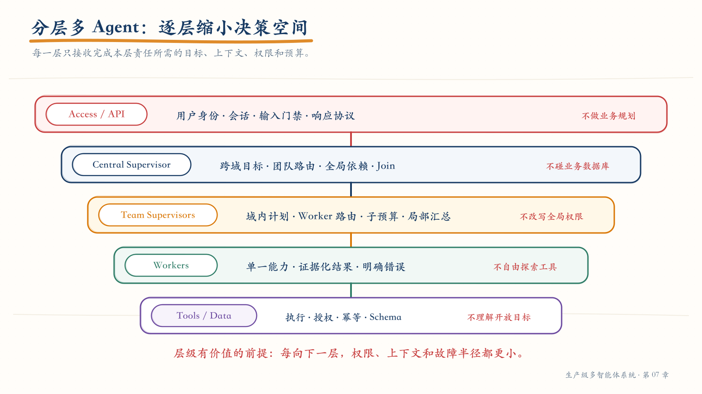
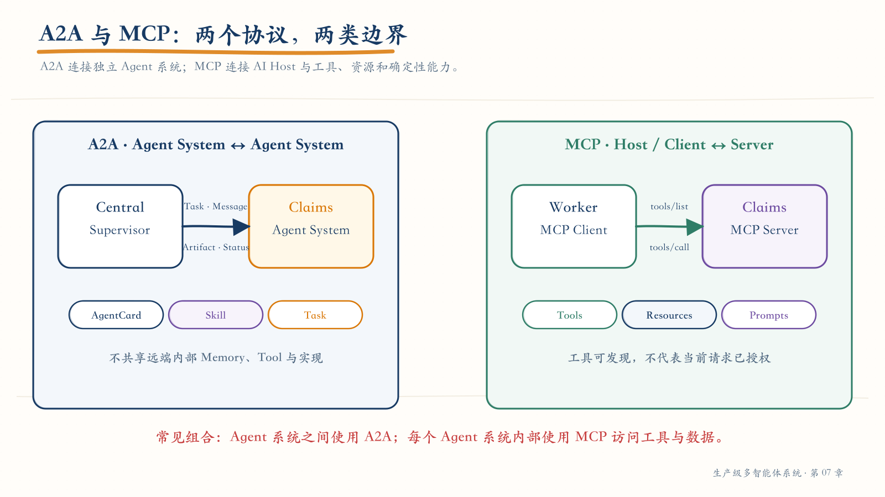
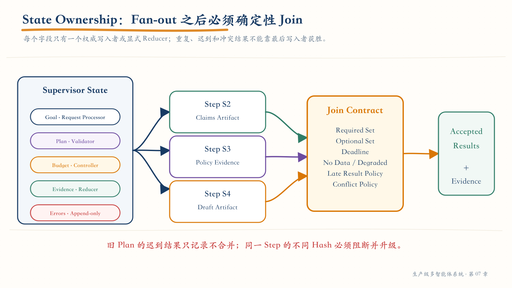
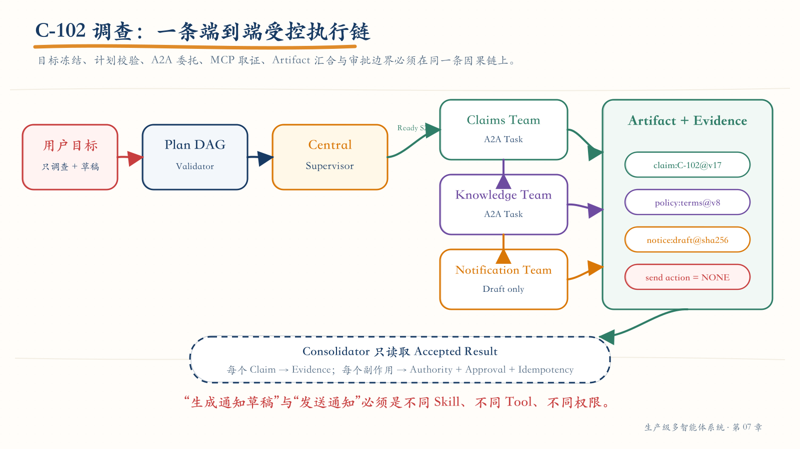
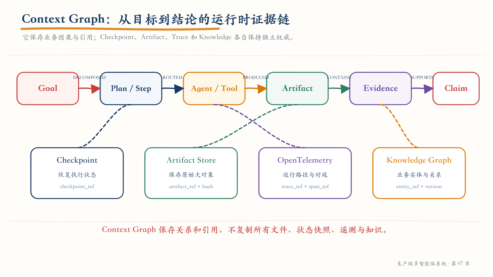
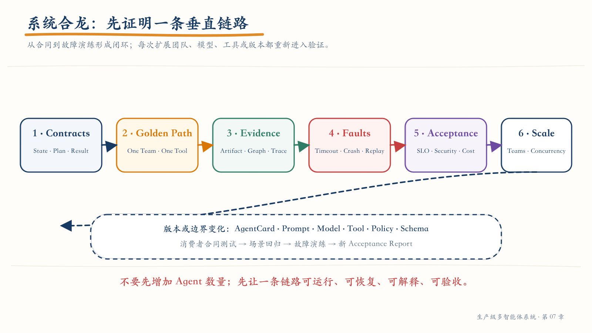
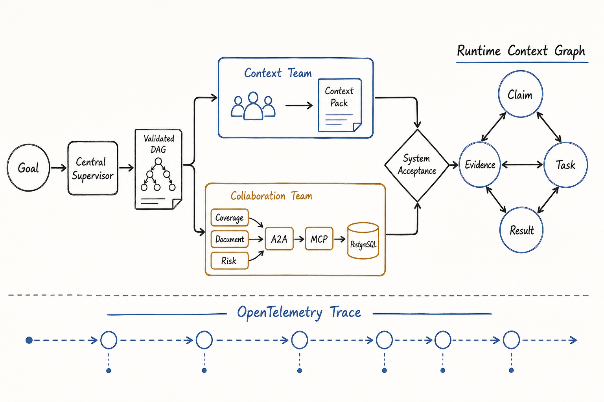

# 第07章　システム統合：Supervisor、A2A、MCP、Context Graph

これまでの6章では、Agent の境界、ツール呼び出し、協調パターン、コンテキスト、本番プラットフォーム、セキュリティ制御をそれぞれ扱ってきました。本章では、さらに難しい問いに答えます。

> **これらの能力を、実行・復旧・説明・受け入れ検証が可能な1つのシステムとして、どのように統合すればよいのでしょうか。**

保険金請求調査システムは、すでにナレッジの検索、ツールの呼び出し、Trace の記録ができ、高リスクのアクションの前には Tool Guard も実行できます。この段階で、保険金請求の運用担当者から、一見するとありふれた依頼が寄せられました。

> 「C-102 の処理がなぜまだ完了していないのか調べ、不足しているものを教えてください。顧客への通知が必要なら、まず通知の下書きを作成し、直接送信はしないでください。」

この依頼は、少なくとも4種類の責任にまたがります。

- メンバーチームは、顧客とテナントのアイデンティティを確認します。
- 保険金請求チームは、案件、書類、処理状況を照会します。
- ナレッジチームは、現在の保険契約と追加書類のルールを説明します。
- 通知チームは下書きを生成しますが、承認を迂回して送信してはなりません。

Demo だけを考えるなら、4つの Agent に順番に会話させれば済みます。しかし本番システムは、さらに次の問いに答えなければなりません。

- 誰が自然言語の目標を実行可能な計画へ変換するのでしょうか。
- どのステップを並列実行でき、どのステップは待つ必要があるのでしょうか。
- 中央レイヤーに、保険金請求データベースへ直接アクセスする権限はあるのでしょうか。
- Agent 間で、能力をどのように発見し、タスクを受け渡し、成果物を受け取るのでしょうか。
- Agent 内部では、データベース、API、ファイルツールをどのように呼び出すのでしょうか。
- あるチームがタイムアウトした場合、システムは失敗、部分結果、縮退結果のどれを返すのでしょうか。
- ツールは成功したものの、Worker が状態を書き込む前にクラッシュした場合、安全に復旧できるのでしょうか。
- 最終結論を、具体的なデータバージョン、ツール呼び出し、権限、承認まで遡れるのでしょうか。

システム統合とは、Agent を「接続する」ことではありません。**目標、権限、状態、依存関係、エビデンス、エラー、予算、復旧セマンティクス**を、複数のプロセスを通過した後も一貫させることです。

本章では、C-102 の調査依頼に沿って議論を進めます。まず、レイヤー化に価値があるのはどのような場合かを判断し、次に Supervisor、A2A、MCP の境界を明確にします。その後、目標を DAG にコンパイルし、状態、エビデンス、復旧ポイントを Context Graph に取り込みます。最後に、フォールトインジェクションと受け入れ検証レポートを用いて、順調な Demo でしか動かないシステムではないことを証明します。

原理を十分に説明するため、本章の前半では「メンバー、保険金請求、ナレッジ、通知」という4つの責任ドメインを使って、方法全体を示します。一方、付属実装では、より狭いものの実際に受け入れ検証できる垂直スライスを採用します。Context Team と Collaboration Team が並列にエビデンスを生成し、Central Supervisor がシステムレベルで統合します。概念モデルは現在のコードより広く、コードのエビデンスは概念上の例より厳密です。両者を同じものとして扱うべきではありません。

!!! note "本章における Context Graph"
    `Context Graph` は、本書で採用するランタイムエビデンスモデルです。Goal、Plan、Step、Agent、Tool、Evidence、Claim、Decision、Approval、Artifact の関係を記録します。A2A、MCP、OpenTelemetry の標準オブジェクトではなく、第4章の Knowledge Graph とも異なります。チームは、グラフデータベース、リレーショナルテーブル、イベントプロジェクション、またはハイブリッドストレージを用いて、この責任を実装できます。

## 1. システム統合の判断基準

マルチエージェントシステムは、「すべてのサービスが 200 を返した」というだけでは統合できたとは言えません。より意味のある基準は、任意の最終結論から遡ってシステムが説明でき、必要に応じて復旧できるかどうかです。

```text
最終 Claim
  → どの TeamResult / Artifact から得られたか
  → どの Step、どの Plan Version が生成したか
  → どの Agent / Worker が実行したか
  → どのバージョンの Tool / MCP Server を呼び出したか
  → どのアイデンティティ、Scope、承認を使用したか
  → どのバージョンのデータまたは文書を読み取ったか
  → 失敗後にどの再試行、縮退、補償を実行したか
```

このチェーンは、少なくとも6つの性質を満たす必要があります。

| 性質 | システムが証明すべきこと |
|---|---|
| 実行可能 | 自然言語の目標が、依存関係、入力、予算、完了条件を持つ計画に変換されている |
| 制約可能 | すべての委譲とツール呼び出しが、アイデンティティ、権限、タスク範囲、リスクポリシーによって制限されている |
| マージ可能 | 並行結果、遅延結果、重複結果、競合結果に、決定論的なマージルールがある |
| 追跡可能 | 最終 Claim から Evidence、Artifact、データバージョン、実行トレースまで遡れる |
| 復旧可能 | タイムアウト、クラッシュ、キャンセル、未知の副作用が、自動的に重複アクションへ発展しない |
| 受け入れ可能 | ビジネス上の正しさ、エビデンスカバレッジ、セキュリティ不変条件、SLO、訓練結果を測定できる |

したがって、本章のアーキテクチャ原則は次のとおりです。

> **LLM は計画と意味上の判断を提案します。Schema、Policy、State Machine、Scheduler、Reducer、Executor、Audit が、何を実行できるか、そして実行後にどのような事実を残すかを決定します。**

## 2. レイヤー化は Agent が多いほどよいわけではない

単一 Agent はコンテキストが集中し、呼び出しチェーンが短く、デバッグも容易です。リスクが低く、ツールが少なく、共有コンテキストが強いタスクでは、多くの場合こちらの方が優れた設計です。

システムに実在する**ドメイン、権限、状態、デプロイ、障害の境界**がある場合に限り、レイヤー化にはエンジニアリング上の価値があります。

### 2.1 レイヤー化を判断する4つの軸

1. **ドメイン結合**：タスクを、明示的な契約を持つサブ目標に安定して分解できるでしょうか。異なるドメインが、それぞれ独自のエンティティ、ルール、Owner を持っているでしょうか。
2. **リスク分離**：財務、プライバシー、外部通知、インフラの副作用に関わる能力はどれでしょうか。個別のアイデンティティと承認が必要でしょうか。
3. **デプロイ境界**：独立したスケーリング、個別の Secret、独立したリリースサイクル、または異なるチームによる保守が必要な能力はどれでしょうか。
4. **レイテンシ予算**：計画、ネットワーク往復、統合が1回ずつ増えても、クリティカルパスはユーザーが許容できる範囲に収まるでしょうか。

| シナリオ | より適した形態 | 理由 |
|---|---|---|
| 1つのドメイン、3つの読み取り専用ツール、単一ターンの Q&A | 単一 Agent | レイヤー化はプロトコルとレイテンシを増やすだけ |
| パスが安定し、ルールが明確で、アクションが高リスク | 決定論的ワークフロー | モデルが制御フローへ及ぼす影響を減らすべき |
| 複数ドメインで、権限が異なり、結果を契約化できる | レイヤー化されたマルチエージェント | コンテキスト、権限、障害半径を縮小できる |
| 組織または技術スタックをまたぐ独立した Agent システム | A2A + 内部オーケストレーション | 内部実装を公開せずに相互運用する必要がある |

!!! warning "組織構造はシステム境界ではない"
    「財務部に1つの Agent、法務部に1つの Agent がある」だけでは、分割する十分な理由になりません。データ、ツール、権限、状態、ライフサイクルが異なり、結果契約によって分離できる場合にのみ、分割が成立します。

## 3. 5層の責任：各層で「責任を持たないこと」を明確にする



*図7-1　レイヤー化の価値は、意思決定空間、権限、障害半径を段階的に縮小することにあり、組織階層を複製することではありません。*

本書では、議論のモデルとして5つのレイヤーを使用します。

| レイヤー | 担う責任 | 明確に責任を持たないこと |
|---|---|---|
| Access / API | ユーザーアイデンティティ、セッション、入力ゲート、応答プロトコル | ビジネス計画とツール実行 |
| Central Supervisor | ドメイン横断の目標分解、チーム選択、グローバルな依存関係、予算、統合 | ビジネスデータベースや任意のツールへの直接アクセス |
| Team Supervisor | ドメイン内のエンティティ解決、Worker ルーティング、チームのサブ予算、ローカルな統合 | グローバル目標の書き換えやユーザー権限の拡大 |
| Worker | 1つの名前付き能力、制御されたツール呼び出し、エビデンスに紐付く結果 | 他チームの自由な探索やグローバルタスクの再計画 |
| Tool / Data | 決定論的な実行、リソースレベルの認可、冪等性、Schema | 自由形式のユーザー目標の理解 |

この5層は、5種類の大規模言語モデルを意味するものではありません。Access、Scheduler、Reducer、Policy、および多くの Worker は、通常のコードで実装できます。

### 3.1 コントロールプレーンと実行プレーン

すべてのロジックを Supervisor Prompt に入れると、コントロールプレーンと実行プレーンが再び混在します。

**コントロールプレーン**が所有するものは次のとおりです。

- Goal と制約
- Plan Version
- Ready Set と依存関係
- Budget と Deadline
- Policy Decision
- Approval と Cancellation
- Result Acceptance と最終的な状態遷移

**実行プレーン**が所有するものは次のとおりです。

- Team / Worker の実行
- モデル呼び出し
- MCP Tool Call
- Sandbox とアダプター
- 生の Artifact 生成

Supervisor は `dispatch claims-team` を提案できます。しかし、「SQL を知っている」からという理由で、Team と Tool の境界を越えてはなりません。実行プレーンはエビデンスとエラーを返せますが、グローバル目標の完了を独断で宣言することはできません。

### 3.2 Supervisor は「最大の権限を持つボス Agent」ではない

Supervisor はオーケストレーションの責任であり、スーパーユーザーではありません。

少なくとも、独立して検証できる3つのノードに分解すべきです。

| ノード | 入力 | 出力 | 決定論的ゲート |
|---|---|---|---|
| Planner | Goal、能力スナップショット、制約 | ExecutionPlan | Plan Validator |
| Router / Scheduler | Ready Steps、Registry、Budget | Dispatches | Policy、並行性、Deadline |
| Consolidator | Accepted Results、Evidence | FinalAnswer | Claim-Evidence Validator |

目的はサービスを増やすことではありません。1つのスーパー Prompt が、計画、認可、実行、自己検証を同時に担うことを防ぐことです。

## 4. Central、Team、Worker：3段階の収束

ドメインをまたぐ依頼の意思決定空間は、レイヤーごとに縮小すべきです。

### 4.1 Central Supervisor：ユーザー目標からチームタスクへ

中央レイヤーが理解するのは、ドメイン横断の目標です。

```text
C-102 が未完了である理由を特定する
├── 顧客とテナントのアイデンティティを検証する
├── 保険金請求の状態と不足書類を照会する
├── 適用されるルールを説明する
└── 通知の下書きを生成する。送信は禁止
```

このレイヤーは `member`、`claims`、`knowledge`、`notification` の各チームを選択し、強い依存関係と弱い依存関係、グローバル予算、最終統合を管理します。保険金請求データベースにどのテーブルが存在するかを知る必要はありません。

### 4.2 Team Supervisor：チームタスクから名前付き能力へ

保険金請求チームが受け取るのは、範囲が限定されたタスクです。

```text
skill: claim_status_and_missing_documents
claim_id: C-102
subject: tenant=t9, member=m42
allowed_actions: [read_claim, read_required_documents]
forbidden_actions: [update_claim, contact_customer]
deadline: 2026-07-23T09:00:08Z
```

Team Supervisor は、状態と不足書類リストを照会する Worker を選択し、ローカルに結果を統合できます。ただし、`claims:read` を `claims:update` に拡大することはできません。

### 4.3 Worker：名前付き能力から制御された Tool Call へ

Worker のワークスペースは最小です。

1. 入力 Schema、エンティティ、テナント、必要なコンテキストを検証します。
2. 呼び出し主体、Scope、Resource ACL、Purpose を検証します。
3. Deadline、Budget、Cancellation、Circuit Breaker を確認します。
4. 自由形式のテキストをインタープリターへ直接渡さず、構造化されたパラメータを構築します。
5. バインドされた MCP Tool を呼び出します。
6. 返された Schema、出所、時刻、ビジネス不変条件を検証します。
7. WorkerResult を生成し、EvidenceRef に紐付けます。
8. Trace と Context Graph の参照を書き込み、失敗時は構造化エラーを返します。

Worker が会話全体、全チーム、全ツールを見る必要があるなら、境界はすでに機能していません。

## 5. A2A と MCP：2つのプロトコルを互いに偽装させない



*図7-2　A2A は独立した Agent システムを接続し、MCP は AI Host とツール、リソース、外部能力を接続します。*

A2A 1.0 は、独立し、内部が不透明である可能性もある Agent システム間の相互運用を対象としています。AgentCard、Message、Task、Part、Artifact に加え、ポーリング、ストリーミング、プッシュなどのタスク対話方式を定義します。

現在の MCP プロトコルバージョンは `2025-11-25` です。Host、Client、Server 間の能力発見と呼び出しを標準化し、Server は Prompt、Resource、Tool を公開できます。MCP には実験的な Tasks 能力も追加されましたが、MCP が Agent 協調プロトコルになったわけではありません。

| 問い | A2A | MCP |
|---|---|---|
| 主な境界 | 独立した Agent システム間 | AI Host / Client と Server 能力の間 |
| 発見対象 | AgentCard、Skills、Interfaces | Server Capabilities、Tools、Resources、Prompts |
| 主な対話 | Message、Task、Artifact | JSON-RPC リクエスト、Tool / Resource / Prompt |
| 長時間タスク | A2A Task が中核オブジェクト | MCP Tasks は 2025-11-25 でも実験的能力 |
| 内部状態 | リモートの内部状態、Memory、Tool の公開を要求しない | ビジネス Agent 間のチーム協調を定義しない |
| 認可 | セキュリティ方式を宣言し、受信側が各操作を引き続き認可する | HTTP 認可フレームワーク。リソースとツールには引き続きビジネス認可が必要 |

### 5.1 実用的な境界

```text
Central Supervisor（A2A Client）
  ── A2A Task / Message ──▶ Claims Agent System（A2A Server）
                               │
                               ├─ Team Supervisor
                               ├─ Claim Worker
                               └─ MCP Client ──▶ Claims MCP Server ──▶ Claims DB
```

A2A Server は、「保険金請求の状態を照会する」というビジネス能力を外部に公開します。内部で使用するフレームワーク、Worker の数、データベースは、中央レイヤーの前提知識となるべきではありません。

### 5.2 プロトコルはビジネス権限を付与しない

次の推論はいずれも成立しません。

- 「AgentCard にこの Skill が書かれているので、現在のユーザーは呼び出せる。」
- 「mTLS に成功したので、Peer はこのテナントのデータへアクセスできる。」
- 「A2A Token が有効なので、受信側はリソースレベルの ACL を省略できる。」
- 「MCP Tool が一覧にあるので、モデルは任意のパラメータで実行できる。」

能力記述が答えるのは「何ができると表明しているか」、認証が答えるのは「あなたは誰か」です。「このユーザーを代理し、この目的のために、このリソースへこのアクションを実行できるか」に答えるのは、認可だけです。

## 6. 能力発見：AgentCard から制御されたスナップショットへ

A2A の AgentCard は、Agent のアイデンティティ、能力、スキル、サービスインターフェース、セキュリティ要件を記述します。本番システムでは、インターネット上で発見した Card をそのまま Planner に渡してはなりません。

能力が計画に入る前に、4段階の処理を通過させる必要があります。

| 段階 | 制御 |
|---|---|
| Registry Ingest | 出所、署名、Owner、プロトコルバージョン、ヘルス、変更履歴 |
| Capability Filter | ユーザー、テナント、環境、リスク、地域、データ分類 |
| Prompt Projection | Planner が実際に必要とする Skill の要約だけを投影 |
| Dispatch Revalidation | Endpoint、Audience、Scope、プロトコルと契約のバージョン |

内部で正規化したスナップショットは、次のように表現できます。

```yaml
snapshot_id: cap-20260723-0900
source_agent_card:
  name: Claims Agent
  protocol_version: "1.0"
  signature_verified: true
interface:
  binding: HTTP+JSON
  url_ref: registry://agents/claims/v1
skills:
  - skill_id: claim-status
    description: 保険金請求の状態と不足書類を照会する
    input_schema: contracts/claim-status-input/1.2.0
    artifact_schema: contracts/claim-status-artifact/1.3.0
    risk: read_only
    latency_slo_ms: 2500
policy_projection:
  allowed_tenants: [t9]
  allowed_purposes: [claim_investigation]
  scopes: [claims:read]
expires_at: 2026-07-23T09:05:00Z
```

これは本システムの内部契約であり、A2A AgentCard に代わる Schema ではありません。分けて保存することで、ローカルの権限判断を、外部向けの能力宣言へ誤って書き込むことを防げます。

!!! tip "機密性の高い能力をすべて公開しない"
    A2A の公式ディスカバリーガイドでは、機密性の高い URL や Skill を含む AgentCard に対して、認証、認可、選択的開示を用いることを推奨しています。静的な Secret を Card に書き込んではなりません。

## 7. 目標を検証可能な DAG にコンパイルする

Planner の成果物を、「まず A を照会し、次に B を照会する」という文章だけにしてはなりません。決定論的な Validator と Scheduler が読み取れる必要があります。

```yaml
plan_id: plan-c102-18
version: 3
goal_id: goal-c102-7
steps:
  - id: s1
    team: member
    skill: resolve-member
    depends_on: []
    required: true
  - id: s2
    team: claims
    skill: claim-status
    depends_on: [s1]
    input_map:
      member_id: s1.artifact.member_id
    required: true
  - id: s3
    team: knowledge
    skill: policy-guidance
    depends_on: [s2]
    required: false
  - id: s4
    team: notification
    skill: draft-notice
    depends_on: [s2, s3]
    required: false
    side_effect: none
join:
  strategy: evidence_consolidation
  required_steps: [s1, s2]
  optional_steps: [s3, s4]
budget:
  max_steps: 6
  max_model_tokens: 12000
  max_tool_calls: 8
  deadline_ms: 9000
```

### 7.1 Plan Validator

任意のステップを実行する前に、Validator は少なくとも次を確認します。

- Schema が有効で、`step_id` が一意である。
- Team / Skill が存在し、プロトコルと契約のバージョンに互換性がある。
- 依存先が存在し、循環がない。
- 必須入力を上流の Artifact からマッピングできる。
- Step、Token、Tool、並行性、Deadline が予算内に収まっている。
- 各 Skill に対し、ユーザー、Workload、タスクの実効権限が成立している。
- 高リスクステップに承認要件がある。
- Join ルールが、完全、部分、縮退、失敗、キャンセルを判定できる。
- 最終 Claim に必要な Evidence が契約で宣言されている。

Validator は、未知のフィールドをひそかに補完して実行を続けてはなりません。Planner が有界の再計画を行えるよう、構造化された診断を返すことはできますが、`replan_count` は制御する必要があります。

### 7.2 Scheduler は Ready Set だけをスケジュールする

```python
def ready(step, state):
    return (
        step.status == "pending"
        and all(state.steps[d].status == "completed"
                for d in step.strong_dependencies)
        and state.plan.version == step.plan_version
        and state.budget.remaining_ms > step.minimum_runtime_ms
        and not state.cancel_requested
    )
```

モデルは依存関係を提案できますが、最終的な Ready Set は決定論的なコードで計算しなければなりません。

## 8. State Contract：プロセス間で共有するのは状態であり、チャット履歴ではない



*図7-3　各状態フィールドには一意の Owner または明示的な Reducer が必要です。並行タスクは、結果契約を通じてのみ合流できます。*

チャットメッセージは対話の表現には適していますが、分散トランザクション状態を担うには不向きです。Supervisor State では、少なくとも次を区別する必要があります。

```python
class SupervisorState(TypedDict):
    request_id: str
    session_id: str
    goal: Goal
    constraints: list[Constraint]
    plan: ExecutionPlan | None
    step_results: Annotated[dict[str, StepResult], merge_by_step_id]
    evidence: Annotated[list[EvidenceRef], dedupe_by_source_anchor]
    errors: Annotated[list[AgentError], append_only]
    approvals: dict[str, Approval]
    budget: BudgetState
    final_answer: FinalAnswer | None
    status: Literal[
        "received", "planned", "running", "blocked",
        "completed", "failed", "cancelled"
    ]
```

### 8.1 フィールドの所有権

| フィールド | 権威ある書き込み主体 | マージルール / 不変条件 |
|---|---|---|
| Goal / Constraints | Request Processor | 作成後は明示的にのみ改訂でき、暗黙の書き換えは禁止 |
| Plan | Planner + Plan Validator | バージョン化する。実行開始後の変更では Replan Event を生成する |
| StepResult | 対応する Step Executor | `step_id + plan_version` で冪等にマージする |
| Evidence | Worker / Tool Adapter | Source + Anchor + Version で重複排除する |
| Errors | すべての実行ノード | Append-only とし、エラーを握りつぶさない |
| Budget | Budget Controller | アトミックに差し引き、Agent の自己申告は受け入れない |
| Approval | Approval Service | アクション、リソース、パラメータハッシュ、バージョン、有効期間に紐付ける |
| FinalAnswer | Consolidator | Accepted Results と Evidence だけを参照できる |

### 8.2 4つのシステム不変条件

1. `completed` になったすべての Step は、契約に適合する Result を持ちます。照会結果がない場合は `no_data` として記録する必要があります。
2. 強い依存先が1つでも未完了なら、下流の Step を開始できません。
3. 最終的なビジネス Claim はすべて `evidence_id` に紐付くか、推論であることとその不確実性が明示されます。
4. すべての副作用は、認可、承認、Expected Version、Idempotency Key まで遡れます。

### 8.3 Result の状態を混同しない

A2A Task State、MCP Task Status、本システムのビジネス Result Status は、それぞれ異なるレイヤーの状態です。

本書では、次のビジネス結果の語彙を使用します。

| 状態 | ビジネス上の意味 |
|---|---|
| completed | 契約を満たし、必須の結果とエビデンスがそろっている |
| no_data | 照会は成功したが記録がない。技術的な失敗ではない |
| partial | 一部の結果が得られており、不足項目が明示されている |
| degraded | 縮退パスを使用し、品質または適時性が影響を受けている |
| blocked | 入力、権限、承認、外部条件を待っている |
| failed | 結果契約を満たせず、構造化エラーが付属している |
| cancelled | ユーザー、親タスク、またはシステムによってキャンセルされた |

プロトコルアダプターは明示的にマッピングする必要があり、名前が似ているから同等だと仮定してはなりません。たとえば、A2A の `TASK_STATE_INPUT_REQUIRED` はローカルの `blocked` にマッピングできますが、その理由と復旧条件を保持する必要があります。

## 9. 1つのリクエストが完了するまで



*図7-4　1つのユーザー目標が、契約で制約されたタスクグラフへコンパイルされ、すべての結論が最終的にエビデンスと承認の境界へ集約されます。*

ここからは、C-102 の依頼を最初から最後までたどります。

### 9.1 受け付け：最初に目標とセキュリティ境界を固定する

Gateway は、ユーザー認証、テナント解決、レート制限、入力検査を完了し、次を作成します。

```yaml
request_id: req-7f2
session_id: ses-91
trace_id: 4bf92f3577b34da6a3ce929d0e0e4736
goal:
  purpose: claim_investigation
  claim_id: C-102
  requested_outputs:
    - cause
    - missing_documents
    - next_action
    - notification_draft
constraints:
  - notification_must_not_be_sent
  - no_claim_update
  - evidence_required_for_business_claims
```

「送信しない」は通常のプロンプトではなく、Goal Contract の禁止アクションに組み込まれます。

### 9.2 計画：モデルが提案し、Validator が裁定する

Planner は、権限によってフィルタリングされた能力スナップショットに基づいて DAG を生成します。Validator は、通知 Skill が `draft-notice` だけで、`send-notice` を持たないことを確認するため、この計画を有効と判断します。

Plan Version 3 が状態とイベントログへ書き込まれます。以後のすべての Dispatch と Result は、このバージョンを含まなければなりません。

### 9.3 中央ルーティング：依存関係と予算に従って最小権限の委譲を発行する

Scheduler は、まず `s1` をディスパッチします。`s1` が完了すると、`s2` が Ready Set に入ります。各 Dispatch に付与される Scope と Deadline は、現在の Step に必要なものだけです。

```yaml
dispatch_id: dsp-s2-v3
task_ref: req-7f2
step_id: s2
plan_version: 3
target_agent: claims-agent
skill: claim-status
scopes: [claims:read]
forbidden_actions: [claims:update, notify:send]
deadline: 2026-07-23T09:00:08Z
input_ref: artifact://req-7f2/s1/member-resolution@sha256:...
```

### 9.4 A2A 委譲：リモートシステムが独立して認可する

Claims Agent は次を検証します。

- A2A プロトコルのバージョンとインターフェース
- 呼び出し元の Workload アイデンティティ
- Token の Audience、Expiry、Scope
- Task / Context の可視性
- Skill が存在するか
- ユーザー、テナント、Purpose、リソース ACL
- Message / Part のメディアタイプと Schema

認証に成功しても、認可に成功したことにはなりません。Claims Agent は、自身の Policy に基づいて権限を再計算しなければなりません。

### 9.5 チーム実行：Worker が MCP を通じてエビデンスを取得する

Team Supervisor は `claim-status-worker` を選択します。Worker の MCP Client は、読み取り専用の Claims MCP Server にだけ接続し、次のツールだけを公開します。

```text
claims.get_status
claims.list_missing_documents
```

ツールの結果は、出力 Schema、テナント、バージョン、Evidence Anchor の検査を経てから WorkerResult に入ります。

### 9.6 Artifact：結果はチャットメッセージではない

A2A 1.0 は Message と Artifact を明確に区別しています。Message はタスクの開始、確認、状態の対話に使用し、タスクの出力は Artifact として提供すべきです。

保険金請求チームは次を返します。

```yaml
artifact_id: art-claims-c102-v17
name: claim-status
media_type: application/json
schema: contracts/claim-status-artifact/1.3.0
data:
  claim_id: C-102
  status: pending_documents
  missing_documents:
    - accident_report
  updated_at: 2026-07-22T14:11:09Z
evidence:
  - evidence_id: ev-391
    source: claims-db
    anchor: claim:C-102@v17
    observed_at: 2026-07-23T09:00:02Z
content_hash: sha256:...
```

### 9.7 依存関係の進行：ポリシーの説明を作成してから、通知の下書きを生成する

`s2` の完了後、ナレッジチームは事故証明の不足が処理を妨げる理由を説明します。`s3` が受け入れられると、通知チームは保険金請求の事実と、受け入れ済みのポリシー結論だけを受け取り、下書きの Artifact を生成します。相互に依存しない他の読み取り専用調査ステップは引き続き並列実行できますが、このチェーンでは、レイテンシを下げるために内容上の依存関係を省略してはなりません。

下書きは副作用ではありません。送信は別の保護対象アクションです。両者は、異なる Skill、異なる Tool、異なる権限でなければなりません。

### 9.8 Join：完全、部分、縮退は契約で決定する

ナレッジチームがタイムアウトしても、`s1` と `s2` が完了している場合は、次のように処理します。

- 保険金請求の状態と不足書類の事実は返せる。
- ポリシーの説明は不足としてマークする。
- 通知の下書きは、ポリシー文言がないため省略する可能性がある。
- グローバル状態は `degraded` とし、`completed` に偽装してはならない。
- ユーザーに不足項目と影響を示す。

### 9.9 Consolidation：Accepted Results だけから回答を生成する

Consolidator は任意の Worker の対話を読みません。読み取るのは次だけです。

- 契約検証を通過した Artifact
- Accepted StepResult
- EvidenceRef
- Warnings、Missing Steps、Policy Decisions

最終回答にある「C-102 は事故証明を待っている」は `ev-391` に紐付きます。「提出後に審査が続行される」は、現在の保険契約条項の Evidence に紐付きます。通知内容は下書きとしてマークされ、送信アクションは実行されていません。

## 10. A2A 契約：コンテキスト、タスク、成果物を分ける

A2A の `contextId` は、関連する Task と Message を論理的にグループ化するために使用し、`taskId` はライフサイクルを持つ1つの作業単位を表します。これらを内部の `request_id`、`plan_id`、`step_id` と1つのフィールドにまとめてはなりません。

明示的な関連付けを維持することを推奨します。

```yaml
correlation:
  request_id: req-7f2
  goal_id: goal-c102-7
  plan_id: plan-c102-18
  plan_version: 3
  step_id: s2
  a2a_context_id: ctx-claims-92
  a2a_task_id: task-claims-882
  trace_id: 4bf92f3577b34da6a3ce929d0e0e4736
```

### 10.1 タスク状態は信頼できるイベントログではない

A2A は、ポーリング、ストリーミング更新、Push Notification をサポートします。クライアントは切断後、一時的な状態メッセージを見逃す可能性があります。重要な事実をストリーミングテキストだけに存在させてはなりません。

したがって、次のように保存先を分けます。

- ビジネス結果は Artifact に入れる。
- 状態変化は永続イベントに入れる。
- 現在のビューは State Store に入れる。
- オブザーバビリティデータは Trace / Metric / Log に入れる。
- 因果関係とエビデンスの関連は Context Graph に入れる。

### 10.2 バージョンを明示する

A2A 1.0 のクライアントは、リクエストで `A2A-Version` を宣言すべきです。システムは次のバージョンを個別に管理する必要があります。

- A2A Protocol Version
- AgentCard / Interface Version
- ローカル Skill Contract Version
- Artifact Schema Version
- Plan Version

プロトコルに後方互換性があっても、ビジネス Schema が自動的に互換になるわけではありません。コンシューマー契約テストは引き続き不可欠です。

## 11. MCP 契約：ツール呼び出しは依然として特権境界である

MCP Tool Description はモデルによる能力理解を助け、Tool Input Schema は構造を制約します。どちらもリソースレベルの認可を代替できません。

本番用 Tool Contract には、少なくとも次を登録すべきです。

```yaml
tool: claims.get_status
server: claims-read-mcp
protocol_version: "2025-11-25"
input_schema: contracts/claims-get-status-input/2.0.0
output_schema: contracts/claims-get-status-output/2.1.0
side_effect: none
required_scopes: [claims:read]
resource_binding: tenant_id + claim_id
timeout_ms: 1200
idempotency: not_applicable_read
evidence:
  source_field: source
  anchor_field: record_version
task_support: forbidden
```

### 11.1 MCP Tasks の使用境界

MCP `2025-11-25` では、実験的な Tasks が導入されました。一部の時間がかかる Tool Call に、永続状態、ポーリング、結果の読み取り、キャンセルを提供できます。使用する前に、次を満たす必要があります。

- 双方が初期化時に Tasks Capability を宣言する。
- Tool が `execution.taskSupport` により required、optional、forbidden のいずれかを宣言する。
- 呼び出し側が `working`、`input_required`、`completed`、`failed`、`cancelled` を処理する。
- 任意の状態通知を唯一の信頼できる情報源にしない。

リモートが独立した目標、スキル、Artifact、協調ライフサイクルを持つ Agent システムなら、A2A を優先します。単に時間のかかる決定論的ツールなら、MCP Task を検討できます。境界は責任モデルによって決まり、「呼び出しにどれほど時間がかかるか」だけで決まるものではありません。

## 12. Join と Reducer：並行処理の後は決定論的に収束させる

Fan-out は容易ですが、本当のシステム設計は Join にあります。

### 12.1 Join Contract

```yaml
join_id: join-c102
required_steps: [s1, s2]
optional_steps: [s3, s4]
completion_rule: all_required_terminal
success_rule: all_required_completed
deadline: 2026-07-23T09:00:09Z
on_optional_failure: degraded
on_required_no_data: completed_with_no_data
on_required_failure: failed
late_result_policy: record_but_do_not_merge
conflict_policy: block_and_escalate
```

Join は次の問いに答える必要があります。

- 何を待つのか。
- いつまで待つのか。
- どのステップが必須か。
- `no_data` は完了条件を満たすか。
- 任意ステップが失敗した場合、`partial` と `degraded` のどちらにするか。
- Late Result を最終回答へ取り込めるか。
- 2つの Evidence が競合した場合、誰が裁定権を持つか。

### 12.2 Reducer

```python
def apply(result, state):
    if result.plan_version != state.plan.version:
        return state.record_stale_result(result)

    existing = state.step_results.get(result.step_id)
    if existing:
        return state.require_same_hash(existing, result)

    contract = state.plan.contract_for(result.step_id)
    validated = contract.validate(result)
    state.step_results[result.step_id] = validated
    state.evidence = merge_evidence(state.evidence, validated.evidence)
    return state
```

同じステップから重複した結果が届いた場合は、次のように処理します。

- Hash が同じ：冪等に受け入れる。
- Hash が異なる：「後勝ち」にしてはならず、競合を記録して処理を阻断する。

## 13. Context Graph：説明可能な因果関係を保存し、すべてのストレージを担わせない



*図7-5　Context Graph は Goal、Task、実行、エビデンス、結論、承認を接続しますが、生の大きなオブジェクトは引き続き Artifact Store に保存します。*

最小限のノードモデルは次のとおりです。

| ノード | 主要フィールド | 代表的なエッジ |
|---|---|---|
| Goal | Owner、Purpose、Constraints、Status | DECOMPOSED_INTO |
| Plan / Step | Version、Team、Skill、Required、Status | DEPENDS_ON、ROUTED_TO |
| Agent / Tool | Identity、Contract、Deployment | EXECUTED_BY、CALLED |
| Result / Artifact | Schema、Status、Hash、Trace Ref | PRODUCED |
| Evidence | Source、Anchor、Observed At、ACL | SUPPORTS |
| Claim / Decision | Text、Confidence、Policy | DERIVED_FROM |
| Error / Approval | Category、Actor、Expiry、Resolution | BLOCKED_BY、AUTHORIZED_BY |

### 13.1 Context Graph は Knowledge Graph ではない

Knowledge Graph は次の問いに答えます。

> C-102 はどの顧客に属するのか。保険契約、事故、書類にはどのようなビジネス上の関係があるのか。

Context Graph は次の問いに答えます。

> 今回の実行で「事故証明を待っている」という結論に至ったのはなぜか。どのステップが、どのバージョンのデータを読み取ったのか。どの承認によって、どのアクションが許可されたのか。

両者は相互参照できますが、ライフサイクル、権限、事実のセマンティクスは異なります。

### 13.2 Context Graph は Trace ではない

OpenTelemetry Trace は、リクエストが通過した操作、所要時間、エラー発生箇所を記述します。Context Graph は、ビジネス目標、計画、エビデンス、意思決定の関係を記述します。

双方向に参照することを推奨します。

```text
Step Node ── trace_ref ──▶ Span / Trace
Span Attributes ── goal.id / task.id / step.id ──▶ Context Graph Node
```

非同期キューによって新しい Trace が生成される場合は、OpenTelemetry Span Link で Trace 間の因果関係を表現できます。

## 14. Checkpoint、Event Log、Artifact、Context Graph にはそれぞれ Owner が必要

| 仕組み | 担う責任 | 担うべきでない責任 |
|---|---|---|
| Checkpoint | 特定の実行状態を復旧する | 完全な監査とビジネス上の因果説明 |
| Event Log | 不変の状態変化とリプレイ入力を保存する | そのまま照会しやすい現在ビューとして機能する |
| State Store | 現在のタスク、ステップ、予算、ロックを保存する | すべての履歴と大きなオブジェクトを保存する |
| Context Graph | 計画、実行、エビデンス、Claim、承認の関係を保存する | 大きなファイルや個々のテレメトリ詳細を保存する |
| Artifact Store | 生のツール出力、レポート、ファイル、スナップショットを保存する | プロセスをスケジュールする |
| Trace / Metric / Log | 実行診断、レイテンシ、エラー、容量、アラートを扱う | ビジネス事実を最終的に裁定する |

「1つのデータベースにすべてを保存する」ことは物理的には可能ですが、論理的な Owner は分離しなければなりません。そうしないと、復旧ロジックが監査イベントを現在状態と誤認したり、Trace のサンプリングを完全なビジネスエビデンスとして扱ったりします。

### 14.1 推奨される書き込み順序

読み取り専用ステップでは、次の順序を推奨します。

1. Step Started Event を書き込む。
2. Tool Call を実行する。
3. 生の Artifact を保存する。
4. Result と Evidence を検証する。
5. StepResult / Outbox をアトミックに書き込む。
6. Context Graph を投影する。
7. Trace Span を完了する。
8. Scheduler が下流のロックを解除する。

副作用では、次の順序を使用します。

1. `command_id / idempotency_key` を固定する。
2. Intent を書き込む。
3. 再認可し、Approval に紐付ける。
4. 外部アクションを実行する。
5. Side Effect State を照会または記録する。
6. Completed / Failed Event を書き込む。
7. State、Artifact、Context Graph を更新する。
8. 不確定な結果は必ず Reconcile に送り、盲目的に再試行しない。

## 15. 復旧、キャンセル、未知の副作用

最も危険な障害は、明確な失敗ではなく、「外部アクションが成功したかどうか分からない」状態です。

| Side Effect State | Safe to Retry | 復旧アクション |
|---|---|---|
| not_started | はい | 同じ Idempotency Key を使用して有界に再試行する |
| unknown | いいえ | 外部システムへ照会するか、人手で確認する |
| completed | いいえ | 既存の結果を読み取り、冪等にマージする |
| partially_completed | 条件付き | 補償を実行するか、人間が介入する |

### 15.1 Checkpoint からの復旧は、古い認証情報を使い続けることではない

復旧時には、次を改めて確認する必要があります。

- ユーザーと Workload のアイデンティティが引き続き有効か。
- Delegation と Approval が期限切れになっていないか。
- リソースのバージョンが変わっていないか。
- Deadline と Budget にまだ余裕があるか。
- Plan Version が引き続き現行バージョンか。
- 完了済みの外部アクションを Idempotency / Reconcile で識別できるか。
- Cancellation がすでに伝播していないか。

Token、Nonce、短期承認は、Checkpoint に書き込まれたからといって寿命が延びるわけではありません。

### 15.2 キャンセルは分散状態遷移である

親 Goal が `cancelling` に移行した後は、次のように処理します。

1. 新しい Ready Step を開始しない。
2. Running 状態の A2A / MCP Task へキャンセルを送信する。
3. Worker は Cancellation Token を定期的に確認する。
4. 開始済みの副作用を Reconcile または補償へ移行する。
5. Late Result は記録するが、キャンセル済み状態を汚染させない。
6. Context Graph に `CANCELLED_BY` と未解決のアクションを記録する。

キャンセルリクエストが成功したことから分かるのは、「システムがキャンセルの意図を受け入れた」ことだけです。すべての外部アクションが即座に停止したことを証明するものではありません。

## 16. コンテキスト圧縮：3つの圧縮ポイント、3種類の損失予算

多層システムでは、完全なセッションとグローバル State を各 Agent に複製すべきではありません。圧縮は3つの異なる場所で行われます。

| 場所 | 圧縮可能 | 必ず保持するもの |
|---|---|---|
| セッション → Central | 挨拶、重複表現、完了済みの詳細 | Goal、制約、エンティティ、否定、未処理項目 |
| Central → Team | 他チームの情報、冗長な説明 | 依存フィールド、Scope、Deadline、リスク |
| Tool Result → Result | 表示用フィールド、重複行、関連性の低い断片 | 出所、Anchor、重要な事実、異常、適時性 |

圧縮契約には、少なくとも次を含めます。

```yaml
compressed_context:
  preserved_constraints:
    - notification_must_not_be_sent
    - evidence_required
  resolved_entities:
    claim_id: C-102
    member_id: m42
  facts:
    - claim_status: pending_documents
  open_questions:
    - policy_effective_date
  evidence_refs: [ev-391]
  omitted_sections:
    - greeting
    - unrelated_session_history
  source_hash: sha256:...
  compressor_version: 2.1.0
```

圧縮品質は、Token の削減率だけで評価できません。金額、日付、否定、禁止アクション、エラー、Evidence Anchor の保持率もテストする必要があります。

## 17. オブザーバビリティ：1つの Trace を複数の責任プレーンに通す

1つのリクエストは、共通の相関キーによって次の要素を結び付けられるようにします。

```text
goal.id
request.id
plan.id + plan.version
task.id
step.id
agent.id
tool.name
trace.id + span.id
artifact.id
evidence.id
```

| プレーン | 主要指標 |
|---|---|
| ビジネス | Goal Success、エスカレーション率、ビジネス正解率、エンドツーエンド SLA |
| Agent | Plan Valid、Routing Precision、Handoff、Replan、Step Retry |
| モデル | Prompt Version、Token、Latency、Structured Output Failure |
| Tool / Infra | Tool Success、Queue Depth、DB Latency、CPU / Memory |
| セキュリティ | Denied Action、Approval、Replay、Injection、DLP |
| コスト | Request / Team / Worker / Model / Tool ごとに帰属させたコスト |

### 17.1 平均レイテンシだけを見ない

レイヤー化されたシステムのユーザー体験は、DAG の Critical Path と最も遅い依存先によって決まります。中核指標は次のとおりです。

| 指標 | 定義 | 診断上の価値 |
|---|---|---|
| Goal Success Rate | ユーザー目標を満たし、ビジネス受け入れ検証を通過した割合 | ノーススター指標。HTTP 200 と同義ではない |
| Plan Valid Rate | 最初の計画が検証を通過した割合 | 能力記述と Planner の品質 |
| Routing Precision | 目標が正しい Team / Worker へルーティングされた割合 | ルーターの品質 |
| Evidence Coverage | エビデンスのある Claim / エビデンスが必要な Claim | 信頼性とコンプライアンス |
| Critical Path Latency | DAG の最長依存パスに要した時間 | 実際の体験上のボトルネック |
| Recovery Success | 復旧可能な障害のうち、自動復旧に成功した割合 | レジリエンス |
| Cost per Successful Goal | 総コスト / 成功した目標数 | 「安いが無効」になることを防ぐ |

セキュリティ不変条件を平均値で薄めてはなりません。たとえば、次のように定義します。

```yaml
unauthorized_side_effects: 0
cross_tenant_data_leaks: 0
duplicate_high_risk_actions: 0
```

## 18. Agent を横に増やす前に、垂直スライスを作る



*図7-6　まず1本のエンドツーエンド経路で契約、エビデンス、復旧を証明してから、チーム、並行性、動的能力を追加します。*

推奨するマイルストーンは次のとおりです。

| マイルストーン | 必ず証明すること |
|---|---|
| M1 契約 | State、Plan、Dispatch、Result、Error、Evidence、バージョンを個別に検証できる |
| M2 単一パス | 1つの Team / Worker / MCP が正しく完了し、Evidence を生成する |
| M3 マルチチーム | 依存関係、並列処理、Join、Artifact、Context Graph が成立する |
| M4 障害 | タイムアウト、重複、クラッシュ、キャンセル、未知の副作用から安全に復旧できる |
| M5 本番ゲート | 権限、予算、オブザーバビリティ、SLO、ロールバック、受け入れ検証エビデンスがそろっている |

妥当なコード構成は次のとおりです。

```text
contracts/
  state/ plan/ dispatch/ result/ error/ evidence/
services/
  access_api/
  central_supervisor/
  teams/member/
  teams/claims/
  teams/knowledge/
  teams/notification/
mcp/
  member_tools/
  claims_tools/
  knowledge_tools/
runtime/
  scheduler.py
  reducer.py
  checkpoint.py
  context_graph.py
security/
  delegation.py
  policy.py
  approval.py
observability/
  tracing.py
  metrics.py
  audit.py
tests/
  contract/
  planner/
  routing/
  recovery/
  e2e/
```

ディレクトリそのものがアーキテクチャなのではありません。しかし、1つの事実を露呈させることはできます。Plan Validator、Policy、Reducer、Context Graph がすべて `supervisor_prompt.py` の中に隠れているなら、システムにはまだ本当の制御境界がありません。

## 19. テストと障害訓練：失敗時にも正しいことを証明する

| レイヤー | テスト対象 | 代表的なアサーション |
|---|---|---|
| Static | Schema、AgentCard、設定、Prompt Variables | バージョンに互換性があり、未宣言フィールドがない |
| Unit | Validator、Scheduler、Reducer、Policy | 決定論的な不変条件が成立する |
| Contract | A2A、MCP、Result、Error、Artifact | プロデューサーとコンシューマーに互換性がある |
| Component | Team + Fake MCP | ルーティング、エビデンス、エラーセマンティクスが正しい |
| Integration | 実際の DB、Queue、Graph、Trace | 状態とオブザーバビリティが一致する |
| Failure | タイムアウト、リプレイ、クラッシュ、部分的な副作用 | 重複アクションなく、安全に復旧する |
| E2E | 実際のユーザー目標 | ビジネス上正しく、エビデンスが完全で、SLO を満たす |

### 19.1 必ず実施すべき8つの障害実験

| 実験 | 注入方法 | 合格基準 |
|---|---|---|
| F1 不正な計画 | 未知の Skill、循環依存、予算超過 | Validator が阻断し、Tool Call がない |
| F2 A2A タイムアウト | Team の応答を遅延させる | Deadline 内に復旧するか、明確に Degraded とする |
| F3 MCP の不正な Schema | 必須フィールドを削除する | Worker が拒否し、Result を State に入れない |
| F4 Worker のクラッシュ | Tool 成功後、状態書き込み前に Kill する | Reconcile し、副作用を重複させない |
| F5 期限切れ Token | 古い Checkpoint から復旧する | 再び認証・認可し、古い Token を再利用しない |
| F6 Context Graph 使用不能 | グラフへの書き込みを阻断する | 重要度に応じて Fail Closed とするか、制御されたバッファリングを行う |
| F7 キャンセルの競合 | Running 中に Cancel する | 下流を停止し、未解決のアクションを記録する |
| F8 Provider 障害 | プライマリモデルが継続的に 5xx を返す | サーキットブレーカーと制御された Fallback を行い、バージョン変更を記録する |

シナリオ Fixture は次のとおりです。

```yaml
scenario_id: E2E-CLAIM-007
goal: C-102 の状態を照会し、次のステップを提示する
faults:
  - at: knowledge.worker
    inject: timeout
expected:
  status: degraded
  required_steps: [s1, s2]
  missing_steps: [s3, s4]
  answer_contains: [pending_documents, accident_report]
  evidence_min: 1
  notification_sent: false
  duplicate_side_effects: 0
  audit_complete: true
```

## 20. System Acceptance：「動く」から「リリースを許可できる」へ

システム完成の定義は、「すべての Agent を接続した」ことではありません。次を満たす必要があります。

### 20.1 アーキテクチャと契約

- 5層の責任、デプロイ境界、信頼境界、ADR がレビュー済みである。
- State、Plan、Step、Result、Error、Evidence、AgentCard のマッピングがすべてバージョン化されている。
- レイヤーをまたぐすべてのフィールドに Owner、Reducer、互換性戦略がある。
- A2A と MCP の境界が明確で、プロトコルがビジネス認可を代替していない。

### 20.2 正しさと復旧

- 計画検証、依存関係のスケジューリング、Join、縮退セマンティクスがテストを通過している。
- Checkpoint、Event Log、Context Graph、Artifact、Trace の Owner が明確である。
- 重複、順不同、古い Plan の Result、キャンセル、未知の副作用を処理できる。
- 障害訓練を通過し、高リスクアクションの重複がない。

### 20.3 セキュリティと運用

- ユーザー → Workload → Delegation → Task → Tool の権限チェーンを追跡できる。
- Token と Approval を Checkpoint 復旧時に再利用しない。
- ビジネス、Agent、モデル、ツール、セキュリティ、コストの各指標を Trace によって関連付けられる。
- アラートに Runbook、Owner、エスカレーションパス、訓練記録がある。
- カナリアリリース、ロールバック、バックアップ、保持、削除のポリシーを実行できる。

### 20.4 ビジネス受け入れ検証

- Golden Scenarios の必須ビジネス結果が正しい。
- 高リスク Claim の Evidence Coverage が基準を満たしている。
- ユーザーが `partial`、`degraded`、`no_data`、`failed` を区別できる。
- ビジネス Owner が残存リスク、SLO、既知の制限を承認している。

```yaml
release: chapter07-reference-v1.0
scope:
  teams: [member, claims, knowledge, notification]
  skills: [resolve-member, claim-status, policy-guidance, draft-notice]
quality:
  goal_success_rate: 98.2%
  plan_valid_rate: 96.4%
  evidence_coverage: 100%
  p95_latency_ms: 7420
reliability:
  recovery_success_rate: 97.5%
  failure_drills_passed: 8/8
  duplicate_side_effects: 0
security:
  unauthorized_side_effects: 0
  notification_sent_without_approval: 0
  replay_block_rate: 100%
decision: go_with_guardrails
known_limits:
  - knowledge team may degrade during index rebuild
owners:
  business: claims-ops
  engineering: agent-platform
  security: appsec
```

| Gate | Go | No-Go |
|---|---|---|
| 契約 | プロデューサーとコンシューマーに互換性があり、Migration の訓練を実施済み | バージョン化されていない、または互換性を破壊している |
| ビジネス | 重要シナリオが基準を満たし、制限が受け入れられている | Goal Success / Evidence が基準未達 |
| 復旧 | 訓練を通過し、重複する副作用が 0 | Unknown Side Effect への対処がない |
| セキュリティ | 最小権限、承認、監査、DLP を通過 | 権限を越えられる、リプレイ可能、またはテナントをまたげる |
| 運用 | SLO、アラート、Runbook、On-call の準備ができている | 開発者が手作業で監視するしかない |
| ロールバック | 旧バージョンとデータ移行を元に戻せる | 不可逆な変更に補償がない |

## 21. CaseOps Slice 6：最初の6章を1つの実行可能なシステムへ統合する

ここまで説明すると、2つの極端に陥りがちです。1つはアーキテクチャ図だけを説明し、読者がこれらの境界を本当に実行できるか判断できないことです。もう1つは、いきなりコードの細部に入り、読者はクラス名をいくつか覚えるだけで、なぜそのように設計したのか理解できないことです。そこで本節では、これまでの判断フレームワークを維持したまま、CaseOps の有界なスライスを使って重要な命題を検証します。



*図7-7　Context Team と Collaboration Team がそれぞれ収束し、Central Supervisor はシステムレベルの受け入れ検証だけを行います。Runtime Context Graph と OpenTelemetry Trace は、それぞれ異なる責任を担います。*

### 21.1 参考実装が担うシステム責任

最初の6章を通じて、CaseOps には独立して成立する2つのチェーンがすでにあります。

- Context Team は、時点、権限、出所、完全性、Token 予算の制約を持つ Context Pack を構築できます。
- Collaboration Team は A2A を通じて Coverage、Document、Risk の3つの専門ノードへタスクを委譲できます。各ノードは MCP を通じてガバナンス対象のツールを読み取り、最後に Evidence Join で収束します。

2つのチェーンがどちらも成功を返しても、システムの結論が正しいことは証明できません。異なるルールバージョンを使用している可能性も、事故証明が要件を満たすかについて相反する結論に達する可能性も、人手レビューが必要かどうかについて判断が一致しない可能性もあります。したがって Slice 6 で追加するのは、4つ目の専門 Agent ではありません。より重要な責任である、**チーム横断の受け入れ検証**です。

1回のシステム実行における DAG は、3つのステップだけで構成されます。

| Step | Owner | 依存関係 | 成果物 |
|---|---|---|---|
| `context-evidence` | Context Team | なし | Context Pack、Evidence-bound Claims |
| `specialist-collaboration` | Collaboration Team | なし | A2A Tasks、専門 Claims、Join Result |
| `system-acceptance` | Central Supervisor | 前の2ステップ | System Result、Runtime Context Graph |

最初の2ステップは、依存関係の観点では並列実行できます。`v0.7.0` のローカル実行器は、単一プロセスのデータベースセッション境界を維持するため、Ready Set を安定した順序で実行します。DAG 契約は、これをプロセス間キュースケジューリングと偽ってはいません。キュー、リース、Worker のハートビートを導入しても、計画そのものを書き換える必要はありません。

### 21.2 Central Supervisor は案件を再調査しない

Central Supervisor は、保険金請求テーブルを読み取らず、MCP を呼び出さず、Worker の思考過程も読み取りません。2つのチームがすでに受け入れ検証した構造化結果だけを受け取り、次の7項目を検査します。

| 検査 | 合格条件 | 不合格時に阻断すべき理由 |
|---|---|---|
| Context が完全 | 必須の主張すべてにエビデンスがある | エビデンスが不足したままでは、完全なビジネス判断を形成できない |
| Collaboration が完全 | 必須の専門ノードと Join 契約を満たしている | 一部の専門ノードの失敗を、完全な結論に偽装できない |
| ルールバージョンが一致 | Context の `2026.1` が案件に紐付くルールのエビデンスに現れる | 新旧のルールが混在すると、書類とリスクの判断が変わる |
| 書類状態が一致 | `satisfied:ACCIDENT_CERTIFICATE` が専門家の結論 `complete` と対応している | 同じ書類を2つのチームで同時に「充足」と「不足」にできない |
| リスクゲートが一致 | `required=true` が `manual_review_required` と対応している | 自動処理が人手によるリスクゲートを迂回してはならない |
| Claim にエビデンスがある | 受け入れた各 Claim に少なくとも1つの Evidence Ref がある | 追跡不能な結論をシステム結果へ入れられない |
| 副作用がない | 2つのチームがどちらも `side_effect=none` を返す | 調査依頼をひそかに処置アクションへ変えてはならない |

これらの検査は、決定論的な Reducer に記述されています。モデルは失敗理由の説明を支援できますが、失敗を合格に変える権限はありません。通常の C-102 の結果は次のとおりです。

```json
{
  "status": "needs_human",
  "result": {
    "outcome": "SYSTEM_ACCEPTED_WITH_HUMAN_REVIEW",
    "checks": [
      {"check_id": "context-complete", "status": "passed"},
      {"check_id": "collaboration-complete", "status": "passed"},
      {"check_id": "policy-version-consistent", "status": "passed"},
      {"check_id": "document-status-consistent", "status": "passed"},
      {"check_id": "risk-gate-consistent", "status": "passed"},
      {"check_id": "claims-evidence-bound", "status": "passed"},
      {"check_id": "side-effect-free", "status": "passed"}
    ],
    "side_effect": "none"
  }
}
```

ここでの `needs_human` はシステムの失敗ではありません。「事故証明は現在のルールを満たしているが、高額で保険契約期間が短いため人手レビューが必要である」とシステムが正しく証明し、人間に代わって支払い拒否、凍結、通知を実行していないことを表します。

### 21.3 Runtime Context Graph に保存するもの

ランタイムの出所グラフは、`runtime_context_nodes` と `runtime_context_edges` という2つのリレーショナルテーブルとして実装しました。ノードには Goal、Plan、Step、Context Pack、Delegated Task、Claim、Evidence、Acceptance、Result を含めます。エッジには `DECOMPOSED_INTO`、`DEPENDS_ON`、`PRODUCED`、`USED`、`SUPPORTED_BY`、`VALIDATED_BY`、`DERIVED_FROM` を含めます。

グラフには、Prompt、Context Pack の本文、ツールパラメータ、ツール結果を複製せず、次だけを保存します。

- 安定したオブジェクト参照
- 責任主体と状態
- データ分類
- Payload の SHA-256 ダイジェスト

これにより、最終 Claim から Evidence まで遡れる一方、「オブザーバビリティのため」という理由で2つ目の機密データウェアハウスを構築せずに済みます。ビルダーには、もう1つの重要な不変条件を組み込みました。各 Claim ノードには少なくとも1本の `SUPPORTED_BY` エッジが必要であり、なければグラフ構築全体が失敗します。

このモデルは、W3C PROV における Entity、Activity、Agent の区別を参考にしていますが、CaseOps は完全な PROV 互換性を実装したとは主張していません。プロトコル名、制約、相互運用テストが整う前に、似た概念を借りて標準実装を装うべきではありません。

### 21.4 状態をどのように永続化し、リプレイするか

`system_runs` は、トップレベルの目標、質問、`as_of`、計画、子実行の参照、最終結果を保存します。`system_steps` は、Owner、依存関係、試行回数、結果参照、結果要約、エラーを保存します。Context Run と Collaboration Run は引き続き元のチームサービスが所有し、トップレベルには外部キーの参照だけを保存します。

システムレベルの冪等キーは、正規化されたリクエストハッシュに紐付けます。

- 同じキー、同じリクエスト：元の `system_run_id` を返し、ステップ、子実行、出所グラフを重複作成しない。
- 同じキー、異なるリクエスト：`409 IDEMPOTENCY_KEY_REUSED` を返す。
- 前回が途中で失敗：完了済み子実行の冪等な結果を再利用し、未完了のステップから続行する。
- 完了済み：最終結果を直接リプレイする。

これは「Exactly Once」ではありません。現在の読み取り専用境界では、リクエストを繰り返しても2つ目のビジネス実行が作られないことを証明するものです。将来、書き込みツールを追加する際には、第5章で扱った Effect Ledger、外部冪等性、Reconcile が依然として必要です。

### 21.5 実行パスに沿ってコードを読む

付属する [CaseOps リポジトリ](https://github.com/dataPro-lgtm/production-grade-multi-agent-caseops)では、責任を次のように分離して配置しています。

```text
src/caseops/orchestration/
  contracts.py     # SystemPlan、SystemResult、Runtime Context Graph の契約
  acceptance.py    # チーム横断の7項目の決定論的な受け入れ検証
  graph.py         # 出所グラフ構築と Claim-Evidence 不変条件
  service.py       # 親子実行、ステップ状態、リプレイ、監査、Outbox

migrations/versions/
  0006_add_hierarchical_system_runs.py

tests/
  test_system_orchestration.py

scripts/
  acceptance-chapter-07.sh
```

本章のリリースバージョンは [`v0.7.0`](https://github.com/dataPro-lgtm/production-grade-multi-agent-caseops/tree/v0.7.0)、対応するマイルストーン tag は [`chapter-07-slice-6`](https://github.com/dataPro-lgtm/production-grade-multi-agent-caseops/tree/chapter-07-slice-6)、固定コミットは `14e08f3` です。ワンコマンドの受け入れ検証では、実際の Agent Card を読み取り、API → A2A → MCP → PostgreSQL の全チェーンを実行し、7項目の検査を行い、Runtime Context Graph を照会し、同じリクエストをリプレイして、ToolGuard の判定がデータベースへ保存されたことを確認します。

### 21.6 参考実装で意図的に設けた制限

プロフェッショナルな実装とは、新機能をすべて有効にすることではありません。このスライスでは、次の境界を明示的に維持しています。

- A2A は独立した Agent システム間のビジネスタスクに使用します。Context Team は引き続きプロセス内のドメインサービスであり、階層的に見せるためだけに A2A Server を偽造してはいません。
- MCP `2025-11-25` の Tasks は依然として実験的能力です。5つの CaseOps ツールはいずれも有界、同期、読み取り専用のクエリであるため、`task_support=false` を宣言します。
- 現在のスケジューラーには、プロセス間リース、ハートビート、プリエンプション、ワークスティーリングがなく、分散ワークフロープラットフォームだとは主張できません。
- Runtime Context Graph はランタイムの出所インデックスであり、新しい Knowledge Graph ではなく、OpenTelemetry Trace の代替でもありません。
- 7項目の検査は現在の C-102 の主張を対象としています。新しいドメイン、Claim、副作用を追加する場合は、明示的なマッピング、失敗セマンティクス、回帰テストのサンプルも追加する必要があります。

これらの制限は、エンジニアリング上の価値を損なうものではありません。むしろ、技術一覧を埋めるために無理にシステムへ押し込むのではなく、それぞれの技術を必要な責任境界内で使用していることを示します。

## 22. よくある誤判断

### 22.1 「Supervisor はすべての Agent を呼び出せるので、すべての権限を持つべきだ」

誤りです。Supervisor が持つのはスケジューリング責任だけです。各委譲の実効権限は、引き続きユーザー、Workload、タスク、Skill、リソース、環境、承認の積集合です。

### 22.2 「A2A を使えば、内部ステートマシンは不要になる」

誤りです。A2A が定義するのは、Agent システムをまたぐ相互運用オブジェクトと操作です。ビジネス DAG、Join、Budget、Policy、Reducer を代わりに定義してはくれません。

### 22.3 「MCP Task を使えば、リモート Agent をツールとして扱える」

必ずしもそうではありません。MCP Task は、時間のかかるリクエストの永続実行を扱います。リモート側が独立した目標、スキル発見、協調状態、Artifact を持つなら、A2A の責任モデルの方が適しています。

### 22.4 「Context Graph は新しい唯一のデータベースだ」

誤りです。Context Graph は因果関係とエビデンス関係の権威あるビューであり、Artifact、Checkpoint、Event、Trace の責任を取り込むべきではありません。

### 22.5 「Trace があれば、最終回答を説明できる」

Trace は、どのような操作が発生したかを示せますが、ある Claim がどのデータバージョンから得られたかを自動的に証明するものではありません。ビジネス上の説明には、引き続き Evidence と Context Graph が必要です。

### 22.6 「すべての必須サービスが正常なら、システムは Ready である」

Readiness ではさらに、契約バージョン、重要な状態レイヤー、監査書き込み、能力スナップショット、モデル Fallback、セキュリティ依存関係を確認する必要があります。プロセスが生きているだけでは、新しい目標を受け付けられるとは限りません。

## 23. アーキテクチャレビューのチェックリスト

- 計画、認可、実行を同時に担うコンポーネントがないか。
- Central Supervisor がビジネスデータや任意のツールへ直接アクセスしていないか。
- Team / Worker の入出力に、いずれもバージョン化された Schema があるか。
- Plan の実行前に、能力、依存関係、循環、予算、権限、リスクを確認しているか。
- 能力発見に、署名、Allowlist、バージョン、権限のフィルタリングがあるか。
- A2A の受信側は、各操作を改めて認可しているか。
- MCP Tool は、パラメータ検証、冪等性、出力検証、監査を実行しているか。
- State のフィールドに、一意の Owner または明確な Reducer があるか。
- 古い Plan の Late Result が新しい状態を汚染する可能性はないか。
- 外部アクションが成功し、ローカル書き込みが失敗した場合、どのように Reconcile するか。
- Checkpoint からの復旧時に、再認証、再認可、Deadline の確認を行っているか。
- Cancellation は Running 状態の Step まで伝播し、未知の副作用を処理しているか。
- Context Graph で、Claim から Plan、Tool、Evidence まで遡れるか。
- 圧縮によって、制約、否定、金額、日付、エラー、Evidence Anchor が保持されているか。
- `partial`、`degraded`、`no_data` を `completed` と明確に区別しているか。
- ビジネス、Agent、モデル、ツールで相関 ID を共有しているか。
- 自動化された障害訓練と、明確な合格基準があるか。
- デプロイ、Readiness、カナリアリリース、ロールバック、バックアップ、Runbook の準備ができているか。

## 24. 本章のまとめ

マルチエージェントシステムの本当の「統合ポイント」は Supervisor Prompt ではなく、境界を越えても成立する一連の契約です。

- レイヤー化は、コンテキスト、権限、障害半径を縮小できる場合にのみ採用する。
- Central Supervisor はドメイン横断の計画、Team Supervisor はドメイン内の収束、Worker は単一の能力を担う。
- A2A は独立した Agent システムを接続し、MCP はツールとリソースを接続する。どちらもビジネス認可を代替しない。
- Goal はバージョン化された DAG にコンパイルされ、Validator、Scheduler、Reducer が実行可能な状態を決定する。
- State、Checkpoint、Event、Artifact、Context Graph、Trace は、それぞれ明確な責任を持つ。
- Join、Late Result、Cancellation、Unknown Side Effect には決定論的なセマンティクスがある。
- すべての最終 Claim から、Agent、Tool、権限、データバージョン、Evidence まで遡れる。
- システムは、シナリオテスト、障害訓練、セキュリティ不変条件、SLO、受け入れ検証レポートを通過して初めて、リリースする資格を得る。

「C-102 はなぜ未完了なのか」という結論から、`claim:C-102@v17`、対応する Tool Call、A2A Task、Plan Version、Scope、承認境界まで一貫して遡れるようになったとき、システムは単に会話し合う Agent の集まりではなく、運用可能な本番システムになります。

## 参考資料

- [A2A Protocol 1.0 Specification](https://a2a-protocol.org/latest/specification/)
- [A2A Agent Discovery](https://a2a-protocol.org/latest/topics/agent-discovery/)
- [Model Context Protocol Architecture](https://modelcontextprotocol.io/docs/learn/architecture)
- [MCP 2025-11-25 Tools](https://modelcontextprotocol.io/specification/2025-11-25/server/tools)
- [MCP 2025-11-25 Authorization](https://modelcontextprotocol.io/specification/2025-11-25/basic/authorization)
- [MCP 2025-11-25 Tasks（実験的能力）](https://modelcontextprotocol.io/specification/2025-11-25/basic/utilities/tasks)
- [LangChain Multi-Agent Subagents](https://docs.langchain.com/oss/python/langchain/multi-agent/subagents)
- [OpenTelemetry Traces](https://opentelemetry.io/docs/concepts/signals/traces/)
- [OpenTelemetry Semantic Conventions](https://opentelemetry.io/docs/specs/semconv/)
- [W3C PROV Data Model](https://www.w3.org/2012/10/prov-dm)
- [CloudEvents Specification](https://github.com/cloudevents/spec)

本章に付属するコピー可能な契約は、[『マルチエージェントシステム統合・受け入れ検証契約』](../toolkit/multi-agent-system-integration-contract.md)を参照してください。
