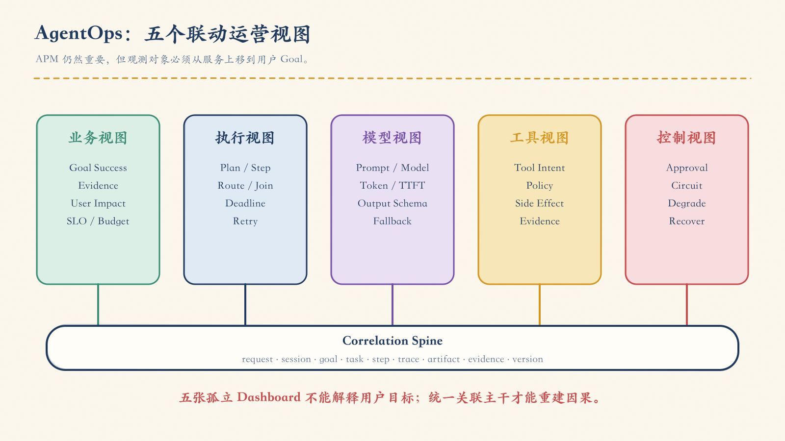
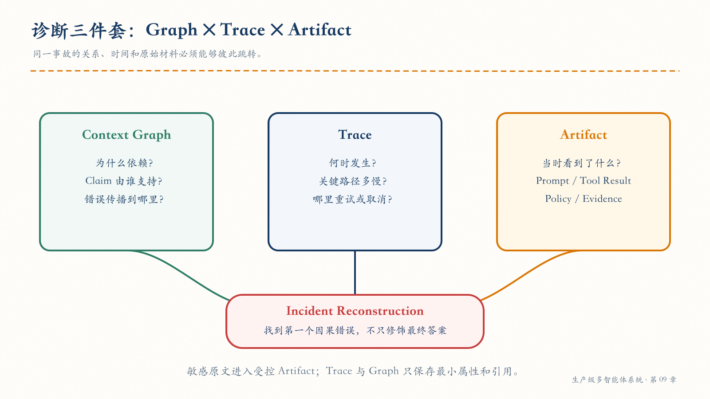
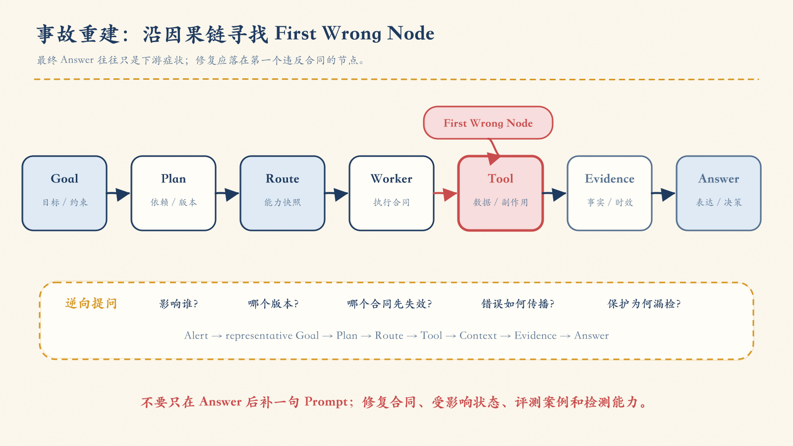
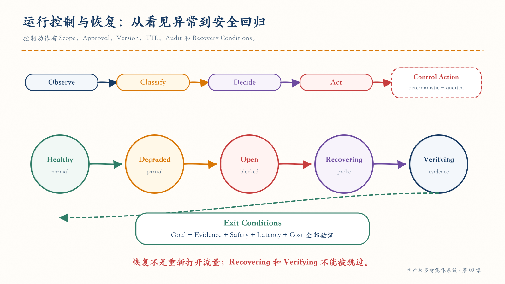
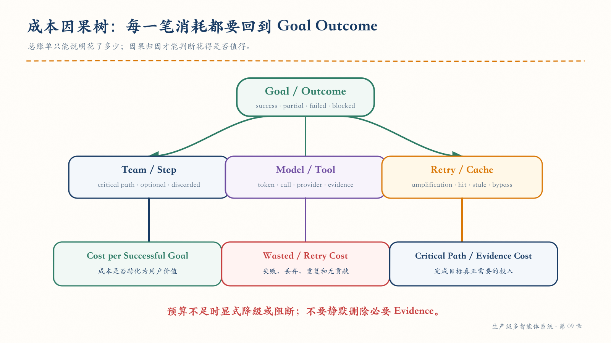
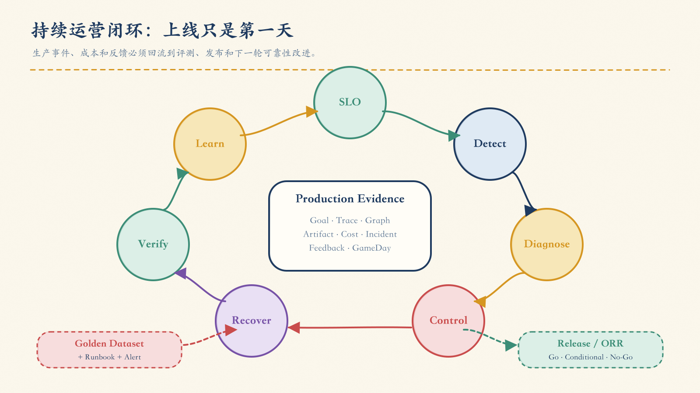
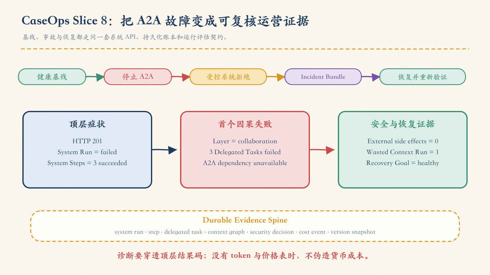

# Chapter 09: AgentOps: Incident Diagnosis, System Resilience, and Cost Governance

By the end of Chapter 8, the C-102 claims investigation system had passed offline regression testing, N-run evaluation, and canary gates. The new Planner Prompt could identify the constraint "generate a notification draft only; do not send it" more quickly, and its evidence coverage was better than that of the old version. The team completed the release, and every dashboard was green:

- The API request success rate showed no significant decline.
- CPU, memory, and Pod counts were all within normal ranges.
- The model Provider showed no widespread errors.
- The database connection pool was not exhausted.

Yet customer service soon reported an anomaly that was difficult to explain: a small number of cases cited the correct claim status but omitted key materials; in other cases, the final text contained no errors, yet completion time and cost suddenly doubled. More troubling still, a piece of historical memory about C-099 was incorrectly merged into the explanation for C-102, while the final answer still returned HTTP 200.

Traditional APM would tell us that "the service is still alive." On its own, it cannot answer:

- Was the user's goal actually completed?
- Why did the Planner generate this plan?
- Why did the Router assign the task to this Team?
- Which context fragment changed the model's judgment?
- Did the tool result mean "the fact does not exist," or "no data was retrieved this time"?
- Which Claim lacks Evidence?
- Are retries recovering from failure, or amplifying cost and side effects?
- At this moment, should we continue observing, degrade service, open the circuit, roll back, or hand off to a human?

These are precisely the production problems that AgentOps must address.

> **AgentOps is not about adding a Dashboard to an LLM. It is about building an operational system around Goal, Plan, Route, Tool, Evidence, Decision, and Control that is diagnosable, controllable, recoverable, and continuously optimizable.**

"AgentOps" is not currently a unified industry standard. This chapter treats it as a boundary of engineering responsibility: once a multi-agent system enters production, how does the team see user goals, reconstruct causal chains, execute audited control actions, recover state safely, and turn incidents, costs, and feedback into the next reliable release?

## 1. APM remains, but the object of observation must move up

Agent systems still run on services, containers, queues, databases, and networks, so APM, infrastructure monitoring, and distributed tracing all remain essential. The problem is not that these capabilities have stopped working, but that the level they observe is not high enough.

| Observation layer | Common objects in traditional systems | What AgentOps must also answer |
|---|---|---|
| Business | Request volume, conversion, error rate | Whether the Goal was completed and the user received an actionable result |
| Execution | Service, Endpoint, Job | Whether the Plan, Step, dependencies, Route, and Join were correct |
| Model | Call count, latency, Token | Prompt / Model version, structured output, reasoning degradation |
| Tool | RPC, database, third-party API | Tool Intent, authorization decision, evidence, unknown side effects |
| Control | Scaling, release, rollback | Budget, approval, circuit breaking, degradation, cancellation, recovery conditions |



*Figure 9-1 The business, execution, model, tool, and control views must be connected through the same correlation backbone; no isolated dashboard is sufficient to explain a user goal.*

### 1.1 From "request success" to "goal success"

HTTP 200 only indicates that a request was processed normally; it does not mean that the user's goal was completed. Even if the answer for C-102 is grammatically correct, it may still exhibit four kinds of production failure:

1. **Outcome failure**: It does not explain why the case is incomplete.
2. **Evidence failure**: The conclusion is correct but cannot be traced to authoritative facts.
3. **Path failure**: It called an unnecessary Team or bypassed the approval path.
4. **Control failure**: After detecting risk, the system could not contain the damage or recover safely in time.

The first layer of operational metrics should therefore center on the user's Goal, not on an individual microservice:

```text
goal_success_rate
safe_path_rate
claim_evidence_coverage
p95_goal_latency
human_escalation_rate
cost_per_successful_goal
error_budget_burn_rate
```

These metrics determine whether "the user was served well." The underlying model, tool, queue, and state metrics then explain why.

### 1.2 A connectable execution backbone

Without stable correlation keys, production incidents can only be investigated by manually piecing logs together. Every execution should establish at least the following backbone:

```text
request_id
  └── session_id
      └── goal_id
          └── task_id
              └── step_id
                  ├── trace_id / span_id
                  ├── tool_call_id
                  ├── artifact_ref
                  └── evidence_ref
```

It must also record the versions that can change behavior:

```text
release_version
prompt_version
model_provider / model_id
agent_contract_version
tool_contract_version
policy_version
knowledge_snapshot
capability_snapshot
checkpoint_schema_version
```

Not all of these fields should be packed into Metric Labels. Low-cardinality fields such as `team`, `agent_type`, `tool_id`, `status`, `model_family`, `prompt_version`, `error_category`, and `risk_level` are suitable for aggregation. By contrast, `request_id`, `user_id`, raw Prompts, URLs, query text, and Tool Output can create high cardinality, leak private data, or drive costs out of control. They belong in controlled Traces, Logs, or Artifacts connected by references.

OpenTelemetry has moved its generative AI semantic conventions to a separate repository, and the relevant attributes are still evolving. It also explicitly warns that Prompts, tool arguments, and results may contain sensitive information. A production system should not assume that stable standards already exist for every Goal, Plan, and Evidence field. Instead, it should version its own extension Schema and explicitly record the semantic-convention version it adopts.[^otel-genai]

## 2. Two tiers of metrics: know first whether commitments are being broken, then where the system is failing

Flattening every metric onto one large screen creates the illusion of "lots of information, few conclusions." A more practical approach divides metrics into two tiers.

### 2.1 Tier 1: user commitments and system health

Tier 1 retains only metrics that can change operational decisions:

| Metric | Question it answers | Typical slices |
|---|---|---|
| Goal Success Rate | Was the user's goal completed? | intent, risk, tenant, release |
| Safe Path Rate | Did execution always follow an allowed path? | tool, policy, risk |
| Evidence Coverage | Does every final Claim have evidence? | claim_type, knowledge_version |
| Goal Latency | How long must the user wait to complete the goal? | p50 / p95 / p99, intent |
| Human Escalation Rate | Where does the system need a human to take over? | reason, team, risk |
| Cost per Successful Goal | Is spending producing effective outcomes? | intent, release, provider |
| Error Budget Burn | How quickly is the reliability commitment being consumed? | fast / slow window |

Tier 1 does not explain root causes. Its purpose is to trigger judgment: Is the user commitment being affected? How large is the impact? Must we control changes or contain the damage?

### 2.2 Tier 2: locate the responsible layer

Tier 2 metrics should correspond to system boundaries:

| Layer | Representative metrics |
|---|---|
| Planner | `plan_valid_rate`, `replan_rate`, plan Token, dependency violations |
| Router | Routing accuracy, Fallback, unknown capability, delegation rejection |
| Team / Worker | Task success, retry, no data, evidence faithfulness |
| Tool | Latency, error, rate limit, unknown result, idempotency conflict |
| Model | TTFT, Token, structured-output failure, Provider Fallback |
| State | Checkpoint Lag, stale result, Reconcile, cancellation latency |
| Security | Rejection, approval, injection, PII, replay, permission drift |

For example, a decline in `goal_success_rate` only tells us that the user commitment is failing. If `router_unknown_capability` and `replan_rate` increase during the same window, the problem begins to point toward the capability snapshot or routing contract.

### 2.3 SLI, SLO, and error budgets

An operational SLI must declare:

```yaml
sli:
  id: goal_success_rate
  population:
    include: [supported_intents]
    exclude: [user_cancelled, declared_dependency_outage]
  numerator: goals_completed_with_required_evidence_and_safe_path
  denominator: eligible_goals
  window: rolling_28d
  slices: [intent, risk, tenant_tier, release_version]
  source: goal_outcome_event_v2
```

An SLO is a target for this SLI, not an attractive number divorced from the business. Its threshold should derive from user loss, risk level, the current baseline, and the team's ability to remediate. Google SRE's monitoring methodology likewise emphasizes that SLI / SLO can show that a service is violating its commitment, but usually cannot explain the cause directly. Diagnostic metrics and executable Playbooks must therefore accompany them.[^sre-monitoring]

An error budget turns a reliability target into a change policy. When the budget is healthy, teams can iterate normally. When it is burning quickly, they narrow the canary and add review. When it is exhausted, they can freeze noncritical Prompt / Model changes and prioritize reliability repairs. The specific actions are organizational policy, not universally applicable thresholds.[^sre-error-budget]

## 3. Alerts must help people act

"P95 increased" and "the error rate exceeded 2%" are not complete alerts. On-call responders also need to know:

```yaml
alert:
  alert_id: AGENT-GOAL-BURN-01
  condition: fast_burn_on_goal_success_slo
  impact: "Successful goals for high-risk claim explanations are declining rapidly"
  window: "5m / 1h"
  affected_slices: [intent, release_version, prompt_version]
  recent_changes: []
  example_goal_refs: []
  trace_queries: []
  context_graph_queries: []
  runbook_ref: ""
  owner: ""
  possible_containment:
    - stop_canary
    - rollback_prompt
    - degrade_to_read_only
```

A good alert contains at least the impact, slices, recent changes, representative samples, Trace / Context Graph entry points, Runbook, and Owner. It should take the responder to the first verifiable question instead of forcing them to begin searching again from the home page.

The sampling strategy must also serve incident reconstruction. Normal low-risk traffic can be sampled according to cost. Errors, high-risk actions, canary versions, and security rejections usually require higher retention rates. Rare slow requests can use Tail-based Sampling. Regardless of the sampling rate, raw Prompts, Tool Results, and personal information must never enter the observability platform without minimization and access controls.

## 4. The diagnostic triad: Graph, Trace, and Artifact

Multi-agent incidents often do not involve a function throwing an exception. Instead, incorrect information propagates through planning, delegation, tools, memory, and consolidation. A Trace alone may show "when it became slow and where it failed." A Context Graph alone may show "who depends on whom." Raw Artifacts alone make it difficult to understand the overall relationship.



*Figure 9-2 The Graph explains relationships and rationale; the Trace explains time and execution; Artifacts preserve governed source material. Together, they support incident reconstruction.*

### 4.1 Context Graph: why

The Context Graph should connect:

```text
Goal → Plan → Step → Team → Tool Call → Result
                             ↓
                       Artifact → Evidence → Claim → Answer
```

It answers:

- Which Evidence does this Claim depend on?
- Why was this Worker selected?
- To which subject, tenant, and time does this historical memory belong?
- Which Plan Version produced the current Step?
- Which downstream conclusions were contaminated by a failed result?

### 4.2 Trace: when, how long, and where it failed

The Trace owns the timeline:

- How long did Plan compilation take?
- Which Team entered the critical path?
- Did the Tool Call time out, hit a rate limit, or retry?
- When did Provider Fallback occur?
- What is the Join waiting for?
- When was the cancellation signal sent, and when did the late result arrive?

Agent Spans should carry stable IDs and versions, but must not include the complete Prompt as a default Span Attribute. Sensitive content should be redacted and stored in a controlled Artifact, while the Span records a reference and summary.

### 4.3 Artifact: what exactly did the system see at the time?

Artifacts preserve governed source material:

- Model inputs and structured outputs;
- Tool Request / Result;
- retrieved fragments and knowledge snapshots;
- Policy Decision;
- Plan, Checkpoint, and error details;
- final Claim / Evidence mappings.

Artifacts must have access controls, retention periods, sensitivity levels, content summaries, and deletion policies. "Store everything for troubleshooting" is not observability; it is a new data risk.

## 5. Incident reconstruction: find the first causal error

The missing materials in C-102's final answer are only the visible symptom. Proper diagnosis does not start by guessing from the last LLM Span. It works backward through the causal chain and locates the first node that diverged from its contract.



*Figure 9-3 The final answer is usually a downstream symptom. What truly needs repair is the first node that caused facts, permissions, state, or paths to diverge from the contract.*

A reusable reconstruction sequence follows:

1. **Confirm the impact**: Which SLO, user group, intent, risk tier, and version are affected?
2. **Identify the Goal**: What were the goal, constraints, and acceptable Outcome of a representative request?
3. **Inspect the Plan**: Did the plan satisfy dependencies, lose any constraints, or trigger an abnormal Replan?
4. **Inspect the Route**: Was the capability snapshot stale, and did the Team / Worker have the capabilities required by its contract?
5. **Inspect the Tool**: Were authorization, arguments, data validity time, error semantics, and side effects explicit?
6. **Inspect the Context**: Did subject, tenant, time, and purpose restrictions remain intact after compression, memory retrieval, and Join?
7. **Inspect the Evidence**: Is every Claim supported by Evidence from the corresponding version?
8. **Inspect the Answer**: Does the final text faithfully express upstream results and uncertainty?

For C-102, this process might produce the following causal chain:

```text
Prompt p19 canary
  → New plan triggers historical case summary
  → Context Compression fails to preserve subject_id
  → Summary for C-099 enters C-102 through a similar entity
  → Consolidator accepts a structurally valid Claim with the wrong subject
  → Final answer returns HTTP 200
```

Adding "do not confuse cases" to the Prompt after the final answer would not fix the system. The first faulty node is the compression contract that lost the subject constraint. The correct actions should include repairing the Context Contract, adding a cross-subject Golden Case, clearing contaminated caches or memory, and replaying the affected Goals.

### 5.1 Incident Bundle: a transferable package of facts

An incident should not depend on ten tabs open on one expert's screen. The response process should continually produce an Incident Bundle:

```yaml
incident_bundle:
  incident_id: INC-2026-071
  severity: SEV-2
  window: {start: "", end: ""}
  impact:
    affected_goals: 0
    affected_tenants: []
    violated_slos: []
  versions:
    release: ""
    prompt: ""
    model: ""
    policy: ""
    knowledge: ""
  evidence:
    dashboards: []
    trace_queries: []
    context_graph_queries: []
    artifact_refs: []
  controls_applied: []
  rollback_ref: ""
  timeline_ref: ""
```

The Timeline records only "time—fact—evidence—action—result," and clearly distinguishes confirmed facts, working hypotheses, and eliminated causes. Google's incident-response practices emphasize defining roles in advance, continuously recording the debugging and mitigation process, and prioritizing the reduction of user impact. These are also the goals the Incident Bundle must serve.[^sre-incident]

## 6. The runtime control plane: make containment actions predictable

Diagnosis only identifies the problem. Real production capability also includes changing system behavior without expanding risk.

The runtime control plane follows four steps:

```text
Observe → Classify → Decide → Act
```



*Figure 9-4 The control plane turns observations into audited actions. Recovery does not mean "turn traffic back on"; it means returning to a healthy state through probing, verification, and exit conditions.*

### 6.1 Control-action contract

Every manual or automated control must answer:

```yaml
control_action:
  action_id: ""
  type: stop_canary | circuit_open | degrade | rollback | cancel | rate_limit
  target: ""
  scope:
    tenant: []
    intent: []
    prompt_version: []
    tool: []
  reason: ""
  requested_by: ""
  approved_by: []
  expected_version: ""
  expires_at: ""
  recovery_conditions: []
  audit_ref: ""
```

The critical fields are Scope and Expiry. "Shutting down the Agent" without a Scope turns a local incident into a global outage. Temporary access without Expiry can become a permanent backdoor. A rollback without an Expected Version can overwrite other concurrent changes.

AI can help summarize evidence and propose recommendations, but it must not become a "super administrator." Circuit breaking, permission overrides, Break-glass access, budget enforcement, and recovery switches should be executed by deterministic policies with approvals, versions, TTLs, and audit evidence retained.

### 6.2 Design circuit breaking and degradation around business semantics

A traditional circuit breaker has three states: Closed, Open, and Half-open. A multi-agent system must also express business outcomes explicitly:

| State | Allowed behavior | Return semantics |
|---|---|---|
| Healthy | Normal planning and execution | complete |
| Degraded | Disable optional Teams, shorten search, read-only | partial / degraded, with missing elements explained |
| Open | Block high-risk Tools or a failed Provider | blocked / pending human |
| Recovering | Low-volume probes, controlled replay | provisional |
| Verifying | Check Goal, Evidence, safety, and cost | Do not immediately restore full traffic |

The degradation order should protect safety and evidence, rather than first preserving the appearance of a complete answer:

1. Disable noncritical Teams.
2. Narrow retrieval and candidate search.
3. Return a partial result with an explanation of what is missing.
4. Switch to read-only or draft mode.
5. Enter the human queue.
6. Block requests that cannot be executed safely.

Never trade Tool Guard, Evidence Check, or tenant filtering for availability.

## 7. Recovery does not mean "continue from the last point"

After a stateful execution crashes, the most dangerous action is to resume unconditionally from the Checkpoint. By the time recovery occurs, the environment may have changed:

- The user has withdrawn the request.
- The approval has expired.
- The Tool Call timed out, but the external side effect has already occurred.
- The Plan, Prompt, Tool Schema, or Policy has been upgraded.
- A late result is arriving.
- The Goal's Deadline has expired.

Safe recovery requires at least five judgments:

1. **Reauthorize**: Are the subject, tenant, purpose, permissions, and approvals still valid?
2. **Check time limits**: Has the Goal been cancelled, expired, or superseded by a new version?
3. **Reconcile side effects**: Does an unknown result mean not executed, executed, or partially executed?
4. **Validate compatibility**: Can the current version read the Checkpoint Schema, Plan, and Tool Contract?
5. **Reestablish invariants**: Are accepted results, Evidence, and constraints still consistent?

State should therefore be layered:

```text
Conversation Store  Preserves interaction history
Execution Store     Preserves Steps, Events, Checkpoints, and the Context Graph
Authorization Store Preserves authorization and approval state
Artifact Store      Preserves immutable execution evidence
Experience Store    Preserves governed, reusable experience
```

Packing everything into a block of "long-term memory" undermines recovery, authorization, and auditing at the same time.

### 7.1 The boundaries of Replan

Replan is appropriate when a capability is unavailable, an optional step fails, or a data precondition changes, but it must:

- preserve the user's Goal, constraints, accepted results, and Evidence;
- not expand permissions;
- not repeat completed side effects;
- set a maximum number of attempts;
- record the `plan_event` and the reason for the change;
- explicitly degrade or hand off to a human after crossing the boundary.

"Let the model think again" is not a recovery policy.

## 8. Deadlines, retries, and unknown side effects

Multi-agent systems can easily create retry amplification: the Supervisor retries the Team, the Team retries the Worker, and the Worker SDK retries the Tool or Provider again. Even if each layer retries only twice, the number of requests at the end of the chain can grow exponentially.

```text
retry_amplification
  = total_physical_attempts / unique_logical_operations
```

A Goal should have an end-to-end Deadline, then allocate it across:

```text
Planning → Team → Worker → Tool → Consolidation
```

Downstream budgets must be deducted from the remaining time instead of granting each layer a fresh, full Timeout.

Retry only safe transient errors, such as explicit rate limiting, temporary unavailability, and connection interruption. Use bounded exponential backoff with jitter and honor `Retry-After`. For a non-idempotent Tool, a Timeout only means that the client did not receive the result in time; it does not mean the server produced no side effect. The AWS Builders' Library makes this clear: timeouts, retries, backoff, and jitter must be designed together, and retries can add load to the system.[^aws-retry]

Unknown side effects should enter Reconcile:

```text
Query by idempotency_key
  ├── committed    → Accept the existing result
  ├── not_found    → Retry when policy permits
  ├── in_progress  → Wait or cancel
  └── ambiguous    → Handle manually; do not replay blindly
```

## 9. Provider Failover is not merely changing a model name

Two models supporting text generation does not make them unconditionally interchangeable. A Provider Contract should describe:

| Dimension | What must be validated |
|---|---|
| Capability | Tool Calling, structured output, context, vision |
| Evaluation | Applicable intents, risk slices, Golden / N-run results |
| Performance | TTFT, P95, throughput, rate-limiting behavior |
| Accounting | Input, output, cached Token, and price version |
| Governance | Data retention, region, compliance, content policy |
| Runtime | Timeout, Cancel, Error Normalization |

Use a unified error taxonomy:

```text
rate_limited
timeout
unavailable
invalid_output
safety_block
context_exceeded
authentication
billing
```

Failover must pass offline evaluation and canary validation, preserve the original safety policies, and record the original Provider, target Provider, trigger, capability differences, and outcome degradation. If the alternative model cannot reliably satisfy a structured Tool Contract, the correct outcome may be to degrade or block rather than to "at least return some text."

## 10. Costs must be explainable, and budgets must be enforceable

Looking only at "this month's model bill" cannot support architectural decisions. AgentOps must attribute cost to the causal chain of a Goal:



*Figure 9-5 Cost must be linked to both execution paths and business outcomes so that necessary cost, wasted cost, and risk cost can be distinguished.*

Each Cost Event contains at least:

```yaml
cost_event:
  goal_id: ""
  task_id: ""
  step_id: ""
  team: ""
  agent_type: ""
  provider: ""
  model: ""
  prompt_version: ""
  model_cost: 0
  tool_cost: 0
  retry_attempt: 0
  cache_status: hit | miss | bypass
  outcome: success | partial | failed | blocked
```

Metrics worth operating include:

- `cost_per_successful_goal`: total effective cost / number of successful Goals;
- `wasted_cost`: the cost of failed, discarded, or noncontributing steps;
- `retry_cost`: the cost caused by repeated physical attempts;
- `critical_path_cost`: the cost of the path that actually determines the outcome;
- `evidence_cost`: the cost of obtaining verifiable evidence;
- unit cost sliced by intent, risk, tenant, release, and provider.

FinOps unit economics emphasizes associating variable costs with a measurable business unit. For an Agent system, a unit closer to business value than "cost per Token" is usually "per successful goal," "per safely completed high-risk decision," or "per Claim with evidence."[^finops-unit]

### 10.1 Budget controls must not quietly sacrifice quality

The budget should be an explicit constraint in the Planner or Budget Controller:

```yaml
goal_budget:
  max_cost: ""
  max_model_tokens: 0
  max_tool_calls: 0
  max_replans: 0
  max_parallelism: 0
  degradation_order: []
  on_exhausted: partial | human | blocked
```

When the budget is insufficient, the system can reduce optional work, use a validated lower-cost path, or return a partial result. It must not silently remove required Evidence and disguise a low-quality answer as complete.

## 11. Knowledge Ops: knowledge errors are also production incidents

Failures in Agentic RAG and GraphRAG do not appear only as "the document was not found." Common operational failures include:

- ETL loses a one-hop relationship;
- entity collisions or a missing Tenant Key;
- an Ontology that is incompatible with the Tool Schema;
- indexes, graph edges, or business facts that have passed their validity time;
- uncontrolled traversal scope;
- cross-permission edges entering retrieval results;
- `no_data` rewritten as "the business fact does not exist."

Monitor:

```text
entity_resolution_error
cross_scope_edge_count
knowledge_freshness_lag
retrieval_no_data_rate
graph_traversal_expansion
claim_evidence_mismatch
ontology_tool_contract_failure
```

Knowledge releases should have snapshots, compatibility tests, canaries, and rollback just like code releases. In particular, after an Ontology rename or relationship migration, the tool arguments, Context Pack, Golden Facts, and Evidence Evaluator must be validated together.

### 11.1 Context Compression is not polishing a summary

When compressing long conversations or long-term memory, filter first and compress second:

```text
Tenant Filter
  → Subject ACL
  → PII Minimize
  → Active Purpose
  → Compress
  → Validate Context Contract
```

Operational metrics should include at least the compression ratio, constraint retention rate, entity resolution accuracy, evidence retention rate, stale-memory usage rate, and cross-session leakage. No matter how fluent the summary sounds, it is a production defect if it loses `tenant_id`, `subject_id`, validity time, or the "do not send" constraint.

## 12. Semantic Cache: a higher hit rate is not necessarily better

The closer a cache layer is to the final answer, the greater its semantic risk:

| Layer | Benefit | Primary risk |
|---|---|---|
| Tool Result | Stable and easy to validate | Stale data |
| Worker Result | Reduces repeated local work | Permission and version inconsistency |
| Team Plan / Result | Saves orchestration cost | Changed preconditions |
| Central Plan | Significantly reduces reasoning | Goal / capability drift |
| Full Response | Greatest benefit on a hit | Wrong subject, evidence, recency, or context |

A safe Cache Key should account for at least:

```text
tenant_id
user_scope_hash
intent
sorted_entity_ids
normalized_arguments
tool_and_data_version
policy_version
locale
valid_time
```

In addition to `hit_rate`, latency savings, and cost savings, the system must track `stale_hit_rate`, `wrong_entity_hit_rate`, authorization rejections, and invalidation propagation. A cache hit for the wrong subject is far more serious than a Cache Miss.

## 13. Learn from production feedback, but do not absorb it automatically

Production feedback is valuable—and dangerous. User corrections, human approvals, incident fixes, and successful paths can all contain bias, personal information, local rules, or attack payloads. They must not be written automatically into a Prompt or long-term memory.

The governance process should be:

```text
Feedback
  → Classify
  → Extract Candidate
  → Human Review
  → Store with Scope and Validity
  → Retrieve
  → Inject under Policy
```

An Experience Entry records at least:

```yaml
experience:
  experience_id: ""
  trigger: ""
  conditions: []
  lesson: ""
  preferred_plan: []
  avoid: []
  provenance: []
  reviewer: ""
  scope: ""
  valid_from: ""
  expires_at: ""
  compatible_prompt_versions: []
  pii_status: ""
```

An experience may apply only to one tenant, one version of a business rule, or one Prompt family. An "experience" without Provenance, Scope, and Expiry is simply an unauditable production Few-shot.

### 13.1 Failure classification is more useful than sentiment labels

Build a Failure Taxonomy around responsibility boundaries:

```text
Input / Context
Planner
Router
Worker
Tool / Data
Consolidator
Runtime
Security
```

Then cluster by `team × failure_class × version × intent`, and return to the Trace and Context Graph to inspect representative samples. A rare case does not necessarily warrant a Prompt change; it may instead call for a deterministic rule, a new tool, a local Experience, or a human-only workflow.

## 14. A Prompt is also a production artifact

Prompt changes can alter plans, routes, tool arguments, and safety paths, so they must enter a complete lifecycle:

```text
Draft → Review → Offline Eval → Canary → Promote
      → Operate → Rollback → Retire
```

A Prompt Release Manifest should contain:

```yaml
prompt_release:
  prompt_id: ""
  version: ""
  git_sha: ""
  variables: []
  compatible_contracts: []
  eval_run: ""
  canary_slices: []
  excluded_risks: []
  rollback_to: ""
  owner: ""
```

The Golden Dataset and regression gates from Chapter 8 become release inputs for AgentOps here. The SLO, Incident Bundle, and Cost Events in this chapter, in turn, generate new Golden Cases and failure slices. Evaluation is not a one-time exam before release; it is the feedback loop of production operations.

## 15. Scaling, HA, and trust boundaries

"Increase the number of Agents" is not a capacity strategy. The system should scale on its actual bottlenecks:

| Boundary | Possible scaling signals |
|---|---|
| Access / Gateway | RPS, queue, CPU, rate limit |
| Supervisor | Plan Queue, Model Concurrency, Deadline Miss |
| Team / Worker | Backlog, task age, Tool Latency |
| MCP / Tool | Provider Rate Limit, connection pool, quota |
| Context Graph | Write lag, lock contention, query latency |
| Evaluation | Replay backlog, Judge Queue, report timeliness |

Kubernetes HPA supports resource metrics, container metrics, and custom and external metrics. This provides a foundation for scaling on queue or business signals, but the application remains responsible for metric selection and side-effect safety.[^k8s-hpa]

Scaling and failover must preserve four invariants:

- Drain gracefully without losing Goals in progress.
- Write Checkpoints at safe points.
- Do not create duplicate side effects.
- Do not let authorization, approvals, or tenant isolation fail during migration.

Trust Boundaries must not disappear during operations either. Every edge from Intent→Gateway, Gateway→Agent Zone, Agent→Tool, and Agent→Knowledge / Context Graph should have identity, encryption, Schema, least privilege, and auditing. Tool Output is untrusted input. Before it enters model context, it must undergo Schema validation, injection detection, and sensitive-information handling.

## 16. Runbooks: write known-safe actions into the system

A Runbook is not "inspect the logs and contact development if necessary." It must let an on-call responder who did not build the system complete a controlled response:

```yaml
runbook:
  alert_id: ""
  scope: ""
  first_checks: []
  containment: []
  diagnosis: []
  recovery: []
  exit_conditions: []
  owner: ""
  escalation: []
```

Automation is suitable for:

- collecting versions, representative Traces, and the Incident Bundle;
- executing scoped, reversible, validated control actions;
- performing reconciliation, health probes, and evidence checks according to contracts.

Humans should retain:

- high-risk business tradeoffs;
- Break-glass access and broad permission changes;
- irreversible side effects;
- recovery confirmation and exception handling.

Runbooks must be exercised with the real control plane. Otherwise, the documentation will quietly become obsolete as the system changes.

## 17. GameDay: validate the system, the people, and the process

GameDay scenarios suitable for multi-agent systems include:

- a model Provider returning sustained 5xx errors or rate limits;
- increased Tool latency with unknown side effects;
- a stale Knowledge Snapshot;
- a process crash after a Checkpoint write;
- A2A capability-card drift;
- Context Compression confusing entities;
- poisoned production feedback;
- a cross-subject Semantic Cache hit.

Observe the following in every exercise:

```text
MTTD / MTTA / MTTR
Affected Goals / Blast Radius
Safety Invariant Violations
Dashboard / Alert / Runbook / Control Effectiveness
Recovery Evidence
New Golden Cases and SLO Changes
```

AWS Well-Architected recommends conducting regular GameDays in production-like environments, having the teams actually responsible for response use real processes, and tracking improvement actions after each exercise. Google's incident-response practices likewise emphasize building a shared language and "muscle memory" through regular exercises.[^aws-gameday] [^sre-incident]

## 18. ORR: put "ready to launch" and "ready to operate" on the same table

An Operational Readiness Review is not merely a final checklist. It is an evidence-driven release decision. At a minimum, it must answer:

### 18.1 Service and commitments

- Which Goals, intents, tenants, and risk levels are supported?
- Are the Tier 1 SLI / SLO and error budget explicit?
- Which outcomes require zero tolerance?

### 18.2 Quality and safety

- Where is the evidence from the Golden Dataset, N-run evaluation, and canary?
- Is every critical Claim traceable?
- Have authorization, approval, privacy, and Tool Guard been validated?

### 18.3 Resilience and recovery

- How does the system degrade when Provider, Tool, State, or Knowledge fails?
- Have Checkpoint, Reconcile, cancellation, and recovery been exercised?
- What are the exit conditions for recovery?

### 18.4 Operations and cost

- Are the Dashboard, Alert, Runbook, On-call, and Incident Bundle available?
- Can cost be attributed to a successful Goal?
- What happens when the budget is exhausted?

### 18.5 Decision

```text
Go
Conditional Go (specify conditions, expiration time, and approver)
No-Go
```

A "known risk" must include more than a description of the risk; it must also have an Owner, controls, an expiration time, and a risk acceptor. A system without recovery evidence, an on-call entry point, or cost attribution is not yet production-ready, no matter how strong its offline evaluation.

## 19. A complete AgentOps loop



*Figure 9-6 Operations is not passive firefighting after release. It connects goals, diagnosis, control, recovery, evaluation, and release into a continuous learning loop.*

Returning to C-102:

1. Tier 1 Goal Success and Evidence Coverage expose the anomaly before HTTP errors do.
2. The Alert directly identifies the affected Prompt p19 slice and representative Goals.
3. The Context Graph, Trace, and Artifact locate the first faulty node: the compression contract lost `subject_id`.
4. The control plane stops the canary, isolates the affected Memory / Cache, and degrades the relevant intent to read-only.
5. The system reauthorizes, reconciles side effects, repairs the Context Contract, and then replays at low volume.
6. It verifies that Goal, Evidence, safety, latency, and cost have all recovered.
7. Incident samples enter the Golden Dataset, and compression constraints enter a deterministic evaluator.
8. The Runbook, Alert, and GameDay scenario are updated together.
9. Only after passing the new ORR evidence does the version ramp up again.

The key to this chain is not "finding a bad Prompt faster." It is giving the system an organizational memory: the next time the same class of failure occurs, it is detected earlier, affects a smaller scope, and relies less on expert intuition.

## 20. CaseOps Slice 8: A2A failure exercise

The preceding subject-confusion scenario for C-102 demonstrated the incident reconstruction method, but the method becomes an engineering capability only when it enters the same production execution path. For CaseOps Slice 8, I therefore selected a failure with a clear boundary that could be injected for real without producing external side effects: **stopping the A2A specialist-node service during execution**.

This scenario tests four things at once:

1. Does the system converge a dependency failure into a controlled terminal state instead of leaving a partially completed state?
2. Can diagnosis penetrate the top-level result and locate the delegated task that actually failed?
3. Can work that consumed resources without producing a successful Goal be classified as wasted cost?
4. After the dependency recovers, can the system prove with a new run that the goal converges again?



*Figure 9-7 A GameDay does not end when "the container restarts." Its evidence consists of three reviewable operational assessments: baseline, incident, and recovery.*

### 20.1 First define operational assessment as a governed product

Slice 8 did not add an "incident analysis Agent" to read logs and improvise freely. It added an explicit operational assessment:

```text
POST /v1/system-runs/{system_run_id}/operational-assessments
```

The endpoint accepts only system runs already in `completed`, `needs_human`, or `failed`, and it imposes four constraints:

- **Explicit write**: Reading a run does not secretly create an incident record.
- **Idempotency**: The same tenant and idempotency key return the same assessment without duplicate accounting.
- **Tenant isolation**: Another tenant accessing the same run still receives a 404.
- **Minimal evidence**: The report stores references to and summaries of the run, steps, subtasks, Context Graph, and security decisions; it does not copy Prompts, tool arguments, or business payloads.

Every assessment has a fixed structure containing impact, the first failure point, a factual timeline, an evidence inventory, cost attribution, recommended control actions, and a version snapshot. The report content is hashed with SHA-256. The assessment snapshot, four types of resource events, and the audit record are committed in the same transaction. The Incident Bundle is therefore no longer a document assembled manually after an incident, but a replayable and comparable operational artifact.

The corresponding implementation is not hidden in chapter-specific scripts:

| Responsibility | Canonical code |
|---|---|
| Runtime assessment contract | [`operations/contracts.py`](https://github.com/dataPro-lgtm/production-grade-multi-agent-caseops/blob/v0.9.0/src/caseops/operations/contracts.py) |
| Causal diagnosis and attribution | [`operations/service.py`](https://github.com/dataPro-lgtm/production-grade-multi-agent-caseops/blob/v0.9.0/src/caseops/operations/service.py) |
| Persistence migration | [`0007_add_operational_assessments.py`](https://github.com/dataPro-lgtm/production-grade-multi-agent-caseops/blob/v0.9.0/migrations/versions/0007_add_operational_assessments.py) |
| Real failure exercise | [`acceptance-chapter-09.sh`](https://github.com/dataPro-lgtm/production-grade-multi-agent-caseops/blob/v0.9.0/scripts/acceptance-chapter-09.sh) |
| Complete operating instructions | [Chapter 9 runbook](https://github.com/dataPro-lgtm/production-grade-multi-agent-caseops/blob/v0.9.0/docs/chapter-09-runbook.md) |

### 20.2 A successful top-level execution does not mean nothing failed downstream

The first real exercise revealed a phenomenon more valuable than the one anticipated. After A2A was stopped, the system run endpoint still returned HTTP 201, and all three top-level `system_steps` entered `succeeded`. If we looked only at HTTP, Span status, or top-level steps, we could easily misclassify the run as healthy.

But the business terminal state was `SYSTEM_REJECTED`, and the `system_run` status was `failed`. Drilling further into the collaboration ledger showed that all three delegated tasks—coverage, document, and risk—had failed. In other words:

```text
HTTP 201
  → System Steps 3/3 succeeded
  → System Result = SYSTEM_REJECTED
  → Delegated Tasks 3/3 failed
  → First Causal Failure = collaboration / A2A unavailable
```

This is precisely the distinction between a "symptom" and a "root cause." The top-level steps succeeded because the Supervisor correctly fulfilled its own responsibility: collecting subsystem results and safely rejecting the request. It does not mean that the subsystems completed the goal. Slice 8 therefore extends the diagnostic scope from `system_runs → system_steps` to `collaboration_runs → delegated_tasks`. The first failure point is determined by persisted completion times and error codes, not guessed by a model.

### 20.3 Incomplete cost attribution is better than false precision

Before this failure occurred, the Context Team had successfully built a Context Run. Because the final Goal did not succeed, that work was `wasted` for this Goal. The three delegated attempts are likewise attributed to the failed goal. Security decisions are labeled separately as `protective`, because their value lies in preserving boundaries and they should not be treated simply as waste.

Slice 8 records four types of verifiable units:

- `system_step_attempt`;
- `context_run`;
- `delegated_task_attempt`;
- `security_decision`.

I did not force these different units into a sum or assign arbitrary weights to them. The current default executor operates in deterministic conformance mode. It does not call a billable model, and no versioned provider price table is configured. Therefore:

```yaml
pricing_status: not_configured
currency: null
monetary_cost_microunits: null
```

This is not disguising a defect; it is an integrity boundary for cost evidence. When real models are integrated, token usage, provider, model, region, price version, and currency should be added before monetary cost is calculated. Estimated values must not be presented as billing facts.

### 20.4 Recovery evidence must cover "before—during—after"

The GameDay exit hook attempts to restore A2A whenever an assertion fails, preventing the exercise itself from damaging the local platform for an extended period. The normal path generates three assessments in sequence:

| Phase | Stable facts |
|---|---|
| Baseline | The Goal is healthy; the Context Graph and security decisions are queryable; external side effects are 0 |
| Incident | The system rejects the request; three delegated tasks fail; the first failure is in the collaboration layer; wasted Context Runs equal 1 |
| Recovery | The A2A health check passes; a new system run converges again; external side effects remain 0 |

The exercise ultimately retained 3 `operational_assessments`, 12 `operational_cost_events`, and 3 audit records, and generated a `caseops.gameday-report.v1` JSON report. All 62 engineering tests passed, with branch-inclusive coverage of 85.99%. The pinned commit is `4241834`.

This conclusion must be strictly bounded: the exercise proves only that the pinned version of the containerized reference system can identify and recover from an **A2A dependency outage**. It does not prove that every network partition, database failure, model degradation, and real production traffic pattern satisfies some RTO. New failure modes still require new GameDays, SLOs, and recovery evidence.

### 20.5 Reproduce the experiment

The pinned version is [`chapter-09-slice-8`](https://github.com/dataPro-lgtm/production-grade-multi-agent-caseops/tree/chapter-09-slice-8), and the release version is [`v0.9.0`](https://github.com/dataPro-lgtm/production-grade-multi-agent-caseops/tree/v0.9.0):

```bash
git clone https://github.com/dataPro-lgtm/production-grade-multi-agent-caseops.git
cd production-grade-multi-agent-caseops
git checkout v0.9.0
docker compose up --build --wait --wait-timeout 120 -d
make acceptance-chapter-09
```

This command actually stops and restores the local A2A container. Do not copy it directly into a shared production environment. In an enterprise environment, inject the failure through the exercise control plane, with change approval, a bounded blast radius, and explicit stop conditions.

## 21. Chapter summary

After a production-grade multi-agent system goes live, the engineering question shifts from "can it run?" to "can it keep its commitments?"

This chapter can be summarized in eight statements:

1. HTTP and infrastructure health do not equal Goal health.
2. Tier 1 assesses user commitments; Tier 2 locates the responsible layer.
3. The Context Graph, Trace, and Artifact reconstruct causality together.
4. An incident response must repair the first faulty node, not merely polish the final answer.
5. Control actions must have scope, approval, version, expiration, and recovery conditions.
6. Recovery must reauthorize, reconcile side effects, and validate invariants.
7. Costs, feedback, exercises, and incidents must all flow back into evaluation and release.
8. Operational conclusions must come from persisted facts and form a closed evidence loop across before, during, and after the failure.

When Dashboard, Alert, Incident Bundle, Control Plane, Runbook, GameDay, and ORR form a closed loop, AgentOps is no longer "inspect the logs when the model has a problem." It becomes a production operations system capable of carrying business responsibility.

The accompanying [AgentOps Production Operations and Readiness Contract](../toolkit/agentops-operations-readiness-contract.md) can be used directly to define SLI / SLO, alerts, incident fact bundles, control actions, recovery, cost attribution, GameDay, and ORR.

## References

[^otel-genai]: OpenTelemetry, [Generative AI semantic conventions](https://opentelemetry.io/docs/specs/semconv/registry/attributes/gen-ai/) and [GenAI agent spans](https://github.com/open-telemetry/semantic-conventions-genai/blob/main/docs/gen-ai/gen-ai-agent-spans.md). Generative AI semantic conventions are still evolving; pin the version and review sensitive attributes when adopting them.
[^sre-monitoring]: Google SRE Workbook, [Monitoring](https://sre.google/workbook/monitoring/). SLI / SLO express user-visible reliability; diagnosis still requires more granular internal metrics.
[^sre-error-budget]: Google SRE Workbook, [Error Budget Policy](https://sre.google/workbook/error-budget-policy/). An error-budget policy connects reliability performance to release, change, and remediation priorities.
[^sre-incident]: Google SRE Workbook, [Incident Response](https://sre.google/workbook/incident-response/). Structured roles, continuous documentation, mitigation-first response, and regular exercises help reduce confusion during incident response.
[^aws-retry]: Amazon Builders' Library, [Timeouts, retries, and backoff with jitter](https://aws.amazon.com/builders-library/timeouts-retries-and-backoff-with-jitter/). Timeouts, retries, backoff, jitter, and idempotency must be designed together.
[^finops-unit]: FinOps Foundation, [Unit Economics](https://www.finops.org/framework/capabilities/unit-economics/). Unit economics connects variable technology costs to measurable business units.
[^k8s-hpa]: Kubernetes Documentation, [Horizontal Pod Autoscaling](https://kubernetes.io/docs/concepts/workloads/autoscaling/horizontal-pod-autoscale/). HPA can scale workloads based on resource, custom, and external metrics.
[^aws-gameday]: AWS Well-Architected Framework, [Conduct game days regularly](https://docs.aws.amazon.com/wellarchitected/latest/framework/rel_testing_resiliency_game_days_resiliency.html). GameDays should regularly validate systems, processes, and the actual response team.
