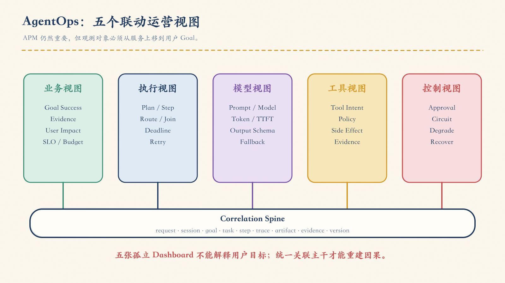
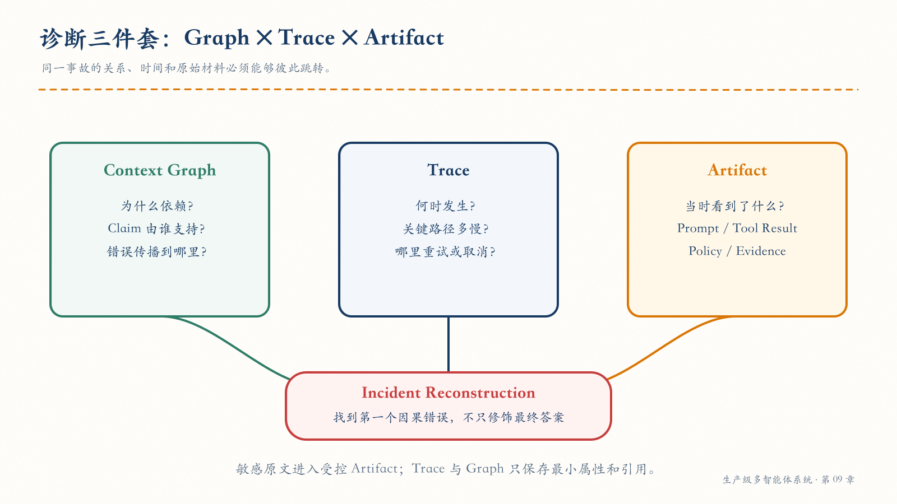
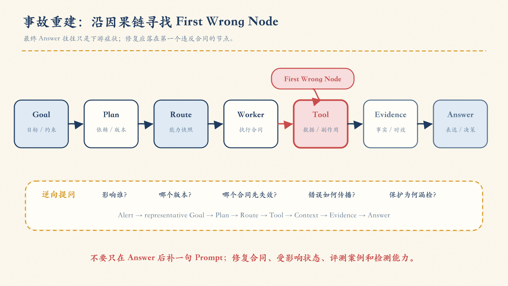
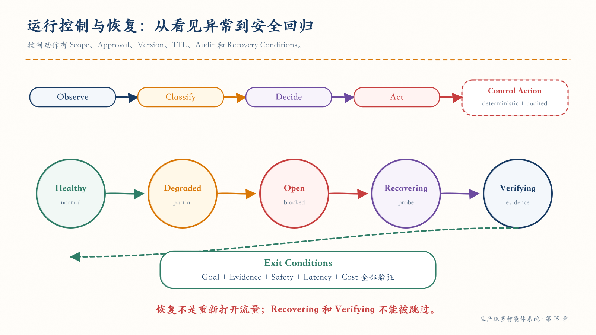
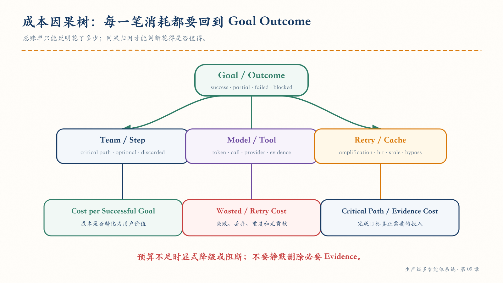
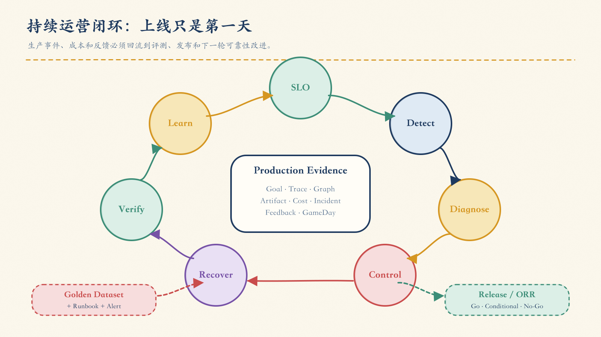
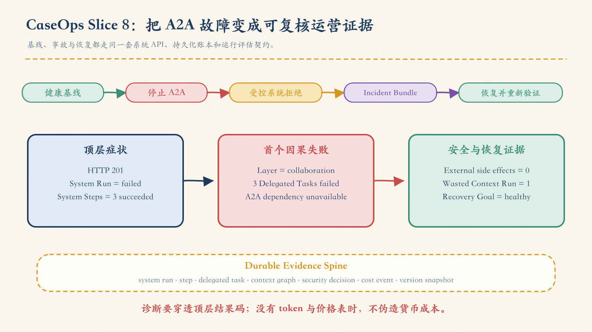

# 第09章　AgentOps：インシデント診断、システムレジリエンス、コストガバナンス

第8章の終了時点で、C-102 保険金請求調査システムはオフライン回帰、N-run、カナリアリリースゲートを通過していました。新バージョンの Planner Prompt は、「通知のドラフトだけを生成し、送信しない」という制約をより迅速に識別でき、エビデンスカバレッジも旧バージョンを上回っていました。チームがリリースを完了すると、ダッシュボードはすべてグリーンでした。

- API リクエストの成功率に明らかな低下はありません。
- CPU、メモリ、Pod 数はいずれも正常範囲内です。
- モデル Provider で大規模なエラーは発生していません。
- データベースのコネクションプールも枯渇していません。

ところが、カスタマーサポートからほどなく、説明しにくい異常が報告されました。少数の案件では、回答が正しい保険金請求ステータスを参照しているにもかかわらず、重要な書類が抜け落ちていました。また別の案件では、最終的な文章に誤りはないものの、完了時間とコストが突然2倍になっていました。さらに厄介なことに、C-099 に関する過去の記憶が誤って C-102 の説明に統合されていたにもかかわらず、最終回答は HTTP 200 を返していました。

従来の APM で分かるのは、「サービスがまだ稼働している」ということです。それだけでは、次の問いに答えられません。

- ユーザーの目標は本当に達成されたのか。
- Planner はなぜこの計画を生成したのか。
- Router はなぜタスクをこの Team に渡したのか。
- どのコンテキスト断片がモデルの判断を変えたのか。
- ツール結果は「事実が存在しない」のか、それとも「今回はデータを取得できなかった」のか。
- どの Claim に Evidence が不足しているのか。
- リトライは障害を復旧しているのか、それともコストと副作用を増幅しているのか。
- 今この時点で、観察継続、縮退、サーキットブレーカーの作動、ロールバック、人間への引き継ぎのどれを選ぶべきか。

まさにこれが、AgentOps が扱う本番運用上の問題です。

> **AgentOps とは、LLM にダッシュボードを1枚追加することではありません。Goal、Plan、Route、Tool、Evidence、Decision、Control を中心に、診断・介入・復旧・継続的最適化が可能な運用システムを構築することです。**

現在、「AgentOps」は統一された業界標準ではありません。本章では、これをエンジニアリング上の責任境界として捉えます。すなわち、マルチエージェントシステムが本番環境に入った後、チームがどのようにユーザー目標を可視化し、因果連鎖を再構築し、監査可能な制御アクションを実行し、安全に状態を復旧し、インシデント、コスト、フィードバックを次の信頼できるリリースへ変換するかを扱います。

## 1. APM は依然として必要だが、観測対象を上位へ引き上げる

Agent システムも、サービス、コンテナ、キュー、データベース、ネットワークの上で動作します。そのため、APM、インフラ監視、分散トレーシングはどれも欠かせません。問題は、これらの能力が無効になったことではなく、観測するレイヤーが十分に高くないことです。

| 観測レイヤー | 従来システムで一般的な対象 | AgentOps がさらに答えるべきこと |
|---|---|---|
| ビジネス | リクエスト数、コンバージョン、エラー率 | Goal が完了したか、ユーザーが実行可能な結果を得たか |
| 実行 | サービス、Endpoint、Job | Plan、Step、依存関係、Route、Join が正しいか |
| モデル | 呼び出し回数、レイテンシ、Token | Prompt / Model のバージョン、構造化出力、推論の劣化 |
| ツール | RPC、データベース、サードパーティ API | Tool Intent、権限判断、エビデンス、不明な副作用 |
| 制御 | スケーリング、リリース、ロールバック | 予算、承認、サーキットブレーカー、縮退、キャンセル、復旧条件 |



*図9-1　ビジネス、実行、モデル、ツール、制御の各ビューは、同じ相関の幹で接続されなければなりません。どのダッシュボードも、単独ではユーザー目標を説明するには不十分です。*

### 1.1 「リクエスト成功」から「目標成功」へ

HTTP 200 が示すのは、あるリクエストが正常に処理されたことだけであり、ユーザーの目標が達成されたことではありません。C-102 の回答は文法的に正しくても、次の4種類の本番障害が発生している可能性があります。

1. **結果の失敗**：案件が未完了である理由を説明できていません。
2. **エビデンスの失敗**：結論は正しいものの、権威ある事実まで追跡できません。
3. **パスの失敗**：不要な Team を呼び出した、または承認パスを迂回しました。
4. **制御の失敗**：システムがリスクを検知した後、速やかに被害を抑えたり安全に復旧したりできません。

したがって、第1層の運用メトリクスは、特定のマイクロサービスではなく、ユーザーの Goal を中心に設計すべきです。

```text
goal_success_rate
safe_path_rate
claim_evidence_coverage
p95_goal_latency
human_escalation_rate
cost_per_successful_goal
error_budget_burn_rate
```

これらのメトリクスは、「ユーザーに適切なサービスを提供できたか」を判断します。下位レイヤーのモデル、ツール、キュー、状態のメトリクスは、「なぜそうなったのか」を説明します。

### 1.2 接続可能な実行の幹

安定した相関キーがなければ、本番インシデントは人手でログをつなぎ合わせるほかありません。各実行では、少なくとも次の幹を形成する必要があります。

```text
request_id
  └── session_id
      └── goal_id
          └── task_id
              └── step_id
                  ├── trace_id / span_id
                  ├── tool_call_id
                  ├── artifact_ref
                  └── evidence_ref
```

同時に、振る舞いを変えるバージョンも記録します。

```text
release_version
prompt_version
model_provider / model_id
agent_contract_version
tool_contract_version
policy_version
knowledge_snapshot
capability_snapshot
checkpoint_schema_version
```

これらのフィールドをすべて Metric Label に詰め込むべきではありません。`team`、`agent_type`、`tool_id`、`status`、`model_family`、`prompt_version`、`error_category`、`risk_level` など、カーディナリティの低いフィールドは集約に適しています。一方、`request_id`、`user_id`、生の Prompt、URL、クエリテキスト、Tool Output は、カーディナリティの増大、プライバシー漏えい、コストの暴走を招くため、制御された Trace、Log、Artifact に保存し、参照で接続すべきです。

OpenTelemetry は、生成 AI のセマンティック規約を独立したリポジトリへ移行しており、関連属性は現在も進化しています。そこでは、Prompt、ツール引数、結果に機密情報が含まれる可能性も明示されています。本番システムは、すべての Goal、Plan、Evidence フィールドに安定した標準がすでに存在すると仮定すべきではありません。独自の拡張 Schema をバージョン管理し、採用したセマンティック規約のバージョンを明示的に記録する必要があります。[^otel-genai]

## 2. 2層のメトリクス：まず信頼を損なったかを知り、次にどこが機能不全かを知る

すべてのメトリクスを1枚の大型画面に平面的に並べると、「情報は多いが結論は少ない」という錯覚が生まれます。より実用的なのは、メトリクスを2層に分ける方法です。

### 2.1 Tier 1：ユーザーへの約束とシステム健全性

Tier 1 には、運用判断を変え得るメトリクスだけを残します。

| メトリクス | 答える問い | 代表的なスライス |
|---|---|---|
| Goal Success Rate | ユーザー目標は達成されたか | intent、risk、tenant、release |
| Safe Path Rate | 常に許可された実行パスを通ったか | tool、policy、risk |
| Evidence Coverage | 最終的な Claim のすべてにエビデンスがあるか | claim_type、knowledge_version |
| Goal Latency | ユーザーが目標を完了するまでどれだけ待つか | p50 / p95 / p99、intent |
| Human Escalation Rate | システムのどこで人間への引き継ぎが必要か | reason、team、risk |
| Cost per Successful Goal | コストが有効な結果に変換されているか | intent、release、provider |
| Error Budget Burn | 信頼性への約束をどの速度で消費しているか | fast / slow window |

Tier 1 の役割は根本原因を説明することではなく、判断を引き起こすことです。ユーザーへの約束が影響を受けているか、影響範囲はどれほどか、変更の制御や被害抑制を実行すべきかを判断します。

### 2.2 Tier 2：責任レイヤーごとの特定

Tier 2 のメトリクスは、システム境界に対応させるべきです。

| レイヤー | 代表的なメトリクス |
|---|---|
| Planner | `plan_valid_rate`、`replan_rate`、計画 Token、依存関係違反 |
| Router | ルーティング精度、Fallback、未知の能力、委任拒否 |
| Team / Worker | タスク成功、リトライ、データなし、エビデンス忠実度 |
| Tool | レイテンシ、エラー、レート制限、不明な結果、冪等性の競合 |
| Model | TTFT、Token、構造化出力の失敗、Provider Fallback |
| State | Checkpoint Lag、古い結果、Reconcile、キャンセル遅延 |
| Security | 拒否、承認、インジェクション、PII、リプレイ、権限ドリフト |

たとえば、`goal_success_rate` の低下だけで分かるのは、ユーザーへの約束が損なわれつつあるということです。同じウィンドウ内で `router_unknown_capability` と `replan_rate` も同時に上昇して初めて、問題は能力スナップショットやルーティング契約を指し始めます。

### 2.3 SLI、SLO、エラーバジェット

運用可能な SLI では、次の内容を宣言する必要があります。

```yaml
sli:
  id: goal_success_rate
  population:
    include: [supported_intents]
    exclude: [user_cancelled, declared_dependency_outage]
  numerator: goals_completed_with_required_evidence_and_safe_path
  denominator: eligible_goals
  window: rolling_28d
  slices: [intent, risk, tenant_tier, release_version]
  source: goal_outcome_event_v2
```

SLO は、この SLI に対する目標であり、ビジネスから切り離された「見栄えのよい数値」ではありません。しきい値は、ユーザーの損失、リスクレベル、現在のベースライン、修復能力に基づいて決めるべきです。Google SRE の監視手法でも、SLI / SLO はサービスが約束に違反しつつあることを示せても、通常はその原因を直接説明できないため、診断メトリクスと実行可能な Playbook を組み合わせる必要があると強調されています。[^sre-monitoring]

エラーバジェットは、信頼性目標を変更ポリシーへ変換します。バジェットが健全なら通常どおり反復開発でき、急速に消費しているならカナリア範囲を縮小してレビューを増やします。バジェットを使い切ったなら、重要でない Prompt / Model の変更を凍結し、信頼性の修復を優先できます。具体的なアクションは組織のポリシーであり、どこにでも適用できる普遍的なしきい値ではありません。[^sre-error-budget]

## 3. アラートは人の行動を支援しなければならない

「P95 が上昇した」「エラー率が2%を超えた」だけでは、完全なアラートとはいえません。オンコール担当者には、次の情報も必要です。

```yaml
alert:
  alert_id: AGENT-GOAL-BURN-01
  condition: fast_burn_on_goal_success_slo
  impact: "高リスクな保険金請求説明で、成功した Goal が急速に減少している"
  window: "5m / 1h"
  affected_slices: [intent, release_version, prompt_version]
  recent_changes: []
  example_goal_refs: []
  trace_queries: []
  context_graph_queries: []
  runbook_ref: ""
  owner: ""
  possible_containment:
    - stop_canary
    - rollback_prompt
    - degrade_to_read_only
```

優れたアラートには、少なくとも影響、スライス、直近の変更、代表的なサンプル、Trace / Context Graph への入口、Runbook、Owner が含まれます。レスポンダーを最初の検証可能な問いへ導くべきであり、トップページから検索をやり直させるべきではありません。

サンプリング戦略も、インシデント再構築に従う必要があります。通常の低リスクトラフィックはコストに応じてサンプリングできますが、エラー、高リスクのアクション、カナリアバージョン、セキュリティ拒否は、通常より高い保持率が必要です。まれな遅いリクエストには Tail-based Sampling を使用できます。サンプリング率にかかわらず、生の Prompt、Tool Result、個人情報を最小化やアクセス制御なしにオブザーバビリティプラットフォームへ直接送るべきではありません。

## 4. 診断の三点セット：Graph、Trace、Artifact

マルチエージェントのインシデントでは、特定の関数が例外を送出するのではなく、誤った情報が計画、委任、ツール、記憶、集約の各レイヤーを伝播することがよくあります。Trace だけを見れば、「いつ遅くなり、どこで失敗したか」は分かるかもしれません。Context Graph だけを見れば、「誰が誰に依存しているか」は分かるかもしれません。生の Artifact だけでは、全体の関係を理解するのが困難です。



*図9-2　Graph は関係と根拠を、Trace は時間と実行を説明し、Artifact はガバナンスされた原資料を保存します。3つがそろって初めてインシデントを再構築できます。*

### 4.1 Context Graph：なぜ

Context Graph は、次の要素を接続すべきです。

```text
Goal → Plan → Step → Team → Tool Call → Result
                             ↓
                       Artifact → Evidence → Claim → Answer
```

Context Graph は次の問いに答えます。

- この Claim はどの Evidence に依存しているか。
- この Worker はなぜ選択されたのか。
- この過去の記憶は、どの主体、テナント、時点に属するか。
- どの Plan Version が現在の Step を生成したのか。
- ある失敗結果は、どの下流の結論を汚染したか。

### 4.2 Trace：いつ、どれだけかかり、どこで失敗したか

Trace はタイムラインを担います。

- Plan のコンパイルにどれだけ時間がかかったか。
- どの Team がクリティカルパスに入ったか。
- Tool Call がタイムアウト、レート制限、リトライのいずれになったか。
- Provider Fallback がいつ発生したか。
- Join は何を待っているか。
- キャンセルシグナルはいつ送信され、遅延した結果はいつ到着したか。

Agent Span には安定した ID とバージョンを付与すべきですが、完全な Prompt をデフォルトの Span Attribute にしてはなりません。機密コンテンツはマスキング後に制御された Artifact へ保存し、Span には参照と要約を記録します。

### 4.3 Artifact：その時点で実際に何を見たか

Artifact には、ガバナンスされた原資料を保存します。

- モデル入力と構造化出力
- Tool Request / Result
- 検索断片と知識スナップショット
- Policy Decision
- Plan、Checkpoint、エラー詳細
- 最終的な Claim / Evidence のマッピング

Artifact には、アクセス制御、保持期間、機密レベル、コンテンツダイジェスト、削除ポリシーが必要です。「トラブルシューティングのためにすべて保存する」ことは、オブザーバビリティではなく、新たなデータリスクです。

## 5. インシデント再構築：最初の因果的な誤りを見つける

C-102 の最終回答から書類が抜け落ちたことは、目に見える症状にすぎません。正しい診断とは、最後の LLM Span から推測を始めることではありません。因果連鎖を逆方向に確認し、契約から最初に逸脱したノードを特定することです。



*図9-3　最終回答は通常、下流に現れた症状です。本当に修復すべきなのは、事実、権限、状態、パスを最初に契約から逸脱させたノードです。*

再利用可能な再構築の手順は、次のとおりです。

1. **影響を確認する**：どの SLO、ユーザー群、意図、リスクレイヤー、バージョンが影響を受けているか。
2. **Goal を特定する**：代表的なリクエストの目標、制約、許容可能な Outcome は何か。
3. **Plan を確認する**：計画は依存関係を満たしているか、制約を失っていないか、異常な Replan が発生していないか。
4. **Route を確認する**：能力スナップショットは古くないか、Team / Worker は契約上の能力を備えているか。
5. **Tool を確認する**：権限、引数、データの有効時間、エラーセマンティクス、副作用は明確か。
6. **Context を確認する**：主体、テナント、時間、目的制限が、圧縮、記憶、Join の後も維持されているか。
7. **Evidence を確認する**：各 Claim は、対応するバージョンの Evidence によって裏付けられているか。
8. **Answer を確認する**：最終テキストは、上流の結果と不確実性を忠実に表現しているか。

C-102 のケースでは、次のような因果連鎖が得られる可能性があります。

```text
Prompt p19 のカナリアリリース
  → 新しい計画が過去案件の要約を起動
  → Context Compression が subject_id を保持しなかった
  → C-099 の要約が類似エンティティを介して C-102 に混入
  → Consolidator が構造的には妥当だが主体が誤っている Claim を受理
  → 最終回答が HTTP 200 を返す
```

最終回答の後ろに「案件を混同しないこと」という Prompt を1行追加するだけでは、システムは修復されていません。最初の誤りは、圧縮契約が主体の制約を失ったことです。正しいアクションには、Context Contract の修正、主体をまたぐ Golden Case の追加、汚染されたキャッシュや記憶の削除、影響を受けた Goal のリプレイが含まれます。

### 5.1 Incident Bundle：引き継ぎ可能な事実パッケージ

インシデント対応を、ある専門家の画面に開かれた10個のタブに依存させてはなりません。対応中は、Incident Bundle を継続的に生成すべきです。

```yaml
incident_bundle:
  incident_id: INC-2026-071
  severity: SEV-2
  window: {start: "", end: ""}
  impact:
    affected_goals: 0
    affected_tenants: []
    violated_slos: []
  versions:
    release: ""
    prompt: ""
    model: ""
    policy: ""
    knowledge: ""
  evidence:
    dashboards: []
    trace_queries: []
    context_graph_queries: []
    artifact_refs: []
  controls_applied: []
  rollback_ref: ""
  timeline_ref: ""
```

Timeline には「時刻—事実—エビデンス—アクション—結果」だけを記録し、確認済みの事実、作業仮説、除外済みの原因を明確に区別します。Google のインシデント対応プラクティスでは、役割を事前に定義し、デバッグと緩和のプロセスを継続的に記録し、ユーザーへの影響低減を優先することが重視されています。Incident Bundle も、この目的に寄与すべきです。[^sre-incident]

## 6. ランタイムコントロールプレーン：被害抑制のアクションを予測可能にする

診断は、問題を見つけるだけです。真の本番運用能力には、リスクを拡大せずにシステムの振る舞いを変更することも含まれます。

ランタイムコントロールプレーンは、次の4ステップに従います。

```text
Observe → Classify → Decide → Act
```



*図9-4　コントロールプレーンは観測を監査可能なアクションへ変換します。復旧とは「トラフィックを再び開放する」ことではなく、プローブ、検証、終了条件を経て健全な状態へ戻ることです。*

### 6.1 制御アクションの契約

人手または自動化によるすべての制御は、次の問いに答えなければなりません。

```yaml
control_action:
  action_id: ""
  type: stop_canary | circuit_open | degrade | rollback | cancel | rate_limit
  target: ""
  scope:
    tenant: []
    intent: []
    prompt_version: []
    tool: []
  reason: ""
  requested_by: ""
  approved_by: []
  expected_version: ""
  expires_at: ""
  recovery_conditions: []
  audit_ref: ""
```

重要なフィールドは Scope と Expiry です。Scope のない「Agent を停止する」という操作は、局所的なインシデントをシステム全体の停止へ拡大しかねません。Expiry のない一時的な権限は、恒久的なバックドアになりかねません。Expected Version のないロールバックは、別の並行変更を上書きする可能性があります。

AI はエビデンスの要約や提案の作成を支援できますが、「スーパー管理者」になってはなりません。サーキットブレーカー、権限の上書き、Break-glass、予算の強制、復旧切り替えは、決定論的なポリシーによって実行し、承認、バージョン、TTL、監査エビデンスを残すべきです。

### 6.2 サーキットブレーカーと縮退は、ビジネスセマンティクスに基づいて設計する

従来のサーキットブレーカーには、Closed、Open、Half-open の3状態があります。マルチエージェントシステムでは、ビジネス上の結果も明示的に表現する必要があります。

| 状態 | 許可される振る舞い | 返却セマンティクス |
|---|---|---|
| Healthy | 通常の計画と実行 | complete |
| Degraded | オプションの Team を無効化、検索を縮小、読み取り専用 | partial / degraded、不足を明記 |
| Open | 高リスク Tool または障害中の Provider をブロック | blocked / pending human |
| Recovering | 小規模トラフィックでのプローブ、制御されたリプレイ | provisional |
| Verifying | Goal、Evidence、安全性、コストを確認 | すぐには全量へ戻さない |

縮退の順序では、「回答が完全に見えること」よりも、安全性とエビデンスを守るべきです。

1. 重要でない Team を無効化する。
2. 検索範囲と候補探索を縮小する。
3. 不足内容を明記した部分的な結果を返す。
4. 読み取り専用またはドラフトモードへ移行する。
5. 人手対応キューへ入れる。
6. 安全に実行できないリクエストをブロックする。

可用性と引き換えに、Tool Guard、Evidence Check、テナントフィルタを省略してはなりません。

## 7. 復旧とは「前回の続きから再開する」ことではない

ステートフルな実行がクラッシュした後、最も危険なのは、無条件で Checkpoint から再開することです。復旧時には、環境がすでに変化している可能性があります。

- ユーザーがリクエストを撤回しています。
- 承認が期限切れになっています。
- Tool Call はタイムアウトしたものの、外部の副作用はすでに発生しています。
- Plan、Prompt、Tool Schema、Policy がアップグレードされています。
- 遅延した結果が返されつつあります。
- 目標の Deadline がすでに期限切れです。

安全な復旧には、少なくとも次の5つの判断が必要です。

1. **再認可**：主体、テナント、目的、権限、承認は依然として有効か。
2. **期限の確認**：Goal はキャンセル、期限切れ、または新しいバージョンによる置き換えの対象になっていないか。
3. **副作用の照合**：結果不明の操作は、未実行、実行済み、部分的に実行済みのいずれか。
4. **互換性の検証**：Checkpoint Schema、Plan、Tool Contract を現在のバージョンで読み取れるか。
5. **不変条件の再構築**：受理済みの結果、Evidence、制約は依然として整合しているか。

したがって、状態はレイヤー別に分離すべきです。

```text
Conversation Store  インタラクション履歴を保存
Execution Store     Step、Event、Checkpoint、Context Graph を保存
Authorization Store 認可と承認の状態を保存
Artifact Store      不変の実行エビデンスを保存
Experience Store    ガバナンスされた再利用可能な経験を保存
```

すべての内容をひとまとめにした「長期記憶」へ詰め込むと、復旧、権限、監査のすべてが損なわれます。

### 7.1 Replan の境界

Replan は、能力の利用不能、オプションステップの失敗、データ前提条件の変化を処理するのに適しています。ただし、次の条件を満たさなければなりません。

- ユーザーの Goal、制約、受理済みの結果、Evidence を保持する。
- 権限を拡大しない。
- 完了済みの副作用を繰り返さない。
- 最大試行回数を設定する。
- `plan_event` と変更理由を記録する。
- 境界を超えた後は、明示的に縮退するか人間へ引き継ぐ。

「モデルにもう一度考えさせる」ことは、復旧ポリシーではありません。

## 8. Deadline、リトライ、不明な副作用

マルチエージェントシステムでは、リトライ増幅が簡単に発生します。Supervisor が Team をリトライし、Team が Worker をリトライし、Worker SDK がさらに Tool または Provider をリトライします。各レイヤーが2回ずつしかリトライしなくても、末端ではリクエストが指数関数的に増える可能性があります。

```text
retry_amplification
  = total_physical_attempts / unique_logical_operations
```

Goal にはエンドツーエンドの Deadline を設定し、次の各段階へ割り当てるべきです。

```text
Planning → Team → Worker → Tool → Consolidation
```

下流のバジェットは残り時間から差し引く必要があり、各レイヤーで完全な Timeout を再付与してはなりません。

リトライの対象は、明確なレート制限、一時的な利用不能、接続切断など、安全な一過性エラーだけに限定します。上限付きの指数バックオフとジッターを採用し、`Retry-After` に従います。非冪等な Tool では、Timeout はクライアントが結果を期限内に受け取れなかったことを示すだけであり、サーバー側で副作用が発生しなかったことを示すものではありません。AWS Builders’ Library は、この点を明確に指摘しています。タイムアウト、リトライ、バックオフ、ジッターは一体として設計する必要があり、リトライはシステム負荷を増大させる可能性があります。[^aws-retry]

不明な副作用は Reconcile に送ります。

```text
idempotency_key でクエリ
  ├── committed    → 既存の結果を受理
  ├── not_found    → ポリシーが許可する場合にリトライ
  ├── in_progress  → 待機またはキャンセル
  └── ambiguous    → 人手で処理し、無条件にリプレイしない
```

## 9. Provider Failover はモデル名を切り替えるだけではない

2つのモデルがどちらもテキスト生成をサポートしているからといって、無条件に相互交換できるとは限りません。Provider Contract では、次の内容を記述すべきです。

| ディメンション | 検証すべき内容 |
|---|---|
| Capability | Tool Calling、構造化出力、コンテキスト、ビジョン |
| Evaluation | 適用する意図、リスクスライス、Golden / N-run の結果 |
| Performance | TTFT、P95、スループット、レート制限の挙動 |
| Accounting | 入力、出力、キャッシュ Token、価格バージョン |
| Governance | データ保持、地域、コンプライアンス、コンテンツポリシー |
| Runtime | Timeout、Cancel、Error Normalization |

エラー分類を統一します。

```text
rate_limited
timeout
unavailable
invalid_output
safety_block
context_exceeded
authentication
billing
```

Failover はオフライン評価とカナリア検証を通過し、元のセキュリティポリシーを維持したうえで、元の Provider、切り替え先の Provider、発動理由、能力差、結果の劣化を記録しなければなりません。代替モデルが構造化 Tool Contract を安定して満たせない場合、正しい結果は縮退またはブロックかもしれません。「少なくとも文章を返す」ことではありません。

## 10. コストは説明可能にし、バジェットは実行可能にする

「今月のモデル請求額」だけを見ても、アーキテクチャ判断はできません。AgentOps では、コストを Goal の因果連鎖へ帰属させる必要があります。



*図9-5　必要なコスト、無駄なコスト、リスクコストを区別するには、コストを実行パスとビジネス結果の両方に関連付ける必要があります。*

各 Cost Event には、少なくとも次の内容を含めます。

```yaml
cost_event:
  goal_id: ""
  task_id: ""
  step_id: ""
  team: ""
  agent_type: ""
  provider: ""
  model: ""
  prompt_version: ""
  model_cost: 0
  tool_cost: 0
  retry_attempt: 0
  cache_status: hit | miss | bypass
  outcome: success | partial | failed | blocked
```

運用すべきメトリクスには、次のものがあります。

- `cost_per_successful_goal`：有効な総コスト / 成功した Goal 数
- `wasted_cost`：失敗した、破棄された、または貢献しなかったステップのコスト
- `retry_cost`：物理的な再試行によって生じたコスト
- `critical_path_cost`：結果を実際に左右したパスのコスト
- `evidence_cost`：検証可能なエビデンスを得るために支払ったコスト
- intent、risk、tenant、release、provider 別の単位コスト

FinOps のユニットエコノミクスでは、変動費を測定可能なビジネス単位と関連付けることが重視されます。Agent システムにおいて、「Token あたりのコスト」よりもビジネス価値に近い単位は、通常、「成功した目標あたり」「安全に完了した高リスク判断あたり」「エビデンスのある Claim あたり」です。[^finops-unit]

### 10.1 バジェット制御で品質をひそかに犠牲にしてはならない

バジェットは、Planner または Budget Controller の明示的な制約にすべきです。

```yaml
goal_budget:
  max_cost: ""
  max_model_tokens: 0
  max_tool_calls: 0
  max_replans: 0
  max_parallelism: 0
  degradation_order: []
  on_exhausted: partial | human | blocked
```

バジェットが不足した場合は、オプション作業を削減し、検証済みの低コストパスを使用するか、部分的な結果を返せます。ただし、必要な Evidence を暗黙のうちに削除し、低品質な回答を完了済みに見せかけてはなりません。

## 11. Knowledge Ops：知識の誤りも本番インシデントである

Agentic RAG と GraphRAG の失敗は、「文書が見つからなかった」という形だけでは現れません。一般的な運用障害には、次のものがあります。

- ETL が1ホップ分の関係を失う。
- エンティティが衝突する、または Tenant Key が欠落する。
- Ontology と Tool Schema に互換性がない。
- インデックス、グラフエッジ、ビジネス上の事実が有効期限を過ぎる。
- トラバーサル範囲が制御不能になる。
- 権限境界をまたいだ情報が検索結果に入る。
- `no_data` が「ビジネス上の事実が存在しない」と誤って書き換えられる。

次の項目を監視すべきです。

```text
entity_resolution_error
cross_scope_edge_count
knowledge_freshness_lag
retrieval_no_data_rate
graph_traversal_expansion
claim_evidence_mismatch
ontology_tool_contract_failure
```

知識もコードと同様に、スナップショット、互換性テスト、カナリアリリース、ロールバックを伴ってリリースします。特に Ontology の名前変更や関係の移行後は、ツール引数、Context Pack、Golden Facts、Evidence Evaluator をまとめて検証しなければなりません。

### 11.1 Context Compression は要約を美しくすることではない

長い対話や長期記憶を圧縮するときは、先にフィルタリングし、その後で圧縮します。

```text
Tenant Filter
  → Subject ACL
  → PII Minimize
  → Active Purpose
  → Compress
  → Validate Context Contract
```

運用メトリクスには、少なくとも圧縮率、制約保持率、エンティティ解決精度、エビデンス保持率、古い記憶の使用率、セッションをまたぐ漏えいを含めます。要約の文章がどれほど流暢でも、`tenant_id`、`subject_id`、有効時間、または「送信しない」という制約が失われていれば、本番上の欠陥です。

## 12. Semantic Cache：ヒット率は高ければよいとは限らない

キャッシュレイヤーが最終回答に近いほど、セマンティックリスクは高くなります。

| レイヤー | 効果 | 主なリスク |
|---|---|---|
| Tool Result | 安定し、検証しやすい | データの陳腐化 |
| Worker Result | 重複する局所作業を削減 | 権限やバージョンの不一致 |
| Team Plan / Result | オーケストレーションコストを削減 | 前提条件の変化 |
| Central Plan | 推論を大幅に削減 | Goal / 能力のドリフト |
| Full Response | ヒット時の効果が最大 | 主体、エビデンス、鮮度、コンテキストの誤り |

安全な Cache Key では、少なくとも次の項目を考慮します。

```text
tenant_id
user_scope_hash
intent
sorted_entity_ids
normalized_arguments
tool_and_data_version
policy_version
locale
valid_time
```

`hit_rate`、短縮したレイテンシ、節約したコストだけでなく、`stale_hit_rate`、`wrong_entity_hit_rate`、権限拒否、無効化の伝播も確認しなければなりません。誤った主体の情報を使ったキャッシュヒットは、Cache Miss よりはるかに深刻です。

## 13. 本番フィードバックから学ぶが、自動的に取り込まない

本番フィードバックは非常に価値がありますが、同時に危険でもあります。ユーザーからの訂正、人手による承認、インシデント修復、成功パスには、バイアス、個人情報、局所ルール、攻撃ペイロードが含まれる可能性があります。これらを Prompt や長期記憶へ自動的に書き込んではなりません。

ガバナンスのフローは、次のとおりです。

```text
Feedback
  → Classify
  → Extract Candidate
  → Human Review
  → Store with Scope and Validity
  → Retrieve
  → Inject under Policy
```

Experience Entry には、少なくとも次の内容を記録します。

```yaml
experience:
  experience_id: ""
  trigger: ""
  conditions: []
  lesson: ""
  preferred_plan: []
  avoid: []
  provenance: []
  reviewer: ""
  scope: ""
  valid_from: ""
  expires_at: ""
  compatible_prompt_versions: []
  pii_status: ""
```

経験は、特定のテナント、特定のビジネスルールバージョン、特定の Prompt ファミリーにしか適用できない場合があります。Provenance、Scope、Expiry のない「経験」は、監査不能な本番 Few-shot にすぎません。

### 13.1 感情ラベルより失敗分類のほうが有用である

責任境界に基づいて Failure Taxonomy を構築することを推奨します。

```text
Input / Context
Planner
Router
Worker
Tool / Data
Consolidator
Runtime
Security
```

さらに、`team × failure_class × version × intent` でクラスタリングし、Trace と Context Graph に戻って代表サンプルを確認します。まれなケースが見つかったからといって、必ずしも Prompt を変更すべきとは限りません。決定論的ルール、新しいツール、局所的な Experience とすべき場合もあれば、人手フローにのみ送るべき場合もあります。

## 14. Prompt も本番成果物である

Prompt の変更は、計画、ルーティング、ツール引数、安全なパスを変化させるため、完全なライフサイクルに組み込まなければなりません。

```text
Draft → Review → Offline Eval → Canary → Promote
      → Operate → Rollback → Retire
```

Prompt Release Manifest には、次の内容を含めるべきです。

```yaml
prompt_release:
  prompt_id: ""
  version: ""
  git_sha: ""
  variables: []
  compatible_contracts: []
  eval_run: ""
  canary_slices: []
  excluded_risks: []
  rollback_to: ""
  owner: ""
```

第8章の Golden Dataset と回帰ゲートは、ここで AgentOps のリリース入力になります。一方、本章の SLO、Incident Bundle、Cost Event は、新しい Golden Case と失敗スライスを生み出します。評価はリリース前の一度きりの試験ではなく、本番運用のフィードバックループです。

## 15. スケーリング、HA、信頼境界

「Agent 数を増やす」ことは、キャパシティ戦略ではありません。システムは、実際のボトルネックに応じてスケーリングすべきです。

| 境界 | スケーリングシグナルの候補 |
|---|---|
| Access / Gateway | RPS、キュー、CPU、レート制限 |
| Supervisor | Plan Queue、Model Concurrency、Deadline Miss |
| Team / Worker | Backlog、タスク経過時間、Tool Latency |
| MCP / Tool | Provider Rate Limit、コネクションプール、クォータ |
| Context Graph | 書き込み遅延、ロック競合、クエリレイテンシ |
| Evaluation | リプレイの滞留、Judge Queue、レポート適時性 |

Kubernetes HPA は、リソースメトリクス、コンテナメトリクス、カスタムメトリクス、外部メトリクスをサポートしています。これにより、キューやビジネスシグナルに基づくスケーリングの基盤が得られますが、メトリクスの選択と副作用の安全性には、依然としてアプリケーションが責任を負います。[^k8s-hpa]

スケーリングとフェイルオーバーでは、次の4つの不変条件を守らなければなりません。

- 正常に Drain し、実行中の Goal を失わない。
- 安全な地点で Checkpoint を書き込む。
- 副作用を重複させない。
- 認可、承認、テナント分離を移行によって無効にしない。

Trust Boundary も、運用段階で見えなくなってはなりません。Intent→Gateway、Gateway→Agent Zone、Agent→Tool、Agent→Knowledge / Context Graph の各境界には、アイデンティティ、暗号化、Schema、最小権限、監査が必要です。Tool Output は信頼できない入力です。モデルのコンテキストへ入れる前に、Schema 検証、インジェクション検出、機密情報の処理を行わなければなりません。

## 16. Runbook：既知の安全なアクションをシステムへ書き込む

Runbook は、「ログを確認し、必要に応じて開発者へ連絡する」という文書ではありません。システムの作者ではないオンコール担当者でも、制御された対応を完了できるようにする必要があります。

```yaml
runbook:
  alert_id: ""
  scope: ""
  first_checks: []
  containment: []
  diagnosis: []
  recovery: []
  exit_conditions: []
  owner: ""
  escalation: []
```

自動化に適しているのは、次の処理です。

- バージョン、代表的な Trace、Incident Bundle を収集する。
- 範囲が明確で、ロールバック可能かつ検証済みの制御アクションを実行する。
- 契約に従って照合、ヘルスプローブ、エビデンス確認を行う。

次の判断は、人に残すべきです。

- 高リスクなビジネス上のトレードオフ
- Break-glass と広範囲の権限変更
- 不可逆な副作用
- 復旧確認と例外処理

Runbook は、実際のコントロールプレーンと一緒に演習しなければなりません。そうしなければ、システムの変更後に文書だけがひそかに古くなります。

## 17. GameDay：システムだけでなく、人とプロセスも検証する

マルチエージェントシステムに適した演習シナリオには、次のものがあります。

- モデル Provider が継続的に 5xx またはレート制限を返す。
- Tool のレイテンシが上昇し、不明な副作用を返す。
- Knowledge Snapshot が古くなる。
- Checkpoint の書き込み後にプロセスがクラッシュする。
- A2A 能力カードがドリフトする。
- Context Compression がエンティティを混同する。
- 本番フィードバックがポイズニングされる。
- Semantic Cache が主体をまたいでヒットする。

各演習では、次の項目を観察します。

```text
MTTD / MTTA / MTTR
Affected Goals / Blast Radius
Safety Invariant Violations
Dashboard / Alert / Runbook / Control Effectiveness
Recovery Evidence
New Golden Cases and SLO Changes
```

AWS Well-Architected は、本番に類似した環境で定期的に GameDay を実施し、実際に対応を担当するチームが実際のプロセスを使用し、演習後に改善アクションを追跡することを推奨しています。Google のインシデント対応プラクティスも同様に、定期的な演習を通じて共通言語と「筋肉の記憶」を形成することを重視しています。[^aws-gameday] [^sre-incident]

## 18. ORR：「リリースできる」と「運用できる」を同じテーブルで判断する

Operational Readiness Review は、最後に埋めるチェックリストにすぎません。エビデンスに基づいてリリースを判断する場です。少なくとも、次の問いに答える必要があります。

### 18.1 サービスと約束

- どの Goal、意図、テナント、リスクレベルをサポートするか。
- Tier 1 SLI / SLO とエラーバジェットは明確か。
- どの結果にゼロトレランスを求めるか。

### 18.2 品質と安全性

- Golden Dataset、N-run、カナリアのエビデンスはどこにあるか。
- 各重要 Claim は追跡可能か。
- 権限、承認、プライバシー、Tool Guard は検証済みか。

### 18.3 レジリエンスと復旧

- Provider、Tool、State、Knowledge の障害時に、どのように縮退するか。
- Checkpoint、Reconcile、キャンセル、復旧は演習済みか。
- 復旧の終了条件は何か。

### 18.4 運用とコスト

- Dashboard、Alert、Runbook、On-call、Incident Bundle は利用可能か。
- コストを成功した Goal に帰属できるか。
- バジェットを使い切ったとき、何が起きるか。

### 18.5 判断

```text
Go
Conditional Go（条件、期限、承認者を明記）
No-Go
```

「既知のリスク」には、リスクの説明だけでなく、Owner、制御手段、期限、リスク受容者も必要です。復旧エビデンス、オンコールの入口、コスト帰属のないシステムは、オフライン評価が優秀でも、まだ本番準備が整っていません。

## 19. 完全な AgentOps の閉ループ



*図9-6　運用はリリース後の受動的な火消しではありません。目標、診断、制御、復旧、評価、リリースをつなぐ継続的な学習ループです。*

C-102 に戻りましょう。

1. Tier 1 の Goal Success と Evidence Coverage が、HTTP エラーより先に異常を明らかにします。
2. Alert が、影響を受けた Prompt p19 のスライスと代表的な Goal を直接提示します。
3. Context Graph、Trace、Artifact によって、圧縮契約が `subject_id` を失った最初の誤りを特定します。
4. コントロールプレーンがカナリアを停止し、影響を受けた Memory / Cache を隔離して、関連する意図を読み取り専用へ縮退させます。
5. システムは再認可し、副作用を照合し、Context Contract を修復してから、小規模トラフィックでリプレイします。
6. Goal、Evidence、安全性、レイテンシ、コストがすべて復旧したことを検証します。
7. インシデントサンプルを Golden Dataset に追加し、圧縮制約を決定論的評価器へ組み込みます。
8. Runbook、Alert、GameDay シナリオを同期して更新します。
9. 新しい ORR エビデンスを通過した後にのみ、バージョンを再び全量展開します。

このチェーンの要点は、「誤った Prompt をより速く1つ見つける」ことではありません。システムに組織的な記憶を持たせ、同種の障害を次回はより早く検知し、影響範囲をより小さく抑え、専門家の直感への依存を減らすことです。

## 20. CaseOps Slice 8：A2A 障害演習

先ほどの C-102 における主体の混同は、インシデント再構築の方法を示しました。しかし、この方法は同じ本番実行パスへ組み込まれて初めて、エンジニアリング能力と呼べます。そこで、CaseOps Slice 8 では、境界が明確で、実際に注入でき、外部の副作用を生じさせない障害として、**実行中に A2A 専門ノードサービスを停止する**シナリオを選びました。

このシナリオでは、次の4点を同時に検証します。

1. システムは依存先の障害を制御された終端状態へ収束させ、未完了の状態を残さないか。
2. 診断はトップレベルの結果を貫通し、実際に失敗した委任タスクを特定できるか。
3. 消費されたものの Goal の成功に結び付かなかった作業を、無駄なコストへ分類できるか。
4. 依存先の復旧後、新しい実行によって目標が再び収束したことを証明できるか。



*図9-7　GameDay の終点は「コンテナが再起動したこと」ではありません。ベースライン、インシデント、復旧という、レビュー可能な3つの実行評価をエビデンスとして残すことです。*

### 20.1 まず、実行評価をガバナンスされたプロダクトとして定義する

Slice 8 では、ログを読んで自由に分析する「インシデント分析 Agent」を追加していません。追加したのは、明示的な実行評価です。

```text
POST /v1/system-runs/{system_run_id}/operational-assessments
```

このインターフェースは、すでに `completed`、`needs_human`、`failed` のいずれかになったシステム実行のみを受け付け、次の4つの制約を備えています。

- **明示的な書き込み**：実行の読み取りによって、インシデント記録がひそかに作成されることはありません。
- **冪等**：同じテナントと冪等キーには同じ評価を返し、重複して計上しません。
- **テナント分離**：別のテナントが同じ実行へアクセスしても、404 が返されます。
- **最小限のエビデンス**：レポートには実行、ステップ、サブタスク、Context Graph、セキュリティ判断の参照と要約を保存し、Prompt、ツール引数、ビジネスペイロードは複製しません。

各評価には、影響、最初の失敗点、事実のタイムライン、エビデンス一覧、コスト帰属、推奨される制御アクション、バージョンスナップショットが必ず含まれます。レポート内容から SHA-256 ダイジェストを計算し、評価スナップショット、4種類のリソースイベント、監査記録を同じトランザクションでコミットします。これにより、Incident Bundle はインシデント終了後に人手でつなぎ合わせる文書ではなく、リプレイと比較が可能な実行成果物になります。

対応する実装は、章専用のスクリプト内に隠されていません。

| 責任 | 固定コード |
|---|---|
| 実行評価契約 | [`operations/contracts.py`](https://github.com/dataPro-lgtm/production-grade-multi-agent-caseops/blob/v0.9.0/src/caseops/operations/contracts.py) |
| 因果診断と帰属 | [`operations/service.py`](https://github.com/dataPro-lgtm/production-grade-multi-agent-caseops/blob/v0.9.0/src/caseops/operations/service.py) |
| 永続化マイグレーション | [`0007_add_operational_assessments.py`](https://github.com/dataPro-lgtm/production-grade-multi-agent-caseops/blob/v0.9.0/migrations/versions/0007_add_operational_assessments.py) |
| 実際の障害演習 | [`acceptance-chapter-09.sh`](https://github.com/dataPro-lgtm/production-grade-multi-agent-caseops/blob/v0.9.0/scripts/acceptance-chapter-09.sh) |
| 完全な操作手順 | [第9章ランブック](https://github.com/dataPro-lgtm/production-grade-multi-agent-caseops/blob/v0.9.0/docs/chapter-09-runbook.md) |

### 20.2 トップレベルの実行成功は、下流に失敗がないことを意味しない

最初の実演では、想定していた以上に価値のある現象が明らかになりました。A2A を停止した後も、システム実行インターフェースは HTTP 201 を返し、3つのトップレベル `system_steps` もすべて `succeeded` になりました。HTTP、Span の状態、トップレベルのステップだけを見れば、この実行は簡単に正常と誤判定されます。

しかし、ビジネス上の終端状態は `SYSTEM_REJECTED` であり、`system_run` の状態は `failed` です。協調台帳まで掘り下げると、coverage、document、risk の3つの委任タスクがすべて失敗していることが分かります。言い換えると、次のようになります。

```text
HTTP 201
  → System Steps 3/3 succeeded
  → System Result = SYSTEM_REJECTED
  → Delegated Tasks 3/3 failed
  → First Causal Failure = collaboration / A2A unavailable
```

これが「症状」と「根本原因」の違いです。トップレベルのステップが成功したことは、Supervisor が自身の責任、すなわちサブシステムの結果を収集し、安全に拒否する処理を正しく実行したことを意味します。サブシステムが目標を完了したことを意味するわけではありません。このため、Slice 8 では診断範囲を `system_runs → system_steps` から `collaboration_runs → delegated_tasks` まで拡張しました。最初の失敗点は、永続化された完了時刻とエラーコードから特定され、モデルによる推測には依存しません。

### 20.3 コスト帰属は、不完全でも見せかけの精密さよりよい

今回の障害が発生する前に、Context Team は Context Run を1件正常に構築していました。最終的な Goal が成功しなかったため、この作業はその Goal にとって `wasted` です。3件の委任試行も、同様に失敗した目標へ帰属します。一方、セキュリティ判断は `protective` として個別にマークします。その価値は境界を守ることにあり、単純に無駄と見なすべきではないためです。

Slice 8 では、次の4種類の検証可能な単位を記録します。

- `system_step_attempt`
- `context_run`
- `delegated_task_attempt`
- `security_decision`

私は、これらの異なる単位を無理に合算せず、恣意的な重みも割り当てていません。現在のデフォルト実行器は決定論的な conformance モードであり、課金対象のモデルを呼び出しておらず、バージョン管理されたプロバイダー価格表もありません。そのため、次のように記録されます。

```yaml
pricing_status: not_configured
currency: null
monetary_cost_microunits: null
```

これは欠陥を隠しているのではなく、コストエビデンスの信頼性を守る境界を示しています。将来、実際のモデルを接続するときは、token usage、provider、model、region、price version、currency を追加してから金銭的コストを計算すべきです。推定値を請求上の事実に見せかけてはなりません。

### 20.4 復旧エビデンスは「障害前—障害中—障害後」を網羅しなければならない

GameDay の終了フックは、アサーションが失敗した場合でも A2A の復旧を試みます。演習そのものによってローカルプラットフォームが長時間壊れたままになることを防ぐためです。正常なパスでは、次の3つの評価を順に生成します。

| フェーズ | 安定した事実 |
|---|---|
| ベースライン | Goal は健全。Context Graph とセキュリティ判断を照会可能。外部副作用は0 |
| インシデント | システムは拒否。3つの委任タスクが失敗。最初の障害は協調レイヤー。無駄になった Context Run は1 |
| 復旧 | A2A ヘルスチェックが成功。新しいシステム実行が再び収束。外部副作用は引き続き0 |

実測では、最終的に3件の `operational_assessments`、12件の `operational_cost_events`、3件の監査記録が残り、`caseops.gameday-report.v1` JSON レポートが生成されました。エンジニアリングテストは62項目すべてが成功し、ブランチを含むカバレッジは85.99%でした。固定コミットは `4241834` です。

ここでは、結論を厳密に限定する必要があります。この演習が証明するのは、固定バージョンのコンテナ化された参照システムが **A2A 依存先の停止**を識別して復旧できることだけです。すべてのネットワーク分断、データベース障害、モデル劣化、実際の本番トラフィックが、ある RTO を満たすという意味ではありません。新しい障害モードには、新しい GameDay、SLO、復旧エビデンスが必要です。

### 20.5 実験の再現

固定バージョンは [`chapter-09-slice-8`](https://github.com/dataPro-lgtm/production-grade-multi-agent-caseops/tree/chapter-09-slice-8)、リリースバージョンは [`v0.9.0`](https://github.com/dataPro-lgtm/production-grade-multi-agent-caseops/tree/v0.9.0) です。

```bash
git clone https://github.com/dataPro-lgtm/production-grade-multi-agent-caseops.git
cd production-grade-multi-agent-caseops
git checkout v0.9.0
docker compose up --build --wait --wait-timeout 120 -d
make acceptance-chapter-09
```

このコマンドは、ローカルの A2A コンテナを実際に停止して復旧します。共有の本番環境でそのまま実行しないでください。企業環境では、変更承認を経て、爆発半径を限定し、停止条件を明確にしたうえで、演習コントロールプレーンから障害を注入すべきです。

## 21. 本章のまとめ

本番運用級のマルチエージェントシステムがリリースされた後、エンジニアリングの対象は「動作するか」から「継続的に約束を果たせるか」へ移ります。

本章は、次の8つの文に要約できます。

1. HTTP とインフラの健全性は、Goal の健全性と同じではありません。
2. Tier 1 はユーザーへの約束を判断し、Tier 2 は責任レイヤーを特定します。
3. Context Graph、Trace、Artifact を組み合わせて因果関係を再構築します。
4. インシデントでは、最終回答を取り繕うだけでなく、最初の誤りを修復します。
5. 制御アクションには、範囲、承認、バージョン、期限、復旧条件が必要です。
6. 復旧時には、再認可し、副作用を照合し、不変条件を検証します。
7. コスト、フィードバック、演習、インシデントは、すべて評価とリリースへ還流させます。
8. 運用上の結論は永続化された事実に基づき、障害前、障害中、障害後のエビデンスで閉ループを形成しなければなりません。

Dashboard、Alert、Incident Bundle、Control Plane、Runbook、GameDay、ORR が閉ループを形成して初めて、AgentOps は「モデルに問題が起きたらログを調べる」作業ではなく、ビジネス上の責任を担える本番運用システムになります。

本章に付属する[『AgentOps 本番運用・準備契約』](../toolkit/agentops-operations-readiness-contract.md)は、SLI / SLO、アラート、インシデント事実パッケージ、制御アクション、復旧、コスト帰属、GameDay、ORR の定義にそのまま利用できます。

## 参考資料

[^otel-genai]: OpenTelemetry, [Generative AI semantic conventions](https://opentelemetry.io/docs/specs/semconv/registry/attributes/gen-ai/) および [GenAI agent spans](https://github.com/open-telemetry/semantic-conventions-genai/blob/main/docs/gen-ai/gen-ai-agent-spans.md)。生成 AI のセマンティック規約は現在も進化しているため、採用時にはバージョンを固定し、機密属性を確認すべきです。
[^sre-monitoring]: Google SRE Workbook, [Monitoring](https://sre.google/workbook/monitoring/)。SLI / SLO はユーザーから見た信頼性を表現するために使用し、診断にはさらに詳細な内部メトリクスが必要です。
[^sre-error-budget]: Google SRE Workbook, [Error Budget Policy](https://sre.google/workbook/error-budget-policy/)。エラーバジェットポリシーは、信頼性の実績をリリース、変更、修復の優先順位へ結び付けます。
[^sre-incident]: Google SRE Workbook, [Incident Response](https://sre.google/workbook/incident-response/)。構造化された役割、継続的な記録、緩和の優先、定期的な演習は、インシデント対応の混乱を減らすのに役立ちます。
[^aws-retry]: Amazon Builders' Library, [Timeouts, retries, and backoff with jitter](https://aws.amazon.com/builders-library/timeouts-retries-and-backoff-with-jitter/)。タイムアウト、リトライ、バックオフ、ジッター、冪等性は、組み合わせて設計しなければなりません。
[^finops-unit]: FinOps Foundation, [Unit Economics](https://www.finops.org/framework/capabilities/unit-economics/)。ユニットエコノミクスは、変動する技術コストを測定可能なビジネス単位へ関連付けます。
[^k8s-hpa]: Kubernetes Documentation, [Horizontal Pod Autoscaling](https://kubernetes.io/docs/concepts/workloads/autoscaling/horizontal-pod-autoscale/)。HPA は、リソースメトリクス、カスタムメトリクス、外部メトリクスに基づいてワークロードをスケーリングできます。
[^aws-gameday]: AWS Well-Architected Framework, [Conduct game days regularly](https://docs.aws.amazon.com/wellarchitected/latest/framework/rel_testing_resiliency_game_days_resiliency.html)。GameDay では、システム、プロセス、実際の対応チームを定期的に検証すべきです。
