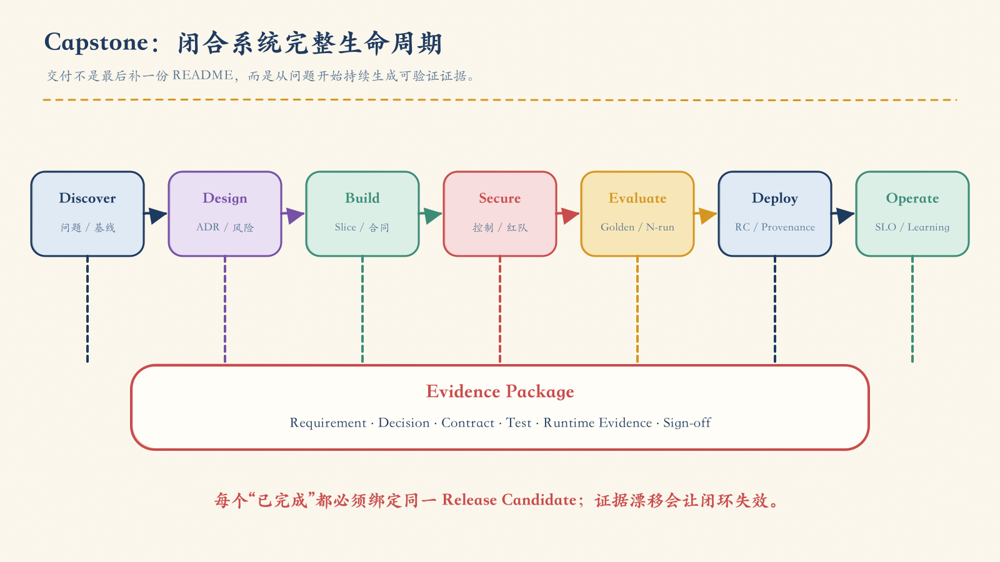
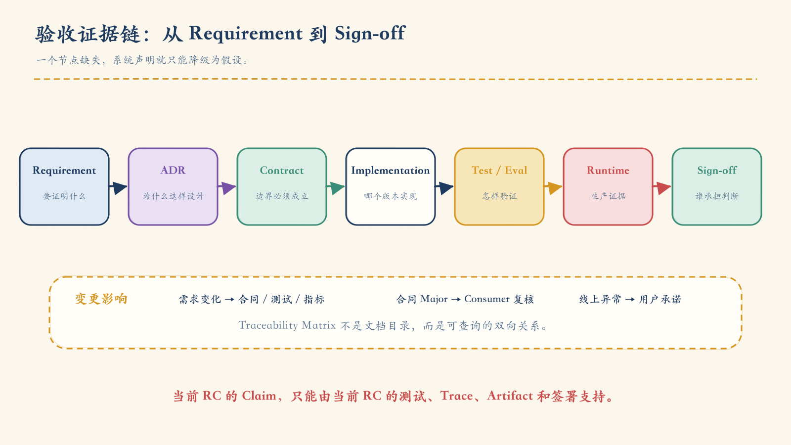
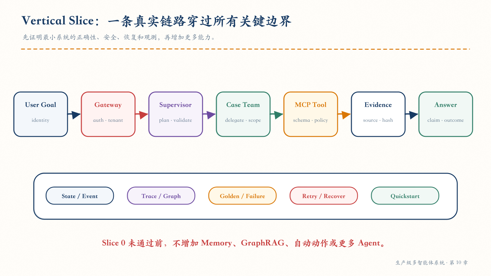
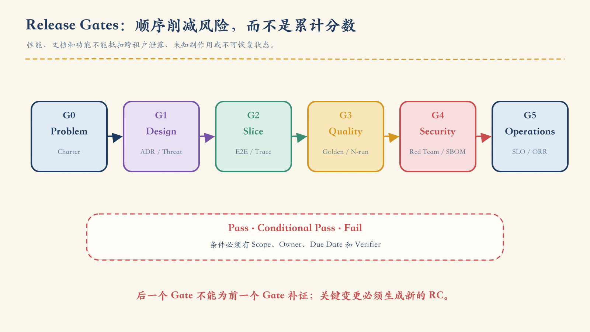
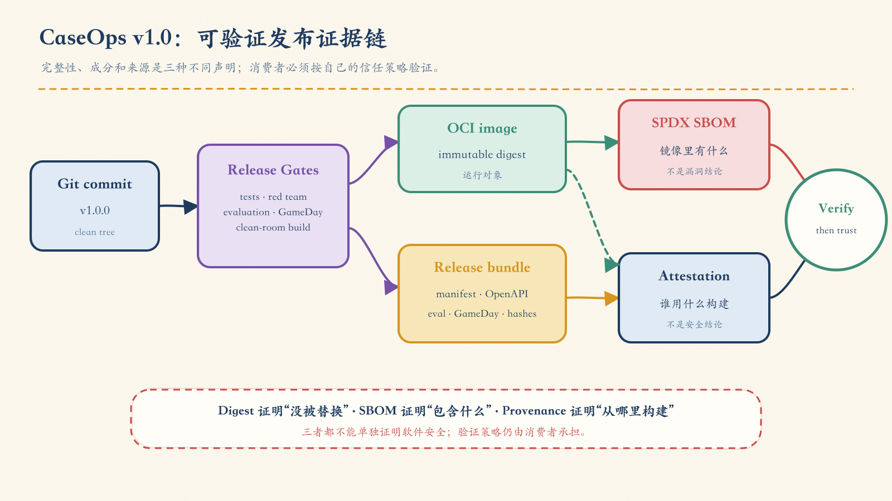
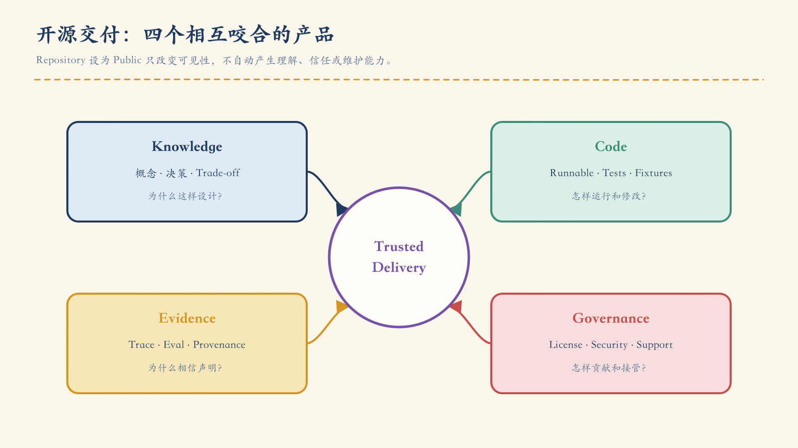
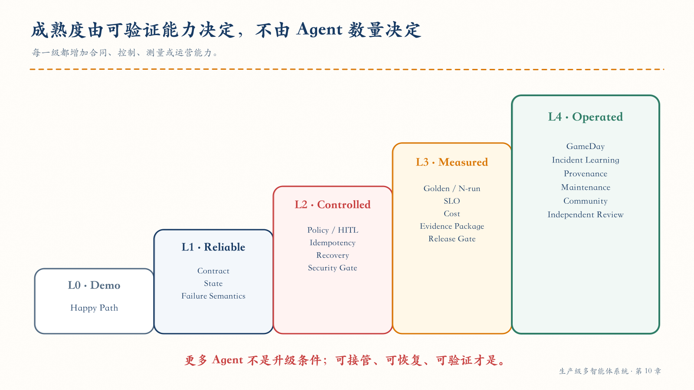

# Chapter 10: System Delivery: Acceptance Evidence, Release Gates, and Open-Source Governance

The first nine chapters advanced the C-102 claims investigation system from a vague idea to an operable system:

- Chapter 1 determined why it needed agents and where the boundaries of autonomy should lie.
- Chapter 2 turned tool calling into a controlled state machine.
- Chapter 3 defined multi-agent collaboration patterns and contracts.
- Chapter 4 established context, RAG, GraphRAG, and the evidence chain.
- Chapter 5 addressed deployment, state, observability, and recovery.
- Chapter 6 added defense in depth, Tool Guard, privacy, and red-team validation.
- Chapter 7 completed system integration through the Supervisor, A2A, MCP, and the Context Graph.
- Chapter 8 used Golden Datasets, N-run evaluation, and continuous regression testing to prove quality.
- Chapter 9 established goal-level SLOs, incident diagnosis, operational control, and a closed AgentOps loop.

At this point, the team can deliver an impressive demo: enter C-102, several Teams collaborate, and the page displays a plan, tool calls, evidence, and an answer. Inject a Provider failure, and the system automatically degrades and recovers.

After the demo, the reviewers ask only four questions:

1. How can I confirm that this is not a set of prearranged successful data?
2. Can someone who never participated in development reproduce it in a clean environment?
3. Did this Release Artifact really come from the code that was reviewed?
4. After the author leaves, who will handle vulnerabilities, compatibility, dependencies, and community issues?

If the team can answer only, "Look, it just worked," the project is still not complete.

> **Production delivery is not about authors proving that they can run the system. It is about enabling independent reviewers to trace claims, reproduce the path, verify risks, and continue maintaining the system without oral clarification from the authors.**

This is also the real meaning of a Capstone. It does not pile RAG, MCP, A2A, Memory, Graph, Guardrail, and more agents on top of one another. It uses the minimum necessary components to close the full lifecycle from problem, architecture, and implementation through acceptance, release, and maintenance.

## 1. The demo paradox: seeing success does not make a system acceptable

Demos naturally favor the Happy Path. Presenters know the environment and the correct input, can skip waits, and can fill gaps with verbal explanations when exceptions occur. System acceptance takes the opposite perspective: reviewers actively look for everything the Demo did not prove.

| What a Demo can show | What a Demo cannot prove on its own |
|---|---|
| One correct result | Stable correctness across representative slices |
| The current environment can run | A clean environment can reproduce the result |
| One failure was handled | Failure classification, recovery, and side-effect reconciliation are complete |
| Evidence appears on the page | Claims are traceable to authoritative Evidence |
| The code is in the repository | The Release Artifact came from that code |
| The project is public | Licensing, vulnerability disclosure, and maintenance responsibilities are clear |

The object of system acceptance is neither an interface nor a repository, but a set of verifiable claims:

```text
Claim: The system can safely explain why a claim is blocked and propose a controlled next step.

Evidence:
  Requirement
  → Architecture Decision
  → Contract
  → Implementation
  → Test / Evaluation
  → Runtime Evidence
  → Independent Sign-off
```

Any break in this chain changes the conclusion. Passing tests without a corresponding requirement proves only that "some code runs as tested." A Trace without a pinned version proves only that "something happened in a particular environment." A cloneable repository whose Quickstart depends on secrets from the author's machine is not reproducible either.



*Figure 10-1 Capstone connects discovery, design, implementation, security, evaluation, release, and operations into a traceable delivery loop.*

## 2. Write the Project Charter before deciding what to build

Many capstone projects begin with, "I want to build five agents." This starting point has already mistaken an architectural technique for a product goal.

The Project Charter should first answer:

```yaml
project:
  name: CaseFlow
  problem: "Service staff spend too much time finding status, policies, and next steps across fragmented systems"
  users: [customer, support_agent, supervisor]
  primary_goal: "Reduce evidence-backed case handling time"
  in_scope:
    - read_case_status
    - explain_blockers_with_evidence
    - recommend_allowed_next_actions
    - propose_human_escalation
  out_of_scope:
    - autonomous_financial_approval
    - unrestricted_database_access
    - unsupported_decisions
  risks:
    - cross_tenant_access
    - unsupported_claim
    - unauthorized_side_effect
  success_metrics: []
  owner: service-operations
```

### 2.1 Value hypotheses must be falsifiable

| Hypothesis | Observation method | Action if falsified |
|---|---|---|
| Reduce search time | Handling time and evidence-backed resolution time | Simplify the scope or stop |
| Improve first-contact resolution | Resolution rate sliced by Intent | Inspect knowledge and process |
| Reduce incorrect recommendations | Sampling, reversals, complaints, and incidents | Block high-risk capabilities |
| Reduce training costs | Time for a new member to complete tasks independently | Improve documentation and product |

Metric thresholds must come from baselines, risks, and business value. Percentages, P95 values, and minute counts in a draft can serve as contract examples; they cannot automatically become the "production standard" for every system.

### 2.2 Anti-goals prevent technical sprawl

State explicitly:

- Do not treat the number of agents, conversation turns, or generated words as success.
- Do not make reducing human escalation a goal in itself; necessary escalation is a correct outcome.
- Do not use likes as a substitute for facts, evidence, and business Outcomes.
- Do not introduce unmaintained components merely to showcase a framework.
- Do not substitute a public repository for a real open-source license and maintenance commitment.

Do not enter detailed architecture design until an Owner has signed off on the problem, users, scope, risks, baseline, and definition of success.

## 3. Requirements are not a wish list; they are the entry point to acceptance

System requirements span at least seven layers:

| Layer | Question to answer | Acceptance evidence |
|---|---|---|
| Business | What are the user goals and business outcomes? | Golden Journey, business sign-off |
| Functional | What capabilities must the system perform? | E2E, Contract Test |
| Quality | How are facts, evidence, and completeness handled? | Layered evaluation, N-run |
| Security | How are tenants, permissions, PII, and side effects handled? | Threat model, red team, hard gates |
| Reliability | How are timeouts, retries, cancellation, and recovery handled? | Failure Test, GameDay |
| Performance | What are the latency, throughput, cost, and capacity requirements? | Load / Cost Test |
| Operations | How are alerts, control, rollback, and maintenance handled? | Runbook, ORR, exercises |

### 3.1 Requirement Record

Each high-value requirement should be an independent record:

```yaml
requirement:
  requirement_id: FR-CASE-004
  statement: "The system shall explain why a case is blocked using current, same-tenant, authorized evidence"
  risk: high
  acceptance:
    required_facts: [case.status, blocker.reason]
    evidence_coverage: 1.0
    freshness_policy: "Defined by business-effective time"
  forbidden:
    - cross_tenant_evidence
    - unsupported_reason
  verification:
    tests: [GOLD-CASE-031, SEC-TENANT-008]
    runtime_sli: claim_evidence_coverage
  owner: case-operations
```

"The system shall answer intelligently" cannot be accepted. "Explain specified facts using current, same-tenant, authorized evidence" can be connected to contracts, tests, and runtime metrics.

### 3.2 Traceability Matrix



*Figure 10-2 Every "done" must be traceable from a Requirement through a Decision, Contract, Test, and Runtime Evidence to Sign-off.*

| Requirement | Decision / Contract | Verification | Runtime Evidence | Owner |
|---|---|---|---|---|
| FR-CASE-004 | ADR-007 / CaseResult v1 | GOLD-031 | evidence coverage | Case Ops |
| SEC-TENANT-001 | ADR-011 / Policy v2 | SEC-008 | leakage event | Security |
| REL-RECOVER-003 | ADR-014 / Error v1 | FAIL-004 | reconcile backlog | SRE |

The matrix is valuable not because it "fills every cell," but because it supports change-impact analysis:

- When a Requirement changes, which contracts, tests, and metrics must be updated?
- When a Contract undergoes a Major change, which Consumers will be affected?
- When an online metric is abnormal, which user commitment has been violated?
- When a risk is accepted, who signs off, and when does the acceptance expire?

## 4. Blueprint and ADR: make the architecture falsifiable

An architecture blueprint should describe layers and trust boundaries before adding framework logos:

```text
Experience  Web / API / Human Console
     ↓
Control     Gateway / Identity / Policy / Budget / HITL
     ↓
Agent       Central Supervisor / Domain Teams / Workers
     ↓
Capability  MCP Tools / A2A / Retrieval / Graph / Memory
     ↓
Platform    State / Event / Artifact / Observability / Cost
```

Every cross-boundary call revalidates identity, permissions, contract, and version. The Central Supervisor does not access databases directly. The model only proposes high-risk actions; deterministic Policy, Approval, and Executor components decide whether to execute them.

Record key decisions in ADRs:

- Why is a multi-agent system needed instead of a workflow or single agent?
- Why are Central, Team, and Worker the current hierarchy?
- Where is the boundary between A2A and MCP?
- How do State, Event, Context Graph, and Artifact divide responsibilities?
- Which actions require HITL, and which should be permanently prohibited?
- How are Prompt, Model, Knowledge, and Tool evaluated, released, and rolled back?

An ADR is not retrospective embellishment. It must record Context, Options, Decision, Consequences, Evidence, and Supersedes. "Adopt a particular framework" without alternatives and consequences is not an architectural decision.

## 5. Define contracts before writing agents

Whether a system can be independently accepted depends on whether its boundaries are explicit:

| Contract | Core fields |
|---|---|
| Goal | user, tenant, purpose, constraints, risk |
| Execution Plan | step, depends_on, team, budget, join |
| A2A Dispatch | task, delegation, deadline, contract version |
| Team Result | status, data, evidence, warnings, trace |
| Agent Error | category, retryable, side_effect_state |
| Evidence Ref | source, anchor, hash, freshness, ACL |
| Approval | actor, action hash, resource, expiry, expected version |
| Audit / Cost | identity, decision, outcome, tokens, tool cost |

### 5.1 Write compatibility as policy

```yaml
compatibility:
  versioning: semantic
  reject_unknown_major: true
  additive_minor_fields: allowed
  required_field_removal: breaking
  enum_extension: consumer_review
  consumer_contract_tests: required
  deprecation_window: "Defined by consumers' migration capabilities"
```

The central prerequisite of Semantic Versioning is declaring a Public API first. Only then do Incompatible, Backward-compatible Feature, and Backward-compatible Fix correspond to Major, Minor, and Patch. It cannot automatically determine for the team whether a Prompt or Tool Schema change breaks semantics.[^semver]

### 5.2 Invariants that must always hold

- `completed` must have a result that satisfies the contract.
- `no_data`, `tool_error`, and a business fact whose value is false must remain strictly distinct.
- Every Claim must bind to unexpired Evidence from the same tenant.
- Every side effect must have authorization, approval, an idempotency key, and `expected_version`.
- A late result from an old Plan must not overwrite current state.
- `partial` / `degraded` must list missing items and their business impact.

These invariants should be enforced by code, Schema, Policy, and tests, not merely written into a Prompt.

## 6. Vertical Slice: complete one vertical path before expanding horizontally

One of the easiest ways for a Capstone to fail is to create several hollow Teams at once, each with only a Happy Path. A more robust approach is to begin with one real vertical slice that crosses every critical boundary.



*Figure 10-3 Slice 0 does not pursue feature count. It proves that identity, planning, delegation, tools, evidence, state, evaluation, and observability can form a single chain.*

CaseFlow's Slice 0 can consist only of "read case status":

1. The Gateway validates the user, tenant, and request contract.
2. The Planner generates a one-step plan that passes the Validator.
3. The Supervisor delegates to the Case Team through A2A, with read-only Scope.
4. The Team selects the Status Worker.
5. The Worker calls the Cases Tool through MCP.
6. The Tool validates parameters, permissions, versions, and the result Schema.
7. The Result binds an EvidenceRef and is written to State, Graph, and Trace.
8. The Consolidator generates a structured answer.
9. The evaluation records Goal Success, evidence, latency, and cost.

Its passing criterion is not "text appears on the page," but:

| Dimension | What must be proved |
|---|---|
| Correctness | Golden Fact agrees with Evidence |
| State | Step, Result, Event, and Graph agree |
| Security | Tenant, Scope, and Tool permissions are correct |
| Resilience | Timeouts, duplicates, and crashes can be handled safely |
| Observability | One Trace connects Goal to Answer |
| Reproduction | An independent environment can complete the published steps |

Do not add more agents, Memory, GraphRAG, or automated actions until Slice 0 passes.

### 6.1 Evolving from Slice 0

| Milestone | New capability | New risks and evidence |
|---|---|---|
| M1 Status | Single Team, read-only | Tenant, Evidence, no_data |
| M2 Guidance | Knowledge Team + RAG | Source, freshness, injection |
| M3 Multi-team | Parallelism, dependencies, and Join | Conflicts, missing data, Late Result |
| M4 Action Proposal | Action Team + HITL | Authorization, approval, idempotency |
| M5 Stateful | Multi-turn, cancellation, recovery | Entity confusion, expired permissions |
| M6 Production | SLO, cost, Runbook | Capacity, incidents, rollback |

Every Milestone submits contracts, code, tests, threat updates, Golden / Failure Cases, documentation, and runtime evidence together. If features are merged first and evidence is added later, the evidence will remain permanently behind.

## 7. Repository structure is an architectural statement

An open-source repository should let directory boundaries and system boundaries explain each other:

```text
caseflow/
├── README.md
├── LICENSE
├── SECURITY.md
├── CONTRIBUTING.md
├── CODE_OF_CONDUCT.md
├── CHANGELOG.md
├── docs/
│   ├── architecture/
│   ├── adr/
│   └── operations/
├── contracts/
│   ├── goal/
│   ├── plan/
│   ├── result/
│   ├── error/
│   └── evidence/
├── services/
│   ├── gateway/
│   ├── supervisor/
│   ├── teams/
│   └── mcp/
├── platform/
│   ├── state/
│   ├── security/
│   └── observability/
├── evals/
├── tests/
├── deploy/
└── examples/
```

Dependency direction must also be checkable:

- Contracts do not depend on Services.
- One Domain Team does not import another Team's internal implementation.
- A Worker depends on a Tool Interface, not a specific database client.
- An Eval observes the system through public entry points and does not invade production code to create a "testing shortcut."
- ADRs, Contracts, Runbooks, and the Release Manifest link to corresponding versions.

## 8. Clean-room Reproduction: the most honest public evaluation

Success on the author's machine is not evidence of reproducibility. Clean-room Reproduction requires an environment with no project cache, hidden files, or oral guidance to execute:

```text
Clone
→ Doctor
→ Bootstrap
→ Start
→ Seed
→ Smoke
→ Eval Smoke
→ Inspect Trace
→ Down
```

The Quickstart should declare:

- Supported OS, architecture, and Runtime versions.
- Every required environment variable and its secure default.
- Synthetic data versions and Hashes.
- Ports, resources, and external dependencies.
- Expected output and failure messages.
- Cleanup and uninstall procedures.

"Runs in 15 minutes" may be an experience budget for a particular project, but it is not a universal standard. Real acceptance means that the time budget is explicit, CI and independent reproducers actually execute the steps, and failure causes are recorded.

### 8.1 Do not make the README depend on the author's brain

The README's primary path should cover:

1. What problem the project solves.
2. Applicable scope and explicit limitations.
3. A minimal architecture diagram.
4. Environment requirements.
5. Quickstart.
6. One successful scenario and one failure scenario.
7. How to inspect Trace / Evidence.
8. Test, evaluation, and security commands.
9. Licensing, support, and maintenance status.

GitHub likewise positions the README as the primary entry point for visitors to understand what a project does, why it is useful, how to get started, where to get help, and who maintains it.[^github-readme]

### 8.2 CaseOps: a clean environment is not another run in the current directory

In CaseOps, I deliberately did not call `docker compose up` a clean-environment acceptance test. It reads the current workspace, which may contain uncommitted code, a local database, `.env`, build caches, and evidence generated by a previous evaluation. Success under these conditions proves only that "this machine can run the system right now," not that a particular commit in the repository can run.

Chapter 10's final review narrows the acceptance object to an exact Git tree:

```text
git commit
  → git archive HEAD
  → unpack into a temporary directory
  → assert that .git / .env / local databases / historical evidence are absent
  → build the runtime image from scratch
  → inspect the package version and OpenAPI version inside the image
  → inspect the UID, OCI version, and revision
```

Three judgments here are easy to overlook.

First, **the acceptance object must be committed first**. Uncommitted code has no stable identity and cannot establish a one-to-one relationship with test reports, image digests, and release tags.

Second, **a cache hit does not invalidate evidence**. Caches can optimize downloads and compilation. As long as every input is constrained by a version and hash, the output remains bound to the current commit. The real danger is secretly reading undeclared inputs from the workspace or external environment.

Third, **reproducible does not mean byte-for-byte identical**. Byte-for-byte reproducible builds are a stronger goal. This chapter first requires that functionality, identity, the dependency set, and acceptance conclusions can be reconstructed in an independent environment. If the industry requires bit-for-bit reproducibility, the clock, compression metadata, compiler, platform, and builder must also be pinned.

The actual CaseOps entry points are:

```bash
make acceptance-chapter-08
make acceptance-chapter-09
make acceptance-chapter-10
```

Chapter 10 cannot skip the first two commands. Otherwise, at most we prove that "the source can be built," not that system quality and incident recovery still belong to the same candidate version.

## 9. Synthetic data, secrets, and public boundaries

Public reproducibility cannot be achieved by publishing real customer data. The Seed Manifest should record:

```yaml
seed:
  dataset: caseflow-demo
  version: 1.0.0
  synthetic: true
  generator_version: ""
  entities:
    tenants: 2
    users: 20
    cases: 100
  edge_cases:
    - no_data
    - stale_policy
    - cross_tenant_attempt
    - conflicting_evidence
    - partial_tool_failure
  hashes: {}
```

Before publication, perform:

- Secret Scanning and inspection of commit history.
- Removal of Tokens, URLs, internal domains, and credentials.
- Checks for PII and re-identifiable data.
- Sensitive-information review of Prompts, Policies, and Tool Outputs.
- Redaction of Notebook output, screenshots, Traces, and Dashboards.
- Verification of redistribution rights for third-party data, models, and tools.

`.env.example` should list only variable names, descriptions, and secure defaults; it must not contain usable secrets. "Rotate them later" is not a control for a public repository.

## 10. Evidence Package: turn "done" into a reviewable object

The Evidence Package should cover:

| Domain | Representative evidence |
|---|---|
| Product | Charter, Journey, Scope, Risk, Acceptance |
| Architecture | Blueprint, ADR, Contract Registry |
| Implementation | Commit, Build, Deployment, Artifact |
| Quality | Golden, N-run, Regression, Known Failure |
| Security | Threat Model, Red Team, SBOM, Exceptions |
| Reliability | Failure Matrix, Recovery, GameDay |
| Operations | SLO, Dashboard, Alert, Runbook, ORR |
| Traceability | Complete index from Requirement to Owner |

An Evidence Record should contain more than file paths:

```yaml
evidence_record:
  evidence_id: EVD-REL-031
  claim: "The Release Candidate can safely handle read-only case status queries"
  requirement_refs: [FR-CASE-004, SEC-TENANT-001]
  decision_refs: [ADR-003, ADR-007]
  contract_refs: [case-result@1.2.0]
  test_refs: [GOLD-031, SEC-008, FAIL-004]
  runtime_refs:
    trace: "trace://release-rc3/gold-031"
    graph: "context-graph://release-rc3/task-882"
  metrics:
    evidence_coverage: 1.0
  artifact_digests: []
  signed_by: [product, engineering, security]
  valid_for_release: rc3
```

Evidence must be bound to the Release Candidate. Using a red-team report from the previous version, evaluation results from another data snapshot, or a Trace from the development environment to support the current RC are all forms of evidence drift.

## 11. Acceptance must cover failure

### 11.1 Quality acceptance

Checks are required at each layer:

```text
Planner        plan validity / dependency
Router / Team  route / scope / delegation
Worker / Tool  arguments / result / faithfulness
Consolidator   claim / evidence / contradiction
Decision       risk / HITL / allowed action
System         goal success / latency / cost
Safety         safe path / leakage / side effect
```

The Golden Dataset must cover common, long-tail, high-risk, `no_data`, `partial`, conflicting, and multi-turn-state cases. N-run evaluation inspects the distribution; it does not substitute one success for stability.

### 11.2 Security acceptance

At minimum, cover:

- Direct and indirect Prompt Injection.
- Tool / MCP parameters, permissions, and output.
- A2A delegation Scope, Expiry, and Replay.
- Tenant, PII, entity, and freshness controls for Memory / RAG.
- Approval, Idempotency, and Expected Version for Side Effects.
- Output DLP and structured results.
- The supply chain for dependencies, images, models, and tools.
- Break-glass and operational permissions.

NIST SSDF recommends integrating secure development practices into the existing SDLC instead of adding a round of scanning only before release. Its AI Community Profile further extends practices related to generative AI and dual-use models.[^nist-ssdf]

### 11.3 Resilience, performance, and cost

The Failure Matrix should explain:

| Failure | Expected Control | Expected Outcome |
|---|---|---|
| Provider unavailable | Circuit + evaluated fallback | degraded / blocked |
| Tool timeout | Deadline + reconcile | no blind side effect |
| Tool schema drift | contract reject | explicit incompatibility |
| Worker crash | checkpoint + resume policy | bounded recovery |
| Knowledge stale | freshness gate | partial / human |
| Trace unavailable | fail closed for high risk | diagnosable state |

Performance budgets are sliced by Intent, Risk, and path and include P95 / P99, concurrency, queues, Tokens, Tool Cost, Cost per Success, and Retry Amplification. Measuring only HTTP RPS misses the real bottlenecks.

## 12. Release Gates reduce risk sequentially



*Figure 10-4 A later Gate cannot supply missing evidence for an earlier Gate; each gate reduces a different class of risk.*

| Gate | Core question | Required evidence | Decision maker |
|---|---|---|---|
| G0 Problem | Is it worth building? | Charter, Baseline, Risk | Product / Business |
| G1 Design | Is the architecture explainable? | Blueprint, ADR, Threat Model | Architecture / Security |
| G2 Slice | Does the minimum path genuinely run? | E2E, Trace, Recovery, Quickstart | Engineering |
| G3 Quality | Are results stable and evidence-backed? | Golden, N-run, Regression | Quality / Domain |
| G4 Security | Are high-risk conditions controlled? | Red Team, SBOM, Exceptions | Security |
| G5 Operations | Can the system be taken over and recovered? | SLO, Runbook, GameDay, ORR | Operations |

A gate is `Pass / Conditional Pass / Fail`, not a total score whose components can offset one another. Better performance cannot offset a single cross-tenant leak; a more polished README cannot offset an unknown side effect.

A Conditional Pass must record its conditions, Owner, expiration, applicable Scope, and verifier. An exception without a deadline permanently lowers the standard.

## 13. The Release Candidate is a frozen acceptance object

When the system enters RC:

```yaml
release_manifest:
  release: caseflow-v1.0.0-rc3
  source_commit: ""
  contracts: {}
  agents: {}
  prompts: {}
  models: {}
  tools: {}
  knowledge_snapshot: ""
  policy_version: ""
  container_digests: []
  datasets: []
  evaluation_run: ""
  security_run: ""
  sbom_ref: ""
  provenance_ref: ""
  evidence_index: ""
  rollback_to: ""
```

If a Prompt, Policy, Tool Schema, Knowledge Snapshot, or image changes during acceptance, a new RC must be created and the affected Gates rerun. Continuing to use old reports breaks evidence closure.

### 13.1 SBOM and Provenance answer different questions

- **SBOM** answers, "Which dependencies, versions, and licenses does the artifact contain?"
- **Provenance** answers, "Who built the artifact, through what process, and with which inputs?"
- **Attestation Verification** answers, "Did these claims come from trusted identities, and do they satisfy expectations?"

GitHub can export an SPDX-format SBOM from the Dependency Graph and also supports generating an SBOM through Actions. Artifact Attestation can associate a Release Artifact with its Repository, Workflow, Commit, and Build process.[^github-sbom] [^github-attestation]

SLSA 1.2 defines Provenance as verifiable information about where an artifact came from and separates Build and Source into independent Tracks. One point requires particular care: an Attestation does not mean the software has no vulnerabilities. Consumers must still verify that the signature, Builder Identity, Build Type, and external parameters satisfy their own policies.[^slsa]

### 13.2 CaseOps v1.0: binding five kinds of identity together

The CaseOps v1.0 release did not create one "universal proof." It assigned each kind of evidence its own role:

| Evidence | Question answered | Question not answered |
|---|---|---|
| Git commit | Which source code was reviewed? | What is actually in the build artifact? |
| Image digest | Was the runtime object replaced? | Is that object secure? |
| SPDX SBOM | Which packages and versions are in the image? | Are those packages appropriate for the current risk? |
| Provenance attestation | Who built it in which Workflow with which inputs? | Is the source logic correct? |
| Eval / GameDay | Did the current candidate pass the quality and recovery gates? | Will it never fail in any future environment? |



*Figure 10-5 Evidence of integrity, composition, origin, and behavior complements one another; no single form of proof can replace the consumer's trust policy.*

The repository's `release-evidence.json` consolidates this evidence into a machine-readable manifest:

```json
{
  "schema_version": "caseops.release-evidence.v1",
  "release": "v1.0.0",
  "source": {
    "commit": "<40-char-git-sha>",
    "ref": "v1.0.0"
  },
  "runtime": {
    "image": "ghcr.io/datapro-lgtm/production-grade-multi-agent-caseops",
    "digest": "sha256:<image-digest>",
    "database_revision": "0007",
    "non_root_uid": 10001
  },
  "artifacts": []
}
```

`artifacts` records not only file names but also the SHA-256 and byte count of each OpenAPI document, release contract, system evaluation, GameDay, and SBOM. The outermost `SHA256SUMS` then covers the manifest itself. This lets readers first verify that the downloaded package came from the expected repository and Workflow, then verify that files inside the package have not changed, and finally review each item of behavioral evidence.

Runtime dependencies are no longer resolved ad hoc on release day either. CaseOps commits separate runtime and development lock files, and every candidate package includes the allowed SHA-256 value for each. The Python base image uses an immutable digest. A dependency update therefore becomes an explicit change: rebuild the lock files, review the differences, and rerun the security and system gates, instead of silently changing runtime results under the same source code.

The Release Workflow triggered by a formal tag also reruns every Gate instead of relying on the impression that "main was green recently." Only after every gate passes does it push the GHCR image, generate a Syft SPDX SBOM, produce build-provenance and SBOM Attestations for the image, and generate a separate Attestation for the downloadable evidence package. Syft can directly analyze a container image or filesystem and output machine-readable formats such as SPDX and CycloneDX. Here, it scans the actual release image, not a manually written dependency list.[^syft]

## 14. Progressive rollout, rollback, and Kill Criteria

The release plan includes at least:

```text
Shadow → Canary → Dual Run → Promote → Rollback → Retire
```

Rollback covers more than the container Tag:

- Prompt.
- Model / Provider.
- Agent Card and Capability Snapshot.
- Tool Schema.
- Policy.
- Knowledge Index / Graph.
- State Migration.
- Cache.
- Contract Compatibility.

Kill Criteria should be explicit conditions that a machine can evaluate or a human can execute:

```yaml
kill_or_pause_if:
  - unauthorized_side_effects > 0
  - cross_tenant_leakage > 0
  - high_risk_safe_path < approved_floor
  - error_budget_fast_burn == true
  - reconciliation_backlog > approved_limit
  - business_owner_requests_stop == true
```

The thresholds are project policy. Security invariants should normally have zero tolerance; thresholds for quality, latency, and cost must be grounded in baselines and risk.

## 15. Open source is not simply making a repository public



*Figure 10-6 Understandable knowledge, runnable code, reviewable evidence, and sustainable governance together constitute open-source delivery.*

A mature open-source delivery contains four products:

| Product | User question to answer |
|---|---|
| Knowledge | How do I understand the concepts, boundaries, and decisions? |
| Code | How do I run, modify, and verify it? |
| Evidence | Why should I trust these claims? |
| Governance | How do I report issues, contribute, and assess maintenance status? |

Repeating the same explanation in the main text, code comments, and README does not add value. The main text explains Why and Trade-offs; code implements the Contract; Evidence proves the Claim; Governance defines participation and responsibility.

GitHub's Community Profile checks for health files such as README, LICENSE, CODE_OF_CONDUCT, and CONTRIBUTING. These files are not decoration; they publish the project's rules to users and contributors.[^github-community]

## 16. Choose licenses by asset boundary

A single repository may contain:

- Software code.
- Manuscripts and diagrams.
- Datasets and Fixtures.
- Model weights or Adapters.
- Third-party documentation, images, and generated content.
- Containers and dependencies.

Do not assume that one LICENSE in the root directory automatically covers every asset. Provide:

```yaml
asset_license:
  path: ""
  asset_type: code | documentation | data | model | media
  copyright_holder: ""
  license_id: ""
  source: ""
  modified: false
  redistribution_allowed: false
  notice_required: false
```

Software described as "open source" should use a license that conforms to the Open Source Definition. OSI maintains a list of reviewed and approved licenses. Custom restrictive clauses may make a project merely "source-available" rather than open source.[^osi-license]

License compatibility and legal conclusions depend on context. High-risk releases should be reviewed by qualified legal counsel. This chapter provides an engineering checklist, not legal advice.

## 17. Community files form a maintenance interface

The minimum maintenance interface includes:

| File | What it must explain |
|---|---|
| README | Value, scope, Quickstart, limitations, support |
| CONTRIBUTING | Development, testing, PRs, review, and DCO / CLA |
| CODE_OF_CONDUCT | Standards of conduct and enforcement |
| SECURITY | Supported versions, private reporting, response expectations |
| GOVERNANCE | Decisions, roles, Owners, and escalation |
| SUPPORT | Support scope, channels, and SLA |
| CHANGELOG | User-visible changes, migration, and deprecation |
| Issue / PR Templates | Reproduction, risk, evidence, and acceptance |

GitHub displays an entry point to `CONTRIBUTING.md` for contributors in the Issue and PR interfaces, helping both parties reduce formatting mistakes and repeated communication.[^github-contributing]

### 17.1 SECURITY.md must not send vulnerabilities into public Issues

SECURITY.md should state:

- Currently supported versions.
- A private reporting channel.
- Required reproduction details and impact.
- The acknowledgment, triage, remediation, and disclosure process.
- Security Advisory and CVE policy.
- What information must not be submitted publicly.

Public repositories should also enable Secret Scanning, Push Protection, Dependency Alerts, and Code Scanning as appropriate to their risk. GitHub's repository security recommendations identify these capabilities as basic protection for public repositories.[^github-repo-security]

## 18. Release Notes must disclose limitations honestly

A Release page should answer at least:

```markdown
### What works
### Who this is for
### Quality and security evidence
### Known limitations
### Compatibility and migration
### Upgrade / rollback
### Artifact digests and provenance
### Support window
```

`v1.0.0` does not mean "every capability is mature." It means the current Public Contract has been declared and the project is willing to maintain it under the compatibility policy. Release Notes must distinguish:

- Verified capabilities.
- Experimental capabilities.
- Unsupported scope.
- Known risks.
- Data, model, and environment assumptions.

## 19. Maturity is determined by verifiable capabilities



*Figure 10-7 Increasing maturity means stronger contracts, controls, measurement, and operational capabilities, not more agents.*

| Level | Standard of proof |
|---|---|
| L0 Demo | One Happy Path can run |
| L1 Reliable | Contracts, state, and failure semantics are explicit |
| L2 Controlled | Security, approval, idempotency, and recovery are controlled |
| L3 Measured | Golden, N-run, SLO, and cost are measurable |
| L4 Operated | GameDay, Incident Learning, and maintenance form a closed loop |

A low-traffic system can reach a high level of maturity; a high-traffic system may still be nothing more than a larger-scale Demo.

## 20. Final delivery decision

Reviewers no longer ask, "How many agents did you use?" Instead, they ask:

### 20.1 Product

- Are the problem, users, scope, and anti-goals explicit?
- Is Goal Success connected to business value?
- Does every high-risk Outcome have an Owner?

### 20.2 Architecture

- Do the Blueprint, ADRs, and Contracts explain the critical boundaries?
- Why were the current agent count, protocols, state, and knowledge approach selected?
- Are change impacts traceable?

### 20.3 Verification

- Can one Vertical Slice be reproduced in a clean environment?
- Are the Golden, Red Team, Failure, and N-run results bound to the current RC?
- Can the Evidence Package support every acceptance Claim?

### 20.4 Release and operations

- Does the Release Artifact have a Digest, SBOM, and Provenance?
- Are progressive rollout, rollback, Kill Criteria, and ORR complete?
- Do SLOs, Alerts, Runbooks, GameDays, and maintenance responsibilities exist?

### 20.5 Open source

- Are asset licenses clear, and do they permit redistribution?
- Are README, CONTRIBUTING, SECURITY, and Governance complete?
- Can external users determine the support scope, known limitations, and project status?

Only three final decisions remain:

```text
Accepted
Conditionally Accepted (conditions, Owner, deadline, verifier)
Rejected
```

### 20.6 Clean-room Sign-off

The most convincing sign-off comes from someone who did not participate in the implementation:

```yaml
independent_acceptance:
  reviewer: ""
  environment: ""
  source_commit: ""
  release_artifact_digest: ""
  steps_executed: []
  successful_scenarios: []
  failure_scenarios: []
  evidence_verified: []
  limitations_confirmed: []
  result: accepted | conditional | rejected
  conditions: []
  signed_at: ""
```

This record converts "trust the author" into "verify the system."

The CaseOps repository divides this sign-off into two layers:

- Automated sign-off: CI and the Release Workflow record the Commit, Gates, image Digest, SBOM, and Attestation.
- Human sign-off: an independent reviewer confirms whether the applicable environment, known limitations, and business risks are acceptable.

The former cannot replace the latter. A machine can prove that the system "was built through the declared process and passed these assertions," but it cannot decide for the business Owner whether the residual risk is worth taking. The latter cannot replace the former either, because "I reviewed it" does not let external readers replay the evidence.

The accompanying engineering work has turned Chapter 10 into a runnable delivery rather than pseudocode in a book:

- [CaseOps v1.0 code repository](https://github.com/dataPro-lgtm/production-grade-multi-agent-caseops)
- [Chapter 10 final review runbook](https://github.com/dataPro-lgtm/production-grade-multi-agent-caseops/blob/main/docs/chapter-10-runbook.md)
- `make acceptance-chapter-10`: final review of clean source, non-root image, SBOM, and checksums
- `v1.0.0`: triggers the complete release Gates, GHCR image, and verifiable GitHub Release

## 21. Book conclusion: from architectural judgment to public verification

A book about production-grade multi-agent systems has not achieved its goal if it only tells readers how to create agents. The complete engineering path is:

```text
Determine whether agents are needed
→ define the boundaries of autonomy and responsibility
→ express actions as contracts and state machines
→ design collaboration, Context, and evidence
→ establish the platform, security, evaluation, and operations
→ accept the system through a vertical slice and Evidence Package
→ deliver it publicly through a reproducible, traceable, and maintainable repository
```

In the end, production-grade is not an adjective but a set of externally verifiable capabilities:

- Goals can be measured.
- Decisions can be explained.
- Boundaries can be enforced.
- Facts can be traced.
- Failures can be recovered from.
- Risks can be controlled.
- Quality can be proved.
- Costs can be attributed.
- Artifacts can be verified.
- The project can be handed over to others.

This is what a Capstone should deliver: not more components, but a trustworthy system that does not depend on the author's presence.

The accompanying [Capstone System Acceptance and Open-Source Delivery Contract](../toolkit/capstone-system-acceptance-and-open-source-delivery-contract.md) provides templates for the Charter, Requirement, Traceability, Vertical Slice, Evidence Package, Release Gates, SBOM / Provenance, Clean-room Reproduction, community governance, and final sign-off.

## References

[^semver]: Semantic Versioning, [Semantic Versioning 2.0.0](https://semver.org/). Version-number compatibility semantics presuppose a declared Public API.
[^github-readme]: GitHub Docs, [About the repository README file](https://docs.github.com/en/repositories/managing-your-repositorys-settings-and-features/customizing-your-repository/about-readmes). A README should explain the project's purpose, how to get started, where to find support, and who maintains it.
[^nist-ssdf]: NIST, [Secure Software Development Framework](https://csrc.nist.gov/Projects/ssdf). Final publications include SSDF 1.1 and the Generative AI Community Profile; the newer SSDF 1.2 was still a Draft when this chapter was written.
[^github-sbom]: GitHub Docs, [Exporting a software bill of materials for your repository](https://docs.github.com/en/code-security/how-tos/secure-your-supply-chain/establish-provenance-and-integrity/export-dependencies-as-sbom). GitHub's Dependency Graph can export an SPDX SBOM.
[^github-attestation]: GitHub Docs, [Using artifact attestations to establish provenance for builds](https://docs.github.com/en/actions/how-tos/secure-your-work/use-artifact-attestations/use-artifact-attestations). Artifact Attestation connects an artifact to its build provenance, but does not replace vulnerability and policy judgments.
[^slsa]: SLSA, [SLSA specification v1.2](https://slsa.dev/spec/v1.2/) and [Verifying artifacts](https://slsa.dev/spec/v1.2/verifying-artifacts). Provenance provides security value only when verified against trusted expectations.
[^syft]: Anchore, [Syft](https://github.com/anchore/syft). Syft can generate SBOMs in formats such as SPDX and CycloneDX from container images and filesystems; this chapter pins the tool version used by the release process.
[^github-community]: GitHub Docs, [About community profiles for public repositories](https://docs.github.com/en/communities/setting-up-your-project-for-healthy-contributions/about-community-profiles-for-public-repositories). Community Profile checks the key health files in a public repository.
[^osi-license]: Open Source Initiative, [OSI Approved Licenses](https://opensource.org/licenses). The OSI-approved list is used to determine whether a license conforms to the Open Source Definition.
[^github-contributing]: GitHub Docs, [Setting guidelines for repository contributors](https://docs.github.com/en/communities/setting-up-your-project-for-healthy-contributions/setting-guidelines-for-repository-contributors). Contribution guidelines are displayed in repository, Issue, and PR workflows.
[^github-repo-security]: GitHub Docs, [Best practices for repositories](https://docs.github.com/en/repositories/creating-and-managing-repositories/best-practices-for-repositories). Public repositories should enable applicable dependency, secret, and code-security capabilities.
