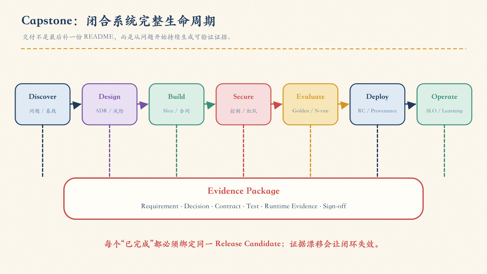
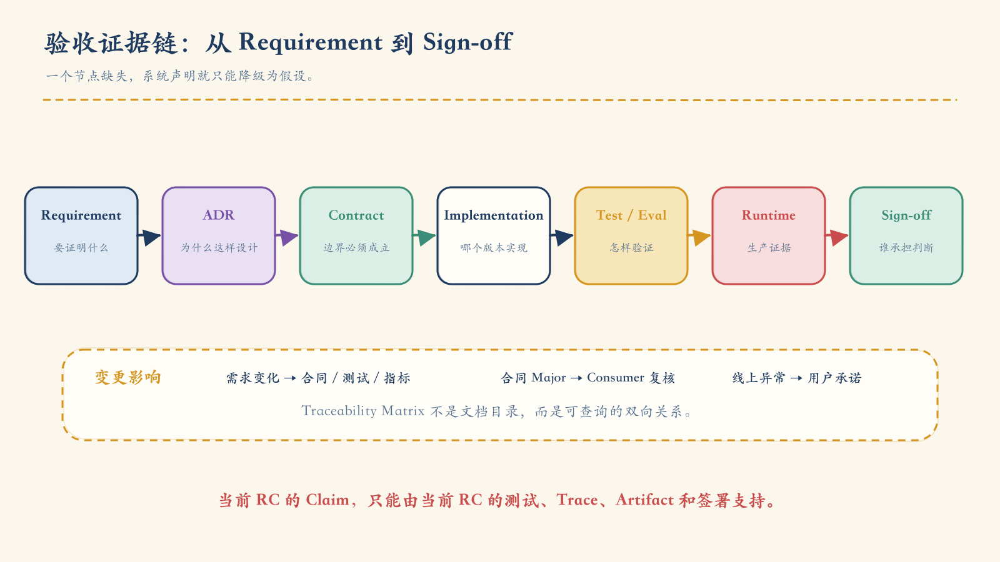
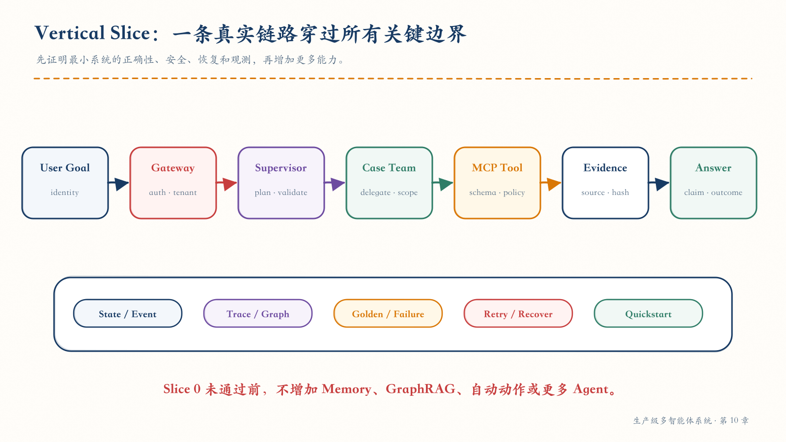
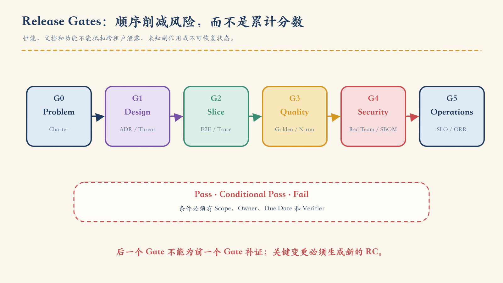
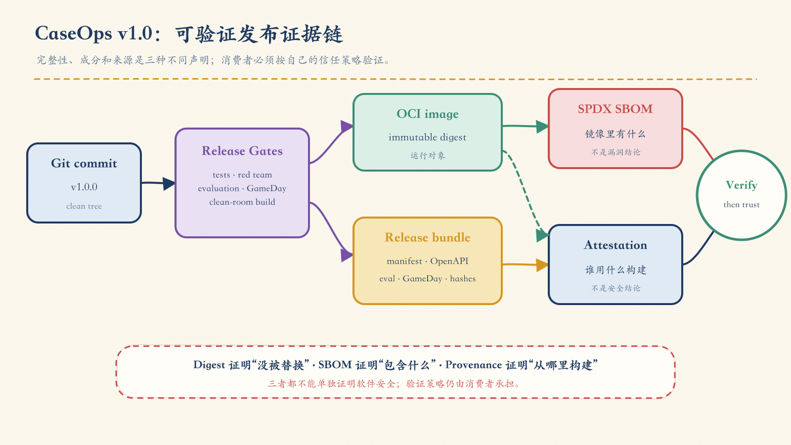
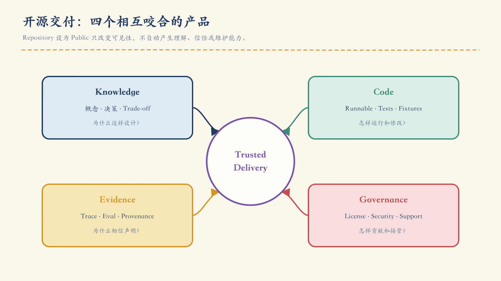
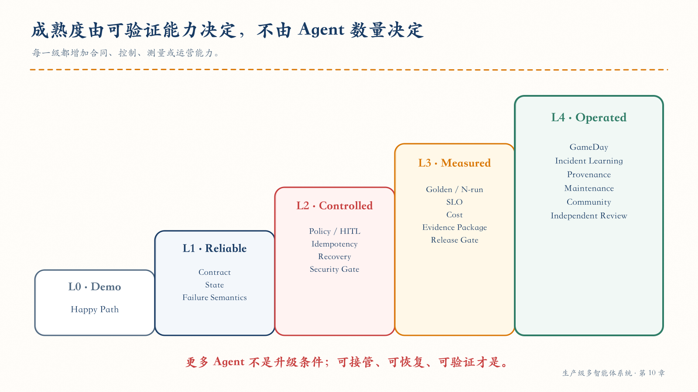

# 第10章　システムデリバリー：受け入れ検証エビデンス、リリースゲート、オープンソースガバナンス

第9章までで、C-102 保険金請求調査システムは、曖昧なアイデアから運用可能なシステムへと進化しました。

- 第1章では、なぜ Agent が必要なのか、そして自律性の境界をどこに置くのかを判断しました。
- 第2章では、ツール呼び出しを制御されたステートマシンに変えました。
- 第3章では、マルチエージェントの協調パターンと契約を定義しました。
- 第4章では、Context、RAG、GraphRAG、エビデンスチェーンを構築しました。
- 第5章では、デプロイ、状態、観測、復旧を扱いました。
- 第6章では、多層防御、Tool Guard、プライバシー、レッドチームを追加しました。
- 第7章では、Supervisor、A2A、MCP、Context Graph を通じてシステム統合を完了しました。
- 第8章では、Golden Dataset、N-run、継続的回帰テストによって品質を証明しました。
- 第9章では、目標レベルの SLO、インシデント診断、運用制御、AgentOps の閉ループを構築しました。

ここまで来れば、チームは非常に見栄えのするデモを実施できます。C-102 を入力すると、複数の Team が協調し、画面には計画、ツール呼び出し、エビデンス、回答が表示されます。さらに Provider 障害を注入すると、システムは自動的に縮退し、復旧します。

デモが終わった後、レビュー担当者が尋ねたのは、わずか4つの質問でした。

1. これが事前に用意された成功データの集まりではないと、どう確認できますか。
2. 開発に一度も関わっていない人でも、クリーンな環境で再現できますか。
3. この Release Artifact は、本当にレビュー対象のコードから生成されたものですか。
4. 作者が離れた後、脆弱性、互換性、依存関係、コミュニティの問題を誰が扱いますか。

チームが「ほら、さっき動きました」としか答えられないなら、プロジェクトはまだ完了していません。

> **本番デリバリーとは、作者がシステムを実行できると証明することではありません。独立したレビュー担当者が、声明を追跡し、手順を再現し、リスクを検証し、作者による口頭の補足がなくても保守を継続できるようにすることです。**

これこそが Capstone の本当の意味です。RAG、MCP、A2A、Memory、Graph、Guardrail、さらに多くの Agent を積み上げることではなく、必要最小限のコンポーネントで、問題、アーキテクチャ、実装、受け入れ検証、リリース、保守に至る完全なライフサイクルを閉じることです。

## 1. デモのパラドックス：成功が見えることと、受け入れ可能であることは同じではない

デモは本質的に Happy Path に偏ります。説明者は環境を熟知し、正しい入力を知っており、待ち時間を飛ばすことができ、異常が発生しても口頭説明で不足を補えます。システム受け入れ検証の視点は、まさにその反対です。レビュー担当者は、Demo が証明していないものを能動的に探さなければなりません。

| Demo で示せること | Demo だけでは証明できないこと |
|---|---|
| 1回の結果が正しい | 代表的なスライスで安定して正しい |
| 現在の環境で動作する | クリーンな環境で再現できる |
| ある障害が処理された | 障害分類、復旧、副作用の照合が完全である |
| 画面にエビデンスが表示される | Claim から権威ある Evidence まで追跡できる |
| コードがリポジトリにある | Release Artifact がそのコードから生成された |
| プロジェクトが公開されている | ライセンス、脆弱性開示、保守責任が明確である |

システム受け入れ検証の対象は、1つのインターフェースでも、1つのリポジトリでもなく、検証可能な声明の集合です。

```text
Claim: システムは保険金請求が滞っている理由を安全に説明し、制御された次のステップを提示できる。

Evidence:
  Requirement
  → Architecture Decision
  → Contract
  → Implementation
  → Test / Evaluation
  → Runtime Evidence
  → Independent Sign-off
```

どこか1か所でも途切れれば、結論は変わります。テストに合格しても対応する要件を見つけられなければ、「一部のコードがテストどおりに動作した」としか証明できません。Trace があってもバージョンが固定されていなければ、「ある時点の環境で何かが起きた」としか証明できません。リポジトリをクローンできても、Quickstart が作者のローカル環境にある秘密情報へ依存していれば、再現可能とは呼べません。



*図10-1　Capstone は、発見、設計、実装、セキュリティ、評価、リリース、運用を、追跡可能なデリバリーの閉ループとして接続します。*

## 2. 何を構築するか決める前に Project Charter を書く

多くの卒業プロジェクトは、「5つの Agent を作りたい」から始まります。この出発点では、すでにアーキテクチャ上の手段をプロダクト目標として誤って記述しています。

Project Charter では、最初に次の問いへ答えるべきです。

```yaml
project:
  name: CaseFlow
  problem: "担当者が分散したシステムからステータス、ポリシー、次のステップを探すのに時間がかかりすぎる"
  users: [customer, support_agent, supervisor]
  primary_goal: "エビデンスに基づく案件処理時間を短縮する"
  in_scope:
    - read_case_status
    - explain_blockers_with_evidence
    - recommend_allowed_next_actions
    - propose_human_escalation
  out_of_scope:
    - autonomous_financial_approval
    - unrestricted_database_access
    - unsupported_decisions
  risks:
    - cross_tenant_access
    - unsupported_claim
    - unauthorized_side_effect
  success_metrics: []
  owner: service-operations
```

### 2.1 価値仮説は反証可能でなければならない

| 仮説 | 観測方法 | 反証された場合のアクション |
|---|---|---|
| 検索時間を短縮する | 処理時間とエビデンス付き解決時間 | スコープを簡素化するか中止する |
| 初回解決率を高める | Intent スライス別の解決率 | ナレッジとプロセスを確認する |
| 誤った提案を減らす | 抜き取り検査、取り消し、苦情、インシデント | 高リスク機能をブロックする |
| トレーニングコストを下げる | 新メンバーが独力でタスクを完了するまでの時間 | ドキュメントとプロダクトを改善する |

メトリクスのしきい値は、ベースライン、リスク、ビジネス価値から導出しなければなりません。原稿にあるパーセンテージ、P95、分数は契約の例として利用できますが、すべてのシステムに通用する「本番標準」にそのまま転用はできません。

### 2.2 反目標によって技術の暴走を防ぐ

次の点を明確に記載します。

- Agent 数、対話ターン数、生成文字数を成功指標にしない。
- 人間への引き継ぎを減らすこと自体を目標にしない。必要な引き継ぎは正しい結果である。
- 「いいね」を、事実、エビデンス、ビジネス Outcome の代わりにしない。
- フレームワークを見せるためだけに、誰も保守しないコンポーネントを導入しない。
- 公開リポジトリを、本当のオープンソースライセンスと保守のコミットメントの代わりにしない。

問題、ユーザー、スコープ、リスク、ベースライン、成功の定義に Owner が署名していない段階で、詳細なアーキテクチャ設計へ進むべきではありません。

## 3. 要件は希望リストではなく、受け入れ検証の入口である

システム要件は、少なくとも7つのレイヤーに分けます。

| レイヤー | 答えるべきこと | 受け入れ検証エビデンス |
|---|---|---|
| Business | ユーザー目標とビジネス成果は何か | Golden Journey、ビジネス部門の署名 |
| Functional | システムが必ず実行すべき機能は何か | E2E、Contract Test |
| Quality | 事実、エビデンス、完全性をどう保証するか | レイヤー別評価、N-run |
| Security | テナント、権限、PII、副作用をどう扱うか | 脅威モデル、レッドチーム、ハードゲート |
| Reliability | タイムアウト、リトライ、キャンセル、復旧をどう扱うか | Failure Test、GameDay |
| Performance | レイテンシ、スループット、コスト、キャパシティをどう扱うか | Load / Cost Test |
| Operations | アラート、制御、ロールバック、保守をどう扱うか | Runbook、ORR、演習 |

### 3.1 Requirement Record

価値の高い要件は、それぞれ独立したレコードにするべきです。

```yaml
requirement:
  requirement_id: FR-CASE-004
  statement: "システムは、現在有効で同一テナント内で認可されたエビデンスを使って、案件が滞っている理由を説明しなければならない"
  risk: high
  acceptance:
    required_facts: [case.status, blocker.reason]
    evidence_coverage: 1.0
    freshness_policy: "ビジネス上の有効期間によって定義する"
  forbidden:
    - cross_tenant_evidence
    - unsupported_reason
  verification:
    tests: [GOLD-CASE-031, SEC-TENANT-008]
    runtime_sli: claim_evidence_coverage
  owner: case-operations
```

「システムはインテリジェントに回答すべきである」は受け入れ検証できません。一方、「現在有効で同一テナント内で認可されたエビデンスを使って、指定された事実を説明する」であれば、契約、テスト、実行時メトリクスへ接続できます。

### 3.2 Traceability Matrix



*図10-2　すべての「完了」は、Requirement から Decision、Contract、Test、Runtime Evidence を経て Sign-off まで追跡できなければなりません。*

| Requirement | Decision / Contract | Verification | Runtime Evidence | Owner |
|---|---|---|---|---|
| FR-CASE-004 | ADR-007 / CaseResult v1 | GOLD-031 | evidence coverage | Case Ops |
| SEC-TENANT-001 | ADR-011 / Policy v2 | SEC-008 | leakage event | Security |
| REL-RECOVER-003 | ADR-014 / Error v1 | FAIL-004 | reconcile backlog | SRE |

このマトリクスの価値は、「表を埋める」ことではなく、変更の影響を分析することにあります。

- Requirement が変わったとき、どの契約、テスト、メトリクスを更新する必要があるか。
- Contract に Major 変更が発生したとき、どの Consumer が影響を受けるか。
- 本番メトリクスに異常が起きたとき、どのユーザーへの約束に違反しているか。
- リスクを受容するとき、誰が署名し、いつ失効するか。

## 4. Blueprint と ADR：アーキテクチャを反証可能にする

アーキテクチャのブループリントでは、フレームワークの Logo を描く前に、レイヤーと信頼境界を説明するべきです。

```text
Experience  Web / API / Human Console
     ↓
Control     Gateway / Identity / Policy / Budget / HITL
     ↓
Agent       Central Supervisor / Domain Teams / Workers
     ↓
Capability  MCP Tools / A2A / Retrieval / Graph / Memory
     ↓
Platform    State / Event / Artifact / Observability / Cost
```

境界を越える呼び出しごとに、アイデンティティ、権限、契約、バージョンを改めて検証します。Central Supervisor はデータベースへ直接アクセスしません。モデルは高リスクなアクションを提案するだけであり、決定論的な Policy、Approval、Executor が実行可否を決定します。

重要な決定は ADR に記録します。

- ワークフローや単一 Agent ではなく、なぜマルチエージェントが必要なのか。
- なぜ Central、Team、Worker が現在の階層になっているのか。
- A2A と MCP の境界はどこにあるのか。
- State、Event、Context Graph、Artifact はどのように役割分担するのか。
- どのアクションに HITL が必須で、どのアクションを恒久的に禁止するのか。
- Prompt、Model、Knowledge、Tool をどのように評価、リリース、ロールバックするのか。

ADR は事後的な体裁作りではありません。Context、Options、Decision、Consequences、Evidence、Supersedes を記録しなければなりません。「あるフレームワークを採用する」とだけ記し、代替案と影響がなければ、それはアーキテクチャ判断ではありません。

## 5. Agent を書く前に契約を定義する

システムを独立に受け入れ検証できるかどうかは、境界が明示されているかにかかっています。

| Contract | 中核フィールド |
|---|---|
| Goal | user、tenant、purpose、constraints、risk |
| Execution Plan | step、depends_on、team、budget、join |
| A2A Dispatch | task、delegation、deadline、contract version |
| Team Result | status、data、evidence、warnings、trace |
| Agent Error | category、retryable、side_effect_state |
| Evidence Ref | source、anchor、hash、freshness、ACL |
| Approval | actor、action hash、resource、expiry、expected version |
| Audit / Cost | identity、decision、outcome、tokens、tool cost |

### 5.1 互換性をポリシーとして記述する

```yaml
compatibility:
  versioning: semantic
  reject_unknown_major: true
  additive_minor_fields: allowed
  required_field_removal: breaking
  enum_extension: consumer_review
  consumer_contract_tests: required
  deprecation_window: "利用者の移行能力によって決定する"
```

Semantic Versioning の中核となる前提は、最初に Public API を宣言することです。その後で初めて、Incompatible、Backward-compatible Feature、Backward-compatible Fix が、それぞれ Major、Minor、Patch に対応します。Semantic Versioning が、「Prompt や Tool Schema の変更によって意味上の互換性が損なわれるか」をチームの代わりに自動判断してくれるわけではありません。[^semver]

### 5.2 常に成立しなければならない不変条件

- `completed` には、契約を満たす結果が必須である。
- `no_data`、`tool_error`、業務上の事実が否であることを厳密に区別する。
- Claim は、同一テナントに属し、有効期間内にある Evidence と紐付ける。
- 副作用には、認可、承認、冪等キー、`expected_version` が必須である。
- 古い Plan から遅れて届いた結果が、現在の状態を上書きしてはならない。
- `partial` / `degraded` には、不足項目とビジネスへの影響を明記する。

これらの不変条件は、コード、Schema、Policy、テストで適用すべきであり、Prompt に書くだけでは不十分です。

## 6. Vertical Slice：横方向に広げる前に、縦方向に貫通させる

Capstone が失敗する最もありがちな方法は、複数の空の Team を同時に作り、それぞれに Happy Path しか用意しないことです。より堅実なのは、まずすべての重要な境界を貫通する、本物の垂直スライスを1本構築することです。



*図10-3　Slice 0 では機能数を追い求めず、アイデンティティ、計画、委任、ツール、エビデンス、状態、評価、観測を1本のチェーンとして接続できることを証明します。*

CaseFlow の Slice 0 は、「案件ステータスを読み取る」だけでも構いません。

1. Gateway がユーザー、テナント、リクエスト契約を検証する。
2. Planner が単一ステップの計画を生成し、Validator を通過させる。
3. Supervisor が A2A を通じて Case Team に委任し、Scope を読み取り専用に限定する。
4. Team が Status Worker を選択する。
5. Worker が MCP を通じて Cases Tool を呼び出す。
6. Tool がパラメータ、権限、バージョン、結果 Schema を検証する。
7. Result を EvidenceRef と紐付け、State、Graph、Trace に書き込む。
8. Consolidator が構造化された回答を生成する。
9. 評価で Goal Success、エビデンス、レイテンシ、コストを記録する。

合格基準は、「画面に文字が表示されること」ではなく、次のとおりです。

| ディメンション | 証明しなければならないこと |
|---|---|
| 正確性 | Golden Fact と Evidence が一致する |
| 状態 | Step、Result、Event、Graph が一致する |
| セキュリティ | Tenant、Scope、Tool の権限が正しい |
| レジリエンス | Timeout、重複、クラッシュを安全に処理できる |
| オブザーバビリティ | 1つの Trace が Goal から Answer までをつなぐ |
| 再現性 | 独立した環境で公開手順に従って完了できる |

Slice 0 が合格するまでは、Agent、Memory、GraphRAG、自動アクションを追加しません。

### 6.1 Slice 0 からの進化

| Milestone | 新しい機能 | 新しいリスクとエビデンス |
|---|---|---|
| M1 Status | 単一 Team、読み取り専用 | Tenant、Evidence、no_data |
| M2 Guidance | Knowledge Team + RAG | 出典、鮮度、インジェクション |
| M3 Multi-team | 並列、依存関係、Join | 競合、不足、Late Result |
| M4 Action Proposal | Action Team + HITL | 認可、承認、冪等性 |
| M5 Stateful | 複数ターン、キャンセル、復旧 | エンティティの混同、期限切れの権限 |
| M6 Production | SLO、コスト、Runbook | キャパシティ、インシデント、ロールバック |

各 Milestone では、契約、コード、テスト、脅威モデルの更新、Golden / Failure Case、ドキュメント、実行時エビデンスを同時に提出します。機能を先にマージしてエビデンスを後から補うと、エビデンスは永遠に追いつきません。

## 7. リポジトリ構造はアーキテクチャの声明である

オープンソースリポジトリでは、ディレクトリ境界とシステム境界が互いを説明するように設計すべきです。

```text
caseflow/
├── README.md
├── LICENSE
├── SECURITY.md
├── CONTRIBUTING.md
├── CODE_OF_CONDUCT.md
├── CHANGELOG.md
├── docs/
│   ├── architecture/
│   ├── adr/
│   └── operations/
├── contracts/
│   ├── goal/
│   ├── plan/
│   ├── result/
│   ├── error/
│   └── evidence/
├── services/
│   ├── gateway/
│   ├── supervisor/
│   ├── teams/
│   └── mcp/
├── platform/
│   ├── state/
│   ├── security/
│   └── observability/
├── evals/
├── tests/
├── deploy/
└── examples/
```

依存関係の方向も検査可能でなければなりません。

- Contracts は Services に依存しない。
- ある Domain Team は、別の Team の内部実装をインポートしない。
- Worker は Tool Interface に依存し、具体的なデータベースクライアントには依存しない。
- Eval は公開インターフェースを通じてシステムを観測し、本番コードへ侵入して「テスト用の近道」を作らない。
- ADR、Contract、Runbook、Release Manifest は、対応するバージョンへリンクする。

## 8. Clean-room Reproduction：最も誠実な公開評価

作者のローカル環境で成功したことは、再現性のエビデンスにはなりません。Clean-room Reproduction では、プロジェクトのキャッシュ、隠しファイル、口頭のガイダンスがない環境で、次の手順を実行します。

```text
Clone
→ Doctor
→ Bootstrap
→ Start
→ Seed
→ Smoke
→ Eval Smoke
→ Inspect Trace
→ Down
```

Quickstart では、次の内容を明記すべきです。

- サポート対象の OS、アーキテクチャ、Runtime バージョン。
- 必須の環境変数すべてと、安全なデフォルト値。
- 合成データのバージョンと Hash。
- ポート、リソース、外部依存関係。
- 期待される出力と、失敗時のメッセージ。
- クリーンアップとアンインストールの方法。

「15分で動かせる」は、あるプロジェクトの体験予算にはなりますが、普遍的な標準ではありません。本当の受け入れ検証とは、時間予算が明確であり、CI と独立した再現担当者が実際に手順を実行し、失敗理由が記録されていることです。

### 8.1 README を作者の頭脳に依存させない

README の最初の導線では、次の内容を網羅すべきです。

1. プロジェクトが解決する問題。
2. 適用範囲と明確な制約。
3. 最小限のアーキテクチャ図。
4. 環境要件。
5. Quickstart。
6. 成功シナリオを1つ、失敗シナリオを1つ。
7. Trace / Evidence の確認方法。
8. テスト、評価、セキュリティのコマンド。
9. ライセンス、サポート、保守状況。

GitHub も README を、訪問者が「プロジェクトは何をするのか、なぜ有用なのか、どう始めるのか、どこで支援を求めるのか、誰が保守しているのか」を理解するための最初の入口と位置付けています。[^github-readme]

### 8.2 CaseOps：クリーンな環境とは、現在のディレクトリでもう一度実行することではない

CaseOps では、意図的に `docker compose up` をクリーン環境での受け入れ検証とは呼んでいません。これは現在のワークスペースを読み取ります。しかし、現在のワークスペースには、未コミットのコード、ローカルデータベース、`.env`、ビルドキャッシュ、前回の評価で生成されたエビデンスが偶然残っているかもしれません。この状態での成功は、「このマシンでは今動作する」ことしか証明できず、リポジトリ内の特定のコミットが動作することは証明できません。

第10章の最終レビューでは、対象を正確な Git tree に限定します。

```text
git commit
  → git archive HEAD
  → 一時ディレクトリに展開
  → .git / .env / ローカルデータベース / 過去のエビデンスが存在しないことを検証
  → 実行イメージをゼロからビルド
  → イメージ内のパッケージバージョンと OpenAPI バージョンを確認
  → UID、OCI version、revision を確認
```

ここには、見落としやすい3つの判断があります。

第1に、**受け入れ検証の対象は、先にコミットされていなければなりません**。未コミットのコードには安定したアイデンティティがないため、テストレポート、イメージダイジェスト、リリースタグと一対一で対応付けることができません。

第2に、**キャッシュヒットは、エビデンスが無効になったことを意味しません**。すべての入力がバージョンとハッシュによって制約され、出力が現在のコミットに紐付いている限り、キャッシュでダウンロードやコンパイルを最適化しても構いません。本当に危険なのは、ワークスペースや外部環境から、宣言されていない入力をひそかに読み取ることです。

第3に、**再現可能であることは、バイト単位で同一であることと同義ではありません**。バイト単位の再現可能ビルドは、より強い目標です。本章で最初に求めるのは、機能、アイデンティティ、依存関係の集合、受け入れ検証の結論を独立した環境で再構築できることです。業界で bit-for-bit reproducibility が求められる場合は、さらに時刻、圧縮メタデータ、コンパイラ、プラットフォーム、ビルダーを固定する必要があります。

CaseOps の実際の入口は、次のとおりです。

```bash
make acceptance-chapter-08
make acceptance-chapter-09
make acceptance-chapter-10
```

第10章では、その前の2つのコマンドを省略できません。省略した場合に証明できるのは、せいぜい「ソースコードをビルドできる」ことだけであり、システム品質とインシデント復旧が同じリリース候補に属していることは証明できません。

## 9. 合成データ、秘密情報、公開境界

公開環境での再現性を、実際の顧客データを公開することで実現してはなりません。Seed Manifest には、次の内容を記録します。

```yaml
seed:
  dataset: caseflow-demo
  version: 1.0.0
  synthetic: true
  generator_version: ""
  entities:
    tenants: 2
    users: 20
    cases: 100
  edge_cases:
    - no_data
    - stale_policy
    - cross_tenant_attempt
    - conflicting_evidence
    - partial_tool_failure
  hashes: {}
```

公開前に、次の作業を実施します。

- Secret Scan と過去のコミットの検査。
- Token、URL、内部ドメイン、認証情報の除去。
- PII と再識別可能なデータの検査。
- Prompt、Policy、Tool Output に含まれる機密情報のレビュー。
- Notebook の出力、スクリーンショット、Trace、Dashboard の匿名化。
- サードパーティのデータ、モデル、ツールについて、再配布権を確認。

`.env.example` には、変数名、説明、安全なデフォルト値のみを記載し、使用可能な秘密情報を提供してはなりません。「後でローテーションする」は、公開リポジトリにおける管理策にはなりません。

## 10. Evidence Package：「完了した」をレビュー可能な対象に変える

Evidence Package では、次の領域を網羅すべきです。

| 領域 | 代表的なエビデンス |
|---|---|
| Product | Charter、Journey、Scope、Risk、Acceptance |
| Architecture | Blueprint、ADR、Contract Registry |
| Implementation | Commit、Build、Deployment、Artifact |
| Quality | Golden、N-run、Regression、Known Failure |
| Security | Threat Model、Red Team、SBOM、Exceptions |
| Reliability | Failure Matrix、Recovery、GameDay |
| Operations | SLO、Dashboard、Alert、Runbook、ORR |
| Traceability | Requirement から Owner までの完全なインデックス |

Evidence Record には、ファイルパスだけを記載するべきではありません。

```yaml
evidence_record:
  evidence_id: EVD-REL-031
  claim: "Release Candidate は、読み取り専用の案件ステータス照会を安全に処理できる"
  requirement_refs: [FR-CASE-004, SEC-TENANT-001]
  decision_refs: [ADR-003, ADR-007]
  contract_refs: [case-result@1.2.0]
  test_refs: [GOLD-031, SEC-008, FAIL-004]
  runtime_refs:
    trace: "trace://release-rc3/gold-031"
    graph: "context-graph://release-rc3/task-882"
  metrics:
    evidence_coverage: 1.0
  artifact_digests: []
  signed_by: [product, engineering, security]
  valid_for_release: rc3
```

Evidence は Release Candidate と紐付いていなければなりません。前バージョンのレッドチームレポート、別のデータスナップショットを使った評価結果、開発環境の Trace を、現在の RC の根拠として使うことは、いずれもエビデンスドリフトです。

## 11. 受け入れ検証では障害も対象にする

### 11.1 品質の受け入れ検証

レイヤー別に確認する必要があります。

```text
Planner        plan validity / dependency
Router / Team  route / scope / delegation
Worker / Tool  arguments / result / faithfulness
Consolidator   claim / evidence / contradiction
Decision       risk / HITL / allowed action
System         goal success / latency / cost
Safety         safe path / leakage / side effect
```

Golden Dataset は、一般的なケース、ロングテール、高リスク、`no_data`、`partial`、競合、複数ターンの状態を網羅しなければなりません。N-run では分布を検査し、1回の成功を安定性の代わりにしません。

### 11.2 セキュリティの受け入れ検証

少なくとも次の内容を網羅します。

- 直接的および間接的な Prompt Injection。
- Tool / MCP のパラメータ、権限、出力。
- A2A 委任の Scope、Expiry、Replay。
- Memory / RAG のテナント、PII、エンティティ、鮮度。
- Side Effect の Approval、Idempotency、Expected Version。
- 出力 DLP と構造化結果。
- 依存関係、イメージ、モデル、ツールのサプライチェーン。
- Break-glass と運用権限。

NIST SSDF は、セキュア開発プラクティスを既存の SDLC に統合し、リリース直前になってスキャンを1回追加するだけにしないことを推奨しています。また、その AI Community Profile は、生成 AI とデュアルユースモデルに関するプラクティスを拡張しています。[^nist-ssdf]

### 11.3 レジリエンス、パフォーマンス、コスト

Failure Matrix では、次の内容を明確にします。

| Failure | Expected Control | Expected Outcome |
|---|---|---|
| Provider unavailable | Circuit + evaluated fallback | degraded / blocked |
| Tool timeout | Deadline + reconcile | no blind side effect |
| Tool schema drift | contract reject | explicit incompatibility |
| Worker crash | checkpoint + resume policy | bounded recovery |
| Knowledge stale | freshness gate | partial / human |
| Trace unavailable | fail closed for high risk | diagnosable state |

パフォーマンス予算は Intent、Risk、パス別にスライスし、P95 / P99、並行数、キュー、Token、Tool Cost、Cost per Success、Retry Amplification を含めます。HTTP RPS だけを測定すると、本当のボトルネックを見落とします。

## 12. Release Gate は順序立ててリスクを削減する



*図10-4　後続の Gate で先行する Gate のエビデンスを補うことはできません。各ゲートでは、異なる種類のリスクを削減します。*

| Gate | 中核となる問い | 必須エビデンス | 意思決定者 |
|---|---|---|---|
| G0 Problem | 取り組む価値があるか | Charter、Baseline、Risk | Product / Business |
| G1 Design | アーキテクチャを説明できるか | Blueprint、ADR、Threat Model | Architecture / Security |
| G2 Slice | 最小経路が実際に動作するか | E2E、Trace、Recovery、Quickstart | Engineering |
| G3 Quality | 結果が安定し、エビデンスを伴うか | Golden、N-run、Regression | Quality / Domain |
| G4 Security | 高リスク条件が制御されているか | Red Team、SBOM、Exceptions | Security |
| G5 Operations | 引き継ぎと復旧が可能か | SLO、Runbook、GameDay、ORR | Operations |

ゲートの判定は `Pass / Conditional Pass / Fail` であり、相互に相殺できる合計点ではありません。パフォーマンスが速くても、テナント間の漏洩を1件相殺することはできません。README が見栄えよくても、未知の副作用を相殺することはできません。

Conditional Pass では、条件、Owner、期限、適用 Scope、検証者を記録しなければなりません。期限のない例外は、基準を恒久的に引き下げることと同じです。

## 13. Release Candidate は凍結された受け入れ検証対象である

システムが RC に入った時点で、次の情報を固定します。

```yaml
release_manifest:
  release: caseflow-v1.0.0-rc3
  source_commit: ""
  contracts: {}
  agents: {}
  prompts: {}
  models: {}
  tools: {}
  knowledge_snapshot: ""
  policy_version: ""
  container_digests: []
  datasets: []
  evaluation_run: ""
  security_run: ""
  sbom_ref: ""
  provenance_ref: ""
  evidence_index: ""
  rollback_to: ""
```

受け入れ検証の期間中に Prompt、Policy、Tool Schema、Knowledge Snapshot、イメージのいずれかが変更された場合は、新しい RC を生成し、影響を受ける Gate を再実行しなければなりません。古いレポートをそのまま使い続けると、エビデンスの閉包が破壊されます。

### 13.1 SBOM と Provenance は異なる問いに答える

- **SBOM** は、「成果物にどの依存関係、バージョン、ライセンスが含まれているか」に答える。
- **Provenance** は、「誰が、どのプロセスで、どの入力を使って成果物をビルドしたか」に答える。
- **Attestation Verification** は、「これらの声明が信頼できるアイデンティティから発行され、期待される条件を満たしているか」に答える。

GitHub は Dependency Graph から SPDX 形式の SBOM をエクスポートでき、Actions を通じた SBOM の生成にも対応しています。Artifact Attestation を使えば、Release Artifact を Repository、Workflow、Commit、Build プロセスへ関連付けられます。[^github-sbom] [^github-attestation]

SLSA 1.2 は Provenance を検証可能な成果物の出所情報として定義し、Build と Source を独立した Track に分けています。特に注意すべきなのは、Attestation が存在しても、ソフトウェアに脆弱性がないことを意味するわけではない点です。利用者は引き続き、署名、Builder Identity、Build Type、外部パラメータが自分たちのポリシーを満たすか検証しなければなりません。[^slsa]

### 13.2 CaseOps v1.0：5種類のアイデンティティを結び付ける

CaseOps の v1.0 リリースでは、「万能な証明」を1つ作ったのではなく、異なるエビデンスがそれぞれの役割を果たすようにしました。

| エビデンス | 答える問い | 答えられない問い |
|---|---|---|
| Git commit | どのソースコードがレビュー対象だったか | ビルド成果物に実際に何が含まれているか |
| Image digest | 実行対象が差し替えられていないか | その対象が安全か |
| SPDX SBOM | イメージ内にどのパッケージとバージョンがあるか | それらのパッケージが現在のリスクに適しているか |
| Provenance attestation | 誰が、どの Workflow で、どの入力を使ってビルドしたか | ソースコードのロジックが正しいか |
| Eval / GameDay | 現在の候補が品質と復旧のゲートを通過したか | 将来のすべての環境で障害が起きないか |



*図10-5　完全性、構成要素、出所、振る舞いの各エビデンスは互いに補完します。どの証明も、利用者自身の信頼ポリシーに代わるものではありません。*

コードリポジトリ内の `release-evidence.json` は、これらのエビデンスを機械可読なマニフェストにまとめます。

```json
{
  "schema_version": "caseops.release-evidence.v1",
  "release": "v1.0.0",
  "source": {
    "commit": "<40-char-git-sha>",
    "ref": "v1.0.0"
  },
  "runtime": {
    "image": "ghcr.io/datapro-lgtm/production-grade-multi-agent-caseops",
    "digest": "sha256:<image-digest>",
    "database_revision": "0007",
    "non_root_uid": 10001
  },
  "artifacts": []
}
```

`artifacts` にはファイル名だけでなく、各 OpenAPI、リリース契約、システム評価、GameDay、SBOM の SHA-256 とバイト数も記録します。最上位の `SHA256SUMS` は、さらにマニフェスト自体を対象にします。これにより、読者はまずダウンロードしたパッケージが想定どおりのリポジトリと Workflow から生成されたことを検証し、次にパッケージ内のファイルが変更されていないことを検証し、最後に各振る舞いのエビデンスをレビューできます。

実行時の依存関係も、リリース当日にその場で解決することはありません。CaseOps では、実行時用と開発用のロックファイルを別々にコミットし、各候補パッケージには許可された SHA-256 を含めます。Python のベースイメージには不変の digest を使用します。これにより、依存関係の更新は明示的な変更になります。つまり、ロックファイルを再生成し、差分をレビューし、セキュリティとシステムのゲートを再実行します。同じソースコードのまま、実行結果をひそかに変えることはありません。

正式なタグによって起動する Release Workflow でも、「main は最近グリーンだった」という印象をそのまま使わず、すべての Gate を再実行します。すべてのゲートが合格した後に初めて、GHCR イメージをプッシュし、Syft SPDX SBOM を生成し、イメージのビルド元と SBOM の Attestation を生成し、ダウンロード用エビデンスパッケージに独立した Attestation を生成します。Syft はコンテナイメージやファイルシステムを直接分析し、SPDX、CycloneDX などの機械可読形式を出力できます。ここでスキャンするのは実際のリリースイメージであり、手書きの依存関係リストではありません。[^syft]

## 14. 段階的リリース、ロールバック、Kill Criteria

リリース計画には、少なくとも次の段階を含めます。

```text
Shadow → Canary → Dual Run → Promote → Rollback → Retire
```

ロールバック対象は、コンテナ Tag だけではありません。

- Prompt。
- Model / Provider。
- Agent Card と Capability Snapshot。
- Tool Schema。
- Policy。
- Knowledge Index / Graph。
- State Migration。
- Cache。
- Contract Compatibility。

Kill Criteria は、機械的に判定可能、または人が実行可能な明示的条件でなければなりません。

```yaml
kill_or_pause_if:
  - unauthorized_side_effects > 0
  - cross_tenant_leakage > 0
  - high_risk_safe_path < approved_floor
  - error_budget_fast_burn == true
  - reconciliation_backlog > approved_limit
  - business_owner_requests_stop == true
```

ここでのしきい値はプロジェクトのポリシーです。セキュリティ上の不変条件には、通常ゼロトレランスを適用すべきです。品質、レイテンシ、コストのしきい値は、ベースラインとリスクを踏まえて決定しなければなりません。

## 15. Open Source とは Repository を Public に設定することではない



*図10-6　理解可能なナレッジ、実行可能なコード、レビュー可能なエビデンス、持続可能なガバナンスが、一体となってオープンソースデリバリーを構成します。*

成熟したオープンソースデリバリーには、4つの成果物があります。

| 成果物 | ユーザーが解決したい問題 |
|---|---|
| Knowledge | 概念、境界、決定をどう理解すればよいか |
| Code | どう実行し、変更し、検証すればよいか |
| Evidence | なぜこれらの声明を信頼できるのか |
| Governance | どう問題を報告し、貢献し、保守状況を判断すればよいか |

同じ説明を本文、コードコメント、README に3回繰り返しても、価値は増えません。本文は Why と Trade-off を説明し、コードは Contract を実装し、Evidence は Claim を証明し、Governance は参加方法と責任を定義します。

GitHub の Community Profile は、README、LICENSE、CODE_OF_CONDUCT、CONTRIBUTING などの健全性ファイルを検査します。これらのファイルは飾りではなく、利用者とコントリビューターにプロジェクトのルールを公開するものです。[^github-community]

## 16. ライセンスはアセット境界ごとに選択する

1つのリポジトリに、次のようなアセットが同時に含まれることがあります。

- ソフトウェアコード。
- 本文と図表。
- データセットと Fixture。
- モデルの重みまたは Adapter。
- サードパーティのドキュメント、画像、生成コンテンツ。
- コンテナと依存関係。

ルートディレクトリにある1つの LICENSE が、すべてのアセットを自動的にカバーすると思い込んではなりません。次の情報を提供すべきです。

```yaml
asset_license:
  path: ""
  asset_type: code | documentation | data | model | media
  copyright_holder: ""
  license_id: ""
  source: ""
  modified: false
  redistribution_allowed: false
  notice_required: false
```

ソフトウェアを「オープンソース」と称する場合は、Open Source Definition に適合するライセンスを選択すべきです。OSI は、審査・承認済みライセンスの一覧を管理しています。独自に作成した制限的な条項があると、プロジェクトはオープンソースではなく、単に「ソース閲覧可能」になる可能性があります。[^osi-license]

ライセンスの互換性と法的判断は、状況によって異なります。高リスクなリリースでは、資格のある法務担当者によるレビューが必要です。本章で提示しているのはエンジニアリング上のチェックリストであり、法的助言ではありません。

## 17. コミュニティファイルは保守インターフェースである

最低限必要な保守インターフェースは、次のとおりです。

| ファイル | 必ず説明する内容 |
|---|---|
| README | 価値、スコープ、Quickstart、制約、サポート |
| CONTRIBUTING | 開発、テスト、PR、レビュー、DCO / CLA |
| CODE_OF_CONDUCT | 行動規範とその適用方法 |
| SECURITY | サポート対象バージョン、非公開での報告、対応予定 |
| GOVERNANCE | 意思決定、ロール、Owner、エスカレーション |
| SUPPORT | サポート範囲、チャネル、SLA |
| CHANGELOG | ユーザーに影響する変更、移行、非推奨化 |
| Issue / PR Templates | 再現手順、リスク、エビデンス、受け入れ検証 |

GitHub は Issue と PR の画面で、コントリビューターに `CONTRIBUTING.md` への導線を表示します。これにより、双方のフォーマットミスや繰り返しのやり取りを減らせます。[^github-contributing]

### 17.1 SECURITY.md で、脆弱性が公開 Issue に投稿されないようにする

SECURITY.md には、次の内容を記載すべきです。

- 現在サポートしているバージョン。
- 非公開の報告チャネル。
- 提供が必要な再現手順と影響。
- 確認、トリアージ、修正、開示のプロセス。
- Security Advisory と CVE のポリシー。
- 公開投稿してはならない内容。

公開リポジトリでは、リスクに応じて Secret Scanning、Push Protection、Dependency Alert、Code Scanning も有効にすべきです。GitHub のリポジトリセキュリティに関する推奨事項では、これらの機能を公開リポジトリの基本的な保護として挙げています。[^github-repo-security]

## 18. Release Notes では制約を誠実に説明する

Release ページでは、少なくとも次の問いに答えます。

```markdown
### What works
### Who this is for
### Quality and security evidence
### Known limitations
### Compatibility and migration
### Upgrade / rollback
### Artifact digests and provenance
### Support window
```

`v1.0.0` は、「すべての機能が成熟した」という意味ではありません。現在の Public Contract が宣言され、その互換性ポリシーに従って保守する意思があるという意味です。Release Notes では、次の内容を区別しなければなりません。

- 検証済みの機能。
- 実験的な機能。
- サポート対象外の範囲。
- 既知のリスク。
- データ、モデル、環境に関する前提。

## 19. 成熟度は検証可能な能力によって決まる



*図10-7　成熟度が上がるとは、契約、制御、測定、運用能力が強化されることであり、Agent 数が増えることではありません。*

| Level | 証明基準 |
|---|---|
| L0 Demo | 1つの Happy Path が動作する |
| L1 Reliable | 契約、状態、障害セマンティクスが明確である |
| L2 Controlled | セキュリティ、承認、冪等性、復旧が制御されている |
| L3 Measured | Golden、N-run、SLO、コストを測定できる |
| L4 Operated | GameDay、Incident Learning、保守の閉ループがある |

トラフィックの少ないシステムでも高い成熟度に到達できます。トラフィックの多いシステムでも、単に規模の大きな Demo にすぎない場合があります。

## 20. 最終デリバリーの判断

レビュー担当者は、もはや「Agent をいくつ使ったか」とは尋ねません。代わりに、次のことを尋ねます。

### 20.1 Product

- 問題、ユーザー、スコープ、反目標は明確か。
- Goal Success はビジネス価値と結び付いているか。
- 高リスクな Outcome に Owner がいるか。

### 20.2 Architecture

- Blueprint、ADR、Contract は重要な境界を説明しているか。
- 現在の Agent 数、プロトコル、状態、ナレッジの方式を選んだ理由は何か。
- 変更の影響を追跡できるか。

### 20.3 Verification

- 1本の Vertical Slice をクリーンな環境で再現できるか。
- Golden、Red Team、Failure、N-run は現在の RC に紐付いているか。
- Evidence Package は、すべての受け入れ検証 Claim を裏付けられるか。

### 20.4 Release and Operations

- Release Artifact に Digest、SBOM、Provenance があるか。
- 段階的リリース、ロールバック、Kill Criteria、ORR が完了しているか。
- SLO、Alert、Runbook、GameDay、保守責任が存在するか。

### 20.5 Open Source

- アセットのライセンスが明確で、再配布可能か。
- README、CONTRIBUTING、SECURITY、Governance が完全か。
- 外部の利用者が、サポート範囲、既知の制約、プロジェクトの状態を判断できるか。

最終判断は、引き続き3つだけです。

```text
Accepted
Conditionally Accepted（条件、Owner、期限、検証者）
Rejected
```

### 20.6 Clean-room Sign-off

最も説得力のある署名は、実装に関わっていない人から得られます。

```yaml
independent_acceptance:
  reviewer: ""
  environment: ""
  source_commit: ""
  release_artifact_digest: ""
  steps_executed: []
  successful_scenarios: []
  failure_scenarios: []
  evidence_verified: []
  limitations_confirmed: []
  result: accepted | conditional | rejected
  conditions: []
  signed_at: ""
```

この記録は、「作者を信じる」を「システムを検証する」へ変えます。

CaseOps のリポジトリでは、この署名を2つのレイヤーに分けています。

- 自動署名：CI と Release Workflow が Commit、Gate、イメージ Digest、SBOM、Attestation を記録する。
- 人手による署名：独立したレビュー担当者が、適用環境、既知の制約、ビジネスリスクを受け入れられるか確認する。

前者が後者の代わりにならないのは、機械が証明できるのは「宣言されたプロセスに従ってビルドし、これらのアサーションに合格した」ことまでであり、残余リスクを引き受ける価値があるかをビジネス Owner の代わりに判断することはできないからです。後者も前者の代わりにはなりません。「確認しました」の一言だけでは、外部の読者がエビデンスをリプレイできないからです。

関連するエンジニアリング実装によって、第10章は書籍内の疑似コードではなく、実行可能なデリバリーになっています。

- [CaseOps v1.0 コードリポジトリ](https://github.com/dataPro-lgtm/production-grade-multi-agent-caseops)
- [第10章最終レビュー Runbook](https://github.com/dataPro-lgtm/production-grade-multi-agent-caseops/blob/main/docs/chapter-10-runbook.md)
- `make acceptance-chapter-10`：クリーンなソースコード、非 root イメージ、SBOM、チェックサムの最終レビュー
- `v1.0.0`：完全なリリース Gate、GHCR イメージ、検証可能な GitHub Release をトリガー

## 21. 全体のまとめ：アーキテクチャ判断から公開検証可能性まで

本番運用級マルチエージェントシステムについての本が、Agent の作り方を伝えるだけなら、その本自身の目標を達成したとはいえません。完全なエンジニアリングの道筋は、次のとおりです。

```text
Agent が必要か判断する
→ 自律性と責任の境界を定める
→ アクションを契約とステートマシンとして記述する
→ 協調、Context、エビデンスを設計する
→ プラットフォーム、セキュリティ、評価、運用を構築する
→ 垂直スライスと Evidence Package で受け入れ検証する
→ 再現可能、追跡可能、保守可能なリポジトリを通じて公開する
```

最終的に、本番運用級とは形容詞ではなく、外部から検証できる能力の集合です。

- 目標を測定できる。
- 判断を説明できる。
- 境界を適用できる。
- 事実を追跡できる。
- 障害から復旧できる。
- リスクを制御できる。
- 品質を証明できる。
- コストを帰属できる。
- 成果物を検証できる。
- 他の人がプロジェクトを引き継げる。

これこそ、Capstone が提供すべきものです。より多くのコンポーネントではなく、作者がその場にいなくても信頼できるシステムです。

本章に付属する[『Capstone システム受け入れ検証・オープンソースデリバリー契約』](../toolkit/capstone-system-acceptance-and-open-source-delivery-contract.md)では、Charter、Requirement、Traceability、Vertical Slice、Evidence Package、Release Gate、SBOM / Provenance、Clean-room Reproduction、コミュニティガバナンス、最終署名のテンプレートを提供しています。

## 参考資料

[^semver]: Semantic Versioning, [Semantic Versioning 2.0.0](https://semver.org/)。バージョン番号が示す互換性は、宣言済みの Public API を前提とします。
[^github-readme]: GitHub Docs, [About the repository README file](https://docs.github.com/en/repositories/managing-your-repositorys-settings-and-features/customizing-your-repository/about-readmes)。README では、プロジェクトの用途、開始方法、サポート、保守担当者を説明すべきです。
[^nist-ssdf]: NIST, [Secure Software Development Framework](https://csrc.nist.gov/Projects/ssdf)。最終版には SSDF 1.1 と Generative AI Community Profile が含まれています。本章執筆時点では、より新しい SSDF 1.2 はまだ Draft です。
[^github-sbom]: GitHub Docs, [Exporting a software bill of materials for your repository](https://docs.github.com/en/code-security/how-tos/secure-your-supply-chain/establish-provenance-and-integrity/export-dependencies-as-sbom)。GitHub Dependency Graph から SPDX SBOM をエクスポートできます。
[^github-attestation]: GitHub Docs, [Using artifact attestations to establish provenance for builds](https://docs.github.com/en/actions/how-tos/secure-your-work/use-artifact-attestations/use-artifact-attestations)。Artifact Attestation は成果物とビルド元を結び付けますが、脆弱性やポリシーの判断に代わるものではありません。
[^slsa]: SLSA, [SLSA specification v1.2](https://slsa.dev/spec/v1.2/) および [Verifying artifacts](https://slsa.dev/spec/v1.2/verifying-artifacts)。Provenance は、信頼できる期待値に照らして検証された場合にのみ、セキュリティ上の価値を持ちます。
[^syft]: Anchore, [Syft](https://github.com/anchore/syft)。Syft は、コンテナイメージとファイルシステムから SPDX、CycloneDX などの SBOM 形式を生成できます。本章では、リリースプロセスで使用するツールのバージョンを固定しています。
[^github-community]: GitHub Docs, [About community profiles for public repositories](https://docs.github.com/en/communities/setting-up-your-project-for-healthy-contributions/about-community-profiles-for-public-repositories)。Community Profile は、公開リポジトリの主要な健全性ファイルを検査します。
[^osi-license]: Open Source Initiative, [OSI Approved Licenses](https://opensource.org/licenses)。OSI の承認済み一覧は、ライセンスが Open Source Definition に適合しているか判断するために使用されます。
[^github-contributing]: GitHub Docs, [Setting guidelines for repository contributors](https://docs.github.com/en/communities/setting-up-your-project-for-healthy-contributions/setting-guidelines-for-repository-contributors)。コントリビューションガイドは、リポジトリ、Issue、PR の各フローで表示されます。
[^github-repo-security]: GitHub Docs, [Best practices for repositories](https://docs.github.com/en/repositories/creating-and-managing-repositories/best-practices-for-repositories)。公開リポジトリでは、適切な依存関係、秘密情報、コードセキュリティの機能を有効にすべきです。
